# Observer separation over H

The main findings are an exact order for independent primitive packages; higher-type factorization; structural representation and normalization; and a branching map of logical-observer principles, including an atomless separation between reversibility and C5 + ☐OS. Complete logical separation recovers C and connects these H results to the existing observer hierarchy.

Only the finite independent primitive family is completely classified. The [open frontier](#10-models-open-comparisons-and-research-status) remains under investigation.

[Main Results](../../MAIN-RESULTS.md#h-observer-separation) · [Theorem tables](MAP.md) · [Language and notation](README.md)

## Notation and reading the diagrams

An observer is an admitted operation $E^{tt}$. Propositional separation by a common class of qualified observers is

$$
S[K]:=\forall p,q\, .\,p=q\leftrightarrow\forall E\, .\,K(E)\to(Ep\leftrightarrow Eq).
$$

| Notation | Meaning |
|---|---|
| FullSep[K]; Fun | Separation at every relational type; Functionality. |
| M, V, N | Preservation of primitive conjunction, disjunction and negation. |
| Qσ, Pσ | Preservation of the primitive universal and existential quantifiers at σ. |
| A, Z | Acceptance of Top; rejection of Bottom. These differ from fixing those objects. |
| Δ | A finite external list of types. |

Preservation means identity of whole composite operations unless explicitly labelled **pointwise** (identity at every input) or **material** (agreement in truth). Primitive and derived operations remain distinct until an identity connects them. H and the fixed relational type system are the base throughout; C appears only where stated.

Arrows mean implication; two-headed arrows mean equivalence. Every node includes all premises written inside it. Two arrows into a node do not require their sources jointly. Missing arrows establish nothing outside the exact primitive classification. These are theorem panels, not a calculation of all theory joins or meets.

| Panels | Subject |
|---|---|
| [1](#1-independent-primitive-packages-the-exact-core)–[2](#2-the-spine-higher-types-and-preservation-strength) | Primitive packages, higher types and preservation tiers |
| [3](#3-algebraic-structures-and-exact-representation)–[4](#4-quantifiers-generate-algebra-modal-2-supplies-a-selector-in-c) | Structural representation and quantifier-generated operations |
| [5](#5-identity-collapse-truth-restrictions-and-the-route-to-extensionality)–[7](#7-derived-implication-and-affine-operations) | Equality, truth, reversible observers and affine operations |
| [8](#8-complete-logical-proof-transport-recovers-c)–[9](#9-the-larger-region-above-c--bf) | Recovery of C and the stronger logical-observer theories |
| [10](#10-models-open-comparisons-and-research-status) | Countermodels and unresolved comparisons |

## 1. Independent primitive packages: the exact core

Here every node means propositional S[A and Z and the displayed clauses], with strong preservation. The empty package is H. Every displayed edge is strict and the only implications between these eight nodes are the displayed paths. At full relational scope the same order holds with the bottom node H + Fun. The classification separately holds at the material and pointwise tiers.

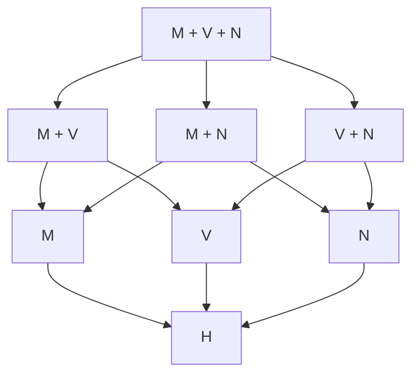

Each independent primitive Qσ or Pσ adds another binary coordinate. For finite Γ and J,K⊆Γ, T_K entails T_J exactly when J⊆K. This is not a claim that theory joins are unions of qualifications: S[A Z M] together with S[A Z V] can be strictly weaker than S[A Z M V].

Proof and models: [Primitive-package classification](primitive-package-classification.md), §§1–5; [Two orders](two-orders-model.md), §§2–4.

## 2. The spine: higher types and preservation strength

The first equivalence holds for every fixed qualification K. The tier equivalence concerns corresponding finite operation-preservation qualifications at full relational scope.

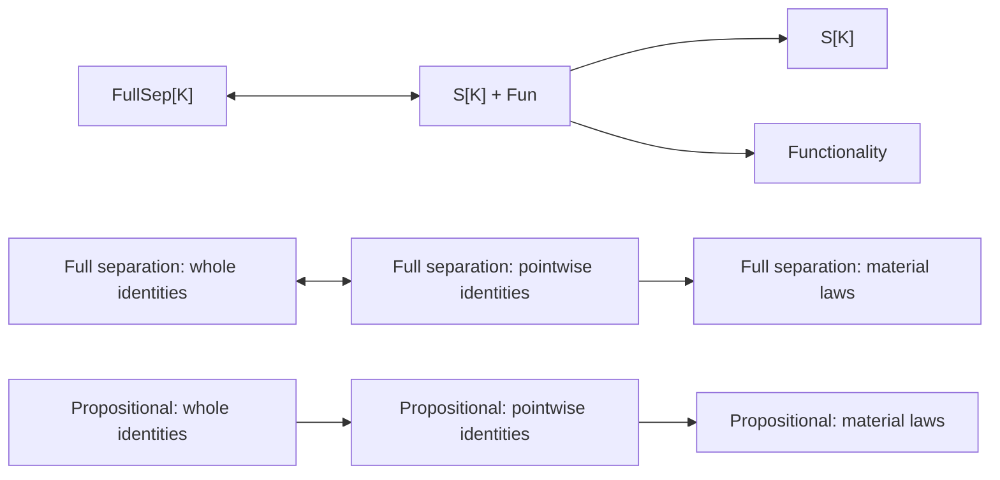

The propositional whole-to-pointwise implication can be strict: conjunction witnesses this. Material-to-pointwise equivalence fails even with all Fun: the negation model witnesses this at full relational scope. Complete logical full separation is a special case where all three tiers coincide; see §8.

There is a positive collapse for each separate M and V branch: **internal Frege finiteness of all propositions makes material and pointwise separation equivalent**, retaining any A/Z orientation. Full relational separation then makes all three tiers equivalent. More locally, a least true meet element or greatest false join element suffices to normalize every material character without changing its truth profile. Thus the remaining M/V material-versus-pointwise question is confined to infinite structures with the relevant nonprincipal truth filter or false ideal.

**Necessity of Distinctness at t supplies another route, without finiteness or Necessity of Identity.** Over H+ND_t, each separate material M/Q or V/P separation principle is equivalent to its pointwise version, with the same A/Z truth conditions. The construction below gives two-output principal witnesses; endpoint fixing is not asserted.

Proofs: [Typed separation](typed-separation-and-classicism.md), §2; [Local tiers](local-tiers-and-models.md), §§2–4; [Relational negation model](relational-clone-model.md), §§1–7; [Finite semilattice normalization](finite-semilattice-normalization.md), §§2–7.

There is also an exact characterization of the pointwise tier by composition. Fix a finite preservation signature Σ, allowing specified constants. An admitted observer family is a predicate X:(tt)t. Then:

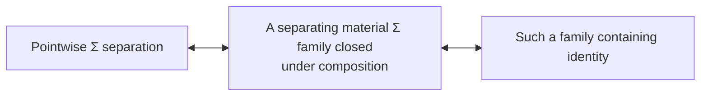

Only **some** admitted family must be closed; the entire material-qualified class need not be. Material preservation of specified constants by that closed family upgrades to identity fixing, so accepting Top and rejecting Bottom here give actual endpoint fixing. At full typed scope, use a separate formula for each relational type, with one family separating both that type and t; no existential quantifier over an infinitary schema is intended. See [Composition-closed characterization](composition-closed-characterization.md), §§2–4.

## 3. Algebraic structures and exact representation

At any tier, truth profiles identify preserved conjunction with intersection, disjunction with union, negation with complement, and listed quantifiers with admitted intersections/unions. This gives the exact equations and universal Horn laws of the corresponding two-element reduct.

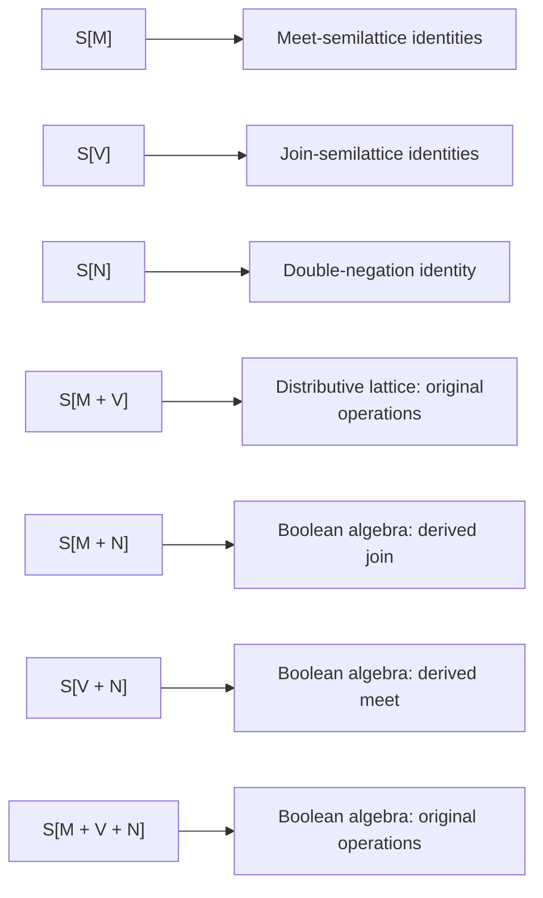

For the first three rows, replacing strong preservation by **material** preservation makes each implication an equivalence. The derived operations in the MN and VN rows are not identified with the omitted primitives.

The quantifier branches have exact material converses, and exact strong converses under a local identity package:

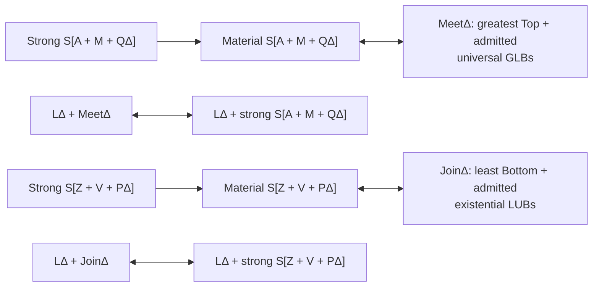

LΔ means identity bivalence at t, Fun(t,t), Fun(t,tt), and Fun(σt,t) for σ∈Δ. MeetΔ does not require Bottom least; JoinΔ does not require Top greatest. Principal equality tests give endpoint-valued separating witnesses under LΔ. These are H results with explicit assumptions; LΔ is not silently equated with C.

Dropping M from the material meet branch gives an exact characterization by the existence of an admitted partial order with greatest Top and the listed universal GLBs. The P branch has the dual characterization. Endpoint additions to M/V separation exactly align the designated Top/Bottom with the corresponding bounds.

Proofs: [Truth profiles](truth-profiles-and-connective-reducts.md), §§2–7; [Local identity representation](representation-under-identity-bivalence.md), §§2–5.

Internal finiteness provides a different exact representation route, without identity bivalence:

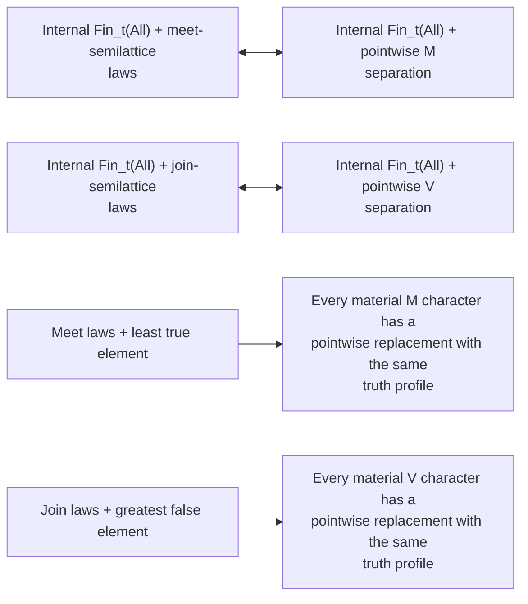

Add the appropriate designated bounds for A/Z. Add local binary Functionality to pass to whole-operation propositional preservation, or all Fun for full relational separation. The two representatives used by the normalization need not be Top and Bottom. See [Finite semilattice normalization](finite-semilattice-normalization.md), §§3–6.

The domain need not be finite if the separating observers have internally finite images:

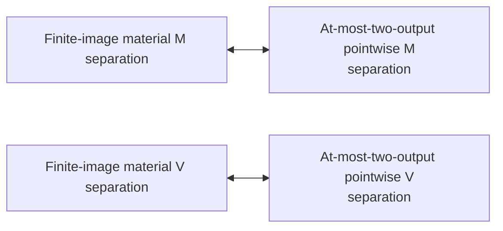

These exact H equivalences retain any A/Z orientation. The two outputs are not required to be Top and Bottom. At full relational scope, pointwise can be replaced by whole-operation preservation. Thus any remaining M/V material-versus-pointwise countermodel must lack even a separating family of finite-image material observers. See [Finite-image normalization](finite-image-material-normalization.md), §§1–5.

These normalizations extend to M with its matching universal quantifiers, V with its matching existential quantifiers, and the joint M,V signature with both kinds of quantifier. Their two output values form the required chain for each admitted GLB/LUB law. Primitive negation is not included in this extension. See [Necessity of Distinctness and representation](necessity-of-distinctness-representation.md), §6.

The same note gives a different exact representation under ND_t:

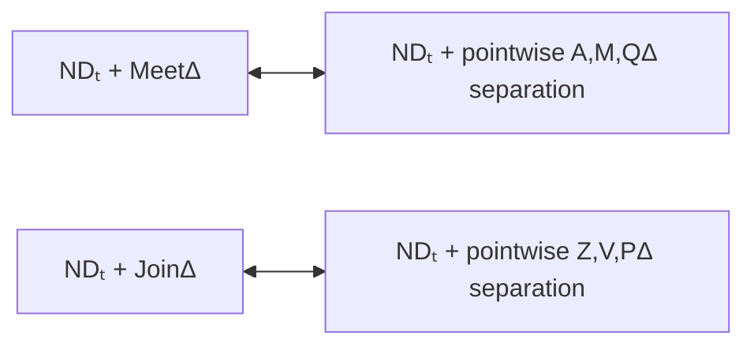

ND_t is the defining H formula saying that a true inequality judgment equals Top. No C-dependent reformulation is used. The witnesses have at most two outputs, which need not be Top and Bottom. Add the listed local Functionality instances to obtain whole-operation identities, or all Fun on the intrinsic side for full typed separation. There are H models of these packages with a corrupted omitted primitive, so the conclusion is not C. See [the proof](necessity-of-distinctness-representation.md), §§1–5.

## 4. Quantifiers generate algebra; modal .2 supplies a selector in C

BRσ below means a **uniform admitted** constructor B[p,q,x] whose object-valued range is exactly {p,q}, with both values attained. Put μ(p,q)=∀x B[p,q,x] and ν(p,q)=∃x B[p,q,x]. They are initially derived operations.

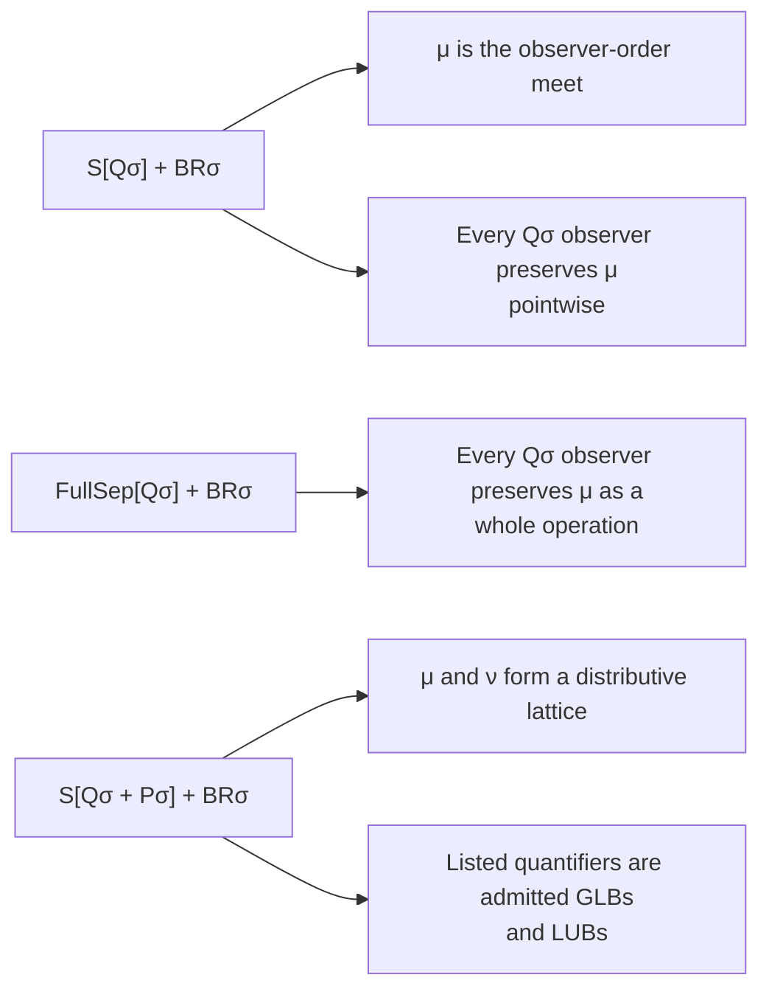

The Pσ dual generates ν as join. Extra observer restrictions may be retained; one passes to the composition-closed pure quantifier class. With BRσ fixed, adding preservation of μ to FullSep[R] adds no strength whenever R implies Qσ; dually for ν and Pσ. No automatic identification with primitive conjunction/disjunction is made.

The modal bridge is conditional on C:

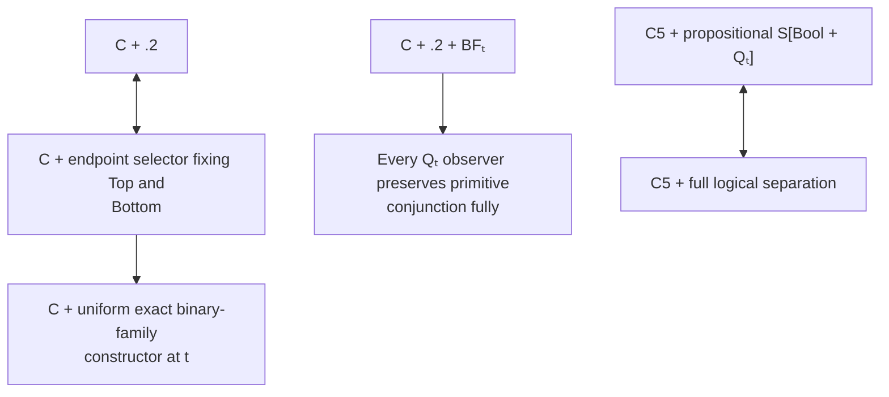

Here .2 is ∀p(◇□p→□◇p); an endpoint selector is Bp=◇□p. The Qₜ-to-conjunction theorem needs no acceptance hypothesis on the observer. Under C+.2, the accepting N+QΔ and V+QΔ separation branches are each equivalent to Bool+QΔ separation when Δ contains t; there is an existential dual. Under C5 the same Boolean Qₜ observer preserves every typed quantifier. These are C-relative bridges, not extra background for the H panels.

The full fork satisfies C and every boxed BF instance, yet has no nonconstant endpoint-valued family at any type. Therefore even full universal separation does not provide the missing constructor. It also has an individual observer preserving **every universal quantifier and disjunction**, fixing both endpoints and idempotent, which fails even material conjunction preservation. The existential/meet dual fails disjunction. Thus boxed BF cannot replace .2 in the individual-observer reduction; this is not a separation-theory non-implication, since the fork itself satisfies OS.

Reversibility gives a positive reduction without .2: **over C, an invertible Q_t observer is automatically Boolean**. Its inverse also preserves each listed quantifier. Consequently, for full separation with finite Δ containing t, C plus separation by invertible QΔ observers is exactly Rev. Necessary bijectivity can replace the admitted-inverse condition. See [Reversible quantifier observers](reversible-quantifier-observers.md), §§1–4; §9 locates this within the upper region.

Proofs: [Quantifier-generated lattices](quantifier-generated-lattices.md), §§1–6; [Modal selectors](../modal-selectors-and-quantifier-reduction.md), §§1–6; [Fork model](fork-without-binary-families.md), §§2–5.

## 5. Identity collapse, truth restrictions and the route to Extensionality

Let z=(Top=Bottom). IC_t says that every true propositional equality judgment equals Top and every false one equals z. Let NC say every false proposition equals Bottom, PC every true proposition equals Top, and FA be the Fregean Axiom.

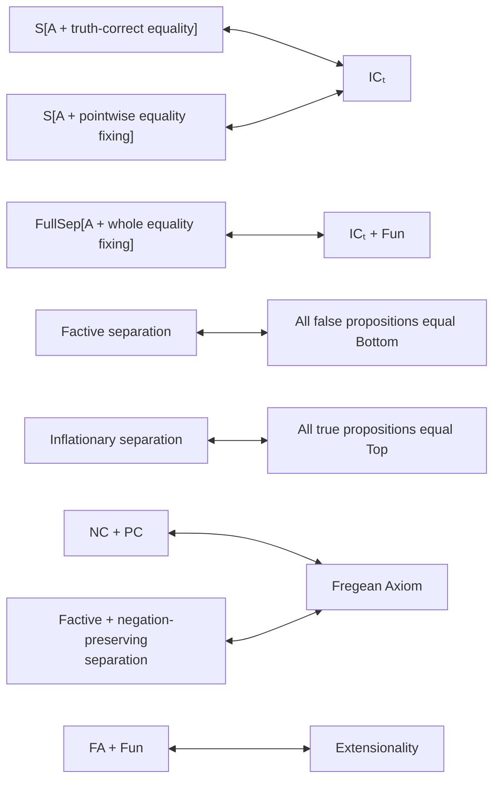

Equality fixing in this panel is at type t. The IC witnesses already have range {Top,z} and are idempotent; those restrictions add no strength. Identity bivalence is exactly IC_t plus z=Bottom. Factive/inflationary separation may also require A,Z without changing their respective one-sided collapse. Their full relational versions add Fun. Material negation preservation already suffices in the factive-to-FA row, and the inflationary version has the same consequence and converse.

One observer separating propositions is equivalent to FA when identity belongs to the eligible class. FullSep[K] plus a unique K-observer is equivalent to Extensionality when identity qualifies and K implies A,Z. A fixed n-observer family instead gives the exact unqualified bound of at most 2^n propositions. This is distinct from each observer having finite image.

Proofs: [Identity collapse](identity-collapse.md), §§2–6; [Observer restrictions](observer-restrictions.md), §§2–6.

## 6. The reversible-meet atom theorem over H

RevM below means propositional S[A Z M Rev_M], where the observer has an admitted meet-preserving inverse and both inverse equations are whole-operation identities. Atom means a meet atom for p≤q iff p∧q=p, not an unannounced replacement by the C-based Boolean definition.

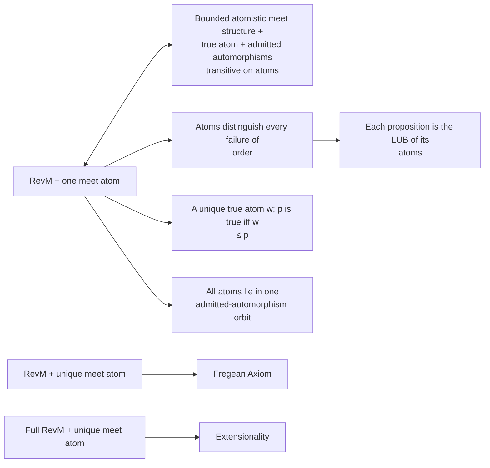

The conclusion gives a faithful representation by sets of atoms, preserving meet. It does not assert that every external set of atoms is represented, or that primitive disjunction is join. Under RevM, unique atom and FA are equivalent; under Full RevM, unique atom and Extensionality are equivalent. For the unrestricted RevM class, FA supplies identity as a qualified separator, so the corresponding packages also have converses. Additional restrictions on the observer class require the stated identity/inverse/composition conditions.

The exact characterization supplies the converse with explicit action and truth hypotheses. For arbitrary additional observer restrictions R, replace true-atom existence plus transitivity by the condition that every atom can be sent to a true proposition by an eligible admitted meet automorphism. That formulation needs no closure of R. The full relational characterization adds exactly Fun on the structural side.

This is a substantive H theorem using none of C, N, V, Q, BF or identity bivalence. The six-element asymmetric-atom model proves that atomisticity plus a true atom does **not** suffice, even with all Fun, all-type identity bivalence, and ordinary strong meet separation by endpoint-valued idempotent witnesses. The atom-transitivity requirement is substantive.

Proofs: [Reversible meet separation](reversible-meet-atomicity.md), §§1–6; [Exact reversible-meet characterization](reversible-meet-characterization.md), §§1–6.

## 7. Derived implication and affine operations

These nodes use specified actual terms for implication, biconditional and XOR. Strong preservation is closed under term composition and fixed constants, not mere truth-table replacement of one primitive by another.

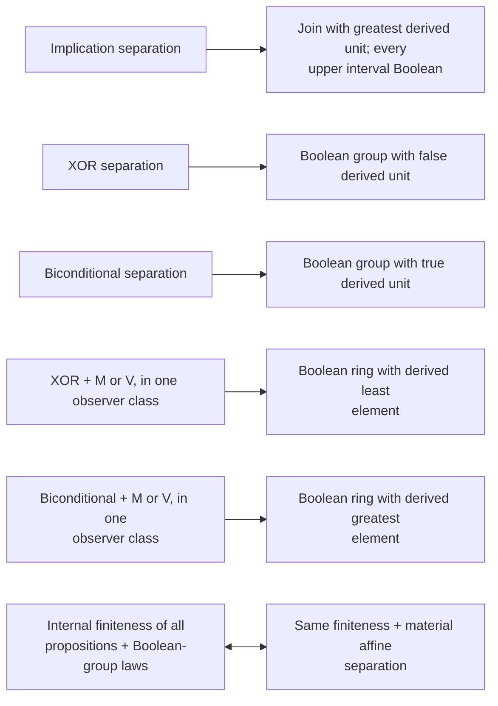

The last equivalence is separate for XOR and biconditional, with the corresponding operation and unit on both sides. Its proof extends admitted truth characters by the internal Frege induction formula; it uses no Choice and no external enumeration. A general infinite strong-character converse has not been proved. Fixing the missing endpoint in the stated affine branches permits full preservation of the derived complement.

The rings may be nonunital. For XOR, multiplication is the appropriate meet and additive zero is the derived bottom. For biconditional, multiplication is the appropriate join and additive zero is the derived top of the observer lattice. The latter is not a claim that the ring's usual order has its zero greatest.

Proofs: [Term closure and affine branches](term-closure-and-affine-branches.md), §§2–5; [Internally finite affine separation](finite-affine-separation.md), §§1–5.

## 8. Complete logical proof transport recovers C

The logical qualification includes the independent primitive operations, each listed quantifier, and the translated equality rules. Full separation ranges over all relational types and all finite type lists.

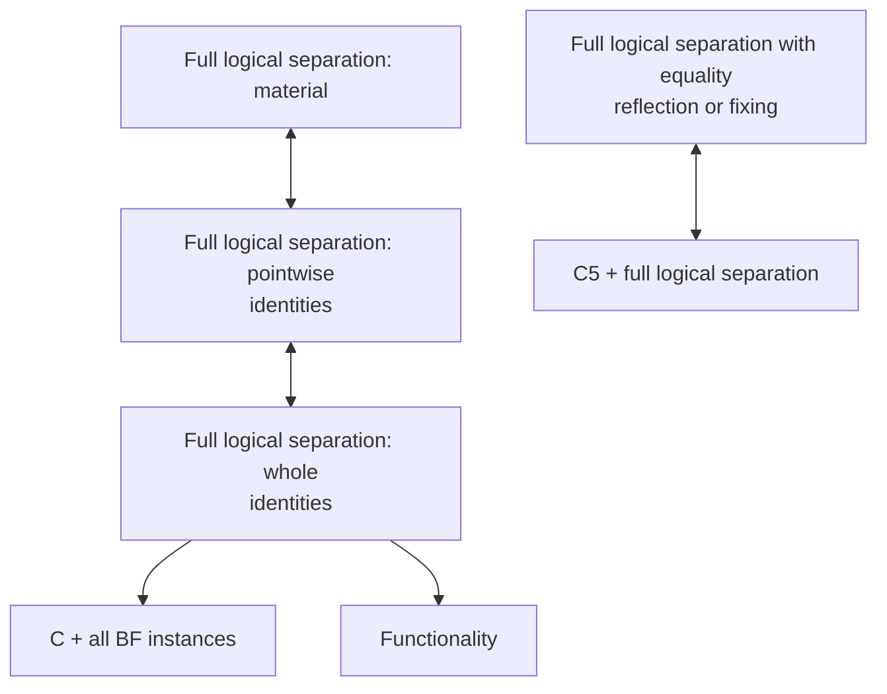

The proof transports finite H derivations through an observer; higher-type separation identifies the resulting relations. Propositional logical separation alone does not imply C or unrestricted Fun. The hidden-individual model refutes that upgrade even with only two propositions and endpoint-valued, factive, equality-fixing observers.

The H + OS ⇒ C + BF step is [Lean certified](../../evidence/certificates/full-typed-logical-separation-actual-c/certificate.json) in the equivalent formulation with explicit endpoint identities.

Proof: [Typed separation and Classicism](typed-separation-and-classicism.md), §§2–7; [Local tiers](local-tiers-and-models.md), §2.

## 9. The larger region above C + BF

OS means full logical separation. Fin means logical separation by observers with internally finitely many outputs, with no uniform bound. Rev means logical separation by observers with an admitted qualified inverse. Nec is the separately boxed OS schema. Bool is propositional Boolean separation. Every complete-logical separation node already entails C+BF by §8.

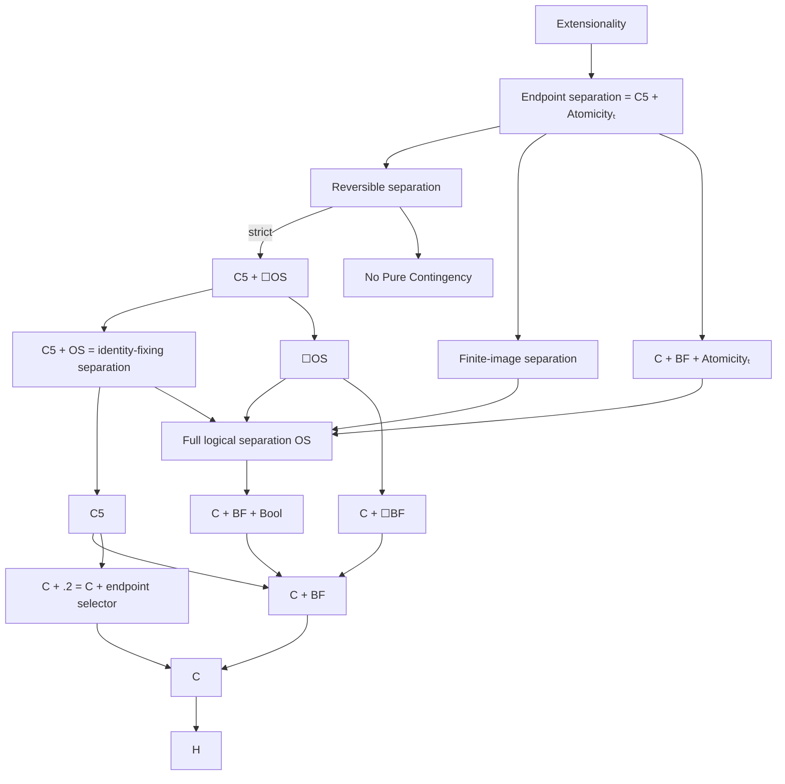

Exact combinations, allowing separate witness families, locate the branches:

$$
\begin{aligned}
\mathsf{Rev}+\mathsf{Fin}&\ \leftrightarrow\ \mathsf{End},&
\mathsf{Rev}+\mathsf{At}&\ \leftrightarrow\ \mathsf{End},\\
\mathrm{C5}+\mathsf{Fin}&\ \leftrightarrow\ \mathsf{End},&
\mathrm{C5}+\mathsf{At}&\ \leftrightarrow\ \mathsf{End},\\
\mathsf{Fix}+\mathsf{Fin}&\ \leftrightarrow\ \mathsf{End},&
\mathsf{Rev}+\text{one meet atom}&\ \leftrightarrow\ \mathsf{End}.
\end{aligned}
$$

The meet-atom equivalence here is in the complete-logical region. Also,

$$
\mathsf{Rev}+\text{one finite-image }\operatorname{Good}_{\{t\}}\text{ observer}
\ \leftrightarrow\ \mathsf{End}.
$$

A single atom also closes the gap from necessary separation to endpoint separation:

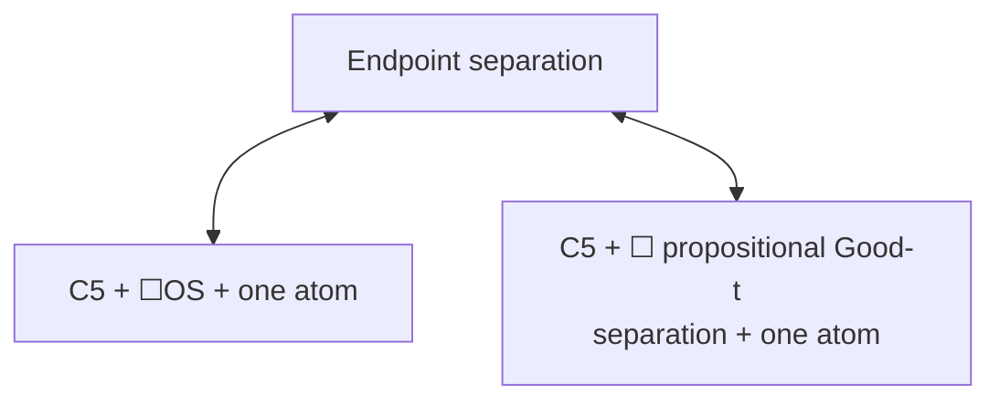

Here Good-t separation is the single closed propositional separation formula whose quantifier-type list is {t}. Under C5 plus that boxed formula, one atom, Actuality, propositional Atomicity, one endpoint-valued Good-t observer, one finite-image Good-t observer, and full endpoint separation are equivalent. See [Necessary separation and atoms](necessary-separation-and-atoms.md), §§2–4.

Rev is equivalent to its involutive-observer version and to its separately boxed schema. Rev and Fin are incomparable. So are C5 and OS, Rev and At, Fix and Nec, Fin and At, and Fin and Nec. No further negative comparisons are inferred from omitted arrows.

**Rev is strictly stronger than C5 plus ☐OS.** The [finite-block symmetry model](finite-block-symmetry-reversible-gap.md) is atomless at both objects and satisfies C5+□OS throughout, but fails Rev. One object's designated group preserves blocks of every positive even size; the other's preserves blocks whose sizes are powers of two. A closed pure sentence about selecting proper nonempty subsets from disjoint six-element sets is true at one object and false at the other. This contradicts the No Pure Contingency consequence of Rev. The atom-bearing positive theorem above and this atomless countermodel settle both parts of the former converse question.

Reversibility also implies **No Pure Contingency without atoms**: every true closed pure sentence is necessary. A qualified involution lifts through the relational types by conjugation and fixes every logical constant needed for that sentence. Separation then identifies the true sentence with Top. Only its finite list of quantifier types is used; the individual component is a metalevel identity substitution, not a forbidden e→e object. This gives Rev ⇒ C5 + ☐OS + No Pure Contingency. It does not assert the converse or the Fregean Axiom. See [Reversible separation and pure truth](reversible-separation-and-pure-truth.md), §§1–4.

There are exact alternatives to the inverse qualification. Over C, an admitted observer has an admitted whole inverse iff it is necessarily bijective; the inverse is a definable description term, with no Choice or BF premise. Its full preservation laws follow by cancellation. Therefore, over H, necessarily-bijective logical separation is exactly Rev. C5 makes current bijectivity necessary, so C5 plus bijective logical separation is also exactly Rev. The quantifier-only version retains an explicit C premise, as in §4. See [Reversible quantifier observers](reversible-quantifier-observers.md), §§1–4.

The positive semantic counterpart is [local symmetry conjugacy](local-conjugacy-and-reversible-observers.md): matching finite stabilizers give admitted logical involutions by swapping two evaluation neighborhoods. This establishes Rev in all one-object symmetric ideally-full models with all bijections and finite pins, and in the specified multiobject conjugate-group or finite-base families. The block model lies outside those sufficient families; its failure of Rev is proved by the pure sentence, not merely by lack of stabilizer conjugacy.

**OS does not imply ☐BF or ☐Functionality.** The finite-support model on the natural numbers and a singleton, with all maps, satisfies C + OS at the natural-number object, but fails □BF_e, □BF_t and □Fun(e,t) there. Its accessible singleton witnesses the failures. This separates current logical observability from the persistence of Barcan and Functionality. The new OS proof uses finite pins, split epimorphisms, extensional fullness and a guarded upgrade to strong preservation; the model construction and earlier Barcan verdicts retain their original sources. See [Logical separation with contingent Barcan](logical-separation-with-contingent-barcan.md), §§2–5.

Idempotent complete-logical observers already suffice for OS, so adding whole-operation idempotence to ordinary logical separation adds no strength. Factive complete-logical separation is exactly Extensionality, as is OS plus uniqueness of the qualified class at a fixed finite type list. Necessary qualification adds no strength over C, while necessary separation can be stronger. Fin + Nec is strictly stronger than each factor and strictly weaker than End.

Proofs and model witnesses: [Logical observer hierarchy](../logical-observer-hierarchy.md), §§3–8; [Upper lattice](../observer-lattice.md), §§5–6; [Upper lattice models](../observer-lattice-models.md); [Modal selectors](../modal-selectors-and-quantifier-reduction.md), §§1–4.

## 10. Models, open comparisons and research status

The following witnesses explain why the map has distinct directions.

| Construction | Established distinction |
| --- | --- |
| Single-primitive corruption on 2² | Every omitted independent primitive gives a missing implication in §1 |
| Diamond-meet / chain-join model | Separate strong meet and join separation need not give a common separating class |
| Hidden-individual model | Even complete propositional logical separation need not give C or full Fun |
| Hidden-proposition model | Pointwise M separation need not give whole-operation M separation |
| Four-proposition relational model | Full material N separation plus Fun need not give pointwise N separation |
| Full fork | All boxed BF and universal separation need not give exact binary families or .2 |
| Full fork, join-of-leaf evaluations | Even endpoint-fixing idempotent observers preserving all universals and disjunction need not preserve conjunction |
| Finite-support natural numbers / singleton, all maps | Full logical separation need not give ☐BF or ☐Functionality |
| Finite-block symmetry: even sizes / powers of two | C5 plus necessary full OS need not give Rev, even with atomlessness at every object |
| Three-proposition full-function models | Factivity and inflationarity separately give only one-sided collapse |
| Six-element asymmetric-atom model | Atomisticity, a true atom, and ordinary strong meet separation do not supply reversible meet separation |

The unresolved comparisons are:

1. Does material conjunction or disjunction separation imply its pointwise version in the remaining infinite, nonprincipal case without ND_t? Internal finiteness, local truth extrema, a separating finite-image material family, and ND_t now give positive converses. Equivalently, can a separating material family always be replaced by an admitted composition-closed one? Any countermodel must evade the stated positive hypotheses.
2. Which admission or extension principles characterize infinite affine separation, and when can material characters be upgraded to strong observers?
3. Which unrestricted mixed quantifier reductions survive over C without .2? The invertible Q_t branch is now settled positively, but the ordinary N+Q/V+Q separation comparisons remain unresolved.
4. Which further partial-signature reversibility and intrinsic admission conditions have exact characterizations? The complete-logical converse C5+□OS⇒Rev is settled negatively; adding No Pure Contingency is not asserted sufficient.

The independent primitive classification and all solid arrows/equivalences in this document are established by the linked arguments. The remaining questions are not settled by that classification. The atom-bearing reversible-meet converse is resolved by §6's exact characterization, and the complete-logical C5+□OS converse is resolved by §9's countermodel. The remaining questions are listed above.

Direct source for this organization: `misc`, OpenAI Codex, prompted by Daniel Kodsi, 24 October 2026, this document §§1–10, unpaginated. Individual mathematical claims retain the proofs, attributions and source caveats in their linked notes.
