# Observer separation over H

Observer separation asks which operations can distinguish propositions, and what follows when those operations preserve specified logical structure. The map starts over H and recovers C in its complete logical region. Its branches track what observers preserve, which types they separate, and restrictions such as finite image or an admitted inverse.

Only the finite independent primitive family is completely classified. The [open frontier](#10-models-open-comparisons-and-research-status) remains under investigation.

[Main Results](../../MAIN-RESULTS.md#h-observer-separation) · [Theorem tables](MAP.md) · [Language and notation](README.md)

## Notation and reading the diagrams

An observer is an admitted operation $E^{tt}$. Propositional separation by a common class of qualified observers is

$$
S[K]:=\forall p,q\, .\,p=q\leftrightarrow\forall E\, .\,K(E)\to(Ep\leftrightarrow Eq).
$$

| Notation | Meaning |
|---|---|
| FullSep[K]; Fun | Separation at every relational type; Functionality. |
| M, V, N | Preservation of primitive conjunction, disjunction and negation. |
| Qσ, Pσ | Preservation of the primitive universal and existential quantifiers at σ. |
| A, Z | Acceptance of Top; rejection of Bottom. These differ from fixing those objects. |
| Δ | A finite external list of types. |

Preservation means identity of whole composite operations unless explicitly labelled **pointwise** (identity at every input) or **material** (agreement in truth). Primitive and derived operations remain distinct until an identity connects them. H and the fixed relational type system are the base throughout; C appears only where stated.

Arrows mean implication; two-headed arrows mean equivalence. Every node includes all premises written inside it. Two arrows into a node do not require their sources jointly. Missing arrows establish nothing outside the exact primitive classification. These are theorem panels, not a calculation of all theory joins or meets.

| Panels | Subject |
|---|---|
| [1](#1-independent-primitive-packages-the-exact-core)–[2](#2-the-spine-higher-types-and-preservation-strength) | Primitive packages, higher types and preservation tiers |
| [3](#3-algebraic-structures-and-exact-representation)–[4](#4-quantifiers-generate-algebra-modal-2-supplies-a-selector-in-c) | Structural representation and quantifier-generated operations |
| [5](#5-identity-collapse-truth-restrictions-and-the-route-to-extensionality)–[7](#7-derived-implication-and-affine-operations) | Equality, truth, reversible observers and affine operations |
| [8](#8-complete-logical-proof-transport-recovers-c)–[9](#9-the-larger-region-above-c--bf) | Recovery of C and the stronger logical-observer theories |
| [10](#10-models-open-comparisons-and-research-status) | Countermodels and unresolved comparisons |

## 1. Independent primitive packages: the exact core

Here every node means propositional S[A and Z and the displayed clauses], with strong preservation. The empty package is H. Every displayed edge is strict and the only implications between these eight nodes are the displayed paths. At full relational scope the same order holds with the bottom node H + Fun. The classification separately holds at the material and pointwise tiers.

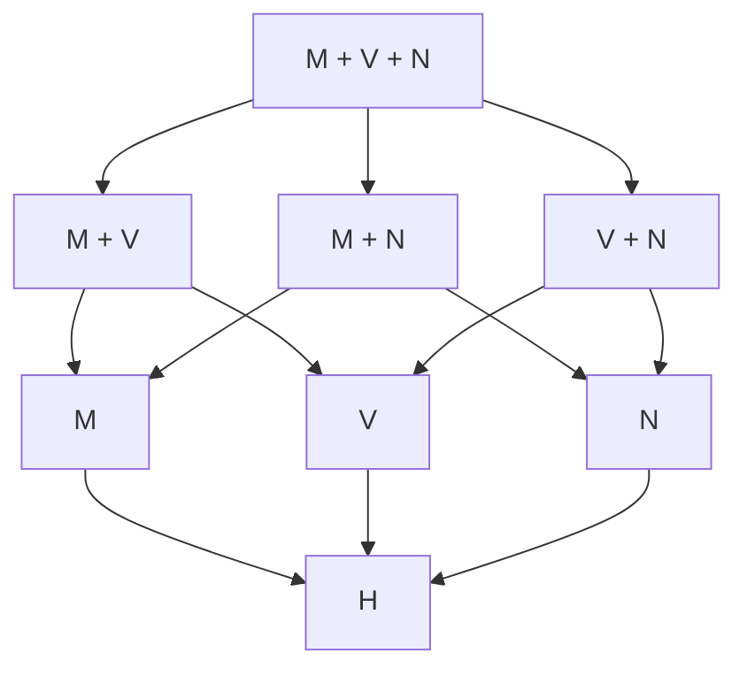

Each independent primitive Qσ or Pσ adds another binary coordinate. For finite Γ and J,K⊆Γ, T_K entails T_J exactly when J⊆K. This is not a claim that theory joins are unions of qualifications: S[A Z M] together with S[A Z V] can be strictly weaker than S[A Z M V].

Proof and models: [Primitive-package classification](primitive-package-classification.md), §§1–5; [Two orders](two-orders-model.md), §§2–4.

## 2. The spine: higher types and preservation strength

The first equivalence holds for every fixed qualification K. The tier equivalence concerns corresponding finite operation-preservation qualifications at full relational scope.

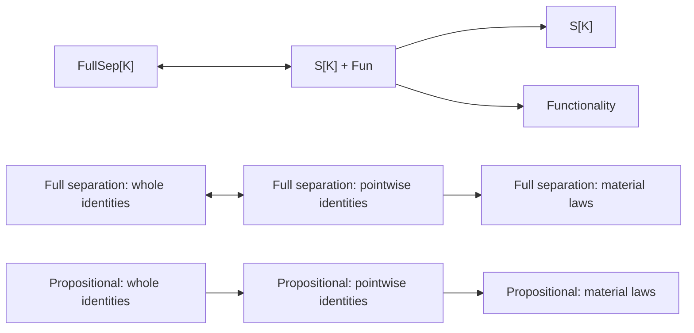

The propositional whole-to-pointwise implication can be strict: conjunction witnesses this. Material-to-pointwise equivalence fails even with all Fun: the negation model witnesses this at full relational scope. Complete logical full separation is a special case where all three tiers coincide; see §8.

There is a positive collapse for each separate M and V branch: **internal Frege finiteness of all propositions makes material and pointwise separation equivalent**, retaining any A/Z orientation. Full relational separation then makes all three tiers equivalent. More locally, a least true meet element or greatest false join element suffices to normalize every material character without changing its truth profile. Thus the remaining M/V material-versus-pointwise question is confined to infinite structures with the relevant nonprincipal truth filter or false ideal.

**Necessity of Distinctness at t supplies another route, without finiteness or Necessity of Identity.** Over H+ND_t, each separate material M/Q or V/P separation principle is equivalent to its pointwise version, with the same A/Z truth conditions. The construction below gives two-output principal witnesses; endpoint fixing is not asserted.

Proofs: [Typed separation](typed-separation-and-classicism.md), §2; [Local tiers](local-tiers-and-models.md), §§2–4; [Relational negation model](relational-clone-model.md), §§1–7; [Finite semilattice normalization](finite-semilattice-normalization.md), §§2–7.

There is also an exact characterization of the pointwise tier by composition. Fix a finite preservation signature Σ, allowing specified constants. An admitted observer family is a predicate X:(tt)t. Then:

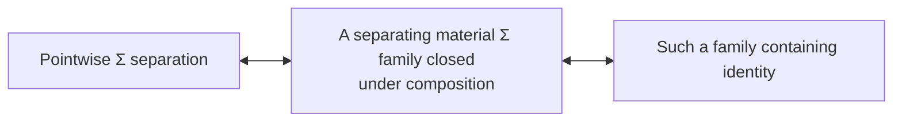

Only **some** admitted family must be closed; the entire material-qualified class need not be. Material preservation of specified constants by that closed family upgrades to identity fixing, so accepting Top and rejecting Bottom here give actual endpoint fixing. At full typed scope, use a separate formula for each relational type, with one family separating both that type and t; no existential quantifier over an infinitary schema is intended. See [Composition-closed characterization](composition-closed-characterization.md), §§2–4.

## 3. Algebraic structures and exact representation

At any tier, truth profiles identify preserved conjunction with intersection, disjunction with union, negation with complement, and listed quantifiers with admitted intersections/unions. This gives the exact equations and universal Horn laws of the corresponding two-element reduct.

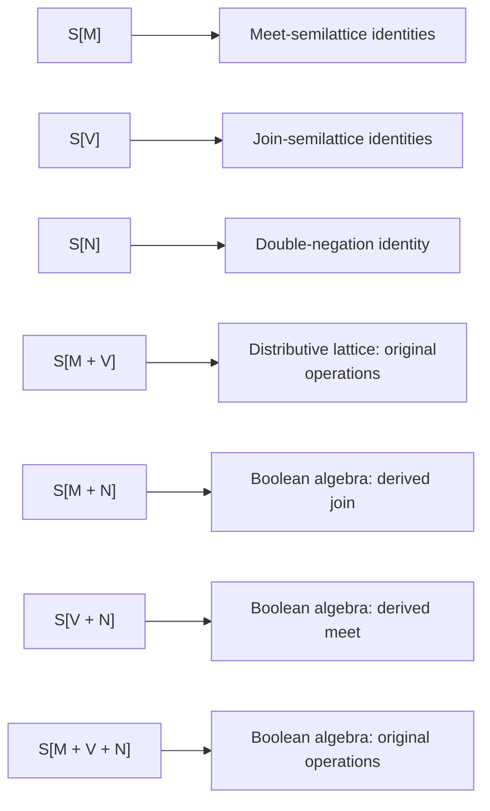

For the first three rows, replacing strong preservation by **material** preservation makes each implication an equivalence. The derived operations in the MN and VN rows are not identified with the omitted primitives.

The joint lattice and Boolean rows also have intrinsic material converses under the explicit preorder Zorn instance at tt:

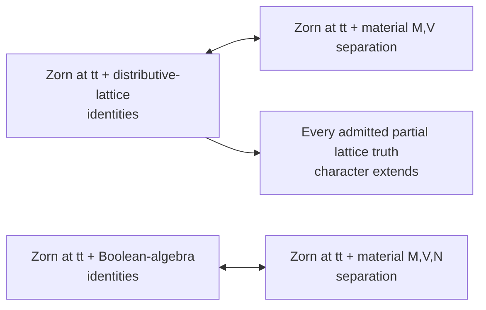

The M,V row retains all A/Z orientations: acceptance adds greatest Top, rejection adds least Bottom. The Boolean result also applies to M,N with its derived join and V,N with its derived meet, retaining their exact endpoint alignments. Zorn supplies an admitted prime filter separating any disjoint admitted filter and ideal; that relative principle is equivalent to partial-character extension. Plenitude adds pointwise normalization, local Fun adds whole identities, and full typed versions retain all Fun. Quantifier preservation is not included. See [Zorn lattice character extension](zorn-lattice-character-extension.md), §§1–6.

The quantifier branches have exact material converses, and exact strong converses under a local identity package:

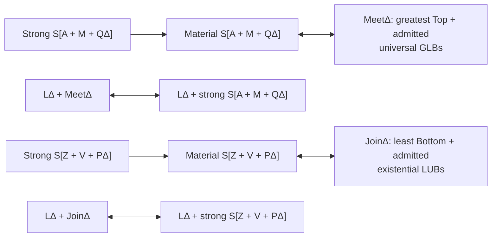

LΔ means identity bivalence at t, Fun(t,t), Fun(t,tt), and Fun(σt,t) for σ∈Δ. MeetΔ does not require Bottom least; JoinΔ does not require Top greatest. Principal equality tests give endpoint-valued separating witnesses under LΔ. These are H results with explicit assumptions; LΔ is not silently equated with C.

Dropping M from the material meet branch gives an exact characterization by the existence of an admitted partial order with greatest Top and the listed universal GLBs. The P branch has the dual characterization. Endpoint additions to M/V separation exactly align the designated Top/Bottom with the corresponding bounds.

Proofs: [Truth profiles](truth-profiles-and-connective-reducts.md), §§2–7; [Local identity representation](representation-under-identity-bivalence.md), §§2–5.

Internal finiteness provides a different exact representation route, without identity bivalence:

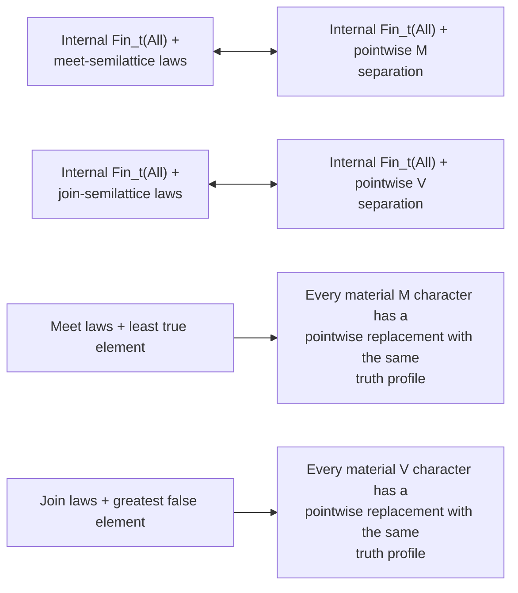

Add the appropriate designated bounds for A/Z. Add local binary Functionality to pass to whole-operation propositional preservation, or all Fun for full relational separation. The two representatives used by the normalization need not be Top and Bottom. See [Finite semilattice normalization](finite-semilattice-normalization.md), §§3–6.

The domain need not be finite if the separating observers have internally finite images:

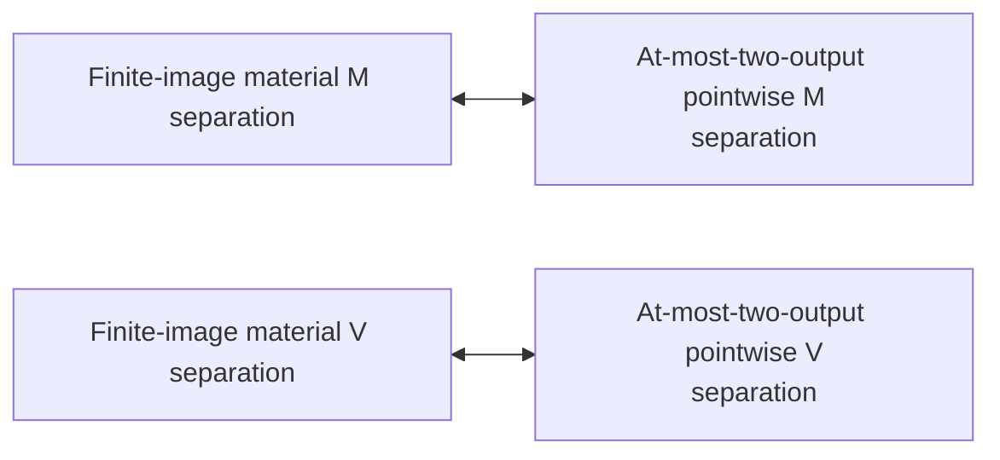

These exact H equivalences retain any A/Z orientation. The two outputs are not required to be Top and Bottom. At full relational scope, pointwise can be replaced by whole-operation preservation. Thus any remaining M/V material-versus-pointwise countermodel must lack even a separating family of finite-image material observers. See [Finite-image normalization](finite-image-material-normalization.md), §§1–5.

These normalizations extend to M with its matching universal quantifiers, V with its matching existential quantifiers, and the joint M,V signature with both kinds of quantifier. Their two output values form the required chain for each admitted GLB/LUB law. Primitive negation is not included in this extension. See [Necessity of Distinctness and representation](necessity-of-distinctness-representation.md), §6.

The same note gives a different exact representation under ND_t:

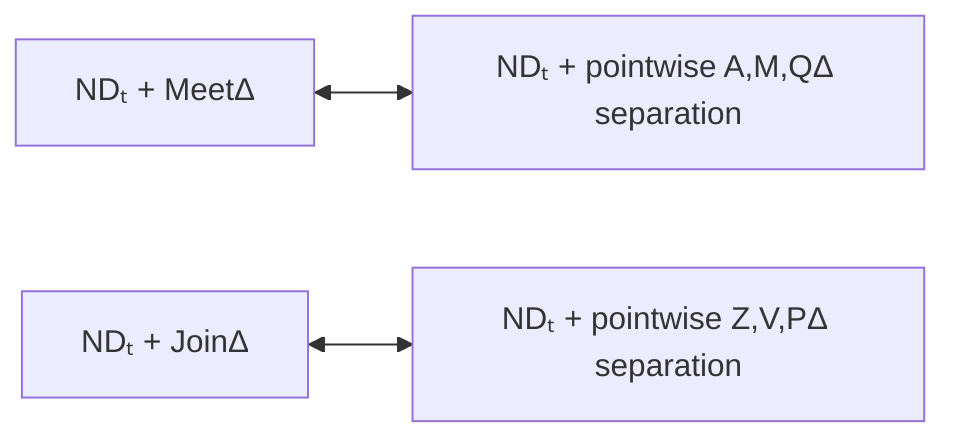

ND_t is the defining H formula saying that a true inequality judgment equals Top. No C-dependent reformulation is used. The witnesses have at most two outputs, which need not be Top and Bottom. Add the listed local Functionality instances to obtain whole-operation identities, or all Fun on the intrinsic side for full typed separation. There are H models of these packages with a corrupted omitted primitive, so the conclusion is not C. See [the proof](necessity-of-distinctness-representation.md), §§1–5.

Plenitude gives an independent admission route on infinite domains. Here Plen_(t,t) is the single pre-existing Plenitude formula at input and output type t, used explicitly over H:

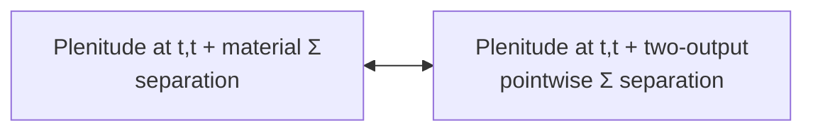

This panel covers every nonempty Σ⊆{M,V,N}, and each separate XOR or biconditional signature, with any A/Z orientation. The chosen false/true pair must realize the operation tables as identities; the algebra forced by separation supplies such a pair. The same theorem covers the stated matching M/Q, V/P and joint lattice/quantifier packages by their GLB/LUB laws. Add the appropriate local Fun for whole identities, or use full typed scope. No finiteness, ND or C is assumed. Plenitude does not supply an unrestricted infinite affine character-existence converse. See [Plenitude normalization](plenitude-material-normalization.md), §§1–6.

## 4. Quantifiers generate algebra; modal .2 supplies a selector in C

BRσ below means a **uniform admitted** constructor B[p,q,x] whose object-valued range is exactly {p,q}, with both values attained. Put μ(p,q)=∀x B[p,q,x] and ν(p,q)=∃x B[p,q,x]. They are initially derived operations.

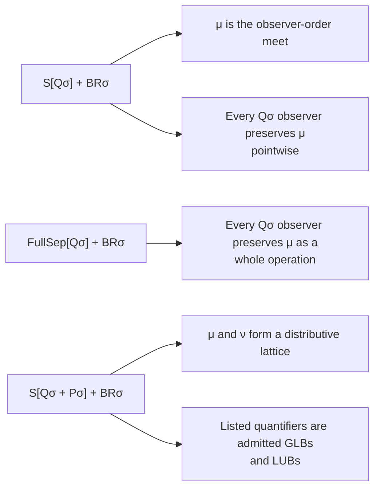

The Pσ dual generates ν as join. Extra observer restrictions may be retained; one passes to the composition-closed pure quantifier class. With BRσ fixed, adding preservation of μ to FullSep[R] adds no strength whenever R implies Qσ; dually for ν and Pσ. No automatic identification with primitive conjunction/disjunction is made.

The modal bridge is conditional on C:

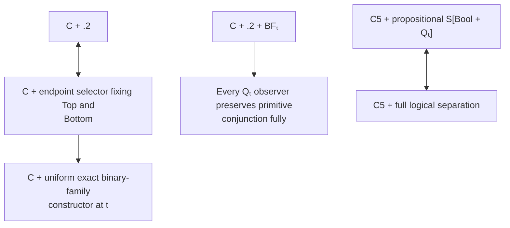

Here .2 is ∀p(◇□p→□◇p); an endpoint selector is Bp=◇□p. The Qₜ-to-conjunction theorem needs no acceptance hypothesis on the observer. Under C+.2, the accepting N+QΔ and V+QΔ separation branches are each equivalent to Bool+QΔ separation when Δ contains t; there is an existential dual. Under C5 the same Boolean Qₜ observer preserves every typed quantifier. These are C-relative bridges, not extra background for the H panels.

The full fork satisfies C and every boxed BF instance, yet has no nonconstant endpoint-valued family at any type. Therefore even full universal separation does not provide the missing constructor. It also has an individual observer preserving **every universal quantifier and disjunction**, fixing both endpoints and idempotent, which fails even material conjunction preservation. The existential/meet dual fails disjunction. Thus boxed BF cannot replace .2 in the individual-observer reduction; this is not a separation-theory non-implication, since the fork itself satisfies OS.

Reversibility gives a positive reduction without .2: **over C, an invertible Q_t observer is automatically Boolean**. Its inverse also preserves each listed quantifier. Consequently, for full separation with finite Δ containing t, C plus separation by invertible QΔ observers is exactly Rev. Necessary bijectivity can replace the admitted-inverse condition. See [Reversible quantifier observers](reversible-quantifier-observers.md), §§1–4; §9 locates this within the upper region.

The unrestricted separation-theory reductions without .2 fail. In the [ternary Cantor symmetry model](ternary-cantor-observer-model.md), the following hold together over C:

| Separate qualified class | Full typed separation, also separately necessary |
| --- | --- |
| Endpoint fixing + M + every listed Q/P | Holds |
| Endpoint fixing + V + every listed Q/P | Holds |
| Endpoint fixing + N + every listed Q/P | Holds |
| Boolean observers, even with no quantifier condition | Fails already for propositions |

All BF and Functionality instances and their boxes also hold. The positive classes use different witnesses; no common M,V,N class is supplied. A monotone test on clopen profiles preserves quantifiers because each admitted family has an admitted argument attaining its leafwise minimum or maximum. Conditional majority gives the selfdual tests for N. A finite-support symmetry obstruction rules out all Boolean profile readers. This settles the former N+Q/V+Q frontier negatively and shows that their conjunction, even with the separate M branch, still does not give Boolean separation. The model fails .2, so it preserves the conditional positive arrows above.

Proofs: [Quantifier-generated lattices](quantifier-generated-lattices.md), §§1–6; [Modal selectors](../modal-selectors-and-quantifier-reduction.md), §§1–6; [Fork model](fork-without-binary-families.md), §§2–5.

## 5. Identity collapse, truth restrictions and the route to Extensionality

Let z=(Top=Bottom). IC_t says that every true propositional equality judgment equals Top and every false one equals z. Let NC say every false proposition equals Bottom, PC every true proposition equals Top, and FA be the Fregean Axiom.

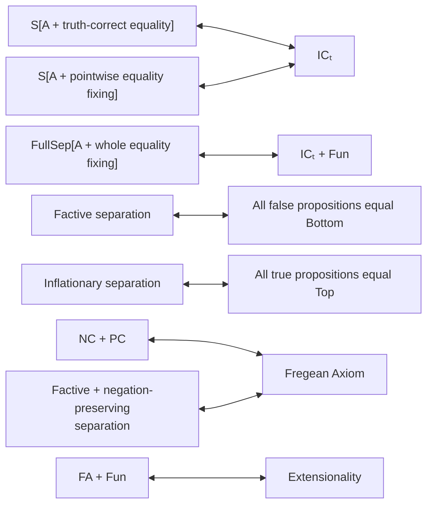

Equality fixing in this panel is at type t. The IC witnesses already have range {Top,z} and are idempotent; those restrictions add no strength. Identity bivalence is exactly IC_t plus z=Bottom. Factive/inflationary separation may also require A,Z without changing their respective one-sided collapse. Their full relational versions add Fun. Material negation preservation already suffices in the factive-to-FA row, and the inflationary version has the same consequence and converse.

One observer separating propositions is equivalent to FA when identity belongs to the eligible class. FullSep[K] plus a unique K-observer is equivalent to Extensionality when identity qualifies and K implies A,Z. A fixed n-observer family instead gives the exact unqualified bound of at most 2^n propositions. This is distinct from each observer having finite image.

Proofs: [Identity collapse](identity-collapse.md), §§2–6; [Observer restrictions](observer-restrictions.md), §§2–6.

## 6. Reversible meet separation: atoms and order actions

RevM below means propositional S[A Z M Rev_M], where the observer has an admitted meet-preserving inverse and both inverse equations are whole-operation identities. Atom means a meet atom for p≤q iff p∧q=p, not an unannounced replacement by the C-based Boolean definition.

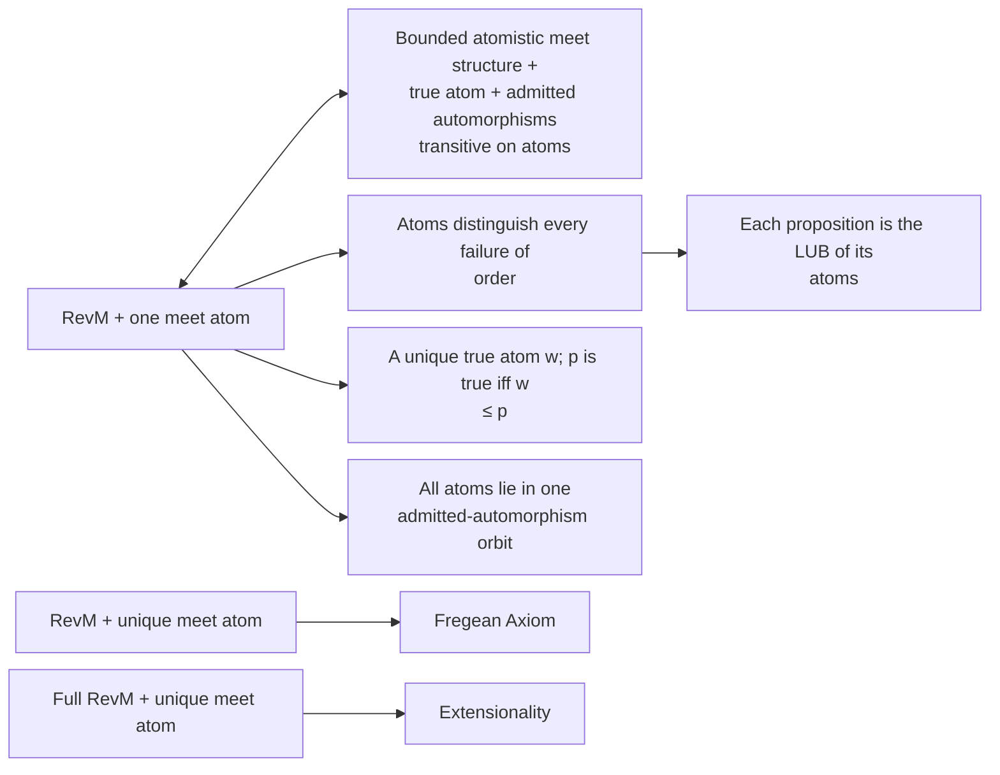

The conclusion gives a faithful representation by sets of atoms, preserving meet. It does not assert that every external set of atoms is represented, or that primitive disjunction is join. Under RevM, unique atom and FA are equivalent; under Full RevM, unique atom and Extensionality are equivalent. For the unrestricted RevM class, FA supplies identity as a qualified separator, so the corresponding packages also have converses. Additional restrictions on the observer class require the stated identity/inverse/composition conditions.

The exact characterization supplies the converse with explicit action and truth hypotheses. For arbitrary additional observer restrictions R, replace true-atom existence plus transitivity by the condition that every atom can be sent to a true proposition by an eligible admitted meet automorphism. That formulation needs no closure of R. The full relational characterization adds exactly Fun on the structural side.

This is a substantive H theorem using none of C, N, V, Q, BF or identity bivalence. The six-element asymmetric-atom model proves that atomisticity plus a true atom does **not** suffice, even with all Fun, all-type identity bivalence, and ordinary strong meet separation by endpoint-valued idempotent witnesses. The atom-transitivity requirement is substantive.

Proofs: [Reversible meet separation](reversible-meet-atomicity.md), §§1–6; [Exact reversible-meet characterization](reversible-meet-characterization.md), §§1–6.

The atomless region has a different positive criterion. For an admitted group G of whole meet automorphisms, its common truth-profile relation is the largest admitted invariant truth-compatible equivalence and is a meet congruence. On a chain it is convex, so absence of a nontrivial such convex equivalence is an exact separation criterion.

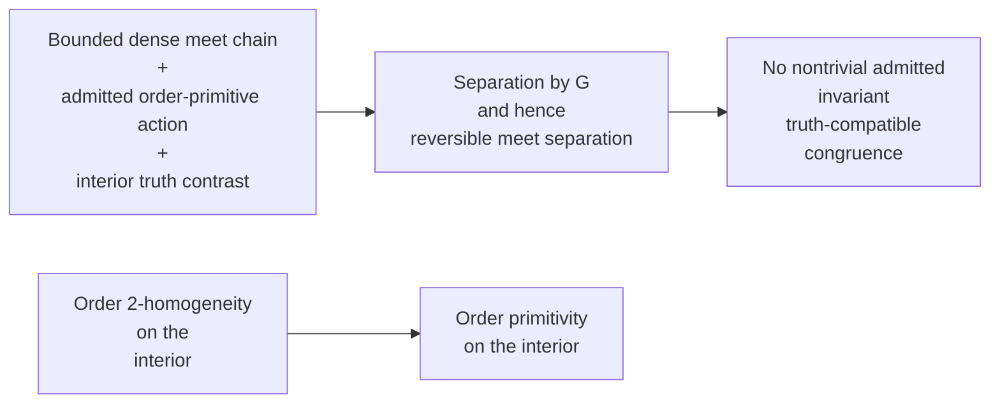

In the last arrow the action is the qualified group being used; the corresponding absence condition also suffices when the bounded meet/group hypotheses are retained. Order primitivity says every admitted invariant convex equivalence on the interior is equality or universal. It does not mention truth. An interior true/false pair rules out the universal truth-profile relation, and density rules out identifying an endpoint with an interior proposition.

The full-function rational-chain model has no atoms, no least true proposition and no greatest false proposition and satisfies joint reversible M/V separation plus Fun, while C fails. A restricted admitted translation subgroup is primitive and separating but not order 2-homogeneous. The dual join and joint lattice versions retain their whole-operation hypotheses. Full typed scope adds Fun. Proofs: [Reversible semilattice order actions](reversible-semilattice-order-actions.md), §§1–7.

### Adjacent truth cuts

For a bounded meet chain, an admitted whole-meet automorphism group G, and a greatest false/least true pair f<u, there is an exact alternative to density and primitivity:

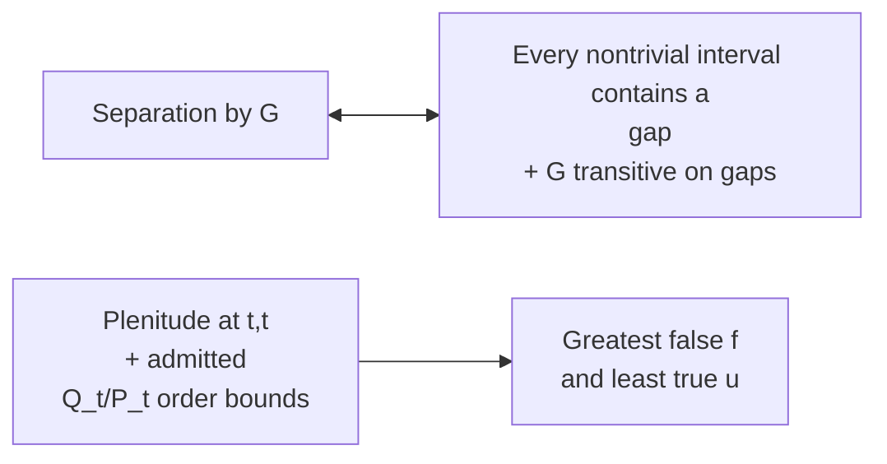

The equivalence retains the stated chain/group/truth-gap background. A gap is an adjacent pair; it need not begin at Bottom. Plenitude admits the true-only and false-only families whose bounds give f,u. Order automorphisms preserve admitted GLBs and LUBs pointwise, and the corresponding Fun gives whole quantifier identities.

The complete split interval has two points at every real coordinate in (0,1), with bounds added. It is atomless and every nontrivial interval contains a gap. Increasing coordinate bijections are gap-transitive. With truth across the gap at 1/2, genuine infima and suprema obey the H truth clauses. Full function domains therefore give **full reversible endpoint-fixing M,V,Q_Δ,P_Γ separation for every finite list**, while C fails. Primitive negation is omitted from this qualification. See [Reversible truth-gap chains](reversible-truth-gap-chains.md), §§1–6.

### Convex blocks and finite lattice factors

The following exact reductions have different backgrounds. The first uses a bounded dense chain with admitted invariant convex blocks, each without endpoints. The second uses a bounded distributive lattice with a specified external finite central partition preserved by the admitted whole-lattice group G.

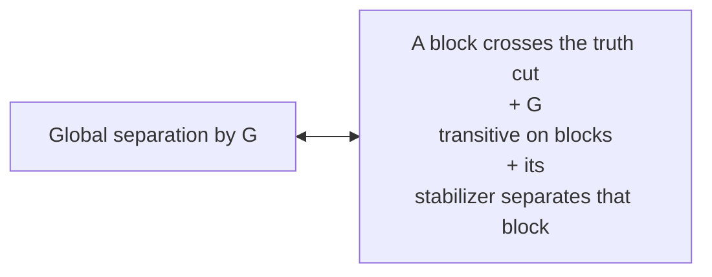

At most one convex block crosses the truth cut. Primitive stabilizers turn its true/false contrast into local separation, so the global action need not itself be primitive. An imprimitive lexicographic full-function model realizes this criterion below C.

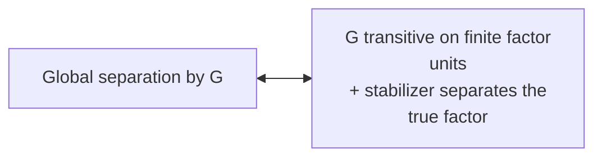

There is exactly one true factor unit w. The lattice identity p=∨ᵢ(p∧eᵢ) finds a differing component, while z↔(z∧w) transfers the local truth test. The factors can be infinite and atomless: finite products of the rational-chain model give non-chain examples with joint reversible M/V separation and Fun but not C. The finite list of factors is external, not internal Frege finiteness of propositions. See [Reversible separation from blocks and factors](reversible-semilattice-local-global.md), §§1–6.

## 7. Derived implication and affine operations

These nodes use specified actual terms for implication, biconditional and XOR. Strong preservation is closed under term composition and fixed constants, not mere truth-table replacement of one primitive by another.

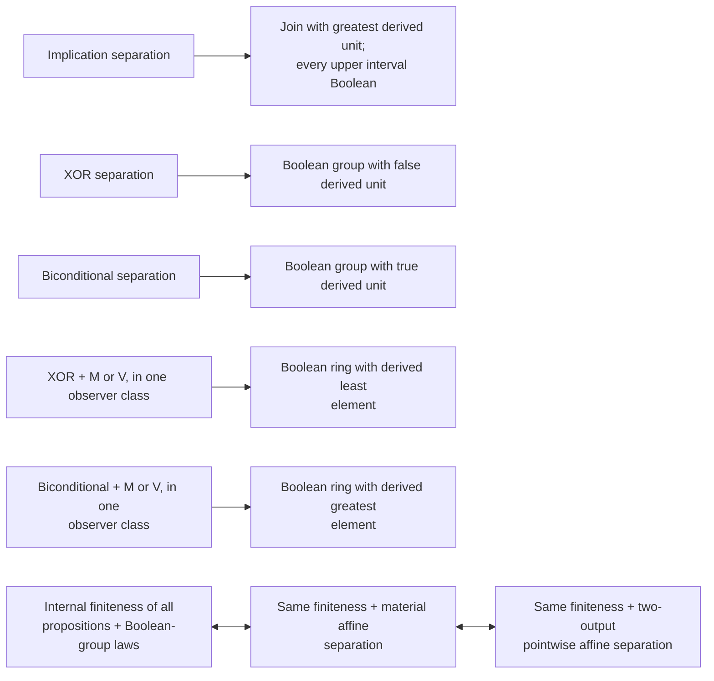

The final equivalences hold separately for XOR and biconditional, with the corresponding operation and unit on each side. Internal Frege induction constructs a subgroup of index two and an admitted test constant on each coset; translating its two outputs gives a pointwise homomorphism. This needs neither Choice, identity bivalence, ND nor an external enumeration. Add local binary Functionality for whole-operation preservation, or all Fun on the structural side for full typed separation. The exact A/Z alignments remain as in the earlier material theorem.

Even on an infinite proposition domain, finite-image material affine observers can be normalized while preserving their entire truth profiles:

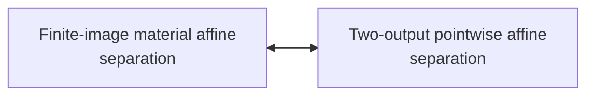

This holds separately for XOR and biconditional, with any A/Z orientation. The image need not be a subgroup. The two outputs need not be Top and Bottom. A general infinite converse without a finiteness or admission hypothesis remains unresolved. Fixing the missing endpoint in the stated affine branches permits full preservation of the derived complement.

The rings may be nonunital. For XOR, multiplication is the appropriate meet and additive zero is the derived bottom. For biconditional, multiplication is the appropriate join and additive zero is the derived top of the observer lattice. The latter is not a claim that the ring's usual order has its zero greatest.

There is a positive infinite-domain route. Zorn is its **preorder instance at type tt**, used as an explicit H premise:

```mermaid
flowchart LR
    ZBG["H + Zorn at tt + Boolean-group<br/>equations"] <--> ZSep["H + Zorn at tt + material affine<br/>separation"]
    ZBG --> Extend["Every admitted partial truth<br/>character extends"]
```

This holds separately for XOR and biconditional. Add Bottom=0 for XOR rejection, or Top=0 for biconditional acceptance; the opposite endpoint condition adds no strength. The proof builds an admitted maximal subgroup avoiding a prescribed element, then an admitted two-coset character. Pointed maximality exactly characterizes separation, and relative maximality exactly characterizes extension. It does not infer admission from an external linear functional.

For negation alone and each separate affine operation, Plenitude supplies a second positive reduction:

```mermaid
flowchart LR
    PMat["Plenitude at t,t + material<br/>separation"] <--> PInv["Same Plenitude + pointwise involutive<br/>separation"]
    WithFun["Plenitude at t,t + local Fun +<br/>pointwise involutive separation"] <--> PWhole["Plenitude at t,t + local Fun +<br/>whole-operation involutive separation"]
    WithFun --> PInv
```

Each node uses one of those signatures, with the same A/Z orientation; the involutions can fix the mentioned endpoint objects. Full typed scope already supplies Fun. Negation uses a single-pair flip; the affine construction adds a square-zero homomorphism to identity. Unlike profile normalization, these witnesses need only separate the chosen pair. This does not assert an analogous collapse for conjunction or complete logical qualification. Under Zorn plus Plenitude, the affine group equations therefore give involutive separation as well, with the stated Functionality qualification for whole identities and full types.

Negation and an affine operation can also be preserved together. Put c=¬0, where 0 is the affine unit:

```mermaid
flowchart LR
    Compat["Material affine separation + negation<br/>is translation by c"] <--> Linked["Material joint N,affine separation"]
    PlenLinked["Plenitude + material joint N,affine<br/>separation"] <--> InvLinked["Plenitude + pointwise joint<br/>involutive separation"]
```

The first equivalence is over bare H. The second permits fixing every endpoint whose truth condition was required; the endpoint alignments are explicit in [Negation and affine compatibility](negation-affine-compatibility.md), §§2–4. A parallel exact theorem handles XOR together with biconditional: D(x,y)=(x⊕y)⊕u, with u the biconditional unit. For the actual expansion X=¬D, all three two-operation material packages coincide and yield preservation of all three operations. Whole identities require local Fun, or full relational scope. Extra lattice or quantifier preservation is not added.

Proofs: [Term closure and affine branches](term-closure-and-affine-branches.md), §§2–5; [Finite affine normalization](finite-affine-normalization.md), §§1–7; [Internally finite affine separation](finite-affine-separation.md), §§1–5; [Zorn character extension](zorn-affine-character-extension.md), §§1–7; [Partial-signature involutions](partial-reversible-normalization.md), §§1–5.

## 8. Complete logical proof transport recovers C

The logical qualification includes the independent primitive operations, each listed quantifier, and the translated equality rules. Full separation ranges over all relational types and all finite type lists.

```mermaid
flowchart TD
    Mat["Full logical separation: material"] <--> Point["Full logical separation: pointwise<br/>identities"]
    Point <--> Strong["Full logical separation: whole<br/>identities"]
    Strong --> CBF["C + all BF instances"]
    Strong --> Fun["Functionality"]
    Eq["Full logical separation with equality<br/>reflection or fixing"] <--> Five["C5 + full logical separation"]
```

The proof transports finite H derivations through an observer; higher-type separation identifies the resulting relations. Propositional logical separation alone does not imply C or unrestricted Fun. The hidden-individual model refutes that upgrade even with only two propositions and endpoint-valued, factive, equality-fixing observers.

Proof: [Typed separation and Classicism](typed-separation-and-classicism.md), §§2–7; [Local tiers](local-tiers-and-models.md), §2.

## 9. The larger region above C + BF

OS means full logical separation. Fin means logical separation by observers with internally finitely many outputs, with no uniform bound. Rev means logical separation by observers with an admitted qualified inverse. Surj means separation by currently surjective Good observers. Surjective means every proposition occurs as an output; it does not itself require an admitted operation selecting preimages. Nec is the separately boxed OS schema. Bool is propositional Boolean separation. Every complete-logical separation node already entails C+BF by §8.

```mermaid
%%{init: {"flowchart": {"nodeSpacing": 15, "rankSpacing": 40}}}%%
flowchart TD
    Ext["Extensionality"] --> End["Endpoint separation<br/>= C5 + Atomicityₜ"]
    End --> Rev["Rev = right-inverse<br/>separation"]
    Rev -->|strict| Both["Surj + SplitMono"]
    Both -->|strict| Mono["SplitMono:<br/>left-inverse separation"]
    Mono -->|strict| OS["Full logical<br/>separation (OS)"]
    Both -->|strict| Surj["Surj: surjective<br/>separation"]
    Surj -->|strict| OS
    End --> Fin["Finite-image<br/>separation"]
    End --> At["C + BF<br/>+ Atomicityₜ"]
    Rev -->|strict| CN["C5 + ☐OS"]
    Rev --> NPC["No Pure<br/>Contingency"]
    CN --> Fix["C5 + OS<br/>= identity-fixing<br/>separation"]
    CN --> Nec["☐OS"]
    Fix --> C5["C5"]
    Fix --> OS
    Nec --> OS
    Nec --> NBF["C + ☐BF"]
    Fin --> OS
    At --> OS
    OS --> DB["C + BF + Bool"]
    DB --> D["C + BF"]
    NBF --> D
    C5 --> D
    C5 --> D2["C + .2<br/>= C + endpoint selector"]
    D --> C["C"]
    D2 --> C
    C --> H["H"]
```

Exact combinations, allowing separate witness families, locate the branches:

$$
\begin{aligned}
\mathsf{Rev}+\mathsf{Fin}&\ \leftrightarrow\ \mathsf{End},&
\mathsf{Rev}+\mathsf{At}&\ \leftrightarrow\ \mathsf{End},\\
\mathrm{C5}+\mathsf{Fin}&\ \leftrightarrow\ \mathsf{End},&
\mathrm{C5}+\mathsf{At}&\ \leftrightarrow\ \mathsf{End},\\
\mathsf{Fix}+\mathsf{Fin}&\ \leftrightarrow\ \mathsf{End},&
\mathsf{Rev}+\text{one meet atom}&\ \leftrightarrow\ \mathsf{End}.
\end{aligned}
$$

The meet-atom equivalence here is in the complete-logical region. Also,

$$
\mathsf{Rev}+\text{one finite-image }\operatorname{Good}_{\{t\}}\text{ observer}
\ \leftrightarrow\ \mathsf{End}.
$$

A single atom also closes the gap from necessary separation to endpoint separation:

```mermaid
flowchart TD
    EndAtom["Endpoint separation"] <--> NecAtom["C5 + ☐OS + one atom"]
    EndAtom <--> LocalAtom["C5 + ☐ propositional Good-t<br/>separation + one atom"]
```

Here Good-t separation is the single closed propositional separation formula whose quantifier-type list is {t}. Under C5 plus that boxed formula, one atom, Actuality, propositional Atomicity, one endpoint-valued Good-t observer, one finite-image Good-t observer, and full endpoint separation are equivalent. See [Necessary separation and atoms](necessary-separation-and-atoms.md), §§2–4.

Current Plenitude gives another exact route into the endpoint region:

```mermaid
flowchart TD
    EP["Endpoint separation = C5 + Atomicityₜ"] <--> OP["OS + Plenitude at t,t"]
    EP <--> AP["C5 + OS + Actuality"]
    AP <--> BP["C5 + OS + full Boolean Completeness"]
```

The single Plenitude instance already gives ND_t and Actuality over C. BF_t then gives C5; full OS supplies C and BF over H. Hence neither OS nor Plenitude is assumed necessary. Conversely End gives necessary full Plenitude, so Plenitude at t,t can equivalently be replaced by the full schema in this panel. The separate admission identity is C+BF_t+Plen_t,t iff C5+Actuality. See [Plenitude and endpoint separation](plenitude-endpoint-bridge.md), §§1–5.

Rev is equivalent to its involutive-observer version, to its separately boxed schema, and to full separation by observers having admitted qualified right inverses. The last characterization uses a localized Boolean patch to replace a distinguishing right-invertible observer by an involution. Over C+BF this works at each fixed finite list containing t; full separation over H already recovers the needed background. It does not identify the individual observer classes. See [Qualified right-inverse separation](split-inverse-logical-observers.md), §§1–4.

Over C5, current surjectivity supplies a qualified right inverse by an explicit fiber term:

```mermaid
flowchart TD
    OntoSep["C5 + surjective Good separation"] <--> Reversible["Reversible separation"]
```

For each finite list containing t, the greatest kernel element k_S=∃p[(Sp=Bottom)∧p] defines a unique inverse below ¬k_S; filling the remaining region with identity gives an admitted same-list logical section. No Choice is assumed. This identifies the individual surjective-Good and qualified-right-invertible classes over C5, and their separation principles with Rev. See [Surjective logical observers](surjective-logical-observers.md), §§1–5. The C5 premise is explicit.

The same C5 region has an exact **individual-observer** classification. Fix $\operatorname{Good}_{\{t\}}(E)$, let $Rq=\exists p\,[(Ep\le q)\land p]$, $Lq=\neg R(\neg q)$, and $k=R\bot$. These admitted terms are its right and left order adjoints:

```mermaid
flowchart TD
    Bij["E bijective"] <--> Equal["Left adjoint = right adjoint"]
    Bij --> Inj["E injective"]
    Bij --> Onto["E onto"]
    Inj <--> Modal["E commutes with original Box"]
    Onto <--> Join["Right adjoint preserves join"]
```

The Box condition can be replaced by Diamond, and needs only Boolean qualification over C5. Injectivity also means R fixes Bottom; onto also means L preserves meet. The image has floor j=E∘R and ceiling c=E∘L, with j≤I≤c, both idempotent. E is endpoint-valued exactly when j is the original Box. Generally j is a separate auxiliary S5 interior. The terms T⁻q=(¬k∧Rq)∨(k∧q) and T⁺q=Lq∨(k∧q) fix both endpoints and respectively preserve M/all Q and V/all P. They coincide exactly when E is onto, recovering its canonical logical right inverse. See [Canonical adjoints and image factorization](canonical-adjoints-and-image-factorization.md), §§2–7. These are individual conditions, not additional separation-theory arrows. The interval/image factorization and the already known all-type preservation reduction use admitted families only.

**Surj and left-inverse separation are incomparable without C5**, even over C+☐BF+☐OS. The full omega-chain has necessary Surj, yet its only injective Good_{ {t} } observer is identity, so left-inverse separation fails at that list. Its logical observers are exactly E(p)=f⁻¹[p] for maps with f(m)≥m; shifts give the surjective separators. Conversely the finite-block C5+necessary-left-inverse model fails Rev and therefore fails Surj. Within C5, Surj equals Rev and does imply left-inverse separation. These witnesses prove both strict arrows on the Surj branch of the main diagram. See [Omega-chain observer classification](omega-chain-surjective-observers.md), §§1–6.

**Even their conjunction is strictly weaker than Rev, including when both schemas are separately boxed.** The full ℤ×ℕ monoid model supplies C+☐BF+necessary Surj+☐SplitMono but fails C5, hence Rev. Together with the preceding incomparability models, it makes both branches from the conjunction in the main graph strict. The conjunction uses separate families of observers.

This example comes from a positive construction theorem for full one-object action models with singleton individuals:

```mermaid
flowchart TD
    Cancel["Full cancellative-monoid model<br/>with singleton individuals"] --> SurjNecessary["☐SurjSep"]
    Units["Such a model + a<br/>specified<br/>infinite sequence of<br/>distinct units"] --> BothNecessary["☐SurjSep<br/>+<br/>☐SplitMono"]
    Units --> Cancel
    BothNecessary --> SurjNecessary
```

With singleton individuals and full relational domains, constant-arrow evaluations separate; left cancellation makes each onto, and right cancellation supplies onto type transports for every quantifier identity. The unit sequence gives a shift of observation coordinates with one common qualified left inverse. The full equation is checked at arbitrary future inputs. A nonunit sends the nonzero singleton proposition {1} to Bottom, refuting C5. Taking the cancellative monoid ℤ×ℕ supplies both the units and a nonunit. See [Full cancellative monoid observers](full-cancellative-monoid-observers.md), §§1–6.

Individual onto witnesses persist over C+BF_t, but their separating power need not:

```mermaid
flowchart TD
    RevPersistent["Reversible separation"] -->|strict| NSurj["☐SurjSep"]
    NSurj -->|strict| SurjCurrent["Surjective separation"]
    NSurj -->|strict| NOS["☐OS"]
    NOS --> NBarcan["C + ☐BF"]
    SurjCurrent --> Barcan["C + BF"]
    NBarcan --> Barcan
```

For an individual admitted E, C+BF_t proves Onto(E)→□Onto(E); Good_Δ also persists. Nevertheless a root truth-profile extension has full SurjSep+☐BF+☐Functionality but fails ☐OS and necessary SurjSep. Its symmetric tail has infinitely many fixed points supplying true-kernel pairs, alongside a freely permuted infinite part retaining the Boolean-separation obstruction. Root truth readers paired with those onto tail maps are admitted surjective logical separators. This supplies the strict NSurj→Surj edge. The omega-chain supplies Rev→NSurj strictness; the finite-block model supplies NSurj→☐OS strictness. See [Surjective separation without persistence](root-truth-profile-surjective-separation.md), §§1–6. That model retains ☐BF. A distinct [integer-shift predecessor](integer-shift-predecessor-contingent-barcan.md), §§1–7, now proves that current SurjSep does **not** imply ☐BF, with a failed BF instance at every admitted type in its accessible tail. Split epimorphisms approximate all finite pins at the source; integer translation charts provide prescribed-coordinate kernel pairs, and the root extension gives onto logical separators. At the smaller future object, one point pins every profile and each type has a missing transport value, yielding the explicit BF failures. Thus the omitted SurjCurrent→NBarcan arrow is a proved nonimplication, not an inference from the drawing.

Qualified **left-inverse** separation lies strictly between Rev and OS. The finite-block model supplies left-inverse separation, even necessarily and together with C5 and atomlessness, while Rev fails. The full fork supplies the other strictness: it has ☐OS and ☐BF and ☐Functionality, but every left-invertible Boolean observer preserves current truth, so left-inverse separation fails. The natural-numbers/singleton all-maps model supplies left-inverse separation without ☐OS, C5, ☐BF or ☐Functionality. Thus left-inverse separation and ☐OS are incomparable. See [Finite-pinning left-inverse models](finite-block-symmetry-left-inverse.md), §§2–7, and [The fork without left-inverse separation](fork-one-sided-inverse-separation.md), §§1–5.

There is an exact decomposition at each fixed output type τ and finite Δ containing t, over C+BF:

```mermaid
flowchart TD
    MonoLocal["C + BF + left-inverse separation at<br/>τ,Δ"] <--> Either["C + BF + [RevSep at τ,Δ OR (OS at τ,Δ<br/>+ KΔ)]"]
```

The exact fixed-list equivalence is

$$
S_{\tau,\Delta}[\operatorname{SplitMono}]
\ \leftrightarrow\ S_{\tau,\Delta}[\operatorname{Rev}]
\lor\bigl(S_{\tau,\Delta}[\operatorname{Good}]\land K_\Delta\bigr).
$$

where

$$
\begin{aligned}
K_\Delta:=\exists E^{tt},F^{tt},c^t\, .\,[
&\operatorname{Good}_\Delta(E)\land\operatorname{Good}_\Delta(F)\\
&\land F\circ E=I\land c\land Fc=\bot].
\end{aligned}
$$

KΔ asserts one admitted qualified pair F∘E=I and one currently true c with Fc=Bottom. That single pair turns every GoodΔ observer G into E_G(p)=(c∧Gp)∨(¬c∧Ep), retaining its entire current truth profile and using the same F as whole left inverse. If no such pair exists, left-inverse and reversible separation coincide. At full H scope, use full OS together with the external schema RevSep(t,Δ)∨KΔ; do not replace it by one global disjunction. See [Left-inverse decomposition](left-inverse-separation-decomposition.md), §§1–6.

Under C5, KΔ equivalently asks for one surjective Good_Δ observer with a currently true greatest kernel element. The opposite condition says every surjective Good_Δ observer satisfies c→◇Sc for every proposition c. This follows from the definable section above; it does not assert either alternative without the left-inverse separation premise.

Even No Pure Contingency does not close the reversible gap:

```mermaid
flowchart TD
    R["Reversible logical separation"] -->|strict| CSM["C5 + ☐SplitMono + No<br/>Pure Contingency"]
    CSM --> CNPC["C5 + ☐OS + No Pure Contingency"]
    R --> Param["Noncontingency with endpoint-valued<br/>first-order relation parameters"]
    Param --> Pure["No Pure Contingency"]
```

The [component-shift symmetry model](component-shift-symmetry-reversible-gap.md), §§1–8, satisfies the middle conjunction but fails Rev. One object guarantees pure noncontingency; allowed arrows shift components carrying alternating finite-block patterns. The same-component relation has endpoint-valued tuples. A choice assertion relative to that relation and an individual parameter changes truth, although every logical involution fixes it under conjugation. This proves the nonimplication using an explicit finite qualification list. It is a distinct construction from the earlier two-object model.

The parameter-noncontingency node is an external formula schema: finitely many first-order relation parameters have types eⁿt and endpoint-valued outputs on every individual tuple; finitely many individual parameters may also occur. For every pure formula P in those variables, Rev gives P↔□P under that condition. It does not say that arbitrary higher-type parameters are fixed. No converse from this stronger parameter schema to Rev is claimed. The main diagram's strict arrow to C5+☐OS therefore remains strict even with the displayed additional premises.

$$
\operatorname{End}(\bar R)\ \to\
\bigl(P(\bar R,\bar x)\leftrightarrow\Box P(\bar R,\bar x)\bigr).
$$

Here $\operatorname{End}(\bar R)$ requires every value of each relation parameter to equal $\top$ or $\bot$; the displayed formula is universally closed over those relation and individual parameters.

If all propositions are internally Frege finite, full left-inverse separation, Rev and endpoint separation coincide. Injection from a left inverse becomes surjection by internal finite reasoning, and Fun supplies the whole right-inverse identity. The endpoint conclusion uses identity as a finite-image Good observer. Ordinary OS is not upgraded by this argument. The finite boundary is proved in the fork note, §5.

The injection-to-surjection condition alone has a smaller effect. Let D_t mean that every admitted injective E:tt is onto:

$$
\mathsf D_t:=\forall E^{tt}\, .\,
\bigl(\forall p,q\, .\,Ep=Eq\to p=q\bigr)
\to\forall q\,\exists p\, .\,Ep=q.
$$

```mermaid
flowchart TD
    Frege["Internal Frege finiteness of all<br/>propositions"] -->|strict| Dedekind["Every admitted proposition injection<br/>is onto"]
    DMono["D_t + full left-inverse separation"] <--> DRev["D_t + full reversible separation"]
```

A one-object model with two infinite colour classes has finite fixed-pin proposition algebras, hence D_t, but its total proposition algebra is atomless. It satisfies C5+Rev and fails endpoint separation and internal Frege finiteness. Thus D_t converts inverse orientations without supplying the finite-image witness needed for endpoint separation. These verdicts concern admitted tt operations, not every external function or an unmentioned relation-based finiteness condition. See [Finite colour-pattern propositions](finite-pinning-dedekind-propositions.md), §§1–5.

**Even C5+☐OS need not give left-inverse separation.** The [linear/circular fibre model](linear-circular-fibre-left-inverse-gap.md) has two objects with infinite fibres, ordered linearly at one and circularly at the other. Local stabilizer inclusions give full ☐OS; finitely many tuple orbits give D_t. A pure sentence about ordering infinite amorphous cells distinguishes the objects, so Rev fails. D_t then makes left-inverse separation fail as well, at the explicit finite propositional list {t,e,et,eet,(et)t,((et)t)t}. The cells' internal finiteness is verified, and the proposition algebras are atomless.

The opposite C5-relative implication fails too. In an all-bijections symmetric finite-pinning model, a source group fixing a specified infinite sequence of individuals gives one qualified pair F∘E=I and a true c with Fc=Bottom. This uniform pair normalizes all ordinary separators into left-invertible ones. A trivial source group also provides ordinary separation. The qualitative-contrast model at its trivial-symmetry object therefore satisfies C5+left-inverse separation+☐BF+☐Functionality, but fails ☐OS and ☐SplitMono. **Left-inverse separation and ☐OS are consequently incomparable over C5.** See [Fixed-point symmetry](fixed-point-symmetry-left-inverse-separation.md), §§1–6.

Rev and Fin are incomparable. So are C5 and OS, Rev and At, Fix and Nec, Fin and At, and Fin and Nec. No further negative comparisons are inferred from omitted arrows.

**Rev is strictly stronger than C5 plus ☐OS.** The [finite-block symmetry model](finite-block-symmetry-reversible-gap.md) is atomless at both objects and satisfies C5+□OS throughout, but fails Rev. One object's designated group preserves blocks of every positive even size; the other's preserves blocks whose sizes are powers of two. A closed pure sentence about selecting proper nonempty subsets from disjoint six-element sets is true at one object and false at the other. This contradicts the No Pure Contingency consequence of Rev. The atom-bearing positive theorem above and this atomless countermodel settle both parts of the former converse question.

Reversibility also implies **No Pure Contingency without atoms**: every true closed pure sentence is necessary. A qualified involution lifts through the relational types by conjugation and fixes every logical constant needed for that sentence. Separation then identifies the true sentence with Top. Only its finite list of quantifier types is used; the individual component is a metalevel identity substitution, not a forbidden e→e object. This gives Rev ⇒ C5 + ☐OS + No Pure Contingency. It does not assert the converse or the Fregean Axiom. See [Reversible separation and pure truth](reversible-separation-and-pure-truth.md), §§1–4.

There are exact alternatives to the inverse qualification. Over C, an admitted observer has an admitted whole inverse iff it is necessarily bijective; the inverse is a definable description term, with no Choice or BF premise. Its full preservation laws follow by cancellation. Therefore, over H, necessarily-bijective logical separation is exactly Rev. C5 makes current bijectivity necessary, so C5 plus bijective logical separation is also exactly Rev. The quantifier-only version retains an explicit C premise, as in §4. See [Reversible quantifier observers](reversible-quantifier-observers.md), §§1–4.

The positive semantic counterpart is [local symmetry conjugacy](local-conjugacy-and-reversible-observers.md): matching finite stabilizers give admitted logical involutions by swapping two evaluation neighborhoods. This establishes Rev in all one-object symmetric ideally-full models with all bijections and finite pins, and in the specified multiobject conjugate-group or finite-base families. The block model lies outside those sufficient families; its failure of Rev is proved by the pure sentence, not merely by lack of stabilizer conjugacy.

**Even qualified left-inverse separation does not imply C5, ☐OS, ☐BF or ☐Functionality.** At the natural-number object of the finite-support natural-numbers/singleton all-maps model, a one-sided shift supplies full left-inverse separation. The accessible singleton still refutes BF at e and t and Functionality at (e,t); the boxed left-inverse schema also fails. The whole inverse calculation works at arbitrary future functions, and quantifier preservation uses onto type transports. See [the strengthened model verdict](finite-block-symmetry-left-inverse.md), §7, and [the underlying Barcan witnesses](logical-separation-with-contingent-barcan.md), §§3–5.

Idempotent complete-logical observers already suffice for OS, so adding whole-operation idempotence to ordinary logical separation adds no strength. Factive complete-logical separation is exactly Extensionality, as is OS plus uniqueness of the qualified class at a fixed finite type list. Necessary qualification adds no strength over C, while necessary separation can be stronger. Fin + Nec is strictly stronger than each factor and strictly weaker than End.

Proofs and model witnesses: [Logical observer hierarchy](../logical-observer-hierarchy.md), §§3–8; [Upper lattice](../observer-lattice.md), §§5–6; [Upper lattice models](../observer-lattice-models.md); [Modal selectors](../modal-selectors-and-quantifier-reduction.md), §§1–4.

## 10. Models, open comparisons and research status

The following witnesses explain why the map has distinct directions.

| Construction | Established distinction |
| --- | --- |
| Single-primitive corruption on 2² | Every omitted independent primitive gives a missing implication in §1 |
| Diamond-meet / chain-join model | Separate strong meet and join separation need not give a common separating class |
| Hidden-individual model | Even complete propositional logical separation need not give C or full Fun |
| Hidden-proposition model | Pointwise M separation need not give whole-operation M separation |
| Four-proposition relational model | Full material N separation plus Fun need not give pointwise N separation |
| Full fork | All boxed BF and universal separation need not give exact binary families or .2 |
| Full fork, join-of-leaf evaluations | Even endpoint-fixing idempotent observers preserving all universals and disjunction need not preserve conjunction |
| Full fork, coordinate readers and the root atom | ☐OS, ☐BF and ☐Functionality need not give qualified left-inverse separation |
| Ternary Cantor symmetry with continuous finite leaf profiles | Even necessary full M+Q/P, V+Q/P and N+Q/P separation together, with ☐BF and ☐Functionality, need not give Boolean separation |
| Finite-support natural numbers / singleton, all maps, with a one-sided shift of evaluation neighborhoods | Even full qualified left-inverse separation need not give C5, ☐OS, its own necessary schema, ☐BF or ☐Functionality |
| Finite-block symmetry: even sizes / powers of two | C5 plus ☐OS need not give Rev, even with atomlessness at every object |
| The same finite-block model, with a one-sided shift of evaluation neighborhoods | C5 plus ☐SplitMono need not give Rev or No Pure Contingency |
| One-object component-shift symmetry, with alternating finite-block patterns | C5 plus ☐SplitMono and No Pure Contingency still need not give Rev |
| One-object symmetry preserving two infinite colour classes | Every admitted proposition injection is onto, with C5 and Rev, yet propositions are atomless and not internally Frege finite |
| Linear versus circular orders of infinite fibres | C5 plus ☐OS, D_t and atomlessness still need not give qualified left-inverse separation |
| Full omega-chain with forward coordinate observers | ☐SurjSep + ☐BF + ☐Atomicity (type t) need not give C5 or left-inverse separation; every injective Good-t observer is identity |
| Qualitative contrast evaluated at its trivial-symmetry object | C5 plus full qualified left-inverse separation, ☐BF and ☐Functionality need not give ☐OS or ☐SplitMono |
| Atomless rational-chain full-function model | An admitted primitive order action gives joint reversible meet/join separation and Fun, while C fails |
| Full cancellative monoid ℤ×ℕ | ☐SurjSep + ☐SplitMono, with C and ☐BF, still do not give C5 or Rev |
| Root truth-profile extension of a fixed/free symmetry tail | Full surjective logical separation, ☐BF and ☐Functionality need not give ☐OS or ☐SurjSep |
| Integer-shift predecessor over ℕ×ℤ and {∗}×ℤ | Full surjective logical separation and current BF coexist with failure of ☐BF at every admitted type |
| Complete split interval with coordinate order automorphisms | Atomless full reversible M,V and both quantifier-family separation need not give C |
| Lexicographic blocks and finite products of rational chains | Imprimitive and non-chain atomless actions give joint reversible M/V separation below C |
| Three-proposition full-function models | Factivity and inflationarity separately give only one-sided collapse |
| Six-element asymmetric-atom model | Atomisticity, a true atom, and ordinary strong meet separation do not supply reversible meet separation |

The live research questions include:

1. Does material conjunction or disjunction separation imply its pointwise version in the remaining infinite, nonprincipal case? Internal finiteness, local truth extrema, a separating finite-image material family, ND_t and Plenitude at t,t give positive converses. Equivalently, can a separating material family always be replaced by an admitted composition-closed one? Any countermodel must evade the stated positive hypotheses.
2. Do the infinite affine group equations supply admitted characters over bare H? Zorn at tt supplies characters and partial-character extension; Plenitude at t,t then supplies pointwise involutions. Pointed subgroup maximality exactly characterizes separation, while relative maximality exactly characterizes extension.
3. What further exact relationships hold among separately boxed inverse restrictions? SurjSep ⇒ ☐BF is refuted at every admitted type by the integer-shift predecessor. Individual qualification persistence, separation persistence, the conjunction and the C5-relative comparisons are distinguished by the theorems above.
4. Which further partial-signature reversibility and intrinsic admission conditions have exact characterizations? The atomless meet region has the invariant-congruence obstruction, dense-chain primitivity, exact gap-density/transitivity, and exact convex-block/finite-factor reductions. The complete split-interval model preserves both quantifier families reversibly below C. Arbitrary admitted semilattice actions still lack a complete intrinsic classification. Plenitude covers negation, each affine operation and the linked negation/affine and paired-affine signatures with their compatibility equations. Zorn gives intrinsic material lattice and Boolean converses as well as the affine converse. Even C5+□SplitMono+No Pure Contingency does not imply Rev. No converse using the stronger first-order endpoint-parameter noncontingency schema is asserted.

The linked proofs settle the finite primitive classification and the displayed implications, equivalences and countermodels. The broader H comparisons remain under investigation.

Direct source for this organization: `misc`, OpenAI Codex, prompted by Daniel Kodsi, 24 October 2026, this document §§1–10, unpaginated. Individual mathematical claims retain the proofs, attributions and source caveats in their linked notes.
