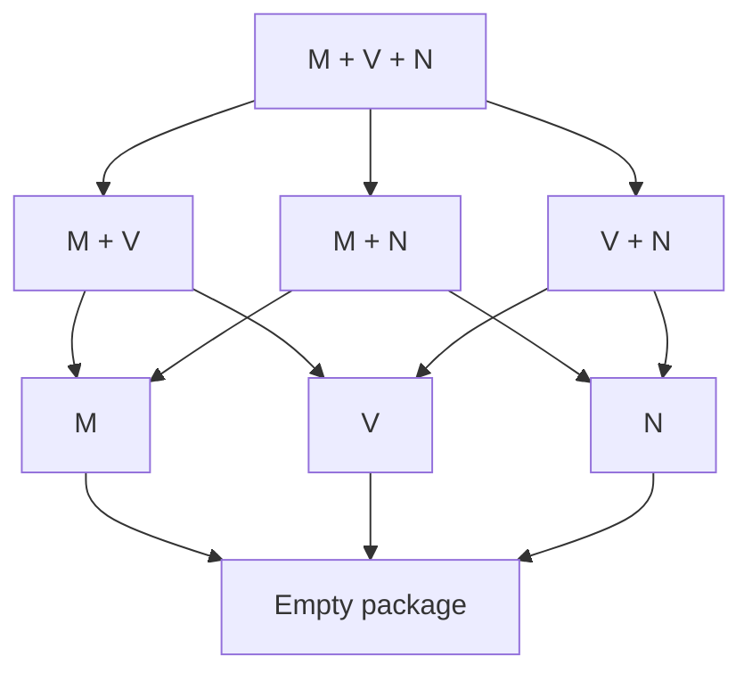

# The theorem space of observer separation over H

H is the fixed base throughout this map. C is an additional theory recovered in one region. The map separates the exact implication order of primitive preservation packages from the further relations introduced by derived operations, identity, observer restrictions and higher types.

Proofs by OpenAI Codex, prompted by Daniel Kodsi, 24 October 2026. Direct sources and section locators are given in the linked notes. See the [thematic diagrams](GRAPH.md) and [notation guide](README.md).

The [full graphical map](GRAPH.md) includes the structural, representation, quantifier, identity, affine and reversible-meet results, as well as the primitive and upper logical regions. Extra premises appear explicitly in its nodes. The broad research objective remains active; completing this atlas and the primitive-package classification did not settle the remaining comparisons.

## 1. Coordinates of a principle

Write S[R] for propositional separation by R-qualified observers:

$$
S[R]:=\forall p,q\, .\,p=q\leftrightarrow\forall E\, .\,R(E)\to(Ep\leftrightarrow Eq).
$$

FullSep[R] applies the same criterion to relations at every admitted argument tuple. Qualifications contain finite lists of types, indexed externally. The agreement clause is Ep↔Eq.

| Coordinate | Choices that must remain distinct |
| --- | --- |
| Preservation strength | Material truth law; pointwise identity; identity of whole operations |
| Separation scope | Propositions; one relational type; full relational schema |
| Primitive signature | M: conjunction; V: disjunction; N: negation; Qσ: universal; Pσ: existential |
| Endpoints | A: accept Top; Z: reject Bottom; fix either endpoint as an object |
| Equality | Translated reflexivity/substitution; truth-correct equality; pointwise or full fixing |
| Observer restriction | Factive, inflationary, endpoint range, finite image, idempotent, reversible, unique |
| Explicit extra premises | Functionality, identity bivalence, ND_t, internal finiteness, binary-family constructors, C |

Primitive and derived operations remain distinct until the appropriate identity is established. The empty accepting/rejecting propositional package is a theorem of H; its full typed version is Functionality.

## 2. The complete primitive-package order

For any finite Γ of independent clauses from M,V,N,Qσ,Pσ, put T_J=H+S[A∧Z∧J], for J⊆Γ. Fix one preservation tier and either propositional or full relational separation. Then

$$
T_K\vdash T_J\quad\Longleftrightarrow\quad J\subseteq K.
$$

This classifies all 2^|Γ| packages at once. Single-primitive corruption models prove every missing implication. The proof is [Primitive-package classification](primitive-package-classification.md), §§1–4.

For the three primitive connectives, arrows from a larger package to a smaller package are the only arrows within this family:

Every node retains A,Z, and uses the same tier and type scope. This diagram is an inclusion-ordered family inside the theorem space. It is not the whole theorem lattice: S[M] together with S[V] can be weaker than S[M∧V]. The [two-orders model](two-orders-model.md), §§2–4, proves this with strong full typed separation and much stronger endpoint/identity restrictions.

## 3. What separation represents

At any evaluation point, send a proposition p to the set of eligible observers accepting it. Separation says this map is injective. Preserved operations become intersection, union, complement, and admitted indexed intersections/unions. Hence each finite signature has exactly the algebraic equations and universal Horn laws valid in its two-element reduct. This is an external representation by truth sets, with no assertion that all external subsets or families are admitted. See [Truth profiles](truth-profiles-and-connective-reducts.md), §§2–3.

Without extra endpoint alignment, the connective output structures are:

| Same-observer signature | Structure forced on propositions |
| --- | --- |
| M; V; N | Meet semilattice; join semilattice; involution, respectively |
| M,V | Distributive lattice for the original operations |
| M,N | Boolean algebra with derived join; fixed Bottom, derived top ¬Bottom |
| V,N | Boolean algebra with derived meet; fixed Top, derived bottom ¬Top |
| M,V,N | Boolean algebra for the original operations and fixed endpoints |
| Implication | Join structure with greatest derived unit; every upper interval Boolean |
| Biconditional or XOR | Elementary abelian 2-group |
| Either group operation plus M or V | A Boolean ring and corresponding distributive lattice, possibly without the missing bound |

Acceptance/rejection aligns bounds; fixing the missing endpoint permits whole-operation preservation of the derived complement. The exact endpoint equivalences are in [Truth profiles](truth-profiles-and-connective-reducts.md), §4, and [Term closure and affine branches](term-closure-and-affine-branches.md), §§3–5. Strong preservation is closed under actual term composition, including fixed constants; it is not closed under mere truth-table replacement.

## 4. Exact intrinsic converses

| Separation principle | Exact counterpart, with stated premises |
| --- | --- |
| Material M | Meet-semilattice equations |
| Material V | Join-semilattice equations |
| Material N | Double-negation identity |
| Material A+M+QΔ | Meet semilattice with greatest Top and listed universals as admitted GLBs |
| Material Z+V+PΔ | Join semilattice with least Bottom and listed existentials as admitted LUBs |
| Material A+QΔ | Existence of an admitted partial order with greatest Top and those GLBs |
| Material Z+PΔ | Dual admitted partial-order statement |
| Pointwise A+M+QΔ, assuming ND_t | The same bounded meet/GLB structure |
| Pointwise Z+V+PΔ, assuming ND_t | The same bounded join/LUB structure |
| Strong A+M+QΔ, assuming IB_t and the listed local Functionality instances | The same bounded meet/GLB structure |
| Strong Z+V+PΔ, under the same local hypotheses | The same bounded join/LUB structure |
| Material XOR or biconditional, assuming internal Frege finiteness of all propositions | The corresponding Boolean-group equations |
| Pointwise M or V, assuming internal Frege finiteness of all propositions | The corresponding semilattice laws; add designated bounds for A/Z |

The first seven rows are proved in [Truth profiles](truth-profiles-and-connective-reducts.md), §§6–7. [Necessity of distinctness representation](necessity-of-distinctness-representation.md), §§1–5, proves the next two: under H+ND_t, material and pointwise M/Q separation have the same exact intrinsic counterpart, as do V/P. The witnesses have two outputs, which need not be Top and Bottom. The finite list may be empty and need not contain t. Whole-operation preservation additionally requires the stated local Functionality instances; at full relational scope all three tiers coincide. This proof assumes neither C nor NI.

The strong IB rows are [Local identity representation](representation-under-identity-bivalence.md), §§2–5: explicit endpoint-valued principal tests prove the converses. IB_t concerns equality judgments, not every proposition, and the local package is not identified with C. The finite affine row is [Internally finite affine separation](finite-affine-separation.md), §§2–5; its extension argument uses the internal induction formula, without Choice or an external enumeration.

The final row follows from [Finite semilattice normalization](finite-semilattice-normalization.md), §§2–6. Internal finite induction supplies a least true meet element, or greatest false join element. An explicit admitted two-valued operation then replaces every material character by a pointwise character with exactly the same truth profile. This collapses material and pointwise M/V separation under internal finiteness, and all three tiers at full relational scope, without identity bivalence. The local extremum already suffices without finiteness.

A further exact reduction needs only finite images of the separating observers, not finiteness of the proposition domain. Over H, for M and V separately and with any of no endpoint condition, A, Z or A+Z,

$$
S[\text{finite-image material observers}]\ \leftrightarrow\ S[\text{at-most-two-output pointwise observers}].
$$

Here finite image is internal Frege finiteness. The two outputs depend on the observer and need not be Top and Bottom. The normalization retains the entire current truth profile. At full relational scope, the pointwise condition can also be replaced by whole-operation identity. See [Finite-image material normalization](finite-image-material-normalization.md), §§2–5.

The same exact finite-image/two-output reduction covers M+QΔ, V+PΔ, and the joint signature M+V+QΔ+PΓ, without ND_t. Separation supplies the original semilattice or distributive-lattice order and the matching admitted bounds; the normalized false/true chain then preserves all listed operations pointwise. It also applies to unrestricted material observers when the whole proposition domain is internally finite. No negation-preservation or fixed-endpoint-range conclusion is added. See [Necessity of distinctness representation](necessity-of-distinctness-representation.md), §6. These reductions do not assert that every pointwise separator has finite image or settle the unrestricted infinite comparison.

## 5. Quantifiers can generate new lattice operations

An admitted uniform family constructor with exact range {p,q} allows Qσ-separation to define a meet by universal quantification over that family. Pσ similarly defines a join. These are operations determined by the observer profiles, initially independent of primitive conjunction/disjunction.

Composition of all strong Qσ observers is closed. Separation therefore upgrades the derived meet's truth law to an identity preserved by every such observer. The same argument applies to any more restricted separating class by first forgetting its extra restrictions. Full typed separation supplies the Functionality needed for the whole-operation identity. Thus adding preservation of this derived meet, or derived join, adds no strength to the full typed principle.

A common Q/P class yields a derived distributive lattice and the corresponding admitted quantifier adjunctions and distribution laws. The exact constructor premise and proofs are in [Quantifier-generated lattices](quantifier-generated-lattices.md), §§1–6. Pair-by-pair existence is distinguished from a uniform admitted constructor.

The constructor is a substantive additional premise. The [full three-object fork](fork-without-binary-families.md), §§2–5, satisfies C, all BF instances, all their boxed forms, and full typed universal-only separation. It has no nonconstant endpoint-valued family at any type. Even pair-by-pair exact binary-family existence therefore fails there.

There is also an exact general composition theorem. For a finite signature Σ of the displayed preservation clauses, optionally including fixed proposition constants,

$$
S[\operatorname{Pt}_\Sigma]\ \leftrightarrow\exists X\,[\operatorname{Sep}(X)\land\operatorname{Closed}(X)\land\operatorname{Material}_\Sigma(X)].
$$

The admitted family X may additionally be required to contain identity. Testing each proposed output equation with X and using composition closure proves that every X-member preserves it pointwise. Material acceptance/rejection in such a closed separating family upgrades to fixing the corresponding endpoint; ordinary A/Z qualifications are not silently composition-closed. For a relational type ρ the exact typed formula uses one X separating both t and ρ, and the full schema is indexed externally by ρ. Full typed scope also makes whole-operation preservation equivalent. See [Composition-closed characterization](composition-closed-characterization.md), §§1–4.

## 6. Identity and truth restrictions

Put z:=(Top=Bottom). Identity collapse IC_t says every true propositional identity judgment equals Top and every false one equals z.

| H principle | Exact counterpart |
| --- | --- |
| Accepting, truth-correct equality separation | IC_t |
| Accepting, pointwise equality-fixing separation | IC_t |
| Full typed versions, including whole equality fixing | IC_t + Functionality |
| The material equality branch plus material negation preservation | IC_t + double negation + z=¬Top |
| Factive separation, even with A,Z | Every false proposition equals Bottom |
| Inflationary separation, even with A,Z | Every true proposition equals Top |
| Factive or inflationary separation plus negation preservation | Extensionality at the stated type |
| One observer separating propositions | Propositional Fregean Axiom |
| Full separation plus unique qualified observer, for identity-containing A,Z classes | Full Extensionality |

Sources: [Identity collapse](identity-collapse.md), §§2–6, and [Observer restrictions](observer-restrictions.md), §§2–4. The IC witnesses already have two outputs {Top,z} and are pointwise idempotent. Those restrictions add no strength there; z need not be Bottom. A fixed n-observer separating family gives the exact unqualified bound of at most 2^n propositions; this is distinct from internal finiteness and finite image of each observer.

## 7. Reversibility gives an H atom theorem

Accepting/rejecting separation by reversible meet observers, together with one meet atom, implies that atoms distinguish every failure of order. Each proposition is the LUB of its atoms, and current truth is membership above a unique true atom. All atoms lie in one orbit of the admitted meet automorphisms.

This uses conjunction and admitted inverses only. No C, negation, disjunction, quantifier, BF or identity-bivalence premise is used. A unique atom then gives the Fregean Axiom; full typed separation upgrades this to Extensionality. Restricted-class transitivity requires the stated closure conditions. See [Reversible meet separation](reversible-meet-atomicity.md), §§2–6.

There is now an exact converse: reversible meet separation plus one atom is equivalent over H to a bounded atomistic meet structure with a true atom and admitted full-meet automorphisms transitive on atoms. For an arbitrarily restricted class, the precise condition is that each atom can be moved to truth by an eligible admitted meet automorphism; no closure of the extra restriction is required. Full relational separation adds exactly Functionality. See [Exact characterization](reversible-meet-characterization.md), §§2–5.

Its §6 gives a six-element H countermodel showing that atomisticity plus a true atom is insufficient without the transitivity condition, even with all Functionality, all-type identity bivalence and ordinary strong meet separation by endpoint-valued idempotent observers.

## 8. Higher types and preservation tiers

For every qualification K,

$$
\mathrm H+\operatorname{FullSep}[K]\ \equiv\ \mathrm H+S[K]+\operatorname{Functionality}.
$$

Consequently pointwise and whole-operation preservation give equivalent full typed separation theories for corresponding finite qualifications. At propositional scope they can differ: the [hidden-proposition model](local-tiers-and-models.md), §3, has pointwise conjunction separation but lacks whole-operation conjunction separation, even with endpoint-valued equality-fixing witnesses.

The [hidden-individual model](local-tiers-and-models.md), §2, has only two propositions and satisfies every propositional logical-separation instance, including endpoint, factive and equality-fixing restrictions. It nevertheless fails C and Functionality at et. Thus even the strongest propositional region does not replace the full typed hypothesis. A separate existing C action model shows that propositional Boolean separation plus C still need not yield Functionality at tt.

Material and pointwise qualifications can differ as predicates. For M and V separation, internal finiteness collapses those two tiers; a least true meet element or greatest false join element suffices locally. ND_t is a separate sufficient condition, including the matching quantifier branches, and finite-image normalization covers the joint lattice/quantifier branch. The unrestricted infinite comparison outside these hypotheses remains unresolved. The complete logical full typed case has a positive equivalence, described next.

For negation, the material/pointwise distinction is proved at the level of separation theories: the [four-proposition relational model](relational-clone-model.md) satisfies all Functionality and full typed material N-separation, but fails even propositional pointwise N-separation. Its only pointwise negation-preserving observers are identity and negation; they cannot distinguish two propositions having the same truth value. This example concerns bare N (also one endpoint truth restriction at a time), not the joint A+Z primitive-package family above.

## 9. C and stronger theories as regions of the H space

Full typed separation by complete logical observers transports finite H proofs and recovers C and all BF instances. Material, pointwise and whole-operation versions of this complete theory coincide. All independent primitives and the translated equality rules have explicit sharpness models; a truth-functionally complete fragment does not automatically recover an omitted primitive. See [Typed separation and Classicism](typed-separation-and-classicism.md), §§3–7.

Within this region the earlier results remain available with their stated scope:

| Full typed complete-logical restriction over H | Established theory or relation |
| --- | --- |
| Ordinary logical separation | Entails C+BF; stronger than merely assuming that base |
| Equality reflection or equality fixing | Exactly C5 + ordinary logical separation |
| Endpoint-valued range | Exactly C5 + Atomicity (type t) |
| Reversible separation | Entails C5 + necessary ordinary separation + No Pure Contingency |
| Necessarily bijective Good-observer separation | Exactly reversible separation |
| C5 + bijective Good-observer separation | Exactly reversible separation |
| C + invertible QΔ-observer separation, with t∈Δ | Exactly reversible separation |
| Reversible and finite-image separation together | Exactly endpoint separation |
| Reversible separation plus one finite-image Good_{ {t} } observer | Exactly endpoint separation |
| C5 + necessary ordinary separation + one proposition atom | Exactly endpoint separation |
| Factive separation; or ordinary separation plus one unique qualified class | Exactly Extensionality |

Reversible and finite-image separation are incomparable separately. The [logical observer hierarchy](../logical-observer-hierarchy.md) and [lattice models](../observer-lattice-models.md) contain the proofs and separating models. Internal finite image is not replaced by external finiteness.

The new reversible characterizations are proved in [Reversible quantifier observers](reversible-quantifier-observers.md), §§1–4. Over C, an admitted E has a whole-operation inverse exactly when □Bij(E); the explicit description term supplies the inverse without Choice or BF. Its inverse preserves every finite list of operations preserved by E. C5 additionally makes current Bij(E) necessary. Over C, Q_t plus admitted whole invertibility makes E a Boolean-order isomorphism, hence yields full Boolean identities. Thus the quantifier-only row retains an explicit C premise and a finite list containing t; invertibility can equivalently be replaced by necessary bijectivity. None of these statements upgrades current bijectivity over bare C or recovers C from an unpreserved primitive signature.

[Local symmetry conjugacy](local-conjugacy-and-reversible-observers.md), §§2–6, supplies admitted involutive separators in a precise semantic family: symmetric ideally-full models with countably infinite objects, all bijections as arrows, and finite pinning. It covers every one-object instance with arbitrary designated group, multiobject families with conjugate groups, and families whose groups all have finite bases. This is a sufficient model construction, not a necessary criterion for arbitrary reversible observers.

Further conditional coordinates are in [Modal selectors and quantifier reduction](../modal-selectors-and-quantifier-reduction.md): over C, modal .2 is equivalent to an endpoint selector; under C5, Boolean plus Q_t separation suffices for full logical separation. These are C-relative results, not H converses.

Its §6 also proves a sharp limitation on the individual-observer upgrade: C plus all boxed BF does not make every Q_t-preserving observer preserve M, or every P_t-preserving observer preserve V. The full fork supplies endpoint-fixing, finite-image, idempotent counterexamples that preserve the opposite binary connective. The fork itself has full OS, so this is not a countermodel to an equivalence between the corresponding separation theories.

Ordinary full OS does **not** entail necessary BF_e, necessary BF_t, or necessary Functionality at e,t. The [contingent-Barcan model](logical-separation-with-contingent-barcan.md), §§2–5, proves OS at the ℕ object of the existing finite-support two-object all-maps construction, while its accessible singleton witnesses those failures. Its reusable sufficient criterion combines current extensional fullness, distinguishing arrows whose listed type transports are onto, and C's unconditional finite guard. No optional qualification is necessitated.

The atom-bearing necessary-separation region has an exact converse. In fact C5 plus the single boxed propositional instance S_{t,{t}} and one proposition atom already implies Atomicity_t. Hence, over H,

$$
\begin{aligned}\mathsf{End}&\leftrightarrow\mathrm{C5}+\operatorname{Atomicity}_t\\&\leftrightarrow\mathrm{C5}+\Box S_{t,\{t\}}+\text{one atom}\\&\leftrightarrow\mathrm{C5}+\Box\mathrm{OS}+\text{one atom}.\end{aligned}
$$

Here End is full typed endpoint separation, while S_{t,{t}} is one closed formula; the C5 premise explicitly includes C. One atom can equivalently be replaced by Actuality or by the existence of one internally finite-image Good_{ {t} } observer. See [Necessary separation and atoms](necessary-separation-and-atoms.md), §§1–4. The atomless countermodel below shows why that atom-bearing conclusion does not extend to C5+□OS alone.

Reversibility also gives a pure-language consequence without any atom premise:

$$
\mathsf{Rev}\ \Longrightarrow\ \mathrm{C5}+\Box\mathrm{OS}+\text{No Pure Contingency}.
$$

For each closed pure sentence P, a qualified involution at the finite list of quantifier types occurring in P extends by explicit typewise conjugation. It fixes the logical constants and hence P. Involutive separation compares a true P with Top and gives □P. At the individual type, conjugation leaves variables unchanged; no forbidden e→e object is introduced. The quantifier-reindexing identity uses a necessary whole-operation involution identity, not necessitation of an optional premise. See [Reversible separation and pure truth](reversible-separation-and-pure-truth.md), §§1–4. This is not a characterization.

The implication Rev⇒C5+□OS is **strict**, even in atomless models. The [finite-block symmetry model](finite-block-symmetry-reversible-gap.md), §§1–8, has two countable objects: one partitioned into blocks of every positive even size, the other into blocks of power-of-two size. Independent within-block permutations and all bijections as arrows give C5 and full necessary OS at both objects. Yet the pure sentence MC₆—every admitted disjoint family of six-element sets admits a relation selecting a nonempty proper subset of each—fails at the even-block object and holds at the power-of-two object. This pure contingency obstructs Rev. The conclusion does not rely on treating failed local conjugacy as a necessary obstruction. The model gives an explicit failed reversible propositional instance at the finite type list stated in its §8; both proposition algebras are atomless.

## 10. Explicit frontier

The exact primitive-package order, typed factorization and displayed characterizations are settled by the linked arguments. The following comparisons are not settled by this research map:

- Material versus pointwise conjunction/disjunction separation in the infinite nonprincipal case, outside the local identity, ND_t or finite-normalization hypotheses; corresponding partial-signature comparisons at full typed scope.
- Intrinsic strong representation for general infinite affine/group signatures without a character-extension or admission hypothesis.
- Reversibility for other partial signatures over H and the general atomless meet region are not classified by the exact atom-bearing theorem in §7. The C-relative invertible-Q branch in §9 is settled.
- The remaining C-region quantifier reductions without the added modal premise, as scoped in their notes. Neither ordinary OS⇒necessary BF nor C5+□OS⇒Rev remains on the frontier: the countermodels in §9 refute both. No converse to Rev⇒C5+□OS+No Pure Contingency is asserted.

No missing comparison is treated as a non-implication. The map is a systematic H foundation with an exact finite primitive core, proved connecting theorems, explicit countermodels, and a stated frontier; it is not a claim that every theorem over H has been enumerated.
