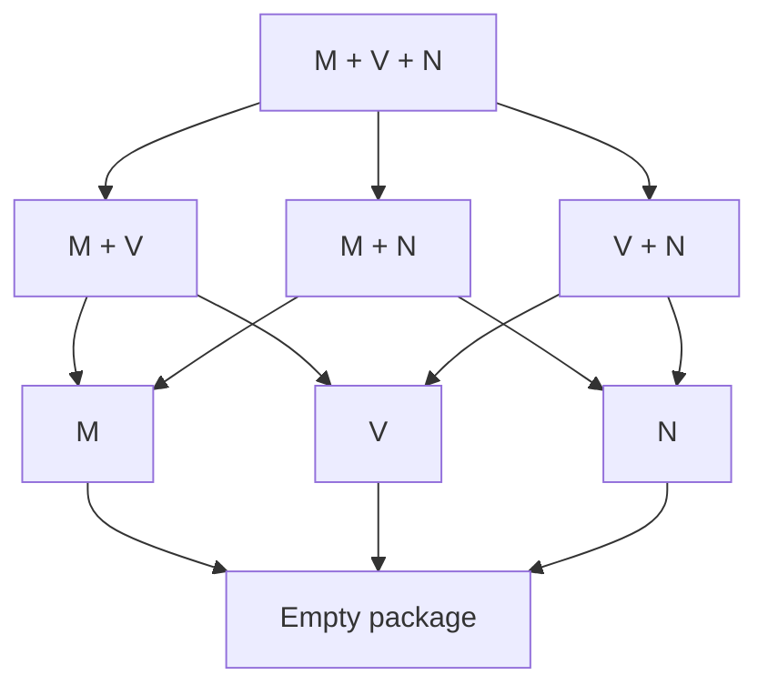

# The theorem space of observer separation over H

H is the fixed base throughout this map. C is an additional theory recovered in one region. The map separates the exact implication order of primitive preservation packages from the further relations introduced by derived operations, identity, observer restrictions and higher types.

Proofs by OpenAI Codex, prompted by Daniel Kodsi, 24 October 2026. Direct sources and section locators are given in the linked notes. See the [thematic diagrams](GRAPH.md) and [notation guide](README.md).

The [full graphical map](GRAPH.md) includes the structural, representation, quantifier, identity, affine and reversible-meet results, as well as the primitive and upper logical regions. Extra premises appear explicitly in its nodes. Only the finite primitive family is completely classified; §10 gives the remaining comparisons.

## 1. Coordinates of a principle

Write S[R] for propositional separation by R-qualified observers:

$$
S[R]:=\forall p,q\, .\,p=q\leftrightarrow\forall E\, .\,R(E)\to(Ep\leftrightarrow Eq).
$$

FullSep[R] applies the same criterion to relations at every admitted argument tuple. Qualifications contain finite lists of types, indexed externally. The agreement clause is Ep↔Eq.

| Coordinate | Choices that must remain distinct |
| --- | --- |
| Preservation strength | Material truth law; pointwise identity; identity of whole operations |
| Separation scope | Propositions; one relational type; full relational schema |
| Primitive signature | M: conjunction; V: disjunction; N: negation; Qσ: universal; Pσ: existential |
| Endpoints | A: accept Top; Z: reject Bottom; fix either endpoint as an object |
| Equality | Translated reflexivity/substitution; truth-correct equality; pointwise or full fixing |
| Observer restriction | Factive, inflationary, endpoint range, finite image, idempotent, reversible, unique |
| Explicit extra premises | Functionality, identity bivalence, ND_t, Plenitude at t,t, Zorn at tt, internal finiteness, binary-family constructors, C |

Primitive and derived operations remain distinct until the appropriate identity is established. The empty accepting/rejecting propositional package is a theorem of H; its full typed version is Functionality.

## 2. The complete primitive-package order

For any finite Γ of independent clauses from M,V,N,Qσ,Pσ, put T_J=H+S[A∧Z∧J], for J⊆Γ. Fix one preservation tier and either propositional or full relational separation. Then

$$
T_K\vdash T_J\quad\Longleftrightarrow\quad J\subseteq K.
$$

This classifies all 2^|Γ| packages at once. Single-primitive corruption models prove every missing implication. The proof is [Primitive-package classification](primitive-package-classification.md), §§1–4.

For the three primitive connectives, arrows from a larger package to a smaller package are the only arrows within this family:

Every node retains A,Z, and uses the same tier and type scope. This diagram is an inclusion-ordered family inside the theorem space. It is not the whole theorem lattice: S[M] together with S[V] can be weaker than S[M∧V]. The [two-orders model](two-orders-model.md), §§2–4, proves this with strong full typed separation and much stronger endpoint/identity restrictions.

## 3. What separation represents

At any evaluation point, send a proposition p to the set of eligible observers accepting it. Separation says this map is injective. Preserved operations become intersection, union, complement, and admitted indexed intersections/unions. Hence each finite signature has exactly the algebraic equations and universal Horn laws valid in its two-element reduct. This is an external representation by truth sets, with no assertion that all external subsets or families are admitted. See [Truth profiles](truth-profiles-and-connective-reducts.md), §§2–3.

Without extra endpoint alignment, the connective output structures are:

| Same-observer signature | Structure forced on propositions |
| --- | --- |
| M; V; N | Meet semilattice; join semilattice; involution, respectively |
| M,V | Distributive lattice for the original operations |
| M,N | Boolean algebra with derived join; fixed Bottom, derived top ¬Bottom |
| V,N | Boolean algebra with derived meet; fixed Top, derived bottom ¬Top |
| M,V,N | Boolean algebra for the original operations and fixed endpoints |
| Implication | Join structure with greatest derived unit; every upper interval Boolean |
| Biconditional or XOR | Elementary abelian 2-group |
| Either group operation plus M or V | A Boolean ring and corresponding distributive lattice, possibly without the missing bound |

Acceptance/rejection aligns bounds; fixing the missing endpoint permits whole-operation preservation of the derived complement. The exact endpoint equivalences are in [Truth profiles](truth-profiles-and-connective-reducts.md), §4, and [Term closure and affine branches](term-closure-and-affine-branches.md), §§3–5. Strong preservation is closed under actual term composition, including fixed constants; it is not closed under mere truth-table replacement.

## 4. Exact intrinsic converses

| Separation principle | Exact counterpart, with stated premises |
| --- | --- |
| Material M | Meet-semilattice equations |
| Material V | Join-semilattice equations |
| Material N | Double-negation identity |
| Material A+M+QΔ | Meet semilattice with greatest Top and listed universals as admitted GLBs |
| Material Z+V+PΔ | Join semilattice with least Bottom and listed existentials as admitted LUBs |
| Material A+QΔ | Existence of an admitted partial order with greatest Top and those GLBs |
| Material Z+PΔ | Dual admitted partial-order statement |
| Pointwise A+M+QΔ, assuming ND_t | The same bounded meet/GLB structure |
| Pointwise Z+V+PΔ, assuming ND_t | The same bounded join/LUB structure |
| Strong A+M+QΔ, assuming IB_t and the listed local Functionality instances | The same bounded meet/GLB structure |
| Strong Z+V+PΔ, under the same local hypotheses | The same bounded join/LUB structure |
| Material or two-output pointwise XOR or biconditional, assuming internal Frege finiteness of all propositions | The corresponding Boolean-group equations |
| Pointwise M or V, assuming internal Frege finiteness of all propositions | The corresponding semilattice laws; add designated bounds for A/Z |

The first seven rows are proved in [Truth profiles](truth-profiles-and-connective-reducts.md), §§6–7. [Necessity of distinctness representation](necessity-of-distinctness-representation.md), §§1–5, proves the next two: under H+ND_t, material and pointwise M/Q separation have the same exact intrinsic counterpart, as do V/P. The witnesses have two outputs, which need not be Top and Bottom. The finite list may be empty and need not contain t. Whole-operation preservation additionally requires the stated local Functionality instances; at full relational scope all three tiers coincide. This proof assumes neither C nor NI.

The strong IB rows are [Local identity representation](representation-under-identity-bivalence.md), §§2–5: explicit endpoint-valued principal tests prove the converses. IB_t concerns equality judgments, not every proposition, and the local package is not identified with C. The finite affine row is strengthened in [Finite affine normalization](finite-affine-normalization.md), §§2–5: internal Frege induction constructs an admitted subgroup of index two and a test invariant on its cosets, then a two-output homomorphism. No Choice, identity-collapse assumption, or external enumeration is used. Local binary Functionality gives whole-operation preservation; full typed separation adds exactly Functionality on the structural side.

The final row follows from [Finite semilattice normalization](finite-semilattice-normalization.md), §§2–6. Internal finite induction supplies a least true meet element, or greatest false join element. An explicit admitted two-valued operation then replaces every material character by a pointwise character with exactly the same truth profile. This collapses material and pointwise M/V separation under internal finiteness, and all three tiers at full relational scope, without identity bivalence. The local extremum already suffices without finiteness.

A further exact reduction needs only finite images of the separating observers, not finiteness of the proposition domain. Over H, for M and V separately and with any of no endpoint condition, A, Z or A+Z,

$$
S[\text{finite-image material observers}]\ \leftrightarrow\ S[\text{at-most-two-output pointwise observers}].
$$

Here finite image is internal Frege finiteness. The two outputs depend on the observer and need not be Top and Bottom. The normalization retains the entire current truth profile. At full relational scope, the pointwise condition can also be replaced by whole-operation identity. See [Finite-image material normalization](finite-image-material-normalization.md), §§2–5.

The same exact finite-image/two-output reduction covers M+QΔ, V+PΔ, and the joint signature M+V+QΔ+PΓ, without ND_t. Separation supplies the original semilattice or distributive-lattice order and the matching admitted bounds; the normalized false/true chain then preserves all listed operations pointwise. It also applies to unrestricted material observers when the whole proposition domain is internally finite. No negation-preservation or fixed-endpoint-range conclusion is added. See [Necessity of distinctness representation](necessity-of-distinctness-representation.md), §6. These reductions do not assert that every pointwise separator has finite image or settle the unrestricted infinite comparison.

The finite-image reduction also holds separately for XOR and biconditional, retaining any A/Z orientation: finite-image material affine separation is equivalent to two-output pointwise affine separation. Under the Boolean-group equations, every individual finite-image material observer receives a pointwise replacement with the same entire truth profile. A truth-oriented finite induction constructs the required invariant test without assuming that the image is a subgroup. See [Finite affine normalization](finite-affine-normalization.md), §6. Whole-operation lifting retains the explicit Functionality premises.

The existing Plenitude principle supplies a further infinite-domain bridge. Its single t,t instance admits a truth-correct selector into any specified false/true pair. Whenever the pair realizes the required operation tables as identities, this selector normalizes every material observer to a two-output pointwise observer with the same truth profile. Such pairs exist under material separation for all seven nonempty subsets of M,V,N, and separately for XOR and biconditional. Matching M/Q and V/P packages, and joint M,V with both listed quantifier families, also normalize by their admitted GLB/LUB laws. Full typed scope gives whole identities; no infinite affine character-existence theorem or quantifier-only reduction is asserted. See [Plenitude normalization](plenitude-material-normalization.md), §§1–6. Thus the remaining bare-H comparisons must also evade this explicit admission hypothesis.

Infinite affine character existence has a separate positive theorem using the existing **preorder Zorn instance at type tt**, stated explicitly over H. Under that premise, the Boolean-group equations are equivalent to material separation for each affine operation, with the existing endpoint alignments. More strongly, every admitted partial truth character extends to an admitted character. The proof applies Zorn to the admitted preorder of subgroups extending a prescribed kernel and avoiding a chosen element, then constructs the character from its two cosets. Pointed maximality exactly characterizes separation; the relative version exactly characterizes partial-character extension. See [Zorn supplies affine characters](zorn-affine-character-extension.md), §§1–7. No C-based equivalence of Zorn with another choice principle is imported.

The same explicit Zorn instance gives exact **joint lattice and Boolean converses**. Material M+V separation is equivalent to the distributive-lattice output equations, with A/Z adding precisely the corresponding designated bounds. Material M+N, V+N and M+V+N separation is equivalent to the appropriate Boolean algebra, retaining derived versus primitive operations and the stated endpoint alignments. An admitted maximal-filter argument supplies prime filters and extends every admitted partial lattice truth character. Relative prime-filter separation is exactly this extension principle. Plenitude adds pointwise normalization; local Fun gives whole identities, while full typed characterizations include all Fun. No quantifier preservation follows from the finite-operation theorem. See [Zorn supplies lattice and Boolean characters](zorn-lattice-character-extension.md), §§1–6.

Plenitude also gives a stronger partial-signature result: for negation alone and each separate affine operation, material separation is equivalent to separation by **pointwise involutions**, with endpoint truth conditions upgraded to fixing the corresponding endpoints. Negation uses an admitted flip of one negation pair; the affine proof adds to identity a two-output homomorphism whose square is zero. Local Functionality gives whole preservation and inverse identities; full typed scope supplies those instances. This does not preserve extra unnamed operations or the original observer's entire truth profile. Thus Zorn supplies affine characters, while Plenitude turns their separation into reversible separation. For details see [Reversible partial-signature normalization](partial-reversible-normalization.md), §§1–5. The six-element full-function meet model shows that Plenitude does not give the analogous collapse for conjunction.

The affine result extends to **linked operations**. Over bare H, joint material N/+ separation is exactly material + separation together with ¬x=x+c, where c=¬0 and 0 is that affine group's unit. Joint material XOR/biconditional separation is exactly material XOR separation together with D(x,y)=(x⊕y)⊕u, where u is the biconditional unit. Under Plenitude the witnesses may be chosen as pointwise involutions preserving the entire linked signature and fixing the required endpoints. Adding A/Z now aligns Top/Bottom with the appropriate two distinguished elements; the opposite-unit endpoint is no longer free as it was for one affine operation. For the actual expansion X=¬D, all three two-operation material packages N+X, N+D and X+D coincide and also give the three-operation package. Whole identities retain local Fun, or full typed scope. See [Negation and affine compatibility](negation-affine-compatibility.md), §§2–7.

## 5. Quantifiers can generate new lattice operations

An admitted uniform family constructor with exact range {p,q} allows Qσ-separation to define a meet by universal quantification over that family. Pσ similarly defines a join. These are operations determined by the observer profiles, initially independent of primitive conjunction/disjunction.

Composition of all strong Qσ observers is closed. Separation therefore upgrades the derived meet's truth law to an identity preserved by every such observer. The same argument applies to any more restricted separating class by first forgetting its extra restrictions. Full typed separation supplies the Functionality needed for the whole-operation identity. Thus adding preservation of this derived meet, or derived join, adds no strength to the full typed principle.

A common Q/P class yields a derived distributive lattice and the corresponding admitted quantifier adjunctions and distribution laws. The exact constructor premise and proofs are in [Quantifier-generated lattices](quantifier-generated-lattices.md), §§1–6. Pair-by-pair existence is distinguished from a uniform admitted constructor.

The constructor is a substantive additional premise. The [full three-object fork](fork-without-binary-families.md), §§2–5, satisfies C, all BF instances, all their boxed forms, and full typed universal-only separation. It has no nonconstant endpoint-valued family at any type. Even pair-by-pair exact binary-family existence therefore fails there.

There is also an exact general composition theorem. For a finite signature Σ of the displayed preservation clauses, optionally including fixed proposition constants,

$$
S[\operatorname{Pt}_\Sigma]\ \leftrightarrow\exists X\,[\operatorname{Sep}(X)\land\operatorname{Closed}(X)\land\operatorname{Material}_\Sigma(X)].
$$

The admitted family X may additionally be required to contain identity. Testing each proposed output equation with X and using composition closure proves that every X-member preserves it pointwise. Material acceptance/rejection in such a closed separating family upgrades to fixing the corresponding endpoint; ordinary A/Z qualifications are not silently composition-closed. For a relational type ρ the exact typed formula uses one X separating both t and ρ, and the full schema is indexed externally by ρ. Full typed scope also makes whole-operation preservation equivalent. See [Composition-closed characterization](composition-closed-characterization.md), §§1–4.

## 6. Identity and truth restrictions

Put z:=(Top=Bottom). Identity collapse IC_t says every true propositional identity judgment equals Top and every false one equals z.

| H principle | Exact counterpart |
| --- | --- |
| Accepting, truth-correct equality separation | IC_t |
| Accepting, pointwise equality-fixing separation | IC_t |
| Full typed versions, including whole equality fixing | IC_t + Functionality |
| The material equality branch plus material negation preservation | IC_t + double negation + z=¬Top |
| Factive separation, even with A,Z | Every false proposition equals Bottom |
| Inflationary separation, even with A,Z | Every true proposition equals Top |
| Factive or inflationary propositional separation plus negation preservation | Fregean Axiom; full relational separation additionally gives Functionality, hence Extensionality |
| One observer separating propositions | Propositional Fregean Axiom |
| Full separation plus unique qualified observer, for identity-containing A,Z classes | Full Extensionality |

Sources: [Identity collapse](identity-collapse.md), §§2–6, and [Observer restrictions](observer-restrictions.md), §§2–4. The IC witnesses already have two outputs {Top,z} and are pointwise idempotent. Those restrictions add no strength there; z need not be Bottom. A fixed n-observer separating family gives the exact unqualified bound of at most 2^n propositions; this is distinct from internal finiteness and finite image of each observer.

## 7. Reversibility gives an H atom theorem

Accepting/rejecting separation by reversible meet observers, together with one meet atom, implies that atoms distinguish every failure of order. Each proposition is the LUB of its atoms, and current truth is membership above a unique true atom. All atoms lie in one orbit of the admitted meet automorphisms.

This uses conjunction and admitted inverses only. No C, negation, disjunction, quantifier, BF or identity-bivalence premise is used. A unique atom then gives the Fregean Axiom; full typed separation upgrades this to Extensionality. Restricted-class transitivity requires the stated closure conditions. See [Reversible meet separation](reversible-meet-atomicity.md), §§2–6.

There is now an exact converse: reversible meet separation plus one atom is equivalent over H to a bounded atomistic meet structure with a true atom and admitted full-meet automorphisms transitive on atoms. For an arbitrarily restricted class, the precise condition is that each atom can be moved to truth by an eligible admitted meet automorphism; no closure of the extra restriction is required. Full relational separation adds exactly Functionality. See [Exact characterization](reversible-meet-characterization.md), §§2–5.

Its §6 gives a six-element H countermodel showing that atomisticity plus a true atom is insufficient without the transitivity condition, even with all Functionality, all-type identity bivalence and ordinary strong meet separation by endpoint-valued idempotent observers.

## 8. Higher types and preservation tiers

For every qualification K,

$$
\mathrm H+\operatorname{FullSep}[K]\ \equiv\ \mathrm H+S[K]+\operatorname{Functionality}.
$$

Consequently pointwise and whole-operation preservation give equivalent full typed separation theories for corresponding finite qualifications. At propositional scope they can differ: the [hidden-proposition model](local-tiers-and-models.md), §3, has pointwise conjunction separation but lacks whole-operation conjunction separation, even with endpoint-valued equality-fixing witnesses.

The [hidden-individual model](local-tiers-and-models.md), §2, has only two propositions and satisfies every propositional logical-separation instance, including endpoint, factive and equality-fixing restrictions. It nevertheless fails C and Functionality at et. Thus even the strongest propositional region does not replace the full typed hypothesis. A separate existing C action model shows that propositional Boolean separation plus C still need not yield Functionality at tt.

Material and pointwise qualifications can differ as predicates. For M and V separation, internal finiteness collapses those two tiers; a least true meet element or greatest false join element suffices locally. ND_t is a separate sufficient condition, including the matching quantifier branches, and finite-image normalization covers the joint lattice/quantifier branch. The unrestricted infinite comparison outside these hypotheses remains unresolved. The complete logical full typed case has a positive equivalence, described next.

For negation, the material/pointwise distinction is proved at the level of separation theories: the [four-proposition relational model](relational-clone-model.md) satisfies all Functionality and full typed material N-separation, but fails even propositional pointwise N-separation. Its only pointwise negation-preserving observers are identity and negation; they cannot distinguish two propositions having the same truth value. This example concerns bare N (also one endpoint truth restriction at a time), not the joint A+Z primitive-package family above.

## 9. C and stronger theories as regions of the H space

Full typed separation by complete logical observers transports finite H proofs and recovers C and all BF instances. Material, pointwise and whole-operation versions of this complete theory coincide. All independent primitives and the translated equality rules have explicit sharpness models; a truth-functionally complete fragment does not automatically recover an omitted primitive. See [Typed separation and Classicism](typed-separation-and-classicism.md), §§3–7.

Within this region the earlier results remain available with their stated scope:

| Full typed complete-logical restriction over H | Established theory or relation |
| --- | --- |
| Ordinary logical separation | Entails C+BF; stronger than merely assuming that base |
| Equality reflection or equality fixing | Exactly C5 + ordinary logical separation |
| Endpoint-valued range | Exactly C5 + Atomicity |
| Reversible separation | Entails C5 + necessary ordinary separation + No Pure Contingency |
| Necessarily bijective Good-observer separation | Exactly reversible separation |
| C5 + bijective Good-observer separation | Exactly reversible separation |
| C5 + surjective Good-observer separation | Exactly reversible separation |
| Surjective Good-observer separation without C5 | Strictly between Rev and OS; incomparable with qualified left-inverse separation |
| Ordinary logical separation + Plenitude at t,t | Exactly endpoint separation |
| C5 + ordinary logical separation + Actuality or full Boolean Completeness | Exactly endpoint separation |
| C + invertible QΔ-observer separation, with t∈Δ | Exactly reversible separation |
| Reversible and finite-image separation together | Exactly endpoint separation |
| Reversible separation plus one finite-image Good_{ {t} } observer | Exactly endpoint separation |
| C5 + necessary ordinary separation + one proposition atom | Exactly endpoint separation |
| Factive separation; or ordinary separation plus one unique qualified class | Exactly Extensionality |

Reversible and finite-image separation are incomparable separately. The [logical observer hierarchy](../logical-observer-hierarchy.md) and [lattice models](../observer-lattice-models.md) contain the proofs and separating models. Internal finite image is not replaced by external finiteness.

The **single propositional Plenitude instance** has an exact complete-logical effect: End iff OS+Plen_t,t iff OS+Plen_r iff C5+OS+Actuality iff C5+OS+BC_r. Already C+BF_t+Plen_t,t is exactly C5+Actuality: the source's t,t selector proofs give ND_t and Actuality, BF_t gives boxed ND_t, and the recorded boxed type reduction gives C5. Thus current OS and current Plenitude suffice; neither is silently boxed. Conversely the endpoint package gives necessary Plenitude at all relational types. See [Propositional Plenitude and endpoint separation](plenitude-endpoint-bridge.md), §§1–5.

The reversible characterizations are proved in [Reversible quantifier observers](reversible-quantifier-observers.md), §§1–4. Over C, an admitted E has a whole-operation inverse exactly when □Bij(E); the explicit description term supplies the inverse without Choice or BF. Its inverse preserves every finite list of operations preserved by E. C5 additionally makes current Bij(E) necessary. Over C, Q_t plus admitted whole invertibility makes E a Boolean-order isomorphism, hence yields full Boolean identities. Thus the quantifier-only row retains an explicit C premise and a finite list containing t; invertibility can equivalently be replaced by necessary bijectivity. None of these statements upgrades current bijectivity over bare C or recovers C from an unpreserved primitive signature.

[Local symmetry conjugacy](local-conjugacy-and-reversible-observers.md), §§2–6, supplies admitted involutive separators in a precise semantic family: symmetric ideally-full models with countably infinite objects, all bijections as arrows, and finite pinning. It covers every one-object instance with arbitrary designated group, multiobject families with conjugate groups, and families whose groups all have finite bases. This is a sufficient model construction, not a necessary criterion for arbitrary reversible observers.

Further conditional coordinates are in [Modal selectors and quantifier reduction](../modal-selectors-and-quantifier-reduction.md): over C, modal .2 is equivalent to an endpoint selector; under C5, Boolean plus Q_t separation suffices for full logical separation. These are C-relative results, not H converses.

The unrestricted N+Q and V+Q reductions are refuted at the level of separation theories. The [ternary Cantor symmetry model](ternary-cantor-observer-model.md) satisfies C, all boxed BF and Functionality instances, and full endpoint-fixing separation for each of the separate M+Q/P, V+Q/P and N+Q/P classes, including their separately boxed instances. Nevertheless even propositional Boolean separation fails. Root propositions are a current truth bit plus a clopen Cantor profile; supported monotone tests preserve quantifiers because continuous leafwise minima and maxima have admitted lifts. Supported majority tests supply negation separation, while no supported Boolean ultrafilter can read the profile. Thus even the conjunction of the three separate separation theories does not provide a common Boolean separating class. Modal .2 fails in the model, so the earlier positive conditional reductions remain intact.

Section 6 of [Modal selectors and quantifier reduction](../modal-selectors-and-quantifier-reduction.md) also proves a sharp limitation on the individual-observer upgrade: C plus all boxed BF does not make every Q_t-preserving observer preserve M, or every P_t-preserving observer preserve V. The full fork supplies endpoint-fixing, finite-image, idempotent counterexamples that preserve the opposite binary connective. The fork itself has full OS, so this is not a countermodel to an equivalence between the corresponding separation theories.

Even full qualified left-inverse separation does **not** entail C5, ☐OS, its own boxed schema, ☐BF at e or t, or ☐Functionality at (e,t). The [all-maps left-inverse construction](finite-block-symmetry-left-inverse.md), §7, supplies this stronger verdict at the natural-number object of the existing finite-support natural-numbers/singleton model. Its [Barcan and Functionality witnesses](logical-separation-with-contingent-barcan.md), §§3–5, remain unchanged. No atomlessness verdict is transferred from the different finite-block symmetry model.

The atom-bearing necessary-separation region has an exact converse. In fact C5 plus the single boxed propositional instance S_{t,{t}} and one proposition atom already implies Atomicity_t. Hence, over H,

$$
\begin{aligned}\mathsf{End}&\leftrightarrow\mathrm{C5}+\operatorname{Atomicity}_t\\&\leftrightarrow\mathrm{C5}+\Box S_{t,\{t\}}+\text{one atom}\\&\leftrightarrow\mathrm{C5}+\Box\mathrm{OS}+\text{one atom}.\end{aligned}
$$

Here End is full typed endpoint separation, while S_{t,{t}} is one closed formula; the C5 premise explicitly includes C. One atom can equivalently be replaced by Actuality or by the existence of one internally finite-image Good_{ {t} } observer. See [Necessary separation and atoms](necessary-separation-and-atoms.md), §§1–4. The atomless countermodel below shows why that atom-bearing conclusion does not extend to C5+□OS alone.

Reversibility also gives a pure-language consequence without any atom premise:

$$
\mathsf{Rev}\ \Longrightarrow\ \mathrm{C5}+\Box\mathrm{OS}+\text{No Pure Contingency}.
$$

For each closed pure sentence P, a qualified involution at the finite list of quantifier types occurring in P extends by explicit typewise conjugation. It fixes the logical constants and hence P. Involutive separation compares a true P with Top and gives □P. At the individual type, conjugation leaves variables unchanged; no forbidden e→e object is introduced. The quantifier-reindexing identity uses a necessary whole-operation involution identity, not necessitation of an optional premise. See [Reversible separation and pure truth](reversible-separation-and-pure-truth.md), §§1–4. This is not a characterization.

The implication Rev⇒C5+□OS is **strict**, even in atomless models. The [finite-block symmetry model](finite-block-symmetry-reversible-gap.md), §§1–8, has two countable objects: one partitioned into blocks of every positive even size, the other into blocks of power-of-two size. Independent within-block permutations and all bijections as arrows give C5 and full necessary OS at both objects. Yet the pure sentence MC₆—every admitted disjoint family of six-element sets admits a relation selecting a nonempty proper subset of each—fails at the even-block object and holds at the power-of-two object. This pure contingency obstructs Rev. The conclusion does not rely on treating failed local conjugacy as a necessary obstruction. The model gives an explicit failed reversible propositional instance at the finite type list stated in its §8; both proposition algebras are atomless.

Adding **No Pure Contingency still does not recover Rev**, even after strengthening necessary OS to necessary qualified left-inverse separation. The [component-shift symmetry model](component-shift-symmetry-reversible-gap.md) has one object, hence No Pure Contingency, and satisfies C5+□SplitMono. Its allowed arrows shift a sequence of components, alternating the two finite-block patterns. The same-component binary relation is endpoint-valued and fixed by every allowed arrow; a choice assertion inside the component of an individual changes truth under a shift. Every qualified involution fixes that assertion under conjugation, so Rev fails at an explicit finite propositional type list.

This gives a stronger positive bound as well: Rev implies noncontingency for pure formulas with finitely many individual parameters and finitely many first-order relation parameters of types eⁿt, provided each relation is endpoint-valued on all individual tuples. These parameters are fixed by conjugation, so the pure-term argument still applies. The condition does not extend here to arbitrary higher-type parameters. The exact external schema and proof are in the component-shift note, §6; its countermodel shows why closed pure noncontingency alone is weaker.

Qualified right inverses give another exact characterization of Rev: full typed logical separation by E admitting a same-list Good right inverse F with E∘F=I is equivalent over H to reversible separation. Over C+BF, for each finite Δ containing t, a localized Boolean patch replaces a distinguishing right-invertible observer by a same-list involution. The theorem is about separation principles, not equality of the individual observer classes. See [Qualified right-inverse separation](split-inverse-logical-observers.md), §§1–4.

Over **C5**, current surjectivity of a Good_Δ observer, with t∈Δ, does supply an admitted same-list qualified right inverse. Define its greatest kernel element k_S=∃p[(Sp=Bottom)∧p], take the unique representative of each fiber below ¬k_S, and fill the k_S region with identity. This is an explicit term, with no Choice or external section. Consequently surjective Good separation plus C5 is exactly Rev. The C5 premise remains explicit; the theorem does not upgrade bare-C surjectivity. See [Surjective logical observers](surjective-logical-observers.md), §§1–5.

Without C5, **surjective separation and qualified left-inverse separation are incomparable**, even over C+□BF+□OS. In the full omega-chain model, every Good_{ {t} } observer has the exact form E(p)=f⁻¹[p], where f(m)≥m. Full Q_t forces each coordinate's Boolean truth test to be principal; this is an exhaustive classification of logical observers in that model. The shifts f(m)=m+k yield surjective logical separation at every future stage. An injective observer would require f onto, which forces f=id by induction. Thus the propositional left-inverse separation instance at {t} fails. Every nonidentity forward map also lacks any admitted whole right inverse, even without a qualification requirement on that inverse. The finite-block C5+□SplitMono model supplies the opposite distinction: SurjSep would give Rev there, but Rev fails. Consequently both arrows Rev⇒SurjSep⇒OS are strict, alongside the distinct chain Rev⇒SplitMono⇒OS. Under C5, SurjSep is Rev and does imply SplitMono; that stronger background is not the incomparability base. See [Omega-chain logical observers](omega-chain-surjective-observers.md), §§1–6.

The opposite orientation gives two strict arrows: Rev implies qualified left-inverse separation, which implies OS. The finite-block model gives strictness of the first arrow even under C5, atomlessness and separately necessary left-inverse separation. The full three-object fork proves strictness of the second: it has full necessary OS, all boxed BF and Functionality, but every left-invertible Boolean observer fixes current truth and therefore cannot separate. Together with the all-maps model, this also proves that qualified left-inverse separation and necessary OS are incomparable. See [Finite-pinning left-inverse models](finite-block-symmetry-left-inverse.md), §§1–7, and [The fork without left-inverse separation](fork-one-sided-inverse-separation.md), §§1–5. The all-maps model separately shows that left-inverse separation gives neither C5 nor necessary BF or Functionality.

Left-inverse separation has an **exact fixed-instance decomposition** over C+BF, for finite Δ containing t and any relational output type τ:

$$
S_{\tau,\Delta}[\operatorname{SplitMono}]
\ \leftrightarrow\ S_{\tau,\Delta}[\operatorname{Rev}]
\lor\bigl(S_{\tau,\Delta}[\operatorname{Good}]\land K_\Delta\bigr).
$$

$$
\begin{aligned}
K_\Delta:=\exists E^{tt},F^{tt},c^t\, .\,[
&\operatorname{Good}_\Delta(E)\land\operatorname{Good}_\Delta(F)\\
&\land F\circ E=I\land c\land Fc=\bot].
\end{aligned}
$$

One such pair converts every ordinary G into E_G(p)=(c∧Gp)∨(¬c∧Ep), with the same whole left inverse F and the same complete current truth profile as G. Conversely, a left-invertible separator either supplies a distinguishing involution or yields this true kernel element. Over full H scope the exact result is full OS together with the external schema RevSep(t,Δ)∨KΔ. It is not one global disjunction between schemas. See [Left-inverse decomposition](left-inverse-separation-decomposition.md), §§1–6.

The canonical-section theorem removes the inverse parameter from KΔ over C5: KΔ holds exactly when some surjective Good_Δ observer S has a currently true greatest kernel element k_S, equivalently some currently true c satisfies Sc=Bottom. Thus ¬KΔ says that every such S satisfies c→◇Sc for every c. See [Surjective logical observers](surjective-logical-observers.md), §6.

The inverse and endpoint effects of finiteness have different strengths. Let D_t say that every admitted injective operation E:tt is onto. Over H+D_t+Fun(t,t), any qualified whole left inverse is already two-sided, with the same witnesses. Thus full SplitMono and Rev coincide under D_t. But D_t+Rev need not give endpoint separation or internal Frege finiteness. The [two-colour finite-pinning model](finite-pinning-dedekind-propositions.md), §§2–5, satisfies C5+Rev+D_t with atomless propositions. Every fixed-pin proposition algebra is finite, so an admitted injection is onto each sufficiently large fixed-pin algebra; a fresh colour coordinate splits every nonzero proposition. This proves the stated nonimplications without confusing external infinitude with failure of internal Fin_t(All).

The stronger comparison **C5+necessary OS⇒SplitMono is refuted** by the [linear/circular fibre model](linear-circular-fibre-left-inverse-gap.md), §§1–9. At one object, infinitely many infinite individual fibres carry a dense linear quotient order; at the other they carry a dense circular quotient order. Local stabilizer inclusions supply full necessary OS. Both groups have finitely many orbits on each finite tuple space, so every fixed-pin proposition algebra is finite and D_t holds. A closed pure sentence asserts a total preorder whose quotient is a dense linear order without endpoints and whose cells are infinite amorphous sets. It holds at the linear object and fails at the circular one: k pinned fibres leave exactly k moving arc orbits, whereas such a linear quotient needs k+1 nonempty invariant gaps. The internal Frege-finiteness assertions are checked through an admitted standard-numeral predicate. This pure contingency refutes Rev, hence SplitMono by D_t, at the explicit propositional list {t,e,et,eet,(et)t,((et)t)t}. The model is atomless. Thus strengthening necessary OS by C5 does not repair the fork's failed implication.

Under **internal Frege finiteness of all propositions**, full qualified left-inverse separation, Rev and endpoint separation coincide. A left inverse gives injection; internal finite Dedekind reasoning gives surjection, and current Functionality yields the second whole inverse equation. The finite image of identity then invokes the existing endpoint theorem. This finite boundary, proved in the fork note §5, does not upgrade ordinary OS.

## 10. Explicit frontier

The exact primitive-package order, typed factorization and displayed characterizations are settled by the linked arguments. The following comparisons are not settled by this research map:

- Material versus pointwise conjunction/disjunction separation in the infinite nonprincipal case, outside the local identity, ND_t, Plenitude at t,t or finite-normalization hypotheses; corresponding partial-signature comparisons at full typed scope.
- Intrinsic representation for general infinite affine/group signatures without a character-extension or admission hypothesis. Zorn at tt now supplies material characters and their partial extensions; Plenitude at t,t supplies pointwise involutive separators, with Functionality needed for whole identities. The bare-H character-existence question remains unresolved.
- Reversibility for other partial signatures over H and the general atomless meet region are not classified by the exact atom-bearing theorem in §7. Negation and each affine operation have a reversible collapse under Plenitude; the C-relative invertible-Q branch in §9 is also settled.
- Further relationships between the inverse restrictions and their separately boxed schemas, and the strength of combining surjective and left-inverse separation, remain under investigation. Surjective and left-inverse separation are now proved incomparable even over C+□BF+□OS; C5 instead identifies surjective separation with Rev. The modal implication C5+necessary OS⇒qualified left-inverse separation is refuted by the linear/circular fibre model, including its explicit finite propositional failure.
- An exact converse characterizing Rev beyond its modal and parameter-noncontingency consequences remains unresolved. The component-shift model refutes C5+□SplitMono+No Pure Contingency⇒Rev, and therefore the weaker C5+□OS+No Pure Contingency converse. Whether the precisely stated first-order endpoint-parameter noncontingency schema supplies a converse is not asserted. Ordinary OS⇒necessary BF and the unrestricted N+Q/V+Q reductions to Boolean separation are also refuted and no longer open comparisons here.

No missing comparison is treated as a non-implication. The map is a systematic H foundation with an exact finite primitive core, proved connecting theorems, explicit countermodels, and a stated frontier; it is not a claim that every theorem over H has been enumerated.
