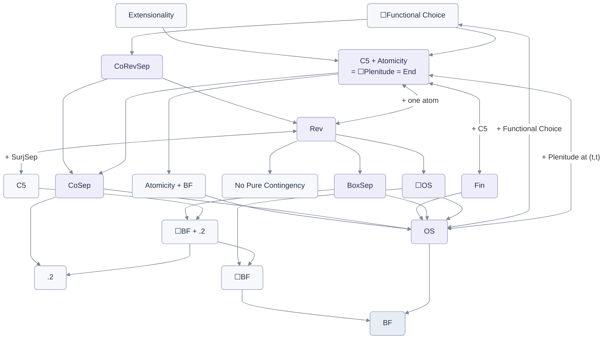
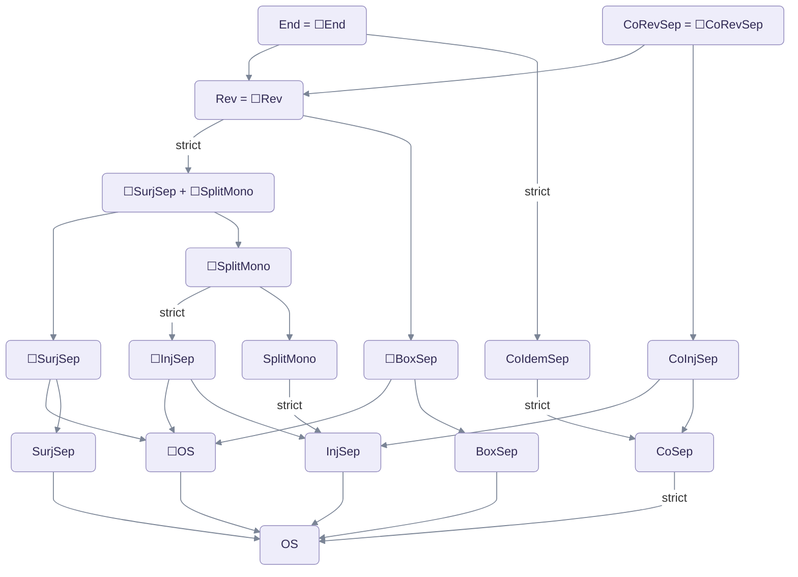
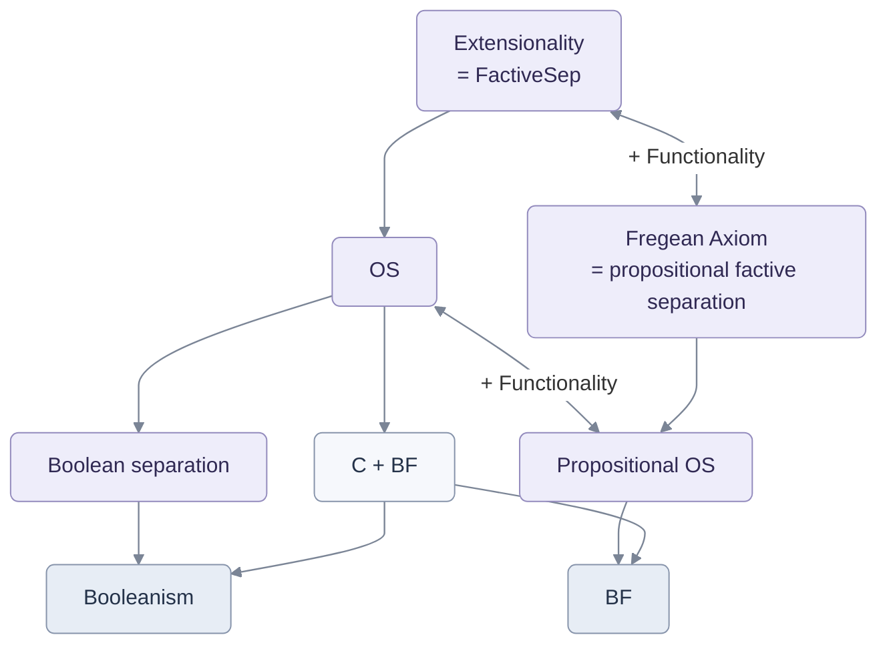
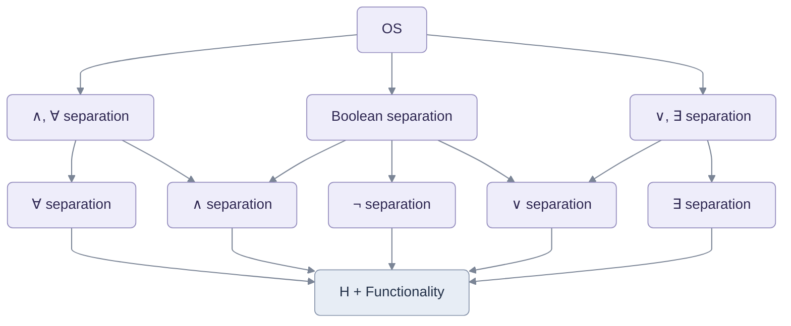

# Logical observers: principles, maps and consequences

Logical observers preserve logical structure while offering different perspectives on propositions. An observer can distinguish two propositions that are both true here by returning a truth for one and a falsehood for the other. A separating family makes every difference between relations detectable.

**Boolean separation recovers Booleanism; logical separation recovers Classicism together with BF.** Over H, Boolean observers suffice to identify abstractions of Boolean-equivalent formulas. The richer qualification in [OS](#map-over-h) extends this to all H-provable equivalences and also entails BF: H + OS ⇒ C + BF (**Lean certified**). Both recovery claims use separation at every relational type. We begin over C, where the observer conditions have their simplest form, then give the additional clauses needed over H.

[Main results](MAIN-RESULTS.md) · [Candidates](CANDIDATES_DK.md) · [Structured definitions](OBSERVER-PRINCIPLES.json) · [Full connection catalogue](proofs/h-observer-space/SUMMARY.md)

[Logical observers](#logical-observers-over-c) · [Separation](#observer-separation) · [Principles](#observer-principles-at-a-glance) · [Simplifications](#simplifications-over-c-and-c5) · [C: familiar principles](#familiar-principles-over-c) · [C: observers](#observer-relations-over-c) · [C5](#c5-simplifications) · [Commuting families](#commuting-observer-families) · [Max(C)](#map-over-max-c) · [H: familiar principles](#familiar-principles-over-h) · [H: observers](#observer-relations-over-h) · [Mathematics](#mathematics-through-observers) · [Shift models](#shift-models) · [Lean evidence](#lean-evidence)

<a id="logical-observers-over-c"></a>
## Logical observers over C

An observer $`E^{tt}`$ sends propositions to propositions. The truth of $`Ep`$ is its assessment of p. Two propositions can agree in truth and still be distinct; observers separate them when some observer gives them different truth values.

A **logical observer** preserves conjunction, negation and universal quantification at the types being tested:

```math
M(E):=(\lambda p,q^t\, .\,E(p\land q))=(\lambda p,q^t\, .\,Ep\land Eq),
```

```math
N(E):=(\lambda p^t\, .\,E(\neg p))=(\lambda p^t\, .\,\neg Ep),
```

```math
Q_\sigma(E):=(\lambda F^{\sigma t}\, .\,E(\forall x^\sigma\, .\,Fx)) =(\lambda F^{\sigma t}\, .\,\forall x^\sigma\, .\,E(Fx))
```

For a finite list of types Δ, put

```math
\mathrm{Good}_\Delta(E):=M(E)\land N(E)\land\bigwedge_{\sigma\in\Delta}Q_\sigma(E)
```

Over C, these identities also give preservation of ⊤, ⊥ and the other Boolean operations, existential quantification at the same types, and the observed equality laws. Write $`\mathrm{Bool}_C(E):=M(E)\land N(E)`$. The [H formulation](#uniform-definitions-over-h) adds the clauses that do not yet follow without C. Types and finite lists index the schema; there is no quantification over types.

<a id="observer-separation"></a>
## The common separation principle

Using $`\mathrm{Good}_\Delta(E)`$ as defined above, the individual observer restrictions below have the following object-language form:

```math
\forall X,Y^{\bar\sigma t}\, .\,\Bigl[\forall E^{tt}\, .\, \bigl(\mathrm{Good}_\Delta(E)\land K(E)\bigr) \to\forall\bar x^{\bar\sigma}\, .\, \bigl(E(X[\bar x])\leftrightarrow E(Y[\bar x])\bigr)\Bigr] \to X=Y
```

Every pair of distinct relations is distinguished at some arguments by an eligible observer. K specifies the additional observer condition; OS takes it to be ⊤. We will use the predicate mathrm{Sep} below to express that this schema is valid for a given specification of K.

<a id="observer-principles-at-a-glance"></a>
## The observer principles

<a id="principal-observer-principles"></a>

In the formulas, p and q are propositions, E and F are operations on propositions, $`I:=\lambda p^t\, .\,p`$, and $`E\circ F:=\lambda p^t\, .\,E(Fp)`$.

The maps use **Fin** as the short label for FinSep.

| Principle and meaning | Additional condition $`K(E)`$ |
| --- | --- |
| <a id="logical-observer-separation-r"></a>**OS.** Every difference between relations is detected by some logical observer. | $`\top`$ |
| <a id="endpoint-logical-observer-separation-r"></a>**End.** The separating observers always return Top or Bottom: each makes an entirely definite assessment. | $`\forall p^t\, .\,Ep=\top\lor Ep=\bot`$ |
| <a id="reversible-logical-observer-separation-r"></a>**Rev.** Each separating observer undoes itself when applied twice. | $`E\circ E=I`$ |
| <a id="native-necessity-logical-observer-separation-r"></a>**BoxSep.** The separating observers preserve necessity as well as the logical operations. | $`(\lambda p^t\, .\,E(\Box p))=(\lambda p^t\, .\,\Box(Ep))`$ |
| <a id="finite-image-logical-observer-separation-r"></a>**FinSep.** Each separating observer has finitely many possible outputs. | $`\mathrm{FinIm}(E)`$ |
| <a id="factive-logical-observer-separation-r"></a>**FactiveSep.** Every proposition accepted by a separating observer is true. | $`\forall p^t\, .\,Ep\to p`$ |
| <a id="surjective-logical-observer-separation-r"></a>**SurjSep.** Every proposition occurs as an output of each separating observer. | $`\forall q^t\, .\,\exists p^t\, .\,Ep=q`$ |

<a id="necessary-separation"></a>
## Necessary separation

For any observer principle P, **☐P** requires each separately closed instance of P to hold necessarily. For example, **☐OS** is the schema

```math
\Box\mathrm{Sep}_{\bar\sigma}(\lambda E^{tt}\, .\,\mathrm{Good}_\Delta(E))
```

It differs from BoxSep, which requires each separating observer to preserve necessity.

<a id="simplifications-over-c-and-c5"></a>
## Simpler formulations over C

For OS over C, it is enough to separate propositions. For each type ρ of propositions or relations, put

```math
K_\rho(E):=\mathrm{Bool}_C(E)\land Q_e(E)\land Q_\rho(E)
```

Then OS is equivalent over C to the schema

```math
\mathrm{Sep}_t(\lambda E^{tt}\, .\,K_\rho(E))\qquad(\rho\ne e)
```

These instances supply BF and therefore Functionality, which lifts proposition separation to relations. The same observer can handle any requested finite list by testing a common relational type.

**Endpoint separation:** the one propositional instance using $`\mathrm{Bool}_C(E)\land Q_t(E)\land\mathrm{End}(E)`$ is equivalent to C5 + Atomicity. Under Extensionality, truth is endpoint-valued and the identity observer suffices.

[OS reduction](../next-update/proofs/observer-single-type-schema.md) · [Endpoint reduction](proofs/logical-observer-hierarchy.md#3-endpoint-separation-is-c5-plus-atomicity).

<a id="reversible-propositional-formulation"></a>
## Reversible separation: a simpler sentence

Rev has an especially short formulation over C: conjunction-preserving observers that undo themselves distinguish any two distinct propositions. Put

```math
J(E):=M(E)\land E\circ E=I
```

Then Rev is exactly

```math
\forall p,q^t\, .\,\Bigl[\forall E^{tt}\, .\,J(E)\to(Ep\leftrightarrow Eq)\Bigr]\to p=q
```

The two laws in J already force preservation of negation and every typed quantifier. Proposition separation then supplies BF and Functionality, so separation of relations follows. [Proof](proofs/reversible-propositional-separation.md).

### Pointwise formulation

The whole-operation identities can also be replaced by pointwise identities, provided separation is required necessarily. Put

```math
J_{\mathrm{pt}}(E):=(\forall u,v^t\, .\,E(u\land v)=Eu\land Ev)\land(\forall u^t\, .\,E(Eu)=u)
```

**Pointwise separation**, Sₚₜ, says that observers satisfying these two conditions distinguish every pair of distinct propositions:

```math
S_{\mathrm{pt}}:=\forall p,q^t\, .\,\Bigl[\forall E^{tt}\, .\,J_{\mathrm{pt}}(E)\to(Ep\leftrightarrow Eq)\Bigr]\to p=q
```

Over C,

```math
\mathrm{Rev}\ \longleftrightarrow\ \Box S_{\mathrm{pt}}\ \longleftrightarrow\ (S_{\mathrm{pt}}\land\mathrm{BF}_t)
```

The necessity allows a different observer at each accessible evaluation. Unboxed Sₚₜ alone is weaker. [Exact scopes and proof](../integration-register/proofs/pointwise-reversible-separation.md).

<a id="commuting-observer-families"></a>
## Commuting families of observers

A commuting family lets us apply any two of its observers in either order with the same result. **CoSep** asks for one such admitted family that distinguishes every pair of distinct relations. **CoIdemSep** also requires that observing twice changes nothing.

For a family $`K^{(tt)t}`$, write

```math
\mathrm{Sep}_{\bar\sigma}(K):=\forall X,Y^{\bar\sigma t}\, .\,\Bigl[\forall E^{tt}\, .\,KE\to\forall\bar x^{\bar\sigma}\, .\,\bigl(E(X[\bar x])\leftrightarrow E(Y[\bar x])\bigr)\Bigr]\to X=Y
```

Then CoSep is the schema

```math
\mathrm{CoSep}_{\bar\sigma,\Delta}:=\exists K^{(tt)t}\, .\,\bigl(\forall E^{tt}\, .\,KE\to\mathrm{Good}_\Delta(E)\bigr)\land\bigl(\forall E,F^{tt}\, .\,(KE\land KF)\to E\circ F=F\circ E\bigr)\land\mathrm{Sep}_{\bar\sigma}(K)
```

CoIdemSep adds $`\forall E^{tt}\, .\,KE\to E\circ E=E`$ inside the same existential. These are conditions on a family, rather than on each observer separately.

Two further restrictions apply to the same family. **CoInjSep** requires its members to be injective; **CoRevSep** requires admitted logical inverses. The respective added clauses are

```math
\forall E^{tt}\, .\,KE\to\forall p,q^t\, .\,(Ep=Eq\to p=q),
```

```math
\forall E^{tt}\, .\,KE\to\exists F^{tt}\, .\, \bigl(\mathrm{Good}_\Delta(F)\land E\circ F=I\land F\circ E=I\bigr)
```

**Over C5, one sentence suffices:** take $`\bar\sigma`$ empty, so only propositions are separated, and replace $`\mathrm{Good}_\Delta(E)`$ by $`N(E)\land Q_t(E)`$. The same family then qualifies and separates at every relational type. [Definitions and reduction](../integration-register/proofs/coherent-observers/object-language-and-finite-basis.txt), §§1–4.

<a id="map-over-c"></a>
## The map over C

All arrows are over C and use full relational separation. A two-headed arrow labelled “+ X” means **upper principle ⇔ lower principle + X**. Ordinary implication arrows point downward.

<a id="familiar-principles-over-c"></a>
### Familiar principles over C



The [fuller familiar-principles map](proofs/h-observer-space/GRAPH.md#9-the-larger-region-above-c--bf) also includes the idempotent branch; inverse distinctions remain in the observer map below.

Here .2 is

```math
\forall p^t\, .\, (\Diamond\Box p\to\Box\Diamond p)
```

Necessity-preserving separation makes what could be necessary necessarily possible. Reversible separation gives both C5 and No Pure Contingency, even in atomless models. Endpoint separation entails reversible separation by constructing different observers; an endpoint-valued observer itself need not be invertible. C5 also turns surjective separation into reversible separation, as the two-headed arrow records.

### Further exact strengthenings

| Starting principle | Add | Equivalent to |
| --- | --- | --- |
| OS | Correct Evaluation | [End](proofs/logical-observers.md#actual-truth-evaluation-and-endpoint-separation) |
| OS | C5 + Actuality | [End](proofs/h-observer-space/plenitude-endpoint-bridge.md) |
| ☐OS | C5 + one atom, or C5 + ◇Actuality | [End](proofs/h-observer-space/necessary-separation-and-atoms.md) |
| OS | A unique qualified logical observer | [Extensionality](proofs/h-observer-space/observer-restrictions.md#4-one-observer-a-separating-subfamily-versus-a-unique-qualified-class) |
| Rev | A unique endpoint observer qualified at t | [Extensionality](proofs/logical-observer-hierarchy.md#6-one-observer-suffices-alongside-reversibility) |

Here one atom is $`\exists a^t\, .\,\mathrm{Atom}_t(a)`$. Correct Evaluation requires a Top-or-Bottom-valued operation agreeing with current truth. Logical-observer uniqueness is at any one fixed finite qualification list.

<a id="injectivity-and-left-inverses"></a>
## Injectivity and left inverses

All inverse witnesses are admitted and logically qualified at the same finite list. Injectivity preserves differences between proposition objects; separation asks the family to reveal a difference in truth. Surjectivity says every proposition occurs as an output; it does not itself specify an inverse operation.

<a id="logical-left-inverse-separation-r"></a>
### SplitMono

Another logical observer recovers every input from the separating observer’s output.

```math
\mathrm{Left}_\Delta(E):=\exists F^{tt}\, .\,\mathrm{Good}_\Delta(F)\land F\circ E=I
```

<a id="injective-logical-observer-separation-r"></a>
### InjSep

Each separating observer sends distinct input propositions to distinct output propositions.

```math
\mathrm{Inj}(E):=\forall p,q^t\, .\,Ep=Eq\to p=q
```

<a id="observer-relations-over-c"></a>
## Relations between observer principles over C



End, Rev and CoRevSep entail their necessary forms. Necessity strictly strengthens OS, SurjSep, SplitMono, InjSep and BoxSep. Even ☐SurjSep and ☐SplitMono together remain weaker than Rev. Their separating families may be different.

SurjSep and SplitMono are incomparable, as are BoxSep and ☐OS. SplitMono strictly implies InjSep. The converse fails even over C5 with ☐Relational Choice, ☐Transversal Choice and ☐Zorn at all types: the [countermodel](proofs/h-observer-space/rigid-souslin-injective-separation.md) has ☐InjSep but necessarily fails propositional SplitMono.

[Reversible persistence](proofs/logical-observer-hierarchy.md#reversible-separation-entails-its-boxed-form) · [Necessary inverse principles](proofs/h-observer-space/full-cancellative-monoid-observers.md) · [Surjective persistence](proofs/h-observer-space/root-truth-profile-surjective-separation.md) · [Injective and left-inverse persistence](proofs/h-observer-space/fixed-point-symmetry-left-inverse-separation.md) · [BoxSep and ☐OS](proofs/h-observer-space/native-box-logical-observers.md#7-exact-comparisons-established-here).

<a id="c5-simplifications"></a>
### Over C5

Over C5, the same observer preserving the Boolean operations and the quantifier at t preserves every typed quantifier. Functionality is already available. OS, InjSep, SplitMono and Rev therefore reduce to their single propositional instance with qualification $`\mathrm{Bool}_C(E)\land Q_t(E)`$ and the stated restriction. In this setting:

```math
\mathrm{SurjSep}\ \longleftrightarrow\ \mathrm{Rev},\qquad\mathrm{BoxSep}\ \longleftrightarrow\ \mathrm{InjSep}
```

[C5 quantifier reduction](proofs/modal-selectors-and-quantifier-reduction.md#4-over-c5-q_t-supplies-every-quantifier) · [Surjectivity](proofs/h-observer-space/surjective-logical-observers.md) · [Necessity preservation and injectivity](proofs/h-observer-space/native-box-logical-observers.md#3-over-c5-native-box-preservation-is-injectivity) · [Finite-image separation](proofs/logical-observer-hierarchy.md#5-observers-with-finitely-many-outputs).

<a id="commuting-family-connections"></a>
## Commuting families and Atomicity

Over C, CoSep entails **OS + .2**: propositions cannot be possibly necessary and possibly necessarily false. [Proof](../integration-register/proofs/coherent-observers/coherent-families.txt), §2.

Over C5, **Atomicity is exactly separation by a stable commuting family of idempotent observers**. Stable membership means

```math
\mathrm{Stable}(K):=\forall E^{tt}\, .\,(KE=\top\lor KE=\bot)
```

It fixes which observers belong to the family; their outputs need not be endpoints. Thus

```math
\mathrm{Atomicity}\quad\longleftrightarrow\quad\exists K^{(tt)t}\, .\,\mathrm{Stable}(K)\land\mathrm{Sep}_t(K) \land\bigl(\forall E\, .\,KE\to N(E)\land Q_t(E)\land E\circ E=E\bigr) \land\bigl(\forall E,F\, .\,(KE\land KF)\to E\circ F=F\circ E\bigr)
```

No Functional Choice is needed. Dropping stability gives the strictly weaker CoIdemSep; dropping idempotence gives CoSep, itself strictly stronger than OS. [Characterization](../integration-register/proofs/coherent-observers/stable-families-and-propagation.txt), §3; [strictness](../integration-register/proofs/coherent-observers/finite-alphabet-coherence-countermodels.txt).

### Choice organizes observation

☐Functional Choice supplies one stable commuting family of reversible observers that distinguishes all relations throughout possibility:

```math
\Box\mathrm{Functional\ Choice}\quad\Longrightarrow\quad\mathrm{CoRevSep}
```

The same family works necessarily, at every relational type and every finite list of quantifier qualifications. Already C5 + Atomicity suffices when the world atoms admit a well-order. [Construction](../integration-register/proofs/coherent-observers/choice-implies-coherent-reversible-separation.txt), §§1–7.

### Actuality supplies inverses

With Actuality, every member of a commuting injective separating family already has an inverse in that same family. Over C,

```math
\mathrm{Actuality}+\mathrm{CoInjSep}
\quad\longleftrightarrow\quad
\mathrm{C5}+\mathrm{Atomicity}+\mathrm{CoRevSep}
```

This package also gives ☐Plenitude and the necessary forms of Actuality, CoInjSep and CoRevSep. [Proof](../integration-register/proofs/coherent-observers/joint-injective-separation.txt), §§2–3. Separate CoSep and InjSep need not have a common witness family; the [catalogue](CATALOG.md#coherent.joint-separation) records the boundary.

### When the same family continues to separate

Over C5, let K be stable, logically qualified, commuting and currently separating. Then

```math
\Box\mathrm{Sep}_t(K)\quad\longleftrightarrow\quad
\forall E^{tt}\, .\,KE\to\mathrm{Inj}(E)
```

If its observers are also idempotent, the existence of such a necessarily separating family is equivalent to **Extensionality**. This concerns the same K throughout possibility. Merely requiring a family to exist currently does not give necessary CoSep. [Exact criterion](../integration-register/proofs/coherent-observers/stable-families-and-propagation.txt), §§2–4; [boundary](../integration-register/proofs/coherent-observers/isolated-point-nonpropagation.txt).

<a id="map-over-max-c"></a>
## Maximalism and logical observers

Here Max(C) includes C and pure Maximalism, with C fixed as its reference theory. Adding OS leaves the closed pure identity theorems unchanged:

```math
\mathrm{Max}(C+OS)=\mathrm{Max}(C)+OS
```

| Addition to Max(C) | Status | Consequence or witness |
| --- | --- | --- |
| OS | Consistent | Gives BF. [Interpretation-root model](../integration-register/proofs/complete-henkin-interpretation-cover.md#83-the-exact-maximalism-corollaries). |
| OS + Zorn | Consistent with Actuality and with ¬Actuality | The [two models](../integration-register/proofs/complete-henkin-interpretation-cover.md#83-the-exact-maximalism-corollaries) also satisfy Relational Choice. Zorn and choice have their all-type scope. |
| CoSep | Inconsistent | Its .2 consequence conflicts with Max(C). [Proof](../integration-register/proofs/coherent-observers/stable-families-and-propagation.txt), §5. |
| SurjSep; SplitMono; InjSep | Open | — |
| OS + Boolean Completeness at t | Open | [The remaining compatibility question](proofs/maximalism-and-logical-observers.md#4-compatible-choice-and-actuality-variants). |

[Maximalization equality and proofs](proofs/maximalism-and-logical-observers.md).

More generally, adding **OS + Strong Actuality + Zorn** preserves every positive-equational consequence of any negative-equational background theory, in any fixed signature. Here “positive-equational” means built from identities using ∧, ∨, ∀ and ∃; the negative class starts from disequalities. Terms inside these atoms are unrestricted. [Conservation theorem](../integration-register/proofs/observer-positive-conservativity.txt).

<a id="map-over-h"></a>
## The map over H

Over H, preservation of each primitive operation has its own consequences. Boolean separation gives Booleanism; universal preservation already gives BF. The full logical qualification also covers H’s equality reasoning, allowing OS to recover C + BF.

<a id="uniform-definitions-over-h"></a>
### The additional clauses over H

Keep M, N and Q as above, and put

```math
V(E):=(\lambda p,q^t\, .\,E(p\lor q))=(\lambda p,q^t\, .\,Ep\lor Eq),
```

```math
P_\sigma(E):=(\lambda F^{\sigma t}\, .\,E(\exists x^\sigma\, .\,Fx)) =(\lambda F^{\sigma t}\, .\,\exists x^\sigma\, .\,E(Fx))
```

Boolean qualification over H is

```math
\mathrm{Bool}_H(E):=M(E)\land V(E)\land N(E)\land E\top=\top\land E\bot=\bot
```

Boolean separation is the schema $`\mathrm{Sep}_{\bar\sigma}(\mathrm{Bool}_H)`$. It gives **Booleanism**: abstractions of Boolean-equivalent formulas are identical. The observers agree on each such equivalence, and separation identifies the abstractions.

The observed equality laws are

```math
\mathrm{Eq}_\sigma(E):=(\forall x^\sigma\, .\,E(x=x)) \land\forall x,y^\sigma\, .\,\forall F^{\sigma t}\, .\, \bigl(E(x=y)\to(E(Fx)\to E(Fy))\bigr)
```

Observed equality expresses reflexivity and substitution; it does not require E to fix each identity proposition. Thus use

```math
\mathrm{Good}^{H}_\Delta(E):=\mathrm{Bool}_H(E)\land
\bigwedge_{\sigma\in\Delta}\bigl(Q_\sigma(E)\land P_\sigma(E)\land\mathrm{Eq}_\sigma(E)\bigr)
```

Use this qualification throughout the observer conditions and the full relational separation schema. Over C the extra clauses follow, so both qualifications agree. The short propositional formulation of Rev above is stated over C.

Separating relations recovers C; separating propositions alone need not. Functionality bridges the two scopes.

<a id="familiar-principles-over-h"></a>
### Recovering familiar principles



**H + OS ⇒ C + BF is Lean certified** for this formulation with explicit endpoint identities. Propositional OS already gives BF. Factive separation gives Extensionality, while its propositional instance gives the Fregean Axiom.

For any fixed condition K, the general scope theorem over H is

```math
\mathrm{FullSep}[K]\quad\longleftrightarrow\quad\mathrm{Sep}_t[K]+\mathrm{Functionality}
```

This also holds for a nonempty family of conditions, with the same family on both sides. The [proof](proofs/h-observer-space/typed-separation-and-classicism.md#2-the-exact-role-of-full-typed-separation) does not assume that K preserves any logical operation. Once full OS recovers C, the relations between the stronger full principles are those in the [C observer map](#observer-relations-over-c); a second copy is unnecessary.

[Proof of the scope equivalence](proofs/h-observer-space/typed-separation-and-classicism.md#2-the-exact-role-of-full-typed-separation) · [H-to-C and BF proof](proofs/logical-observers.md#3-os-entails-c-and-bf-over-h) · [Factivity](proofs/h-observer-space/observer-restrictions.md#3-negation-converts-either-one-sided-condition-into-correctness).

<a id="observer-relations-over-h"></a>
### Preserving fewer operations

Each node below uses the same relational-separation schema $`\mathrm{Sep}_{\bar\sigma}(K)`$. Its qualification K requires $`E\top=\top`$, $`E\bot=\bot`$, and preservation of just the displayed operations. Thus ∧ separation uses $`K(E):=E\top=\top\land E\bot=\bot\land M(E)`$; ∀ separation replaces M by $`\bigwedge_{\sigma\in\Delta}Q_\sigma`$. Quantifier labels include every finite type list Δ.

A combined label requires the **same observers** to preserve the listed operations. Separate families need not combine into one.



| Preservation required | Consequence over H |
| --- | --- |
| ∧ | Conjunction is commutative, associative and idempotent, with Top as its unit. |
| ∨ | The corresponding join laws, with Bottom as its unit. |
| ¬ | Double negation is identity: $`\forall p^t\, .\,\neg\neg p=p`$. |
| ∀ | BF; universal quantifiers give greatest lower bounds in the order defined below. |
| ∃ | Existential quantifiers give least upper bounds in that order. |

The order associated with each qualified separating family is

```math
p\preceq_K q:=\forall E^{tt}\, .\,K(E)\to(Ep\to Eq)
```

When the same observers preserve ∧ and ∀, these greatest lower bounds agree with the conjunction order. The ∨, ∃ branch is dual. Over H, preserving two Boolean primitives does not automatically preserve the third; all three are used for Booleanism.

[Connective laws](proofs/h-observer-space/truth-profiles-and-connective-reducts.md#3-exact-equational-theory-of-the-listed-connective-signature) · [Quantifiers and BF](proofs/meet-quantifier-separation.md#3-quantification-and-the-interaction-result) · [Complete primitive comparison](proofs/h-observer-space/primitive-package-classification.md).

<a id="mathematics-through-observers"></a>
## Mathematics through endpoint observers

An endpoint observer gives a definite version of each relation. These versions obey Extensionality, and they let us express mathematical claims using the original language.

### Definite relations obey Extensionality

Put

```math
X_E:=\lambda\bar x\, .\,E(X[\bar x])
```

Over C, if E is an endpoint logical observer qualified at the argument types, then

```math
\forall X,Y^{\bar\sigma t}\, .\,
\bigl(\forall\bar x\, .\,X_E[\bar x]\leftrightarrow Y_E[\bar x]\bigr)
\to X_E=Y_E
```

Thus the observed relations are identical whenever they apply to the same arguments. Qualification at t also gives the operation identity $`E\circ E=E`$: observing a second time changes nothing. These conclusions need the stated observer, without assuming separation or C5.

### Ordinary mathematics with definite relations

Work over C5 for the remainder of this section, and abbreviate $`L(E):=\mathrm{Bool}_C(E)\land Q_t(E)\land\mathrm{End}(E)`$. This qualifies E at every type. A relation on individuals is **definite** when every application is Top or Bottom:

```math
D_n(R):=\forall x_1^e\cdots x_n^e\, .\,
R[\bar x]=\top\lor R[\bar x]=\bot
```

Let A be an ordinary relational second-order formula: it may quantify over individuals and their relations, use individual equality, and apply relations to individuals. Define $`A^\circ`$ by restricting each relation quantifier to definite relations; individual quantifiers stay unchanged. For example,

```math
(\forall R^{e\cdots et}\, .\,B)^\circ
:=\forall R^{e\cdots et}\, .\,D_n(R)\to B^\circ
```

Existential quantifiers use $`D_n(R)\land B^\circ`$. For any endpoint logical observer, the exact evaluation identity is

```math
L(E)\ \to\ E\bigl(A(\bar R,\bar a)\bigr)
=A^\circ(\bar R_E,\bar a)
```

Every observer uses the same individuals and the same definite relations. What varies is how it interprets the original relation parameters. For example, different observers can turn a given relation into different definite relations on those same individuals.

If endpoint separation holds, necessity and possibility have the following object-language tests:

```math
\Box A(\bar R,\bar a) \leftrightarrow\forall E^{tt}\, .\,L(E)\to A^\circ(\bar R_E,\bar a),
```

```math
\Diamond A(\bar R,\bar a) \leftrightarrow\exists E^{tt}\, .\,L(E)\land A^\circ(\bar R_E,\bar a)
```

So necessity means that every such interpretation makes A true, and possibility means that some such interpretation does. Several parameters must be interpreted by the **same** observer; their interpretations cannot be freely recombined.

### Choice, completeness and infinity at higher types

For relations taking relations as arguments, observe the arguments as well as the final output. The recursive terms are

```math
r_t^E(p):=Ep,\qquad
r_{\sigma\tau}^E(f):=\lambda x^\sigma\, .\,
r_\tau^E\bigl(f(r_\sigma^E(x))\bigr)
```

At individual arguments use x unchanged; no operation of type ee is introduced. Write $`A^{[E]}`$ for the formula interpreted using the objects fixed by these terms: restrict relational quantifiers by $`r_\sigma^E(x)=x`$, and use the correspondingly observed logical operations and abstractions. This is a finite translation into the original language; its [full definition](../next-update/proofs/observer-classical-cores.md#2-the-core-is-a-c5-model) specifies each clause.

For any endpoint logical observer, the following connections hold, instance by instance:

```math
\mathrm{Functional\ Choice}\to(\mathrm{Functional\ Choice})^{[E]},
```

```math
\mathrm{Boolean\ Completeness}\to(\mathrm{Boolean\ Completeness})^{[E]},
```

```math
E(\mathrm{Relational\ Choice})\to(\mathrm{Relational\ Choice})^{[E]},
```

```math
E(\mathrm{Transversal\ Choice})\to(\mathrm{Transversal\ Choice})^{[E]},
```

```math
(\mathrm{Infinity}_e)^{[E]}=E(\mathrm{Infinity}_e)
```

Consequently, ☐Relational Choice, ☐Transversal Choice and quantified ☐Infinity at e imply their translated versions. Functional Choice and Boolean Completeness require only their unboxed instances. For every pure sentence A, any two endpoint logical observers agree on the translated claim:

```math
L(E)\land L(F)\ \to\ (A^{[E]}\leftrightarrow A^{[F]})
```

These results give one shared interpretation of pure mathematics. They do not assert that A itself always agrees with $`A^{[E]}`$, or that every set of objects has an admitted predicate. Endpoint separation with ☐Infinitary Comprehension reconstructs full standard models; this representation theorem is **Lean certified** and uses the stated extension of the language. [Statement and certificate](../next-update/items/20-endpoint-ic-certificates.md).

[Extensionality and idempotence over C](../next-update/proofs/endpoint-classical-cores.md#3-extensionality-inside-the-fixed-hierarchy) · [Second-order evaluation](../next-update/proofs/observer-core-recovery.md#5-one-classical-second-order-structure) · [Choice and completeness](../next-update/proofs/observer-classical-cores.md#4-choice-and-completeness-descend) · [Infinity and observed choice](../next-update/proofs/observer-core-mathematics.md).

<a id="general-observer-interpretations"></a>
## General interpretations over C

The [general interpretation theorem](../integration-register/OBSERVER-INTERPRETATIONS.md) applies to idempotent logical observers without endpoint values or C5. Functional Choice descends in both its current and necessary forms, and necessary Boolean Completeness descends instancewise. Every general C model has a proper observer realization; full current or necessary completeness is preserved. Every model of **C + ☐Functional Choice** also has a proper realization within that same theory.

Current Relational Choice and Transversal Choice can fail to descend even over C5 + OS; Actuality repairs endpoint descent under full Relational Choice. General interpretations can also lose current BF or Boolean Completeness.

Over BF, observers with the same proposition image give isomorphic pure interpretations, so this holds under OS. Without BF, the same image can yield different pure theories even with all-type ☐Atomicity and ☐Boolean Completeness.

Commuting idempotent observers also **compose their interpretations**: interpreting through E and then through the observer induced by F gives the same structure as interpreting through E∘F. Finite iterations are independent of order and grouping, already over C. [Composition theorem](../integration-register/OBSERVER-INTERPRETATIONS.md#commuting-interpretations).

<a id="further-restrictions"></a>
## Further observer conditions

<a id="details-finite-image-logical-observer-separation-r"></a>
### FinSep

```math
\mathrm{Im}_E:=\lambda q^t\, .\,\exists p^t\, .\,Ep=q,\qquad\mathrm{FinIm}(E):=\exists Z^{(tt)t}\, .\,\mathrm{FiniteCardinality}_t(Z)\land Z(\mathrm{Im}_E)
```

<a id="idempotent-native-necessity-logical-observer-separation-r"></a>
### IdemBoxSep

The observers preserve necessity and stabilize after one application.

```math
\mathrm{BoxComm}(E)\land E\circ E=E
```

<a id="bounded-stabilization-native-necessity-logical-observer-separation-r"></a>
### B_r

The observers preserve necessity and stabilize after a fixed number r of applications.

```math
\mathrm{BoxComm}(E)\land E^{r+1}=E^r\qquad(r\ge1)
```

<a id="central-logical-observer-separation-r"></a>
### CentreSep

Each separating observer commutes with every observer qualified at the same finite list.

```math
\mathrm{Cent}_\Delta(E):=\forall F^{tt}\, .\,\mathrm{Good}_\Delta(F)\to E\circ F=F\circ E
```

<a id="restriction-formulas"></a>
## Pointwise separation and atoms

Requiring, for each nonzero proposition, an observer that necessarily remains pointwise-qualified and accepts it is equivalent over C to Extensionality:

```math
\mathrm{Extensionality}\ \longleftrightarrow\ \forall p^t\, .\,p\ne\bot\to\exists E^{tt}\, .\,\Box\bigl(J_{\mathrm{pt}}(E)\land Ep\bigr)
```

[Proof](../integration-register/proofs/pointwise-reversible-separation.md#1-definitions-and-main-conclusions).

With OneAtom meaning that some proposition is a Boolean atom, the exact atomic cases over C are

```math
S_{\mathrm{pt}}+\mathrm{OneAtom}\ \longleftrightarrow\ ND_t+\mathrm{Atomicity}_t,
\qquad
\mathrm{Rev}+\mathrm{OneAtom}\ \longleftrightarrow\ \Box\mathrm{Plenitude}
```

Under pointwise separation, one atom suffices for Atomicityₜ and Actuality. The reverse implication uses Atomicityₜ + Vicinity ⇒ Actuality, with Vicinity supplied by NDₜ. [Atomic proof](../integration-register/proofs/pointwise-atomicity.md).

<a id="further-formulas"></a>
## Finiteness, iteration and uniqueness

FiniteCardinality is the database's [Frege-finiteness predicate](source/topics/classicism/background.md). Finite-image separation imposes no common numerical bound.

For the stabilization principles, r is a fixed external integer with r ≥ 1. Powers abbreviate finite composition: $`E^0=I`$ and $`E^{r+1}=E\circ E^r`$.

Uniqueness says that identity is the only qualified observer at a specified finite list:

```math
\mathrm{Unique}_\Delta:=\forall E^{tt}\, .\,\mathrm{Good}_\Delta(E)\to E=I
```

<a id="further-connections"></a>
## Further connections

The stabilization principles form a strict hierarchy:

```math
\mathrm{IdemBoxSep}=B_1\ \Longrightarrow\ B_2\ \Longrightarrow\ \cdots\ \Longrightarrow\ \mathrm{BoxSep}
```

Each fixed stabilization principle, and also CentreSep, gives Extensionality together with C5. Finite-family, group-law and degree restrictions have further exact characterizations in the [full connection catalogue](proofs/h-observer-space/SUMMARY.md) and [technical map](proofs/h-observer-space/GRAPH.md).

Rev implies noncontingency with endpoint-valued first-order relation parameters, but the converse fails even with C5 + ☐SplitMono. Over C5 an exact converse uses endpoint-valued families of propositions invariant under admitted surjective order automorphisms. [Countermodel](../next-update/proofs/fixed-individual-component-shift.md) · [Exact characterization](../integration-register/proofs/observer-parameters/order-invariant-parameters.md).

No finite or uniformly bounded-type-order axiomatization is equivalent to OS over C. [Proof](../next-update/proofs/observer-single-type-schema.md).

<a id="shift-models"></a>
## Shift models

The observer principles also have a common model-theoretic presentation: observation acts by shifts.

| Theory | Shift structure |
| --- | --- |
| C + OS | [Monoid](../next-update/proofs/observer-shift-semantics.md) |
| C + Rev | [Group](../next-update/proofs/reversible-group-semantics.md) |
| C5 + CoSep | [Commutative monoid](../integration-register/proofs/coherent-observers/commutative-shift-semantics.txt) |
| C5 + CoIdemSep | [Semilattice](../integration-register/proofs/coherent-observers/commutative-shift-semantics.txt) |

Each class gives a sound and strongly complete semantics with admitted shifts and, for the commuting principles, an admitted selecting family. These are general/Henkin models; full standard domains are not required.

<a id="lean-evidence"></a>
## Lean-certified results and components

| Result | Certified scope |
| --- | --- |
| **Recovery of C and BF from H + OS** | Full relational separation with the explicit endpoint identities. The proof translates the repository C calculus into H + OS and also derives BF and Functionality. [Certificate](evidence/certificates/full-typed-logical-separation-actual-c/certificate.json). |
| **Atoms give logical observers** | C5 + Atomicityₜ gives current and necessary propositional separation, using one observer for each specified finite list of closed quantifier types. Over C5 + Actuality, either schema gives Atomicityₜ, and the two schemas are equivalent. This certificate covers propositional separation. [Certificate](evidence/certificates/full-observers-simultaneous-finite-schema/certificate.json). |
| **Diagonal separation and stable atoms** | The specified diagonal-character separation is equivalent over C to NDₜ + Atomicityₜ; the observer-to-atom reconstruction is also certified. [Statement](evidence/RESULT-INDEX.md#diagonal-characters) · [Certificate](evidence/certificates/diagonal-characters/certificate.json). |
| **Endpoint separation + Infinitary Comprehension** | Full standard representation and its converse from the specified λ-free H framework, preserving the original typed carriers, application and formula values. C and the needed classical structure are recovered. The certificate uses Lean’s classical metatheory. [Statement and certificate](../next-update/items/20-endpoint-ic-certificates.md). |
| **Choice, Plenitude and inverse maps** | Functional Choice and Plenitude decompose into Actuality plus the respective section/retraction schemas; the necessary Functional Choice characterization is also certified. For C5 and strong retractions, the forward rules, low-type converses to ☐NDₜ and per-map necessary-injectivity equivalence are certified. [Choice and Plenitude](evidence/RESULT-INDEX.md#sections-retractions) · [C5 and retractions](evidence/RESULT-INDEX.md#c5-strong-retractions). |
| **Actuality-based evaluation** | Canonical current evaluators, graph normalization and the current-truth interpretation have certified components. These concern the earlier Actuality construction, rather than the whole observer-interpretation development above. [Scope and evidence](evidence/RESULT-INDEX.md#evaluators-cores). |
| **Actual truth and modality** | Existence of an actual truth evaluator commuting with ☐ is equivalent to Extensionality; the same holds for ◇. Both equivalences are certified. [Statement and certificate](evidence/RESULT-INDEX.md#evaluator-modal-commutation). |

The commuting-family characterizations, representations and composition theorem have ordinary proofs with [scoped independent AI review](../integration-register/evidence/coherent-observer-review.json).
