# Observer separation over H

Observer separation asks which operations can distinguish propositions, and what follows when those operations preserve specified logical structure. The map starts over H and recovers C in its complete logical region. Its branches track what observers preserve, which types they separate, and restrictions such as finite image or an admitted inverse.

Only the finite independent primitive family is completely classified. The [open frontier](#10-models-open-comparisons-and-research-status) remains under investigation.

[Main Results](../../MAIN-RESULTS.md#h-observer-separation) · [Theorem tables](MAP.md) · [Language and notation](README.md)

<a id="headline-results"></a>
## Headline results

A logical observer is an admitted operation on propositions preserving Boolean operations and quantifiers as whole-operation identities, with the equality laws needed over H. **OS** says that these observers distinguish any two distinct relations. Qualification uses a finite list of types; the principles below are full relational schemas unless a narrower scope is stated.

- **Logical separation recovers Classicism.** H + OS entails C + BF. **Lean certified** for the formulation with explicit endpoint identities; [the reduction](../logical-observer-endpoint-reduction.md) removes them. Atomicity (type t) + BF suffices for OS over C, but OS also has atomless models. [Proof and certificate scope](../../evidence/RESULT-INDEX.md#logical-observers).
- **Endpoint and unique observers locate familiar theories.** Requiring endpoint-valued observers gives exactly C5 + Atomicity (type t) over H; requiring OS and a unique qualified observer gives Extensionality. Under Extensionality, truth is itself endpoint-valued. Over C, every arrow in the following chain is strict:

  $$
  \small\text{Extensionality}\Rightarrow\mathrm{C5}+\mathrm{Atomicity}_t\Rightarrow\Box\mathrm{OS}\Rightarrow\mathrm{OS}\Rightarrow\mathrm{BF}.
  $$

  OS + Plenitude at (t,t) already gives endpoint separation. Over C5, ☐OS plus possible Actuality gives ☐Plenitude. [Hierarchy](../logical-observer-hierarchy.md) · [Plenitude bridge](plenitude-endpoint-bridge.md) · [Necessary OS](../logical-observers.md#8-necessary-os-and-possible-actuality).
- **Reversibility gives No Pure Contingency without atoms.** Separation by observers with qualified two-sided inverses (**Rev**) entails C5 + ☐OS + No Pure Contingency. It can hold in atomless models. One atom, Actuality, or one qualified finite-image observer raises Rev to endpoint separation. Over C5, Rev is exactly the claim that only ⊤ and ⊥ are fixed by every reversible logical observer. [Pure contingency](reversible-separation-and-pure-truth.md) · [Invariant propositions](#reversibility-and-the-invariant-proposition-algebra).
- **Surjectivity, injection and admitted inverses give different theories.** Surjective separation (**SurjSep**) and separation by observers with logical left inverses (**SplitMono**) are incomparable; their conjunction remains strictly weaker than Rev. Over C5, SurjSep is Rev. Injective separation (**InjSep**) is weaker than Rev and stronger than OS, strictly over C5. Whether InjSep implies SplitMono remains unresolved. [Inverse comparison](#9-the-larger-region-above-c--bf) · [Exact open question](../../CONJECTURES.md#observer-strength).
- **Preserving necessity has additional modal force.** Separation by logical observers preserving native necessity (**BoxSep**) entails ☐BF and .2. Over C5 it is exactly InjSep; outside C5 the two are incomparable. Requiring idempotence strictly strengthens BoxSep and gives Extensionality with C5. The fixed bounds $E^{r+1}=E^r$ form an unbounded strict hierarchy. [Modal comparison](native-box-logical-observers.md) · [Stabilization](#an-unbounded-stabilization-hierarchy).
- **Symmetry laws give exact finite bounds.** With Rev, any fixed nontrivial group law on all reversible observers gives an exact finite bound on propositions: commutativity gives at most four, and the metabelian law at most eight. Internally finite separating families give corresponding internal-finiteness characterizations without a fixed numerical bound. Centrality among all logical observers and centrality among reversible observers give distinct theories. [Group laws](#any-nontrivial-group-equation) · [Finite families](#internally-finite-families-of-observers) · [Centrality](#commuting-with-every-logical-observer).
- **Endpoint separation and comprehension recover full models.** Endpoint separation plus ☐Infinitary Comprehension characterizes full standard relational hierarchies over the specified λ-free base of H, in ZF. Finite instances reconstruct abstraction; neither Infinity nor Extensionality is imposed. [Formulation and proof](../lambda-free-endpoint-comprehension.md).

The broader investigation also classifies every finite package of independent primitive preservation clauses, factors full relational separation into propositional separation plus Functionality, and gives algebraic representations for weaker observer classes. [Primitive packages](#1-independent-primitive-packages-the-exact-core) · [Higher types](#2-the-spine-higher-types-and-preservation-strength) · [Representations](#3-algebraic-structures-and-exact-representation).

<!-- BEGIN OBSERVER PRINCIPLE REFERENCE -->

<a id="logical-observer-principles"></a>
<details>
<summary><strong>Logical-observer principles: definitions and established consequences</strong></summary>

<a id="logical-observer-separation-r"></a>
### Logical Observer Separation

Relations are identical exactly when all suitably qualified logical observers agree on their instances.

$$
\begin{aligned}
&\forall X,Y^{\bar\sigma t}\, .\,X=Y\leftrightarrow\forall E^{tt}\, .\,\mathrm{Good}_{\Delta}(E) \\
&\qquad \to\forall\bar z^{\bar\sigma}\, .\,(E(X[\bar z])\leftrightarrow E(Y[\bar z])).
\end{aligned}
$$

The schema ranges over finite tuples $\bar\sigma$ of argument types, including the empty tuple, and finite sets $\Delta$ of tested types. $\mathrm{Good}_{\Delta}(E)$ consists of the following clauses:

Boolean operation identities:

$$
\begin{aligned}
&(\lambda p\, .\,E(\neg p))=(\lambda p\, .\,\neg Ep), \\
&(\lambda p,q\, .\,E(p\land q))=(\lambda p,q\, .\,Ep\land Eq), \\
&(\lambda p,q\, .\,E(p\lor q))=(\lambda p,q\, .\,Ep\lor Eq).
\end{aligned}
$$

For each $\sigma\in\Delta$, quantifier operation identities:

$$
\begin{aligned}
&(\lambda F^{\sigma t}\, .\,E(\forall x^\sigma\, .\,Fx))=(\lambda F^{\sigma t}\, .\,\forall x^\sigma\, .\,E(Fx)), \\
&(\lambda F^{\sigma t}\, .\,E(\exists x^\sigma\, .\,Fx))=(\lambda F^{\sigma t}\, .\,\exists x^\sigma\, .\,E(Fx)).
\end{aligned}
$$

For each $\sigma\in\Delta$, Equality laws:

$$
\begin{aligned}
&\forall x^\sigma\, .\,E(x=x), \\
&\forall x,y^\sigma\, .\,\forall F^{\sigma t}\, .\,E(x=y)\to(E(Fx)\to E(Fy)).
\end{aligned}
$$

Over C, the equality laws follow from Boolean preservation. They support the formulation over H, where OS recovers C.

Boolean preservation makes $E\top$ true and $E\bot$ false over H; over C it gives $E\top=\top$ and $E\bot=\bot$. Including these identities leaves the full separation theory unchanged: see the [reduction proof](../logical-observer-endpoint-reduction.md).

- H + OS entails C + BF. **Lean certified** with explicit endpoint identities; [omitting them](../logical-observer-endpoint-reduction.md) uses the ordinary reduction proof.
- Over C: Atomicity (type t) + BF ⇒ OS ⇒ BF, with neither converse valid.
- Over C5 + Actuality: OS ⇔ Atomicity (type t) ⇔ ☐OS.
- OS does not imply Atomicity (type t), Actuality, ND, ☐OS, ☐BF or ☐Functionality.
- Over C5, ☐OS + ◇Actuality entails ☐Plenitude; replacing ☐OS by OS does not suffice.
- Over C, the variants below extend the strict hierarchy:

  $$
  \small\text{Extensionality}\ \Rightarrow\ \mathrm{C5}+\mathrm{Atomicity}_t\ \Rightarrow\ \Box\mathrm{OS}\ \Rightarrow\ \mathrm{OS}\ \Rightarrow\ \mathrm{BF}.
  $$

- Over C, $\mathrm{Good}_\Delta(E)\leftrightarrow\Box\mathrm{Good}_\Delta(E)$; requiring the qualification necessarily does not strengthen separation.
- Over H, OS plus uniqueness of the qualified logical observer at one fixed finite list is equivalent to Extensionality; no endpoint restriction is needed.
- Over C5, propositional separation by Boolean observers preserving the universal quantifier at t is equivalent to full OS.
- Endpoint separation is equivalent over H to C5 + ☐OS + one atom; the boxed propositional $\mathrm{Good}_{\{t\}}$ separation instance suffices in place of ☐OS.
- Even the stronger qualified left-inverse separation principle does not imply C5, ☐OS, its own boxed schema, ☐BF or ☐Functionality; see the [all-maps model](finite-block-symmetry-left-inverse.md), §7.
- The [ternary Cantor model](ternary-cantor-observer-model.md) has full endpoint-fixing separation for each separate M/Q/P, V/Q/P and N/Q/P class, even necessarily and with boxed BF and Functionality, while Boolean separation fails.
- Qualified left-inverse separation lies strictly between reversible separation and OS, and is incomparable with ☐OS even over C5. With internal finiteness of all propositions, full left-inverse, reversible and endpoint separation coincide.
- Over C + BF, each finite-list left-inverse separation instance is exactly the corresponding reversible instance or ordinary separation together with one qualified left-inverse pair having a true kernel element. The full-H statement is an external schema of alternatives; see the [decomposition](left-inverse-separation-decomposition.md).
- Over H, OS + Plenitude at (t,t) is equivalent to endpoint separation; full Plenitude may replace the single instance. Already C + BF (type t) + Plenitude at (t,t) is exactly C5 + Actuality. See the [Plenitude bridge](plenitude-endpoint-bridge.md).
- C5 + ☐OS need not imply qualified left-inverse separation, even when every admitted proposition injection is onto and propositions are atomless; see the [linear/circular fibre model](linear-circular-fibre-left-inverse-gap.md).
- Separation by currently surjective logical observers lies strictly between Rev and OS and is incomparable with qualified left-inverse separation, even over C + ☐BF + ☐OS. Under C5 it is equivalent to Rev. The [omega-chain classification](omega-chain-surjective-observers.md) and finite-block model supply the distinctions.
- The [fixed-point symmetry criterion](fixed-point-symmetry-left-inverse-separation.md) strengthens the qualitative-contrast model to C5 + SplitMono without ☐OS or ☐SplitMono.
- SurjSep + SplitMono is strictly stronger than either factor and strictly weaker than Rev. Even ☐SurjSep + ☐SplitMono + C + ☐BF does not imply Rev, witnessed by the [full ℤ×ℕ model](full-cancellative-monoid-observers.md). Separate witness families are allowed.
- Over C + BF (type t), Onto(E) implies ☐Onto(E), with E a free parameter. Nevertheless SurjSep implies neither ☐OS nor ☐SurjSep, even with ☐BF and ☐Functionality; see the [root truth-profile model](root-truth-profile-surjective-separation.md). Rev ⇒ ☐SurjSep ⇒ SurjSep and ☐SurjSep ⇒ ☐OS are strict. SurjSep does not imply ☐BF, with failure at every admitted type in the integer-shift predecessor model.
- Over C5, [canonical admitted adjoints](canonical-adjoints-and-image-factorization.md) give exact individual-observer tests for injection, surjection and reversibility. A Boolean observer commutes with native necessity or possibility exactly when it is injective; this test needs no quantifier-preservation premise.
- BoxSep, separation by logical observers commuting with native necessity, implies ☐BF and .2, hence ☐Functionality. Over C5 it is equivalent to InjSep and lies strictly between Rev and OS. It is incomparable with InjSep and SplitMono over C + BF, and with ☐OS over C + ☐BF; see [native necessity](native-box-logical-observers.md).
- IdemBoxSep strictly strengthens BoxSep and becomes Extensionality with C5. The finite-frame join theorem, C5 injective decomposition and scoped modal reflection are in the [updated atlas](GRAPH.md).
- Fixed finite stabilization bounds give an unbounded strict native-necessity hierarchy, including a single infinite countermodel to every fixed bound. Over C5, finite relative-generation separation is exactly Rev without assuming injection; J alone does not give K. See the [observer atlas](GRAPH.md).
- Over C5, canonical local-support separation is exactly Rev. Boolean Completeness (type t) plus Zorn at t gives exact controlled-inverse criteria; admitted true local homogeneity plus OS gives SplitMono without J. See the [support and selection map](GRAPH.md#canonical-local-support-and-selection).
- Over C5, central logical separation is Extensionality and fixed-degree separation is Rev. OS reflects each assumed Boolean Completeness instance into necessity; completeness at t remains strictly below the tt-to-Actuality route. See the [full observer map](GRAPH.md).
- Over C5, Rev is exactly triviality of the propositions fixed by all reversible Good-t observers. Centrality, group exponents and finite images have exact finite-domain characterizations; see the [full map](GRAPH.md).
- With Rev, any fixed nontrivial group law on all reversible observers gives an exact finite proposition bound. Without Rev, it gives an exact invariant-component condition over C5. Internally finite separating families give the corresponding full separation theory plus FinAll. See the [theorem map](MAP.md).

<a id="native-necessity-logical-observer-separation-r"></a>
#### Logical Observer Separation with ☐ Preservation

Logical observers commuting with native necessity distinguish every pair of distinct relations. Write BoxSep for the full schema.

$$
\begin{aligned}
&\forall X,Y^{\bar\sigma t}\, .\,X=Y\leftrightarrow\forall E^{tt}\, .\,[\mathrm{Good}_\Delta(E)\land \mathrm{BoxComm}(E)]\\
&\qquad\to\forall\bar z^{\bar\sigma}\, .\,(E(X[\bar z])\leftrightarrow E(Y[\bar z])).
\end{aligned}
$$

$$
\mathrm{BoxComm}(E):=(\lambda p^t.E(\Box p))=(\lambda p^t.\Box(Ep)),\qquad\Box p:=(p=\top).
$$

- Over H, implies OS + ☐BF + .2, hence ☐Functionality. The entire consequence bundle does not imply BoxSep.
- Over C5, equivalent to InjSep at the same output type and finite list. Rev ⇒ BoxSep ⇒ OS has both implications strict.
- Incomparable with InjSep and SplitMono over C + BF, and with ☐OS over C + ☐BF. Implies neither C5 nor its own boxed schema.
- Reflects every current universal modal law and the specified predicate-universal first-order modal fragment to necessity; see [the exact grammar](native-box-reflection.md). The .3 and 5 conclusions are conditional. Necessary .2 already follows from C + BF (type t) + .2.
- Failure of persistence already occurs on a ten-point full poset satisfying B₂ and ☐OS + ☐BF + ☐Functionality + ☐Atomicity (type t) + ☐.2.
- Over C at every fixed relational output and finite list, Actuality plus internally finite-image BoxSep is exactly Fin_t(All) plus BoxSep. At full scope C is recovered over H; Actuality remains on the finite-image side.
- Full FinBoxSep is exactly BoxSep plus internal finiteness, and derives Actuality and necessary finiteness. Over C the fixed-instance theorem without Actuality holds whenever Δ contains a relational type. FinBoxSep need not persist even with necessary finiteness.

<a id="idempotent-native-necessity-logical-observer-separation-r"></a>
#### Idempotent Logical Observer Separation with ☐ Preservation

Idempotent logical observers commuting with native necessity distinguish every pair of distinct relations. Write IdemBoxSep for the full schema.

$$
\begin{aligned}
&\forall X,Y^{\bar\sigma t}\, .\,X=Y\leftrightarrow\forall E^{tt}\, .\,[\mathrm{Good}_\Delta(E)\land \mathrm{BoxComm}(E)\land E\circ E=E]\\
&\qquad\to\forall\bar z^{\bar\sigma}\, .\,(E(X[\bar z])\leftrightarrow E(Y[\bar z])).
\end{aligned}
$$

$$
\mathrm{BoxComm}(E):=(\lambda p^t.E(\Box p))=(\lambda p^t.\Box(Ep)),\qquad\Box p:=(p=\top).
$$

- Strictly implies BoxSep. Over H, C5 + IdemBoxSep is equivalent to Extensionality.
- Incomparable with Rev and End; either conjunction is Extensionality. Neither C5, .3 nor ☐IdemBoxSep follows from IdemBoxSep.
- In full models with singleton individuals on finite rooted posets, holds exactly when every pair of frame points has a join. The specified two-antichain family has exact BoxSep and IdemBoxSep thresholds.

<a id="bounded-stabilization-native-necessity-logical-observer-separation-r"></a>
#### Logical Observer Separation with Bounded Stabilization and ☐ Preservation

For each fixed external integer r≥1, logical observers commuting with native necessity and satisfying E^(r+1)=E^r distinguish every pair of distinct relations. Write B_r for the full schema.

$$
\begin{aligned}
&\forall X,Y^{\bar\sigma t}\, .\,X=Y\leftrightarrow\forall E^{tt}\, .\,[\mathrm{Good}_\Delta(E)\land \mathrm{BoxComm}(E)\land E^{r+1}=E^r]\\
&\qquad\to\forall\bar z^{\bar\sigma}\, .\,(E(X[\bar z])\leftrightarrow E(Y[\bar z])).
\end{aligned}
$$

$$
\mathrm{BoxComm}(E):=(\lambda p^t.E(\Box p))=(\lambda p^t.\Box(Ep)),\qquad\Box p:=(p=\top).
$$

The integer $r\ge1$ is a fixed external index. Powers of $E$ are finite term iterates; the schema introduces no object-language quantifier over bounds.

- B₁ is IdemBoxSep. Every successive implication B_r ⇒ B_{r+1} is strict, as is each B_r ⇒ BoxSep. The separately boxed hierarchy is strict too.
- For each fixed r, adding C5, Rev or End gives exactly Extensionality; B_r is incomparable with Rev and End.
- One full infinite frame has ☐BoxSep and ☐OS + ☐BF + ☐Functionality + ☐Atomicity (type t) + ☐.2 but fails every fixed B_r on one common proposition pair.
- For every fixed r≥2, B_r need not persist even in a finite full poset: the same ten-point model has B₂ but fails ☐BoxSep and every ☐B_r. B₁ is hereditary only within the stated full poset family.

<a id="injective-logical-observer-separation-r"></a>
#### Injective Logical Observer Separation

Currently injective logical observers distinguish every pair of distinct relations. Write InjSep for the full schema.

$$
\begin{aligned}
&\forall X,Y^{\bar\sigma t}\, .\,X=Y\leftrightarrow\forall E^{tt}\, .\,[\mathrm{Good}_\Delta(E)\land \mathrm{Inj}(E)]\\
&\qquad\to\forall\bar z^{\bar\sigma}\, .\,(E(X[\bar z])\leftrightarrow E(Y[\bar z])).
\end{aligned}
$$

$$
\mathrm{Inj}(E):=\forall p,q^t\, .\,Ep=Eq\to p=q.
$$

- SplitMono implies InjSep, which implies OS. Over C5, Rev ⇒ InjSep ⇔ BoxSep ⇒ OS has both outer implications strict.
- Over C5, qualified left inverses of an individual injective Good-t observer correspond exactly to its admitted Boolean transversals.
- The regular-open nonsplitting model fails OS, so it does not refute InjSep ⇒ SplitMono.
- Whether InjSep implies SplitMono remains unresolved over H and over C5.
- Over C5, the full theory is exactly Rev or (OS and J_{t}), where J asserts one injective Good-t observer and a true proposition with no nonzero image part. SplitMono has the same decomposition with K_{t}, and K_{t} implies J_{t}; see [the decomposition](injective-separation-decomposition.md).
- Over C5, K implies J strictly. A J witness with any fixed finite image-generation bound gives K; the countermodel to J ⇒ K fails OS, leaving the separation comparison open.

<a id="finite-image-logical-observer-separation-r"></a>
#### Finite-Image Logical Observer Separation

Logical observers with finitely many outputs distinguish every pair of distinct relations.

$$
\begin{aligned}
&\forall X,Y^{\bar\sigma t}\, .\,X=Y\leftrightarrow\forall E^{tt}\, .\,[\mathrm{Good}_{\Delta}(E)\land\mathrm{FinIm}(E)] \\
&\qquad\to\forall\bar z^{\bar\sigma}\, .\,(E(X[\bar z])\leftrightarrow E(Y[\bar z])).
\end{aligned}
$$

Put $\mathrm{Im}_E=\lambda r^t.\exists p^t(Ep=r)$. Then

$$
\mathrm{FinIm}(E):=\exists Z^{(tt)t}\, .\,\mathrm{FiniteCardinality}_t(Z)\land Z(\mathrm{Im}_E).
$$

This uses the [database’s Frege finiteness definition](../../source/topics/classicism/background.md#notation). It is a single finitary condition, with no common bound on the number of outputs.

- Strictly stronger than OS and strictly weaker than endpoint separation; incomparable with reversible separation, C + Atomicity (type t) + BF, and ☐OS.
- Together with C5, equivalent to C5 + Atomicity (type t).

<a id="reversible-logical-observer-separation-r"></a>
#### Reversible Logical Observer Separation

Logical observers with qualified inverses distinguish every pair of distinct relations.

$$
\begin{aligned}
&\forall X,Y^{\bar\sigma t}\, .\,X=Y\leftrightarrow\forall E^{tt}\, .\,[\mathrm{Good}_{\Delta}(E)\land\mathrm{Rev}_\Delta(E)] \\
&\qquad\to\forall\bar z^{\bar\sigma}\, .\,(E(X[\bar z])\leftrightarrow E(Y[\bar z])).
\end{aligned}
$$

Put $I=\lambda p.p$ and $(E\circ F)(p)=E(Fp)$.

$$
\mathrm{Rev}_\Delta(E):=\exists F^{tt}\, .\,\mathrm{Good}_\Delta(F)\land E\circ F=I\land F\circ E=I.
$$

- Over H, equivalent to involutive separation and to its separately boxed schema; entails C5 + ☐OS + No Pure Contingency, without atoms or Actuality.
- Strictly weaker than endpoint separation and strictly stronger than C5 + ☐OS, even in atomless models. Incomparable with finite-image separation.
- Together with Actuality, the existence of one atom, or the existence of one qualified observer at t with finitely many outputs, equivalent to C5 + Atomicity (type t). The single observer need not separate.
- Forces the proposition algebra to be either atomless or atomic with a true atom.
- Equivalent over H to full logical separation by necessarily bijective observers. Over C5, current bijectivity suffices.
- Over C, equivalent to full separation by invertible observers preserving universal quantification at every finite type list containing t; Boolean preservation and the inverse quantifier laws follow.
- Equivalent over H to full logical separation by observers admitting a same-list qualified right inverse. Qualified left-inverse separation is strictly weaker, even with C5 and its own boxed schema; it need not imply No Pure Contingency.
- Even C5 + ☐SplitMono + No Pure Contingency does not imply reversible separation, as the [component-shift model](component-shift-symmetry-reversible-gap.md) shows.
- Implies noncontingency for every pure formula with finitely many individual parameters and finitely many first-order relation parameters whose values on all tuples are endpoints. Arbitrary higher-type parameters are not covered.
- If every admitted injective proposition operation is onto, full left-inverse and reversible separation coincide. C5 + Rev with that condition still need not imply endpoint separation, as the [two-colour model](finite-pinning-dedekind-propositions.md) shows.
- Equivalent over H to C5 + separation by currently surjective Good observers. The [explicit section](surjective-logical-observers.md) uses the greatest kernel element and a definable fibre representative, without Choice; C5 cannot be omitted.
- SurjSep + SplitMono is a strict weakening, even with both conjuncts boxed. The positive model-family theorem gives ☐SurjSep for full cancellative monoids and also ☐SplitMono when a specified infinite sequence of distinct units is available; a nonunit refutes C5 and hence Rev.
- Strictly stronger than ☐SurjSep, which is strictly stronger than SurjSep and than ☐OS. Individual onto qualification persists over C + BF (type t), while surjective separation need not persist.
- Over C5, equivalent to separation by Good observers with any fixed finite relative image-generation bound, without an injectivity premise; also equivalent to separation by Good observers each having a currently true local Boolean transversal.
- Over C5, exactly separation by Good observers with full or currently true local-transversal support, equivalently by the range of the canonical support normalization. Individual normalized observers need not be injective.
- Over C5, equivalent to separation by Good observers with any fixed fibre-degree bound n≥1; no injectivity, Boolean Completeness or Zorn is needed. The same-profile involution theorem applies to each such observer.

<a id="endpoint-logical-observer-separation-r"></a>
#### Endpoint Logical Observer Separation

Logical observers with outputs restricted to ⊤ and ⊥ distinguish every pair of distinct relations.

$$
\begin{aligned}
&\forall X,Y^{\bar\sigma t}\, .\,X=Y\leftrightarrow\forall E^{tt}\, .\,[\mathrm{Good}_{\Delta}(E)\land\mathrm{End}(E)] \\
&\qquad\to\forall\bar z^{\bar\sigma}\, .\,(E(X[\bar z])\leftrightarrow E(Y[\bar z])).
\end{aligned}
$$

$$
\mathrm{End}(E):=\forall p^t\, .\,Ep=\top\lor Ep=\bot.
$$

The types and $\mathrm{Good}_\Delta$ are as above. In a full model with fixed domains and an admitted evaluation operation, an endpoint observer reports whether $p$ is true at a fixed possible world; it need not report the truth here.

Endpoint-valuedness differs from $\Box\forall p(Ep\leftrightarrow p)$: the latter gives the identity observer over C, whose outputs may remain contingent.

- Over H, the full typed schema is equivalent to C5 + Atomicity (type t), without Actuality.
- Over C, propositional separation testing quantifiers only at t already suffices. The full schema and its separately boxed form are equivalent.
- Strictly stronger than ☐OS and strictly weaker than Extensionality over C.
- Given endpoint separation, Extensionality is equivalent to there being a unique qualified endpoint observer; uniqueness at any one fixed finite list of tested types suffices.
- Under C5, propositional atoms and endpoint observers qualified at $t$ correspond bijectively: $E_a(p)=\Box(a\to p)$ and $a_E=\forall p(Ep\to p)$. Such observers qualify at every finite type list.
- Equivalent to C5 + ☐OS + one atom, and to C5 plus one atom and the single boxed propositional $\mathrm{Good}_{\{t\}}$ separation instance.
- Equivalent over H to OS + Plenitude at (t,t), OS + full Plenitude, C5 + OS + Actuality, and C5 + OS + Boolean Completeness. Both OS and Plenitude are current premises.
- Together with boxed Infinitary Comprehension, it characterizes full standard hierarchies over the λ-free base of H, in ZF. In this package the initial qualification may omit translated equality clauses; they follow after reconstruction. See the [exact formulation](../lambda-free-endpoint-comprehension.md).

**Additional sources:** [lambda-free-endpoint-comprehension.md](../lambda-free-endpoint-comprehension.md) (§§1–5).

<a id="factive-logical-observer-separation-r"></a>
#### Factive Logical Observer Separation

Factive logical observers distinguish every pair of distinct relations.

$$
\begin{aligned}
&\forall X,Y^{\bar\sigma t}\, .\,X=Y\leftrightarrow\forall E^{tt}\, .\,[\mathrm{Good}_{\Delta}(E)\land\mathrm{Fact}(E)] \\
&\qquad\to\forall\bar z^{\bar\sigma}\, .\,(E(X[\bar z])\leftrightarrow E(Y[\bar z])).
\end{aligned}
$$

$$
\mathrm{Fact}(E):=\forall p^t\, .\,Ep\to p.
$$

The types and $\mathrm{Good}_\Delta$ are as above. Negation preservation and factivity imply $\forall p(Ep\leftrightarrow p)$.

Under Extensionality, truth is endpoint-valued: every true proposition is $\top$ and every false proposition is $\bot$, so the identity observer alone separates all propositions.

- Over H, each instance is equivalent to Extensionality at its relational type. At type t it is the Fregean Axiom.
- Over C, one propositional instance suffices for full Extensionality; adding the endpoint restriction gives no further strength.
- Over H, OS together with factivity of every qualified observer at one fixed finite list is also equivalent to full Extensionality. Universal factivity alone does not suffice.

<a id="central-logical-observer-separation-r"></a>
#### Central Logical Observer Separation

Observers commuting with every logical observer at the same finite qualification list distinguish every pair of distinct relations. Write CentreSep for the full schema.

$$
\begin{aligned}
&\forall X,Y^{\bar\sigma t}\, .\,X=Y\leftrightarrow\forall E^{tt}\, .\,[\mathrm{Cent}_\Delta(E)]\\
&\qquad\to\forall\bar z^{\bar\sigma}\, .\,(E(X[\bar z])\leftrightarrow E(Y[\bar z])).
\end{aligned}
$$

$$
\mathrm{Cent}_\Delta(E):=\mathrm{Good}_\Delta(E)\land\forall G^{tt}\,[\mathrm{Good}_\Delta(G)\to E\circ G=G\circ E].
$$

Commutation is identity of whole operations, and ranges over every admitted same-list Good observer. A chosen pairwise commuting family is a different condition.

- Over H, equivalent to IdemBoxSep plus at most four proposition objects, and equivalent to its separately boxed schema. Centrality within the reversible group instead gives C5 plus the same bound; the two principles are incomparable and their conjunction is Extensionality.
- Over C5, equivalent to Extensionality; the propositional instance at any finite Δ containing t already suffices.
- CentreSep + Rev and CentreSep + End are each equivalent to Extensionality. CentreSep is incomparable with Rev and End over H.
- In full finite rooted-poset models with singleton individuals, holds exactly on the singleton and two-point chain. The latter has ☐CentreSep without C5 or Extensionality.

**Sources:** [logical-observers.md](../logical-observers.md) (§§1–8) · [operator-representation.md](../operator-representation.md) (§§2–6) · [logical-observer-hierarchy.md](../logical-observer-hierarchy.md) (§§1–8) · [logical-observer-endpoint-reduction.md](../logical-observer-endpoint-reduction.md) (§§1–4) · [observer-lattice.md](../observer-lattice.md) (§§4–6) · [observer-lattice-models.md](../observer-lattice-models.md) (§§1–3) · [modal-selectors-and-quantifier-reduction.md](../modal-selectors-and-quantifier-reduction.md) (§§1–5) · [logical-separation-with-contingent-barcan.md](logical-separation-with-contingent-barcan.md) (§§2–5) · [necessary-separation-and-atoms.md](necessary-separation-and-atoms.md) (§§1–4) · [reversible-separation-and-pure-truth.md](reversible-separation-and-pure-truth.md) (§§1–5) · [finite-block-symmetry-reversible-gap.md](finite-block-symmetry-reversible-gap.md) (§§1–8) · [reversible-quantifier-observers.md](reversible-quantifier-observers.md) (§§1–4) · [local-conjugacy-and-reversible-observers.md](local-conjugacy-and-reversible-observers.md) (§§2–6) · [split-inverse-logical-observers.md](split-inverse-logical-observers.md) (§§1–4) · [finite-block-symmetry-left-inverse.md](finite-block-symmetry-left-inverse.md) (§§1–7) · [ternary-cantor-observer-model.md](ternary-cantor-observer-model.md) (§§1–9) · [fork-one-sided-inverse-separation.md](fork-one-sided-inverse-separation.md) (§§1–5) · [component-shift-symmetry-reversible-gap.md](component-shift-symmetry-reversible-gap.md) (§§1–8) · [left-inverse-separation-decomposition.md](left-inverse-separation-decomposition.md) (§§1–6) · [finite-pinning-dedekind-propositions.md](finite-pinning-dedekind-propositions.md) (§§1–5) · [plenitude-endpoint-bridge.md](plenitude-endpoint-bridge.md) (§§1–5) · [surjective-logical-observers.md](surjective-logical-observers.md) (§§1–7) · [linear-circular-fibre-left-inverse-gap.md](linear-circular-fibre-left-inverse-gap.md) (§§1–10) · [omega-chain-surjective-observers.md](omega-chain-surjective-observers.md) (§§1–6) · [fixed-point-symmetry-left-inverse-separation.md](fixed-point-symmetry-left-inverse-separation.md) (§§1–7) · [full-cancellative-monoid-observers.md](full-cancellative-monoid-observers.md) (§§1–7) · [root-truth-profile-surjective-separation.md](root-truth-profile-surjective-separation.md) (§§1–7) · [canonical-adjoints-and-image-factorization.md](canonical-adjoints-and-image-factorization.md) (§§2–7) · [integer-shift-predecessor-contingent-barcan.md](integer-shift-predecessor-contingent-barcan.md) (§§1–7) · [native-box-logical-observers.md](native-box-logical-observers.md) (§§1–7) · [injective-observers-and-boolean-transversals.md](injective-observers-and-boolean-transversals.md) (§§1–6) · [idempotent-native-box-observers.md](idempotent-native-box-observers.md) (§§1–7) · [injective-separation-decomposition.md](injective-separation-decomposition.md) (§§1–6) · [native-box-reflection.md](native-box-reflection.md) (§§1–5) · [bounded-stabilization-native-box-observers.md](bounded-stabilization-native-box-observers.md) (§§1–6) · [finite-relative-image-generation.md](finite-relative-image-generation.md) (§§1–6) · [injective-gap-without-split-kernel.md](injective-gap-without-split-kernel.md) (§§1–5) · [exterior-arm-posets-native-box-nonpersistence.md](exterior-arm-posets-native-box-nonpersistence.md) (§§1–5) · [local-transversal-support.md](local-transversal-support.md) (§§1–6) · [zorn-local-transversal-selection.md](zorn-local-transversal-selection.md) (§§1–5) · [local-homogeneity-and-split-observers.md](local-homogeneity-and-split-observers.md) (§§1–4) · [bounded-fibre-degree-logical-observers.md](bounded-fibre-degree-logical-observers.md) (§§1–6) · [finite-image-native-box-observers.md](finite-image-native-box-observers.md) (§§1–5) · [central-logical-observers.md](central-logical-observers.md) (§§1–5) · [finite-colour-propositional-completeness.md](finite-colour-propositional-completeness.md) (§§2–6) · [reversible-fixed-proposition-characterization.md](reversible-fixed-proposition-characterization.md) (§§1–5) · [central-separation-and-four-propositions.md](central-separation-and-four-propositions.md) (§§1–5) · [finite-image-box-reflection.md](finite-image-box-reflection.md) (§§1–5) · [centre-of-reversible-logical-observers.md](centre-of-reversible-logical-observers.md) (§§1–5) · [invariant-components-and-local-support.md](invariant-components-and-local-support.md) (§§1–5) · [bounded-exponent-reversible-observers.md](bounded-exponent-reversible-observers.md) (§§1–5) · [group-identities-reversible-observers.md](group-identities-reversible-observers.md) (§§1–6) · [invariant-components-and-group-identities.md](invariant-components-and-group-identities.md) (§§1–5) · [internally-finite-observer-families.md](internally-finite-observer-families.md) (§§1–5).

**Evidence:** [Proofs and certificates](../../evidence/RESULT-INDEX.md#logical-observers).

</details>

<!-- END OBSERVER PRINCIPLE REFERENCE -->

## Guide to the results

| Question | Start here |
|---|---|
| What changes when different logical operations are preserved? | [Primitive packages](#1-independent-primitive-packages-the-exact-core) and [representation](#3-algebraic-structures-and-exact-representation) |
| How does separation recover Classicism? | [Proof transport](#8-complete-logical-proof-transport-recovers-c) |
| How do reversibility, inverses and necessity compare? | [The logical region](#9-the-larger-region-above-c--bf) |
| What exactly characterizes reversible separation? | [Invariant propositions](#reversibility-and-the-invariant-proposition-algebra) |
| Which restrictions force a finite proposition domain? | [Finite images](#finite-images-with-native-necessity), [centrality](#commuting-with-every-logical-observer) and [exponents](#uniform-exponents-of-the-whole-reversible-group) |
| Which distinctions and questions remain? | [Models and open comparisons](#10-models-open-comparisons-and-research-status) |

## Notation and reading the diagrams

An observer is an admitted operation $E^{tt}$. Propositional separation by a common class of qualified observers is

$$
S[K]:=\forall p,q\, .\,p=q\leftrightarrow\forall E\, .\,K(E)\to(Ep\leftrightarrow Eq).
$$

| Notation | Meaning |
|---|---|
| FullSep[K]; Fun | Separation at every relational type; Functionality. |
| M, V, N | Preservation of primitive conjunction, disjunction and negation. |
| Qσ, Pσ | Preservation of the primitive universal and existential quantifiers at σ. |
| A, Z | Acceptance of Top; rejection of Bottom. These differ from fixing those objects. |
| Δ | A finite external list of types. |
| C5 | C + ☐ND in the fixed relational type system. |
| $\mathrm{Good}_\Delta$; OS | Boolean and listed quantifier identities, with translated equality; separation by these logical observers. |
| Rev; End | Separation by reversible logical observers; by endpoint-valued logical observers. |
| SurjSep; SplitMono | Separation by onto logical observers; by logical observers with an admitted same-list qualified left inverse. |
| BoxSep; InjSep | Separation by logical observers commuting with native necessity; by currently injective logical observers. |
| FinBoxSep | BoxSep with internally Frege-finite image required of each separating observer. |
| CentreSep | Separation by observers commuting, as whole operations, with every same-list Good observer. |
| CentreRevSep | Separation by reversible observers commuting with every same-list reversible logical observer. |
| $\mathrm{Four}_t$ | At most four proposition objects; repetitions are allowed in the four-object enumeration. |
| $\mathrm{Exp}_n$ | Every reversible Good observer at t satisfies $E^n=I$, for fixed external $n\ge1$. |
| $\mathrm{Deg}_n(E)$ | No $n+1$ disjoint propositions have $L_E$-images with a common nonzero overlap; $n\ge1$ is fixed externally. |
| IdemBoxSep | BoxSep with the additional whole identity $E\circ E=E$ for its separating observers. |
| $B_r$ | BoxSep with $E^{r+1}=E^r$, for a fixed external integer $r\ge1$. Thus $B_1$ is IdemBoxSep. |
| $\mathrm{FG}_n(E)$ | The image of $E$ together with $n$ admitted propositions generates the Boolean algebra; $n\ge0$ is fixed externally. |
| $s_E$; $\mathcal N$ | The admitted support of local transversals for $E$; normalization onto the class with support Top. |
| TrueHom | A currently true principal interval with admitted order isomorphisms and inverses to each nonzero principal subinterval. |

Preservation means identity of whole composite operations unless explicitly labelled **pointwise** (identity at every input) or **material** (agreement in truth). Primitive and derived operations remain distinct until an identity connects them. H and the fixed relational type system are the base throughout; C appears only where stated.

Arrows mean implication; two-headed arrows mean equivalence. Every node includes all premises written inside it. Two arrows into a node do not require their sources jointly. Missing arrows establish nothing outside the exact primitive classification. These are theorem panels, not a calculation of all theory joins or meets.

| Panels | Subject |
|---|---|
| [1](#1-independent-primitive-packages-the-exact-core)–[2](#2-the-spine-higher-types-and-preservation-strength) | Primitive packages, higher types and preservation tiers |
| [3](#3-algebraic-structures-and-exact-representation)–[4](#4-quantifiers-generate-algebra-modal-2-supplies-a-selector-in-c) | Structural representation and quantifier-generated operations |
| [5](#5-identity-collapse-truth-restrictions-and-the-route-to-extensionality)–[7](#7-derived-implication-and-affine-operations) | Equality, truth, reversible observers and affine operations |
| [8](#8-complete-logical-proof-transport-recovers-c)–[9](#9-the-larger-region-above-c--bf) | Recovery of C and the stronger logical-observer theories |
| [10](#10-models-open-comparisons-and-research-status) | Countermodels and unresolved comparisons |

## 1. Independent primitive packages: the exact core

Here every node means propositional S[A and Z and the displayed clauses], with strong preservation. The empty package is H. Every displayed edge is strict and the only implications between these eight nodes are the displayed paths. At full relational scope the same order holds with the bottom node H + Fun. The classification separately holds at the material and pointwise tiers.

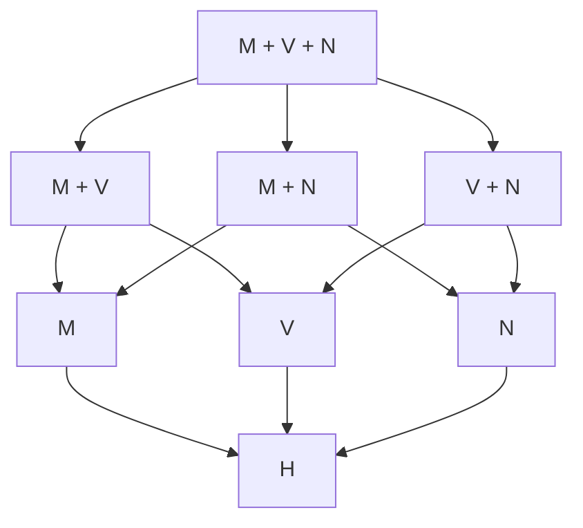

Each independent primitive Qσ or Pσ adds another binary coordinate. For finite Γ and J,K⊆Γ, T_K entails T_J exactly when J⊆K. This is not a claim that theory joins are unions of qualifications: S[A Z M] together with S[A Z V] can be strictly weaker than S[A Z M V].

Proof and models: [Primitive-package classification](primitive-package-classification.md), §§1–5; [Two orders](two-orders-model.md), §§2–4.

## 2. The spine: higher types and preservation strength

The first equivalence holds for every fixed qualification K. The tier equivalence concerns corresponding finite operation-preservation qualifications at full relational scope.

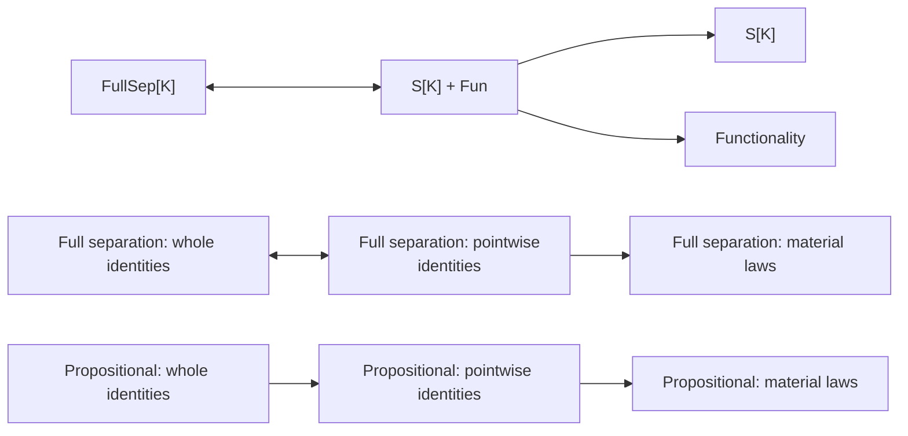

The propositional whole-to-pointwise implication can be strict: conjunction witnesses this. Material-to-pointwise equivalence fails even with all Fun: the negation model witnesses this at full relational scope. Complete logical full separation is a special case where all three tiers coincide; see §8.

There is a positive collapse for each separate M and V branch: **internal Frege finiteness of all propositions makes material and pointwise separation equivalent**, retaining any A/Z orientation. Full relational separation then makes all three tiers equivalent. More locally, a least true meet element or greatest false join element suffices to normalize every material character without changing its truth profile. Thus the remaining M/V material-versus-pointwise question is confined to infinite structures with the relevant nonprincipal truth filter or false ideal.

**Necessity of Distinctness at t supplies another route, without finiteness or Necessity of Identity.** Over H+ND_t, each separate material M/Q or V/P separation principle is equivalent to its pointwise version, with the same A/Z truth conditions. The construction below gives two-output principal witnesses; endpoint fixing is not asserted.

Proofs: [Typed separation](typed-separation-and-classicism.md), §2; [Local tiers](local-tiers-and-models.md), §§2–4; [Relational negation model](relational-clone-model.md), §§1–7; [Finite semilattice normalization](finite-semilattice-normalization.md), §§2–7.

There is also an exact characterization of the pointwise tier by composition. Fix a finite preservation signature Σ, allowing specified constants. An admitted observer family is a predicate X:(tt)t. Then:

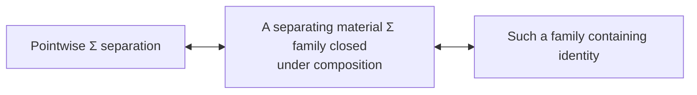

Only **some** admitted family must be closed; the entire material-qualified class need not be. Material preservation of specified constants by that closed family upgrades to identity fixing, so accepting Top and rejecting Bottom here give actual endpoint fixing. At full typed scope, use a separate formula for each relational type, with one family separating both that type and t; no existential quantifier over an infinitary schema is intended. See [Composition-closed characterization](composition-closed-characterization.md), §§2–4.

## 3. Algebraic structures and exact representation

At any tier, truth profiles identify preserved conjunction with intersection, disjunction with union, negation with complement, and listed quantifiers with admitted intersections/unions. This gives the exact equations and universal Horn laws of the corresponding two-element reduct.

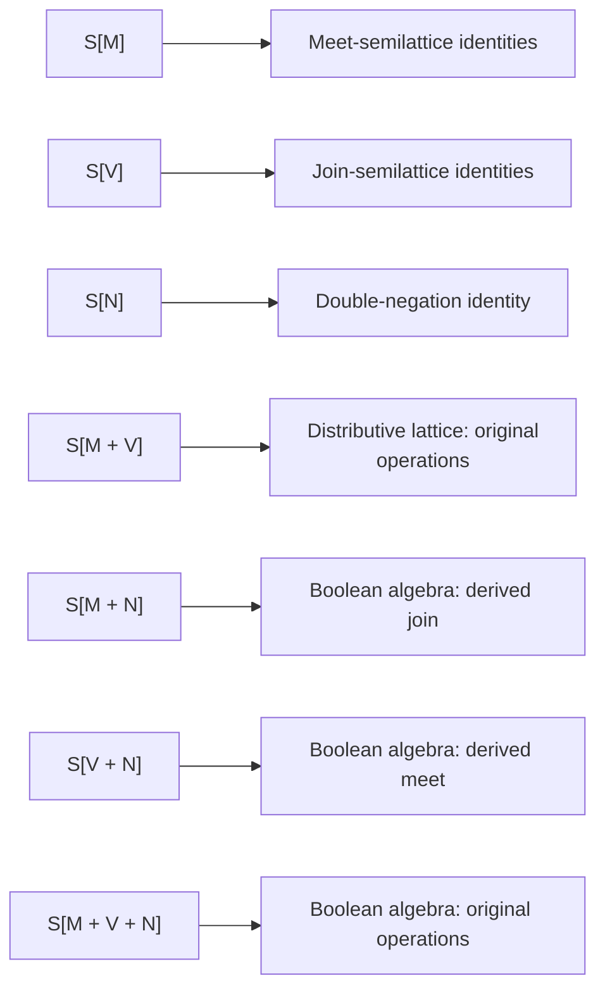

For the first three rows, replacing strong preservation by **material** preservation makes each implication an equivalence. The derived operations in the MN and VN rows are not identified with the omitted primitives.

The joint lattice and Boolean rows also have intrinsic material converses under the explicit preorder Zorn instance at tt:

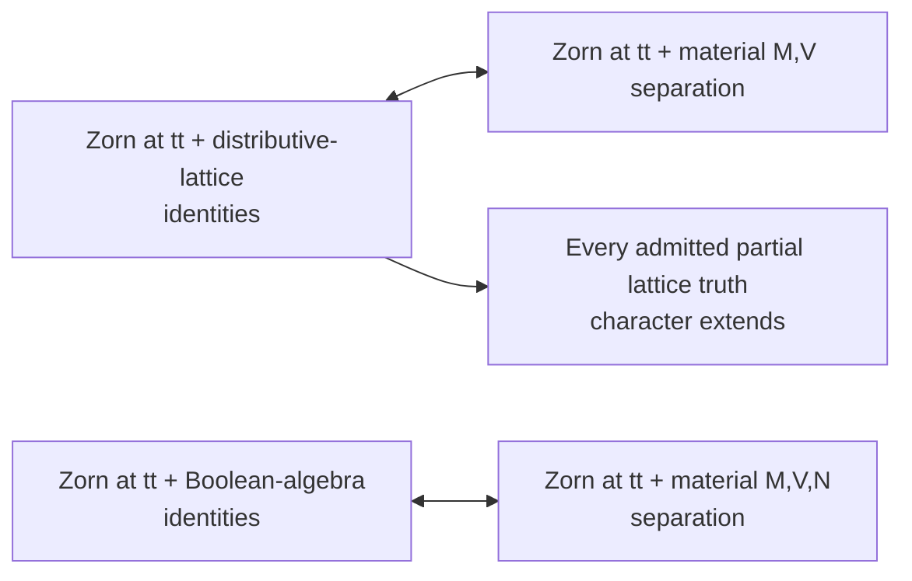

The M,V row retains all A/Z orientations: acceptance adds greatest Top, rejection adds least Bottom. The Boolean result also applies to M,N with its derived join and V,N with its derived meet, retaining their exact endpoint alignments. Zorn supplies an admitted prime filter separating any disjoint admitted filter and ideal; that relative principle is equivalent to partial-character extension. Plenitude adds pointwise normalization, local Fun adds whole identities, and full typed versions retain all Fun. Quantifier preservation is not included. See [Zorn lattice character extension](zorn-lattice-character-extension.md), §§1–6.

The quantifier branches have exact material converses, and exact strong converses under a local identity package:

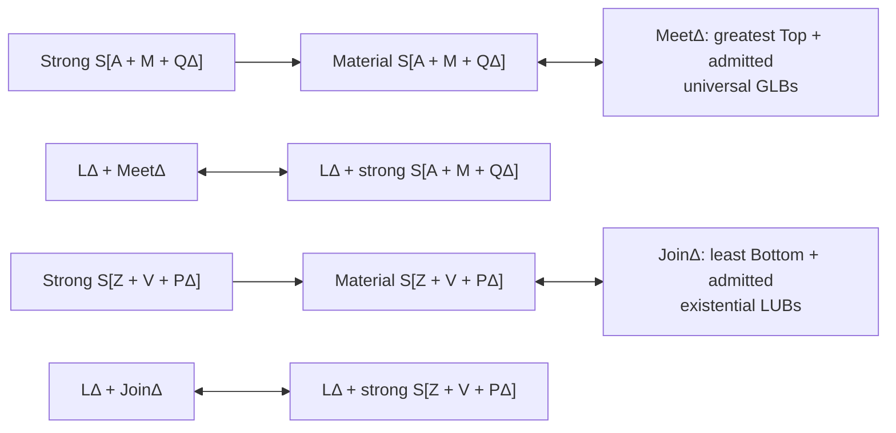

LΔ means identity bivalence at t, Fun(t,t), Fun(t,tt), and Fun(σt,t) for σ∈Δ. MeetΔ does not require Bottom least; JoinΔ does not require Top greatest. Principal equality tests give endpoint-valued separating witnesses under LΔ. These are H results with explicit assumptions; LΔ is not silently equated with C.

Dropping M from the material meet branch gives an exact characterization by the existence of an admitted partial order with greatest Top and the listed universal GLBs. The P branch has the dual characterization. Endpoint additions to M/V separation exactly align the designated Top/Bottom with the corresponding bounds.

Proofs: [Truth profiles](truth-profiles-and-connective-reducts.md), §§2–7; [Local identity representation](representation-under-identity-bivalence.md), §§2–5.

Internal finiteness provides a different exact representation route, without identity bivalence:

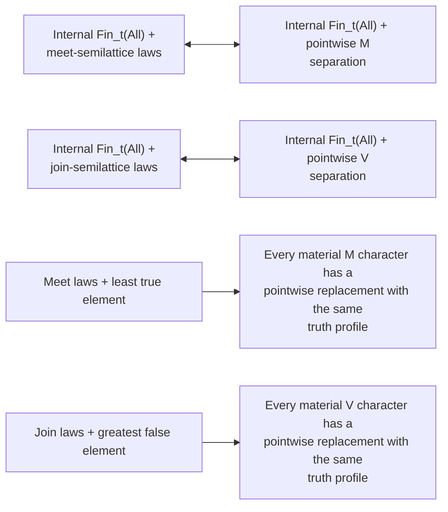

Add the appropriate designated bounds for A/Z. Add local binary Functionality to pass to whole-operation propositional preservation, or all Fun for full relational separation. The two representatives used by the normalization need not be Top and Bottom. See [Finite semilattice normalization](finite-semilattice-normalization.md), §§3–6.

The domain need not be finite if the separating observers have internally finite images:

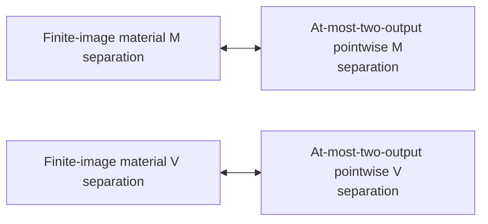

These exact H equivalences retain any A/Z orientation. The two outputs are not required to be Top and Bottom. At full relational scope, pointwise can be replaced by whole-operation preservation. Thus any remaining M/V material-versus-pointwise countermodel must lack even a separating family of finite-image material observers. See [Finite-image normalization](finite-image-material-normalization.md), §§1–5.

These normalizations extend to M with its matching universal quantifiers, V with its matching existential quantifiers, and the joint M,V signature with both kinds of quantifier. Their two output values form the required chain for each admitted GLB/LUB law. Primitive negation is not included in this extension. See [Necessity of Distinctness and representation](necessity-of-distinctness-representation.md), §6.

The same note gives a different exact representation under ND_t:

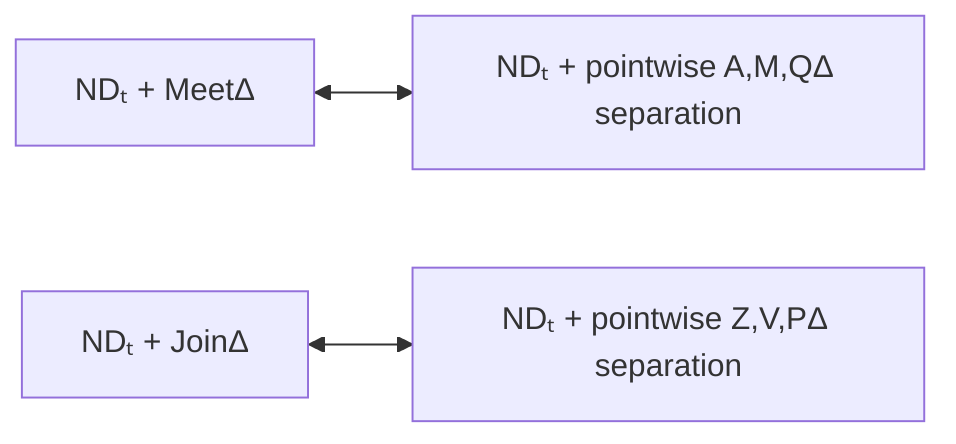

ND_t is the defining H formula saying that a true inequality judgment equals Top. No C-dependent reformulation is used. The witnesses have at most two outputs, which need not be Top and Bottom. Add the listed local Functionality instances to obtain whole-operation identities, or all Fun on the intrinsic side for full typed separation. There are H models of these packages with a corrupted omitted primitive, so the conclusion is not C. See [the proof](necessity-of-distinctness-representation.md), §§1–5.

Plenitude gives an independent admission route on infinite domains. Here $\mathrm{Plen}_{t,t}$ is the single pre-existing Plenitude formula at input and output type t, used explicitly over H:

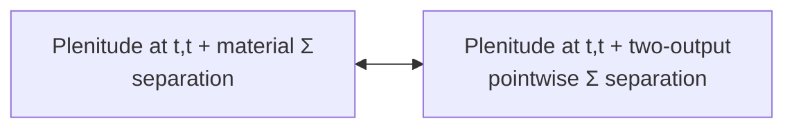

This panel covers every nonempty Σ⊆{M,V,N}, and each separate XOR or biconditional signature, with any A/Z orientation. The chosen false/true pair must realize the operation tables as identities; the algebra forced by separation supplies such a pair. The same theorem covers the stated matching M/Q, V/P and joint lattice/quantifier packages by their GLB/LUB laws. Add the appropriate local Fun for whole identities, or use full typed scope. No finiteness, ND or C is assumed. Plenitude does not supply an unrestricted infinite affine character-existence converse. See [Plenitude normalization](plenitude-material-normalization.md), §§1–6.

## 4. Quantifiers generate algebra; modal .2 supplies a selector in C

BRσ below means a **uniform admitted** constructor B[p,q,x] whose object-valued range is exactly {p,q}, with both values attained. Put μ(p,q)=∀x B[p,q,x] and ν(p,q)=∃x B[p,q,x]. They are initially derived operations.

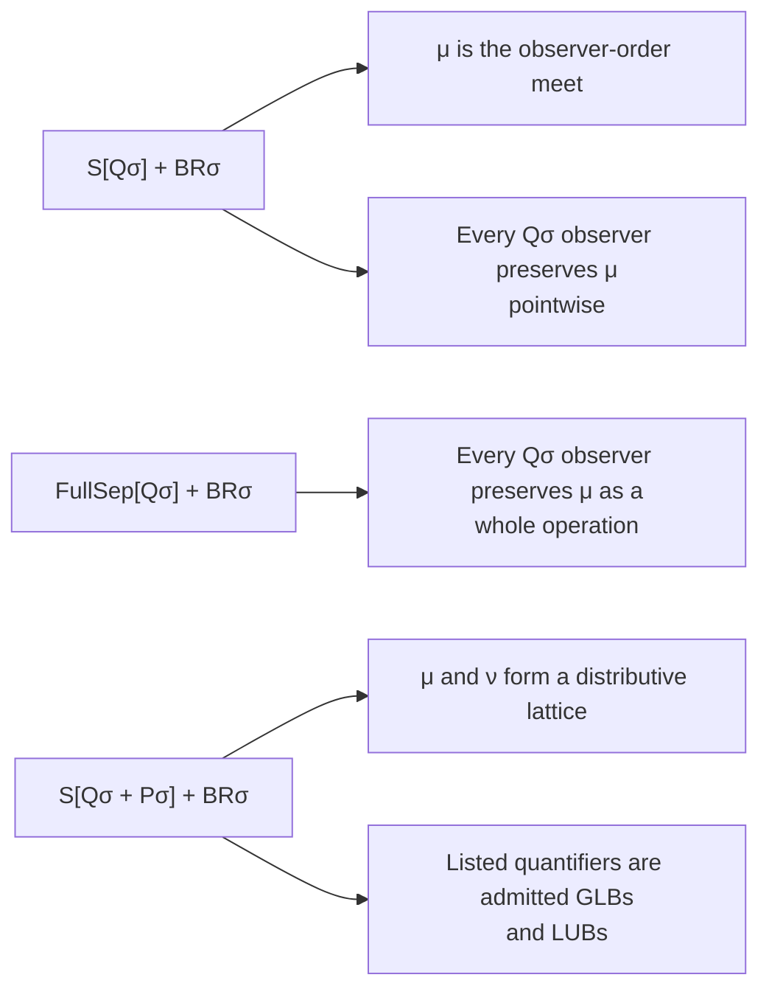

The Pσ dual generates ν as join. Extra observer restrictions may be retained; one passes to the composition-closed pure quantifier class. With BRσ fixed, adding preservation of μ to FullSep[R] adds no strength whenever R implies Qσ; dually for ν and Pσ. No automatic identification with primitive conjunction/disjunction is made.

The modal bridge is conditional on C:

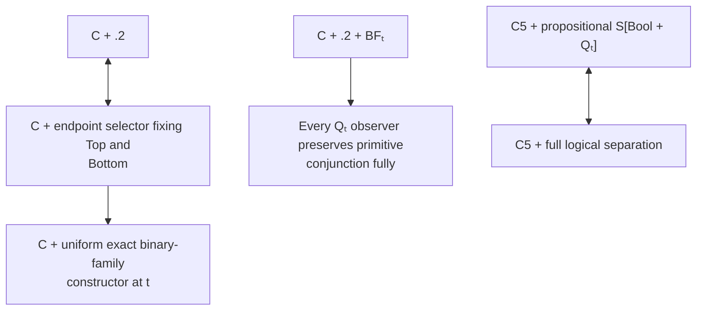

Here .2 is ∀p(◇□p→□◇p); an endpoint selector is Bp=◇□p. The Qₜ-to-conjunction theorem needs no acceptance hypothesis on the observer. Under C+.2, the accepting N+QΔ and V+QΔ separation branches are each equivalent to Bool+QΔ separation when Δ contains t; there is an existential dual. Under C5 the same Boolean Qₜ observer preserves every typed quantifier. These are C-relative bridges, not extra background for the H panels.

Native-modal preservation gives a separate, smaller route to .2:

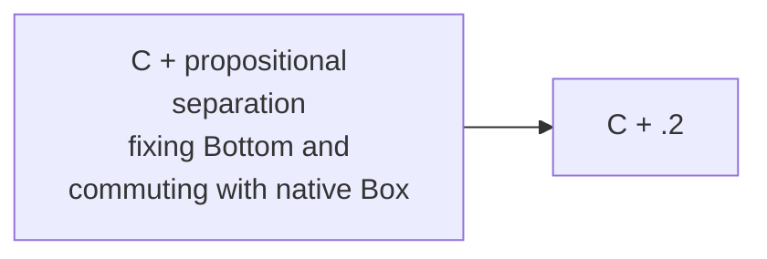

Here the only observer conditions are EBottom=Bottom and the whole identity (λp.E(□p))=(λp.□Ep). No Good qualification, Boolean preservation, quantifier preservation or BF premise is needed. If □p differs from Bottom, a separator makes E(□p) true and hence Ep=Top. Necessity of these endpoint identities then gives □◇p. This is a C-relative propositional result; full logical BoxSep obtains C by the independent transport theorem. See [Native-Box logical observers](native-box-logical-observers.md), §2, (7a).

The full fork satisfies C and every boxed BF instance, yet has no nonconstant endpoint-valued family at any type. Therefore even full universal separation does not provide the missing constructor. It also has an individual observer preserving **every universal quantifier and disjunction**, fixing both endpoints and idempotent, which fails even material conjunction preservation. The existential/meet dual fails disjunction. Thus boxed BF cannot replace .2 in the individual-observer reduction; this is not a separation-theory non-implication, since the fork itself satisfies OS.

Reversibility gives a positive reduction without .2: **over C, an invertible Q_t observer is automatically Boolean**. Its inverse also preserves each listed quantifier. Consequently, for full separation with finite Δ containing t, C plus separation by invertible QΔ observers is exactly Rev. Necessary bijectivity can replace the admitted-inverse condition. See [Reversible quantifier observers](reversible-quantifier-observers.md), §§1–4; §9 locates this within the upper region.

The unrestricted separation-theory reductions without .2 fail. In the [ternary Cantor symmetry model](ternary-cantor-observer-model.md), the following hold together over C:

| Separate qualified class | Full typed separation, also separately necessary |
| --- | --- |
| Endpoint fixing + M + every listed Q/P | Holds |
| Endpoint fixing + V + every listed Q/P | Holds |
| Endpoint fixing + N + every listed Q/P | Holds |
| Boolean observers, even with no quantifier condition | Fails already for propositions |

All BF and Functionality instances and their boxes also hold. The positive classes use different witnesses; no common M,V,N class is supplied. A monotone test on clopen profiles preserves quantifiers because each admitted family has an admitted argument attaining its leafwise minimum or maximum. Conditional majority gives the selfdual tests for N. A finite-support symmetry obstruction rules out all Boolean profile readers. This settles the former N+Q/V+Q frontier negatively and shows that their conjunction, even with the separate M branch, still does not give Boolean separation. The model fails .2, so it preserves the conditional positive arrows above.

Proofs: [Quantifier-generated lattices](quantifier-generated-lattices.md), §§1–6; [Modal selectors](../modal-selectors-and-quantifier-reduction.md), §§1–6; [Fork model](fork-without-binary-families.md), §§2–5.

## 5. Identity collapse, truth restrictions and the route to Extensionality

Let z=(Top=Bottom). IC_t says that every true propositional equality judgment equals Top and every false one equals z. Let NC say every false proposition equals Bottom, PC every true proposition equals Top, and FA be the Fregean Axiom.

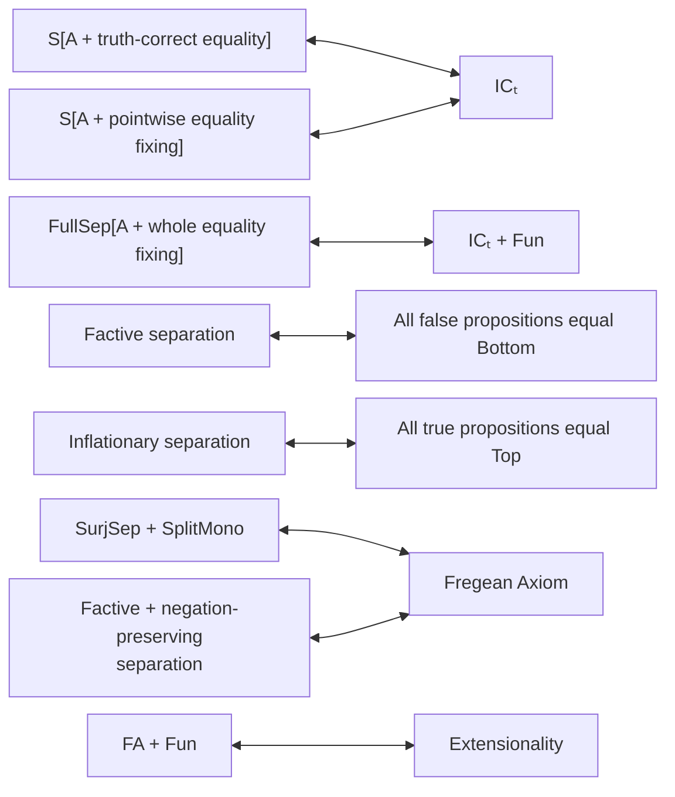

Equality fixing in this panel is at type t. The IC witnesses already have range {Top,z} and are idempotent; those restrictions add no strength. Identity bivalence is exactly IC_t plus z=Bottom. Factive/inflationary separation may also require A,Z without changing their respective one-sided collapse. Their full relational versions add Fun. Material negation preservation already suffices in the factive-to-FA row, and the inflationary version has the same consequence and converse.

One observer separating propositions is equivalent to FA when identity belongs to the eligible class. FullSep[K] plus a unique K-observer is equivalent to Extensionality when identity qualifies and K implies A,Z. A fixed n-observer family instead gives the exact unqualified bound of at most 2^n propositions. This is distinct from each observer having finite image.

Proofs: [Identity collapse](identity-collapse.md), §§2–6; [Observer restrictions](observer-restrictions.md), §§2–6.

## 6. Reversible meet separation: atoms and order actions

RevM below means propositional S[A Z M Rev_M], where the observer has an admitted meet-preserving inverse and both inverse equations are whole-operation identities. Atom means a meet atom for p≤q iff p∧q=p, not an unannounced replacement by the C-based Boolean definition.

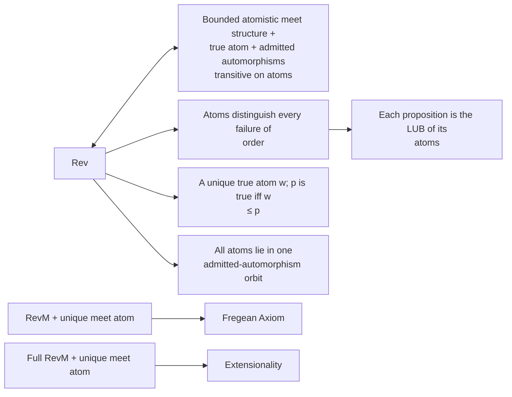

The conclusion gives a faithful representation by sets of atoms, preserving meet. It does not assert that every external set of atoms is represented, or that primitive disjunction is join. Under RevM, unique atom and FA are equivalent; under Full RevM, unique atom and Extensionality are equivalent. For the unrestricted RevM class, FA supplies identity as a qualified separator, so the corresponding packages also have converses. Additional restrictions on the observer class require the stated identity/inverse/composition conditions.

The exact characterization supplies the converse with explicit action and truth hypotheses. For arbitrary additional observer restrictions R, replace true-atom existence plus transitivity by the condition that every atom can be sent to a true proposition by an eligible admitted meet automorphism. That formulation needs no closure of R. The full relational characterization adds exactly Fun on the structural side.

This is a substantive H theorem using none of C, N, V, Q, BF or identity bivalence. The six-element asymmetric-atom model proves that atomisticity plus a true atom does **not** suffice, even with all Fun, all-type identity bivalence, and ordinary strong meet separation by endpoint-valued idempotent witnesses. The atom-transitivity requirement is substantive.

Proofs: [Reversible meet separation](reversible-meet-atomicity.md), §§1–6; [Exact reversible-meet characterization](reversible-meet-characterization.md), §§1–6.

The atomless region has a different positive criterion. For an admitted group G of whole meet automorphisms, its common truth-profile relation is the largest admitted invariant truth-compatible equivalence and is a meet congruence. On a chain it is convex, so absence of a nontrivial such convex equivalence is an exact separation criterion.

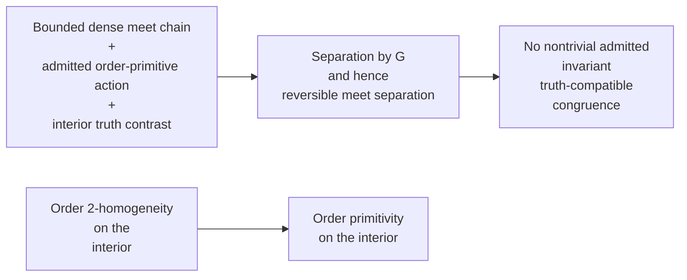

In the last arrow the action is the qualified group being used; the corresponding absence condition also suffices when the bounded meet/group hypotheses are retained. Order primitivity says every admitted invariant convex equivalence on the interior is equality or universal. It does not mention truth. An interior true/false pair rules out the universal truth-profile relation, and density rules out identifying an endpoint with an interior proposition.

The full-function rational-chain model has no atoms, no least true proposition and no greatest false proposition and satisfies joint reversible M/V separation plus Fun, while C fails. A restricted admitted translation subgroup is primitive and separating but not order 2-homogeneous. The dual join and joint lattice versions retain their whole-operation hypotheses. Full typed scope adds Fun. Proofs: [Reversible semilattice order actions](reversible-semilattice-order-actions.md), §§1–7.

### Adjacent truth cuts

For a bounded meet chain, an admitted whole-meet automorphism group G, and a greatest false/least true pair f<u, there is an exact alternative to density and primitivity:

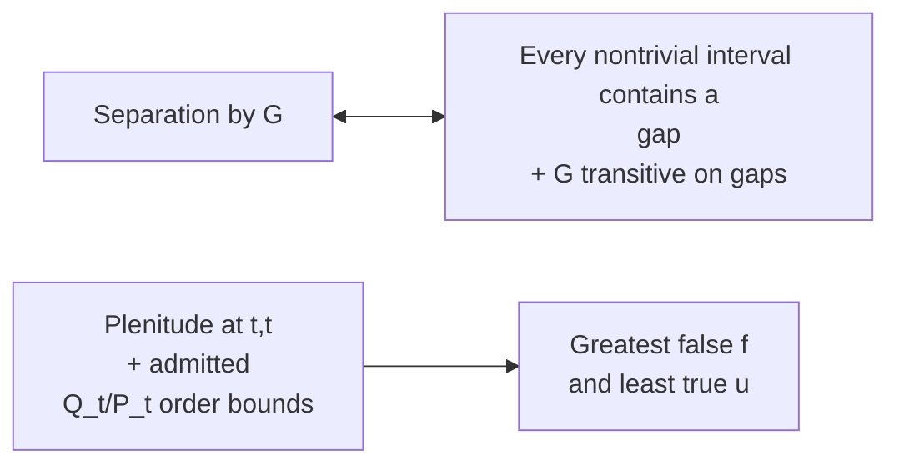

The equivalence retains the stated chain/group/truth-gap background. A gap is an adjacent pair; it need not begin at Bottom. Plenitude admits the true-only and false-only families whose bounds give f,u. Order automorphisms preserve admitted GLBs and LUBs pointwise, and the corresponding Fun gives whole quantifier identities.

The complete split interval has two points at every real coordinate in (0,1), with bounds added. It is atomless and every nontrivial interval contains a gap. Increasing coordinate bijections are gap-transitive. With truth across the gap at 1/2, genuine infima and suprema obey the H truth clauses. Full function domains therefore give **full reversible endpoint-fixing M,V,Q_Δ,P_Γ separation for every finite list**, while C fails. Primitive negation is omitted from this qualification. See [Reversible truth-gap chains](reversible-truth-gap-chains.md), §§1–6.

### Convex blocks and finite lattice factors

The following exact reductions have different backgrounds. The first uses a bounded dense chain with admitted invariant convex blocks, each without endpoints. The second uses a bounded distributive lattice with a specified external finite central partition preserved by the admitted whole-lattice group G.

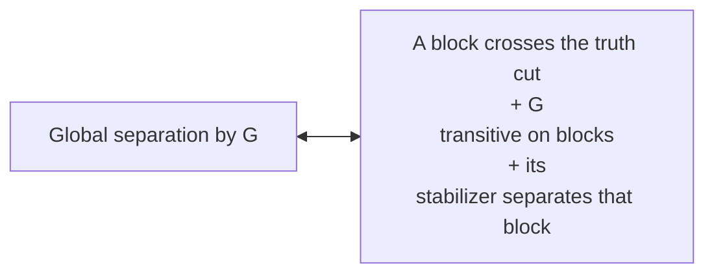

At most one convex block crosses the truth cut. Primitive stabilizers turn its true/false contrast into local separation, so the global action need not itself be primitive. An imprimitive lexicographic full-function model realizes this criterion below C.

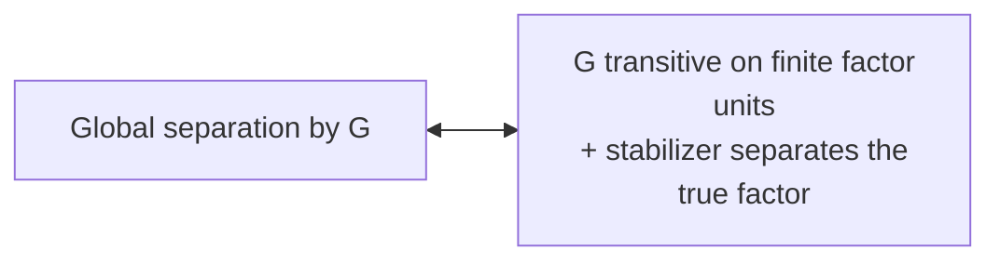

There is exactly one true factor unit w. The lattice identity p=∨ᵢ(p∧eᵢ) finds a differing component, while z↔(z∧w) transfers the local truth test. The factors can be infinite and atomless: finite products of the rational-chain model give non-chain examples with joint reversible M/V separation and Fun but not C. The finite list of factors is external, not internal Frege finiteness of propositions. See [Reversible separation from blocks and factors](reversible-semilattice-local-global.md), §§1–6.

## 7. Derived implication and affine operations

These nodes use specified actual terms for implication, biconditional and XOR. Strong preservation is closed under term composition and fixed constants, not mere truth-table replacement of one primitive by another.

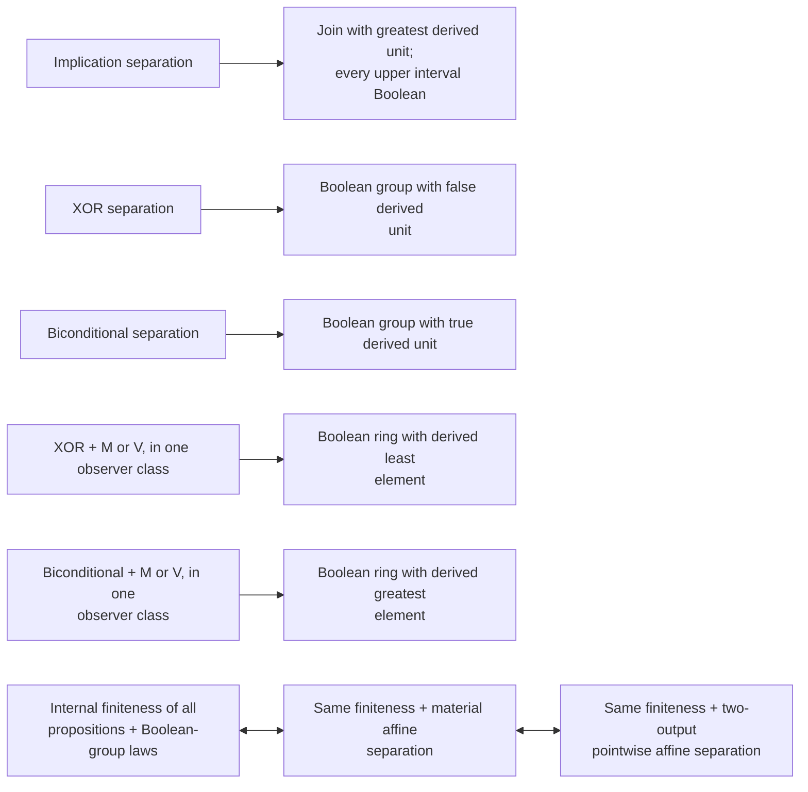

The final equivalences hold separately for XOR and biconditional, with the corresponding operation and unit on each side. Internal Frege induction constructs a subgroup of index two and an admitted test constant on each coset; translating its two outputs gives a pointwise homomorphism. This needs neither Choice, identity bivalence, ND nor an external enumeration. Add local binary Functionality for whole-operation preservation, or all Fun on the structural side for full typed separation. The exact A/Z alignments remain as in the earlier material theorem.

Even on an infinite proposition domain, finite-image material affine observers can be normalized while preserving their entire truth profiles:

```mermaid
flowchart LR
    FinAffine["Finite-image material affine<br/>separation"] <--> TwoAffine["Two-output pointwise affine<br/>separation"]
```

This holds separately for XOR and biconditional, with any A/Z orientation. The image need not be a subgroup. The two outputs need not be Top and Bottom. A general infinite converse without a finiteness or admission hypothesis remains unresolved. Fixing the missing endpoint in the stated affine branches permits full preservation of the derived complement.

The rings may be nonunital. For XOR, multiplication is the appropriate meet and additive zero is the derived bottom. For biconditional, multiplication is the appropriate join and additive zero is the derived top of the observer lattice. The latter is not a claim that the ring's usual order has its zero greatest.

There is a positive infinite-domain route. Zorn is its **preorder instance at type tt**, used as an explicit H premise:

```mermaid
flowchart LR
    ZBG["H + Zorn at tt + Boolean-group<br/>equations"] <--> ZSep["H + Zorn at tt + material affine<br/>separation"]
    ZBG --> Extend["Every admitted partial truth<br/>character extends"]
```

This holds separately for XOR and biconditional. Add Bottom=0 for XOR rejection, or Top=0 for biconditional acceptance; the opposite endpoint condition adds no strength. The proof builds an admitted maximal subgroup avoiding a prescribed element, then an admitted two-coset character. Pointed maximality exactly characterizes separation, and relative maximality exactly characterizes extension. It does not infer admission from an external linear functional.

For negation alone and each separate affine operation, Plenitude supplies a second positive reduction:

```mermaid
flowchart LR
    PMat["Plenitude at t,t + material<br/>separation"] <--> PInv["Same Plenitude + pointwise involutive<br/>separation"]
    WithFun["Plenitude at t,t + local Fun +<br/>pointwise involutive separation"] <--> PWhole["Plenitude at t,t + local Fun +<br/>whole-operation involutive separation"]
    WithFun --> PInv
```

Each node uses one of those signatures, with the same A/Z orientation; the involutions can fix the mentioned endpoint objects. Full typed scope already supplies Fun. Negation uses a single-pair flip; the affine construction adds a square-zero homomorphism to identity. Unlike profile normalization, these witnesses need only separate the chosen pair. This does not assert an analogous collapse for conjunction or complete logical qualification. Under Zorn plus Plenitude, the affine group equations therefore give involutive separation as well, with the stated Functionality qualification for whole identities and full types.

Negation and an affine operation can also be preserved together. Put c=¬0, where 0 is the affine unit:

```mermaid
flowchart LR
    Compat["Material affine separation + negation<br/>is translation by c"] <--> Linked["Material joint N,affine separation"]
    PlenLinked["Plenitude + material joint N,affine<br/>separation"] <--> InvLinked["Plenitude + pointwise joint<br/>involutive separation"]
```

The first equivalence is over bare H. The second permits fixing every endpoint whose truth condition was required; the endpoint alignments are explicit in [Negation and affine compatibility](negation-affine-compatibility.md), §§2–4. A parallel exact theorem handles XOR together with biconditional: D(x,y)=(x⊕y)⊕u, with u the biconditional unit. For the actual expansion X=¬D, all three two-operation material packages coincide and yield preservation of all three operations. Whole identities require local Fun, or full relational scope. Extra lattice or quantifier preservation is not added.

Proofs: [Term closure and affine branches](term-closure-and-affine-branches.md), §§2–5; [Finite affine normalization](finite-affine-normalization.md), §§1–7; [Internally finite affine separation](finite-affine-separation.md), §§1–5; [Zorn character extension](zorn-affine-character-extension.md), §§1–7; [Partial-signature involutions](partial-reversible-normalization.md), §§1–5.

## 8. Complete logical proof transport recovers C

The logical qualification includes the independent primitive operations, each listed quantifier, and the translated equality rules. Full separation ranges over all relational types and all finite type lists.

```mermaid
flowchart TD
    Mat["Full logical separation: material"] <--> Point["Full logical separation: pointwise<br/>identities"]
    Point <--> Strong["Full logical separation: whole<br/>identities"]
    Strong --> CBF["C + all BF instances"]
    Strong --> Fun["Functionality"]
    Eq["Full logical separation with equality<br/>reflection or fixing"] <--> Five["C5 + full logical separation"]
```

The proof transports finite H derivations through an observer; higher-type separation identifies the resulting relations. Propositional logical separation alone does not imply C or unrestricted Fun. The hidden-individual model refutes that upgrade even with only two propositions and endpoint-valued, factive, equality-fixing observers.

Proof: [Typed separation and Classicism](typed-separation-and-classicism.md), §§2–7; [Local tiers](local-tiers-and-models.md), §2.

## 9. The larger region above C + BF

[Reversibility and invariants](#reversibility-and-the-invariant-proposition-algebra) · [Finite domains](#finite-images-with-native-necessity) · [The reversible group centre](#the-centre-of-the-reversible-group) · [Group identities](#any-nontrivial-group-equation) · [Finite families](#internally-finite-families-of-observers)

[Finite images](#finite-images-with-native-necessity) · [Central observers](#commuting-with-every-logical-observer) · [Completeness](#completeness-reflects-into-necessity-but-its-type-matters) · [Support and selection](#canonical-local-support-and-selection) · [Fibre degree](#bounded-fibre-degree-and-finite-local-sheets)

OS means full logical separation. Fin means logical separation by observers with internally finitely many outputs, with no uniform bound. Rev uses observers with an admitted qualified two-sided inverse; SplitMono uses a qualified left inverse. Surj and InjSep require current surjectivity and injectivity respectively. BoxSep requires whole-operation commutation with the original □p=(p=Top); IdemBoxSep also requires the whole identity E∘E=E. FinBoxSep adds internally finite image to BoxSep. CentreSep requires commutation with every same-list Good observer. These qualifications are added to Good for the same finite type list. Nec is the separately boxed OS schema. Bool is propositional Boolean separation. Every complete-logical separation node already entails C+BF by §8.

```mermaid
%%{init: {"flowchart": {"nodeSpacing": 15, "rankSpacing": 40}}}%%
flowchart TD
    Ext["Extensionality"] --> End["End<br/>= C5 + Atomicityₜ"]
    Ext -->|strict| IdemBox["IdemBoxSep"]
    IdemBox -->|strict| BoxSep["BoxSep"]
    End --> Rev["Rev"]
    Rev -->|strict| Both["SurjSep + SplitMono"]
    Both -->|strict| SplitMono["SplitMono"]
    SplitMono --> Inj["InjSep"]
    Inj -->|strict| OS["OS"]
    Rev -->|strict| BoxSep
    BoxSep -->|strict| OS
    BoxSep --> NBF["C + ☐BF"]
    BoxSep --> D2["C + .2"]
    Both -->|strict| Surj["SurjSep"]
    Surj -->|strict| OS
    End --> Fin["Fin"]
    End --> At["C + BF<br/>+ Atomicityₜ"]
    Rev -->|strict| CN["C5 + ☐OS"]
    Rev --> NPC["No Pure<br/>Contingency"]
    CN --> Fix["C5 + OS"]
    CN --> Nec["☐OS"]
    Fix --> C5["C5"]
    Fix --> OS
    Nec --> OS
    Nec --> NBF
    Fin --> OS
    At --> OS
    OS --> DB["C + BF + Bool"]
    DB --> D["C + BF"]
    NBF --> D
    C5 --> D
    C5 --> D2
    D --> C["C"]
    D2 --> C
    C --> H["H"]
```

The new injective and native-modal branches coincide only with an explicit C5 premise:

```mermaid
flowchart TD
    RevFive["Reversible separation"] -->|strict| InjFive["C5 + injective separation"]
    InjFive <--> BoxFive["C5 + native-Box separation"]
    BoxFive -->|strict| OSFive["C5 + ordinary logical separation"]
```

Both strictness claims retain C5. The finite-block model has C5+SplitMono and fails Rev, while the linear/circular fibre model has C5+☐OS and fails InjSep and BoxSep at the explicit list {t,e,et,eet,(et)t,((et)t)t}. The latter model satisfies D_t, so any injective Good observer there would be bijective and qualified reversible. **SplitMono⇒InjSep is not marked strict or reversible:** that comparison remains unresolved, both over H and over C5.

Without C5, BoxSep and InjSep are incomparable, as are BoxSep and SplitMono, already over C+current BF. Omega shifts supply BoxSep without InjSep or SplitMono. The all-maps natural-numbers/singleton model supplies SplitMono and thus InjSep, but fails ☐BF and hence BoxSep. BoxSep and ☐OS are also incomparable over C+☐BF: the root truth-profile model has BoxSep but fails ☐OS, while the linear/circular model supplies the reverse witness. The root model also refutes persistence of BoxSep itself.

Full BoxSep entails **C+OS+☐BF+☐Functionality+.2**. The whole lower bundle is strictly weaker: the linear/circular model satisfies it but fails BoxSep. For the local Barcan step, over C, current BF_σ plus BoxSep(t,Δ) gives ☐BF_σ when {σ,σt}⊆Δ. This does not necessitate an optional BF assumption or assert necessary separation. The smaller .2 implication is displayed separately in §4. See [Native-Box logical observers](native-box-logical-observers.md), §§2–3 and 5–7.

### Universal-law reflection

Native-Box separation has a conditional consequence beyond particular modal axioms:

```mermaid
flowchart LR
    ReflectPrem["C + appropriate BoxSep(t,Δ) + current<br/>A"] --> ReflectConcl["Necessary A"]
```

For a universal modal sentence A=∀p₁…∀pₙ θ, where θ is a Boolean/native-Box formula without further quantifiers or parameters, Δ={t} suffices. More generally, A may universally close finitely many predicate variables over a first-order modal body with universal or existential object quantifiers. Its nonconstant atoms must be applications of those predicates to object variables; all object variables are bound in the body and occur only as arguments, and no predicate-head quantifier occurs inside the body. In this broader fragment Δ contains the outer predicate types and every object-binder type. These are external schemas of finite formulas, not a quantification over syntax.

Whole-operation preservation gives E(A) as A evaluated on the transformed predicates. Current A applies to those admitted predicates, so every qualified observer accepts A and separation gives A=Top. No optional premise is necessitated; existential object witnesses stay unchanged. This does not authorize existential reindexing of bare proposition or predicate-head variables. Full BoxSep over H recovers the C background. See [Universal modal reflection](native-box-reflection.md), §§1–3.

In particular BoxSep gives ☐.2. This is **not an additional strict branch**: C+BF_t+.2 already gives ☐.2 by its endpoint-selector characterization and Necessity of Identity. Reflection also says that current .3 or 5 becomes necessary; it does not assert either law. A finite root with a terminal singleton and a separate two-point terminal cluster has ☐OS, ☐BF and ☐Functionality and a current universal modal law that fails necessarily. The law is ∀p(□◇p→◇□p); .2 fails at the root, so this boundary does not refute reflection from the stronger lower bundle containing .2. See the reflection note, §§4–5.

### Idempotence with native necessity

Idempotence changes the theory when it is imposed on the same observers as native-Box preservation. There are three exact conjunctions:

```mermaid
%%{init: {"flowchart": {"nodeSpacing": 15, "rankSpacing": 40}}}%%
flowchart TD
    IdemFive["C5 + IdemBoxSep"] <--> IdemExt["Extensionality"]
    IdemRev["Rev + IdemBoxSep"] <--> IdemExt
    IdemEnd["End + IdemBoxSep"] <--> IdemExt
```

Over C5, native-Box preservation makes an observer injective, and an injective idempotent observer is identity. Propositional separation then gives the Fregean Axiom, and available Functionality gives Extensionality. The full schema recovers the background over H. The conjunctions with Rev and End permit separate witness families; each supplies C5. Conversely identity alone supplies all the required separation under Extensionality.

There is also an exact characterization for a particular full-model family:

```mermaid
flowchart LR
    FiniteIdem["Full model on a finite rooted poset<br/>P: IdemBoxSep"] <--> Joins["Every pair of points in P has a join"]
```

Here individuals are singleton and relational domains are the full action-model domains. Every Boolean observer is a coordinate reader E_f with x≤f(x). Native-Box commutation says f[↑x]=↑f(x); idempotence says f²=f. A qualifying reader of a from the root is therefore exactly f(x)=x∨a. The successful case supplies all relational types and every finite list, and also ☐IdemBoxSep. Failure is already propositional at Δ={t}. This is a characterization of this model family, not a representation theorem for arbitrary IdemBoxSep theories.

The six-point frame with levels {o}<{x,a}<{b,c}<{1} has full BoxSep but lacks the join of x and a, so it refutes IdemBoxSep. The four-point diamond has ☐IdemBoxSep but fails C5 and modal .3. Thus the two strict edges Extensionality→IdemBoxSep→BoxSep in the main graph are witnessed, and IdemBoxSep is incomparable with Rev and with End. Finally, a root below a two-point terminal cluster has IdemBoxSep but fails its necessary schema; at the cluster, endpoint separation holds while IdemBoxSep fails. See [Idempotent native-Box observers](idempotent-native-box-observers.md), §§1–7.

The finite family has a sharper classification. For positive finite m,n, let $P_{m,n}$ have a root, an m-point antichain A, an n-point antichain B and a top, with all cross-level order relations. In its full model, **BoxSep iff m=1 or n≤m; IdemBoxSep iff m=1 or n=1**. These are external conditions on the specified frames. In particular the seven-point P_{2,3} has ☐OS, ☐BF, ☐Functionality, ☐Atomicity (type t) and ☐.2 but fails BoxSep. It supplies a finite witness to the strict lower-bundle comparison above. See the idempotent note, §5, (7a).

### Finite images with native necessity

Actuality changes a finite-image restriction into finiteness of the entire proposition domain. At each fixed relational output type τ and finite list Δ, **over C**,

```mermaid
flowchart LR
    ActualFinBox["Actuality + finite-image native-Box<br/>separation"] <--> FiniteAllBox["Internally finite proposition domain<br/>+ native-Box separation"]
```

There is no requirement t∈Δ for this local theorem. A qualifying observer accepting an actual world has identity's current truth profile; native-Box preservation then makes that observer injective. An internally finite image pulls back through this injection to make all propositions internally Frege finite. Conversely internal finiteness makes every admitted image finite and supplies a least true proposition, hence Actuality. These are internal deletion-induction arguments, with no standard enumeration, fixed numerical bound, Choice, BF or Functionality premise added to C.

Actuality can be removed when Δ contains any relational type, and therefore from the full schemas. For an individual $\mathrm{Good}_\Delta$, native-Box-preserving E, put I_E(V)(q):=∃p[(Ep=q)∧E(Vp)]. Internal Frege induction proves **Fin_t(I_E(V))→E(Fin_t(V))**. Native Box supplies E(p=x)=(Ep=Ex), so deleting one input deletes its entire observed fibre. The only quantifier preservation used is Q_t. Any relational Q_σ law supplies it by the constant-relation/evaluation retraction, and the existential law suffices by Boolean duality; E is never moved through the higher-type quantifiers in the definition of finiteness. No injectivity or Actuality is assumed.

Consequently, over C, **FinBoxSep(τ,Δ) is exactly $\mathrm{Fin}_t(\mathrm{All})$+BoxSep(τ,Δ) whenever Δ contains a relational type**, at every fixed relational output type τ. Every eligible observer accepts $\mathrm{Fin}_t(\mathrm{All})$, so separation identifies that proposition with Top and also gives its necessity. For the full schemas over H:

```mermaid
flowchart TD
    FinBoxFull["Finite-image native-Box separation"] <--> FinAllBoxFull["Finite propositions + native-Box<br/>separation"]
    FinBoxFull --> NecessaryFiniteAll["Necessary internal finiteness +<br/>Actuality"]
    FiveFinBox["C5 + finite-image native-Box<br/>separation"] <--> EndFiniteAll["Endpoint separation + finite<br/>propositions"]
```

Here “finite” always means internal Frege finiteness, with no fixed numerical bound or finite family of observers. Rev+FinBoxSep is also equivalent to End+$\mathrm{Fin}_t(\mathrm{All})$. The arbitrary-list Actuality theorem above is retained: the remaining local cases are the empty and individual-only qualification lists. At full scope, C is recovered from separation, and Actuality becomes a consequence. See [Finite-image Box reflection](finite-image-box-reflection.md), §§1–4.

FinBoxSep strictly implies BoxSep and is incomparable with IdemBoxSep, Rev and End. The infinite omega chain has IdemBoxSep and BoxSep but fails FinBoxSep; finite P_{2,2} has FinBoxSep but fails IdemBoxSep. The two-point chain has FinBoxSep without C5, while a full infinite S5 cluster has End and Rev without internal finiteness. In the full action model with singleton individuals on any set-sized rooted poset P, **FinBoxSep holds exactly when P is finite and BoxSep holds**. This covers arbitrary widths. See [Finite-image native-Box observers](finite-image-native-box-observers.md), §5, and [the reflection note](finite-image-box-reflection.md), §5.

FinBoxSep is not equivalent to its boxed schema. The finite $A_{2,3}$ exterior-arm model satisfies FinBoxSep and ☐FinAll, but its future cone P_{2,3} fails even BoxSep(t,{t}). In finite full rooted-poset models FinBoxSep and BoxSep agree point by point; in $A_{m,n}$, their boxed forms hold exactly when m=1 or n≤m. See [Finite-image Box reflection](finite-image-box-reflection.md), §5.

### Internally finite families of observers

An internally Frege-finite family of arbitrary observers separating a class V makes V internally finite, already over H. The proof deletes one observer and splits V by its current output truth. A separate finite-table induction uses **output identities**, not truth agreement, to count admitted functions. Functionality supplies its identifying premise on a full domain.

```mermaid
flowchart TD
    FiniteAut["Rev + internally finitely many<br/>reversible observers"] <--> InternalFiniteFive["C5 + internally finite propositions"]
    InternalFiniteFive <--> InternalFiniteEnd["Endpoint separation + internally<br/>finite propositions"]
    InternalFiniteFive <--> InternalFiniteBox["C5 + finite-image Box separation"]
    FiniteOSFamily["Internally finite logical separating<br/>families"] <--> FiniteOSDomain["OS + internally finite propositions"]
    FiniteBoxFamily["Internally finite Box-separating<br/>families"] <--> FiniteBoxImage["Finite-image Box separation"]
```

All displayed separation principles have full relational/type-list scope. Each finite-family instance existentially supplies its own admitted family for the fixed output type and qualification list. No one family over all types is asserted. The finiteness is internal Frege finiteness with no fixed numerical bound. C5+FinAll gives Atomicity_t by internal minimal-element induction, then End and Rev. Finite full S5 clusters realize arbitrarily large finite domains; an infinite full cluster has End without this finiteness. These conclusions connect the family-size, image-size and finite-domain branches while retaining their different observer predicates. See [Internally finite observer families](internally-finite-observer-families.md), §§1–5.

### Commuting with every logical observer

Centrality means $\mathrm{Good}_\Delta(E)$ together with E∘G=G∘E for every admitted $\mathrm{Good}_\Delta$ observer G, as a whole-operation identity. It is stronger than selecting a pairwise commuting family. Over C with unary Functionality, the Boolean patches with which E must commute force E²=E. With t∈Δ and ordinary propositional separation at that list, the centre contains only identity and at most one additional endpoint observer; this classification no longer requires C5. The idempotent observer's greatest kernel is the admitted join ∃p(p△Ep), avoiding equality guards.

```mermaid
flowchart TD
    CentralFive["C5 + central-observer separation"] <--> CentralExt["Extensionality"]
    CentralRev["Rev + central-observer separation"] <--> CentralExt
    CentralEnd["End + central-observer separation"] <--> CentralExt
```

For the first equivalence, a single propositional CentreSep(t,Δ) with t∈Δ suffices. A possible nonidentity central observer has a currently true greatest kernel. Central separation makes that kernel an atom; its principal endpoint observer contradicts the asserted centrality. Only identity remains, so separation gives the Fregean Axiom and C supplies full Extensionality. No BC, Zorn or Choice is assumed. The Rev and End conjunctions concern full schemas and allow separate witness families; each supplies C5.

The C5 premise cannot be omitted. There is an exact comparison in one model family:

```mermaid
flowchart LR
    CentralPoset["Central separation in the full model<br/>on finite rooted P"] <--> CentralSmall["P is a singleton or a two-point<br/>chain"]
```

These full models have singleton individuals. Every Boolean observer in that family is an inflationary coordinate map. Its centre consists of identity and, when P has a greatest point, the constant map to that point. The central read points exhaust P exactly in the displayed two cases. The two-point chain has ☐CentreSep, BF and Fun, as well as Actuality and internal finiteness, but fails C5, Rev and End. Conversely the full two-point S5 cluster has End and Rev but fails CentreSep. Thus CentreSep is incomparable with Rev and with End over H, although either conjunction above is Extensionality. See [Central logical observers](central-logical-observers.md), §§1–5.

There is an exact characterization beyond that model family. Let Four_t say that every proposition is identical to one of four specified proposition objects, allowing repetitions. At full relational schema scope over H:

```mermaid
flowchart TD
    CentralTop["Extensionality"] -->|strict| CentralFull["Central-observer separation"]
    CentralFull <--> FourIdem["Idempotent native-Box separation +<br/>at most four propositions"]
    CentralFull <--> NecessaryCentral["☐CentreSep"]
    CentralFull -->|strict| CentralIdem["Idempotent native-Box separation"]
    CentralFull -->|strict| CentralFinBox["Finite-image native-Box separation"]
```

Central separation has at most two qualified truth profiles, supplied by identity and the possible endpoint observer. They give the four proposition objects 0,k,¬k,1, with k a true atom in the nonextensional case. The native Box table is then forced, so the same witnesses are idempotent and Box-preserving. Conversely IdemBoxSep+Four_t constrains **every** Boolean observer to identity or the same endpoint reader, making the required witnesses central at their original finite lists, including lists without t. Four_t bounds proposition objects, not merely current truth values.

Persistence is proved separately. Necessary identity and BF_t carry the finite enumeration and its controlling equality propositions forward; a discharged C structural theorem plus necessary Functionality reconstructs centrality at each future point. Current centrality is not simply assumed to persist. CentreSep therefore also gives Actuality and internal finiteness. The four-point diamond refutes the converse from IdemBoxSep, and finite P_{2,2} refutes the converse from FinBoxSep. See [Central separation and four propositions](central-separation-and-four-propositions.md), §§1–5.

### The centre of the reversible group

Here the selected observer must be reversible and commute with every admitted reversible Good observer at the same finite qualification list. This is a different class from the ordinary centre above. At full schema scope over H:

```mermaid
flowchart TD
    GroupExt["Extensionality"] -->|strict| GroupCentre["Separation by the reversible group<br/>centre"]
    GroupCentre <--> GroupFour["C5 + at most four propositions"]
    GroupCentre <--> GroupNecessary["☐CentreRevSep"]
    GroupCentre -->|strict| GroupEnd["Endpoint separation"]
    GroupMeet["Ordinary centre + reversible group<br/>centre"] <--> GroupExt
```

The moved support of every automorphism is fixed by the group centre. Separation makes every nonzero moved support Top, and admitted local swaps then force at most two Boolean atoms. Conversely the resulting reversible group is trivial or has two members. The two-point S5 cluster separates this principle from Extensionality; the three-point S5 cluster separates End from it. Ordinary CentreSep and CentreRevSep are incomparable, witnessed by the two-point chain and two-point S5 cluster. Their conjunction is Extensionality. See [The reversible observer group centre](centre-of-reversible-logical-observers.md), §§1–5.

### Uniform exponents of the whole reversible group

For each fixed external n≥1, let Exp_n assert E^n=I for **every** reversible Good_t observer, as a whole identity. Put k=max{j: each of 1,…,j divides n}. Then, over H:

```mermaid
flowchart TD
    ExpRev["Rev + every reversible observer has<br/>n-th power identity"] <--> ExpFinite["C5 + at most 2^k propositions"]
    ExpFinite --> ExpEnd["Endpoint separation"]
```

The external parameter n is fixed in each finite formula; k is the stated arithmetic function of it. For n=1,2,6,12,60 the proposition bounds are 2,4,8,16,64. The n=2 case is the group-centre theory above. Under Rev, any finite disjoint family of nonzero regions has smaller nonzero parts related by admitted reversible maps; patching yields the corresponding finite cycle. Excluding a (k+1)-cycle forces the finite Boolean bound. Conversely all automorphisms permute the at most k atoms. Finite full S5 clusters witness strict differences when k changes; different n with the same k give the same theory. A restriction merely on chosen witnesses has different strength: involutions already suffice for Rev. See [Bounded exponents](bounded-exponent-reversible-observers.md), §§1–5.

### Any nontrivial group equation

Fix a nonempty reduced group word w of length L. Law_w requires its whole-operation identity for every tuple of admitted qualified inverse pairs. Let k(w) be the largest j for which Sym(j) satisfies w; an explicit finite permutation path proves 1≤k(w)≤L. At full schema scope over H:

```mermaid
flowchart LR
    WordRev["Rev + a fixed nontrivial group law"] <--> WordFinite["C5 + at most 2^k(w) propositions"]
    WordFinite <--> WordEnd["Endpoint separation + that same<br/>bound"]
```

The disjoint-piece refinement supports a faithful admitted action of every finite symmetric group, with whole multiplication identities. Sym(k(w)+1) violating the word gives the sharp obstruction; the finite Boolean converse gives the other direction. Commutativity gives four propositions, while the metabelian law gives eight. Words with the same k(w) give the same theory with Rev; finite S5 clusters distinguish different thresholds. Empty reduced words add nothing, and constraints on a chosen witness family are different from a law on the entire group. See [Group identities](group-identities-reversible-observers.md), §§1–6.

### An unbounded stabilization hierarchy

For each fixed external integer r≥1, $B_r$ requires the same Good, native-Box-preserving observer to satisfy the whole identity $E^{r+1}=E^r$. Thus B₁ is IdemBoxSep. At every fixed output type and finite qualification list, and also for the full schemas,

```mermaid
flowchart LR
    BoundR["Bᵣ"] -->|strict| BoundNext["Bᵣ₊₁"]
    BoundNext -->|strict| UnboundedBox["BoxSep"]
```

Every strict step has a finite model, even over C + ☐OS + ☐BF + ☐Functionality + ☐Atomicity (type t) + ☐.2. The seven-point $P_{3,2}$ has ☐B₂ but fails B₁. For r≥2, a root followed by r successive two-point antichains and a top has ☐$B_{r+1}$ but fails $B_r$: a reader of the first level must move each antichain bijectively to the next. On $P_{m,n}$, the exact additional threshold is **B₂ iff m=1 or n=1 or m>n**, while B₃ is equivalent to BoxSep.

One infinite model also defeats every fixed bound. The frame with a root, countably many successive two-point antichains and a common top has ☐BoxSep and the same necessary background, but fails $B_r(t,\{t\})$ for every external finite r. A single pair of propositions witnesses all these failures. Full Q_t excludes nonprincipal observer characters by an admitted diagonal predicate; the remaining coordinate readers are forced to keep shifting levels. This is a metatheoretic family of verdicts about one model, not an object-language quantifier over r or an infinitary disjunction of qualifications.

Over C5 every $B_r$ collapses to Extensionality by cancellation of an injective observer's finite powers. Consequently Rev+$B_r$ and End+$B_r$ also equal Extensionality, with separate witness families allowed. Each $B_r$ is incomparable with Rev and End. The coordinate argument also extends the IdemBox join criterion above from finite frames to rooted posets of fixed finite external width. See [Bounded stabilization](bounded-stabilization-native-box-observers.md), §§1–6.

The finite-poset success statements need not persist once r≥2. The following panel records one specified full model:

```mermaid
flowchart TD
    Arms["Full exterior-arm poset<br/>A₂,₃ (ten points)"] --> ArmsRoot["Root satisfies B₂"]
    Arms --> ArmsFailure["☐BoxSep fails"]
    Arms --> ArmsBackground["☐OS, ☐BF, ☐Fun,<br/>☐Atomicityₜ and ☐.2"]
```

The frame adds exterior inputs to the two-antichain cone P_{2,3}. Root readers use those inputs to supply all upper coordinates, but the inputs disappear on restriction to that future cone. Whole qualification persists for each reader; separation by the class does not. This one model has $B_r$ but not ☐$B_r$ for every fixed r≥2, with failure already at t,{t}. The eight-point $A_{2,2}$ separately has B₂ and ☐B₃ but not ☐B₂. In contrast B₁ is cone-hereditary in the full finite-poset family because binary joins are inherited by future cones. This finite-frame fact does not override the earlier terminal-cluster failure of general IdemBox persistence. See [Exterior-arm nonpersistence](exterior-arm-posets-native-box-nonpersistence.md), §§1–5.

Exact combinations, allowing separate witness families, locate the other branches:

$$
\begin{aligned}
\mathsf{Rev}+\mathsf{Fin}&\ \leftrightarrow\ \mathsf{End},&
\mathsf{Rev}+\mathsf{At}&\ \leftrightarrow\ \mathsf{End},\\
\mathrm{C5}+\mathsf{Fin}&\ \leftrightarrow\ \mathsf{End},&
\mathrm{C5}+\mathsf{At}&\ \leftrightarrow\ \mathsf{End},\\
\mathsf{Fix}+\mathsf{Fin}&\ \leftrightarrow\ \mathsf{End},&
\mathsf{Rev}+\text{one meet atom}&\ \leftrightarrow\ \mathsf{End}.
\end{aligned}
$$

The meet-atom equivalence here is in the complete-logical region. Also,

$$
\mathsf{Rev}+\text{one finite-image }\mathrm{Good}_{\{t\}}\text{ observer}
\ \leftrightarrow\ \mathsf{End}.
$$

A single atom also closes the gap from necessary separation to endpoint separation:

```mermaid
flowchart TD
    EndAtom["Endpoint separation"] <--> NecAtom["C5 + ☐OS + one atom"]
    EndAtom <--> LocalAtom["C5 + ☐ propositional Good-t<br/>separation + one atom"]
```

Here Good-t separation is the single closed propositional separation formula whose quantifier-type list is {t}. Under C5 plus that boxed formula, one atom, Actuality, propositional Atomicity, one endpoint-valued Good-t observer, one finite-image Good-t observer, and full endpoint separation are equivalent. See [Necessary separation and atoms](necessary-separation-and-atoms.md), §§2–4.

Current Plenitude gives another exact route into the endpoint region:

```mermaid
flowchart TD
    EP["Endpoint separation = C5 +<br/>Atomicityₜ"] <--> OP["OS + Plenitude at t,t"]
    EP <--> AP["C5 + OS + Actuality"]
    AP <--> BP["C5 + OS + full Boolean Completeness"]
```

The single Plenitude instance already gives ND_t and Actuality over C. BF_t then gives C5; full OS supplies C and BF over H. Hence neither OS nor Plenitude is assumed necessary. Conversely End gives necessary full Plenitude, so Plenitude at t,t can equivalently be replaced by the full schema in this panel. The separate admission identity is C+BF_t+$\mathrm{Plen}_{t,t}$ iff C5+Actuality. See [Plenitude and endpoint separation](plenitude-endpoint-bridge.md), §§1–5.

### Completeness reflects into necessity, but its type matters

Ordinary logical separation gives a persistence theorem for current Boolean Completeness:

```mermaid
flowchart LR
    CurrentComplete["C5 + S(t,Δ) + BCσ<br/>Δ contains σ and σt"] --> NecessaryComplete["☐BCσ"]
```

Here σ is a fixed relational type and Δ contains σ and σt. Equality and algebraic-order judgments are endpoints under C5. A Good observer therefore transforms the completeness formula only by postcomposing its admitted family predicate; current $\mathrm{BC}_\sigma$ applies to that transformed predicate. All observers accept $\mathrm{BC}_\sigma$, and separation identifies it with Top. No optional premise is necessitated. The C5 reduction from $\mathrm{Good}_{\{t\}}$ to every requested finite list permits S(t,{t}) in place of the larger list. This is persistence of each assumed instance, not a type-lifting theorem from $\mathrm{BC}_t$.

The exact distinction already appears between propositions and operations on propositions:

```mermaid
flowchart TD
    HigherComplete["C5 + BCₜₜ"] --> HigherActual["Actuality"]
    HigherObservable["C5 + OS + BCₜₜ"] --> HigherEndpoint["Endpoint separation"]
    ColourComplete["Two-colour<br/>finite-pinning model"] --> LowComplete["C5 + ☐Rev + ☐BCₜ"]
    ColourComplete --> LowFailures["¬Actuality, ¬BCₜₜ, ¬Zornₜ"]
```

Completeness at tt constructs an admitted representative of every currently functional proposition-to-proposition relation, giving $\mathrm{Plen}_{t,t}$ and Actuality. With OS this reaches End. Completeness at t has no such consequence: in the two-colour model, projecting a stabilizer orbit into the finite fixed-pin Boolean algebra gives the actual least upper bound of each admitted current family. This proves necessary $\mathrm{BC}_t$ while the proposition algebra stays atomless; D_t also holds. The model consequently fails Actuality, End and $\mathrm{BC}_{tt}$.

An admitted preorder on finite joins of coordinates of one colour separately refutes $\mathrm{Zorn}_t$ there: each admitted antisymmetric chain has a finite pin and a bound, while fresh coordinates always extend a valid element. Thus the model does **not** refute a theorem with both $\mathrm{BC}_t$ and $\mathrm{Zorn}_t$ added. No current-extension join is obtained by simply replacing predicate membership with an endpoint. See [Finite colour patterns and completeness](finite-colour-propositional-completeness.md), §§2–6.

### Reversibility and the invariant proposition algebra

Over C5 there is an exact criterion that makes no reference to the current truth of observer outputs. Let A(E) be the single finite formula saying that E is $\mathrm{Good}_{\{t\}}$ and has an admitted qualified whole inverse. Put Inv(p):=∀E[A(E)→Ep=p], and define the admitted orbit join O(p):=∃E[A(E)∧Ep]. Then:

```mermaid
flowchart TD
    RevInvariant["Reversible logical separation"] <--> TrivialInvariant["Only Bottom and Top are fixed by<br/>every reversible observer"]
    TrivialInvariant <--> OrbitTest["The admitted orbit join is the<br/>nonzero test"]
```

Every equivalence in this panel is **over C5**. The middle condition is the single sentence ∀p[Inv(p)→(p=Bottom∨p=Top)]; the final condition is ∀p[O(p)=(p≠Bottom)]. Thus full Rev over H is exactly C5 plus that finite sentence, retaining C5's type-schema meaning. The same-observer C5 type reduction takes $\mathrm{Good}_{\{t\}}$ and its inverse to each requested finite list; Functionality supplies full relational output scope.

C5 makes the finite qualification guard A(E) an endpoint, so O(p) is the admitted join of the qualified images. Composition and inversion prove that O(p) is the **least invariant proposition above p**. If invariant propositions are only endpoints, every nonzero p has O(p)=Top; existential truth then supplies a reversible observer accepting p. Conversely separation makes every invariant proposition an endpoint. Failure of Rev is therefore exactly the existence of a nonzero false invariant proposition, and O(p△q) constructs one from a missed pair.

The invariant propositions form a Boolean algebra closed under admitted quantified families. Its ceiling is O and its floor is ¬O¬; neither auxiliary map is asserted to be a logical observer. No Actuality, atoms, BC, Zorn or Choice enters. This is an exact algebraic converse for Rev, distinct from the still-unsettled comparison with first-order endpoint-parameter noncontingency and from centrality of observers. See [Reversible separation and fixed propositions](reversible-fixed-proposition-characterization.md), §§1–5.

The same invariant algebra can be recovered from **all** logical observers on their local-transversal supports. Over C5:

```mermaid
flowchart LR
    LocalInv["Every reversible observer fixes u"] <--> LocalRespect["Every Good E respects u on s_E"]
    LocalRespect <--> NormalFix["Every normalized observer N(E) fixes<br/>u"]
```

Respect on $s_E$ is the identity $s_E\land Eu=s_E\land u$. Equivalently, no nonzero parts of u and ¬u admit a relative order isomorphism with an admitted inverse. Writing B(E) for the endpoint-valued identity-based Good_t guard, the same orbit closure is $O(p)=\exists E[B(E)\land s_E\land Ep]=\exists E[B(E)\land N(E)p]$. These are admitted guarded joins, with no Choice or external completeness.

An injective observer detecting a false invariant must change it outside its local support. With current $\mathrm{BC}_t$+$\mathrm{Zorn}_t$, the additional coverage $L_E s_E=\top$ then supplies a qualified inverse with a true kernel. That coverage is not automatic here, so the general InjSep/left-inverse comparison remains unresolved. See [Invariant components and local support](invariant-components-and-local-support.md), §§1–5.

### Group identities without separation

For fixed k≥1, C_k says that k+1 pairwise disjoint propositions cannot have orbit joins O(b_i) with nonzero common meet. For every fixed nontrivial word w, **over C5 without Rev**:

```mermaid
flowchart LR
    ComponentLaw["Every reversible tuple obeys the<br/>word w"] <--> ComponentBound["C_k(w): at most k(w) disjoint<br/>regions with overlapping orbit joins"]
```

Finitely many target propositions admit smaller nonzero pieces related by reversible maps exactly when their orbit joins overlap. This gives the finite permutation obstruction. Conversely, finite Boolean partitions generated by a selected tuple stabilize on finitely many invariant regions, with at most k(w) cells in each. The word holds on these finite permutation actions and hence on every proposition. The proof is internal to the admitted algebra, with no Stone representation, Choice, BC or Zorn. Under Rev this component bound reduces to the preceding global finite proposition bound; without Rev it is not a total-domain bound. See [Invariant components and group identities](invariant-components-and-group-identities.md), §§1–5.

Rev is equivalent to its involutive-observer version, to its separately boxed schema, and to full separation by observers having admitted qualified right inverses. The last characterization uses a localized Boolean patch to replace a distinguishing right-invertible observer by an involution. Over C+BF this works at each fixed finite list containing t; full separation over H already recovers the needed background. It does not identify the individual observer classes. See [Qualified right-inverse separation](split-inverse-logical-observers.md), §§1–4.

Over C5, current surjectivity supplies a qualified right inverse by an explicit fiber term:

```mermaid
flowchart TD
    OntoSep["C5 + surjective Good separation"] <--> Reversible["Reversible separation"]
```

For each finite list containing t, the greatest kernel element k_S=∃p[(Sp=Bottom)∧p] defines a unique inverse below ¬k_S; filling the remaining region with identity gives an admitted same-list logical section. No Choice is assumed. This identifies the individual surjective-Good and qualified-right-invertible classes over C5, and their separation principles with Rev. See [Surjective logical observers](surjective-logical-observers.md), §§1–5. The C5 premise is explicit.

The same C5 region has an exact **individual-observer** classification. Fix $\mathrm{Good}_{\{t\}}(E)$, let $Rq=\exists p\,[(Ep\le q)\land p]$, $Lq=\neg R(\neg q)$, and $k=R\bot$. These admitted terms are its right and left order adjoints:

```mermaid
flowchart TD
    Bij["E bijective"] <--> Equal["Left adjoint = right adjoint"]
    Bij --> Inj["E injective"]
    Bij --> Onto["E onto"]
    Inj <--> Modal["E commutes with original Box"]
    Onto <--> Join["Right adjoint preserves join"]
```

The Box condition can be replaced by Diamond, and needs only Boolean qualification over C5. Injectivity also means R fixes Bottom; onto also means L preserves meet. The image has floor j=E∘R and ceiling c=E∘L, with j≤I≤c, both idempotent. E is endpoint-valued exactly when j is the original Box. Generally j is a separate auxiliary S5 interior. The terms T⁻q=(¬k∧Rq)∨(k∧q) and T⁺q=Lq∨(k∧q) fix both endpoints and respectively preserve M/all Q and V/all P. They coincide exactly when E is onto, recovering its canonical logical right inverse. See [Canonical adjoints and image factorization](canonical-adjoints-and-image-factorization.md), §§2–7. These are individual conditions, not additional separation-theory arrows. The interval/image factorization and the already known all-type preservation reduction use admitted families only.

Current injectivity gives admitted order-adjoint left inverses over C5, but those need not be qualified logical observers. The exact additional condition is a Boolean transversal of the image:

```mermaid
flowchart LR
    QualifiedLeft["An admitted qualified left inverse of<br/>E"] <--> Transversal["A Boolean transversal for the image<br/>closure of E"]
```

This is an **individual-observer** equivalence over C5, with E injective and $\mathrm{Good}_\Delta$ for a finite Δ containing t. Write $C_E=E\circ L$. A transversal is an admitted proposition u with $C_E u=\top$ and $u\land C_E(u\land q)=u\land q$ for every q. The correspondence is a bijection: u gives F_u(q)=L(u∧q), and a qualified left inverse F gives u=¬k_F, where k_F is its greatest kernel element. The same terms preserve every listed quantifier, and available Functionality collects the whole-operation identities. No Choice premise or external power-set representation is assumed.

The full-function C5 model with proposition algebra 2×RO(Cantor²) has an injective all-type Good cylinder embedding with **no qualified Good-t left inverse**, although its order adjoints are admitted whole left inverses. A clopen rectangle split rules out every transversal. This model itself fails OS; it therefore does **not** refute InjSep⇒SplitMono. See [Injective observers and Boolean transversals](injective-observers-and-boolean-transversals.md), §§1–6.

Finite Boolean generation over an observer's image gives a positive converse. Fix an external n≥0. $\mathrm{FG}_n(E)$ says that n admitted propositions together with the image of E generate the ambient Boolean algebra: for their finite Boolean partition cells b_s, every q has a representation $q=\bigvee_s(b_s\land Ep_s)$. This is one finitary formula for each n; it is neither finite output range nor internal finiteness of the proposition domain.

Over C5, for every such fixed n and at each fixed τ,Δ containing t, the following separating classes have equal strength:

```mermaid
flowchart TD
    subgraph FGBase["C5; fixed n ≥ 0 and Δ containing t"]
    FinGenSep["Good + FGₙ<br/>separation"] <--> FinGenRev["Rev"]
    TrueLocalSep["Good separation with a<br/>true local transversal"] <--> FinGenRev
    end
```

The same equivalences hold at full relational scope, with C5 retained. **No injectivity premise is needed on the left.** A local transversal for E is a proposition b satisfying $b\land C_E(b\land q)=b\land q$ for every q. If b is true, a relative interval swap gives a qualified involution with E's entire current truth profile. $\mathrm{FG}_n$ supplies such a b because its finitely many cells are local transversals and join to Top. Conversely a reversible observer is onto, giving FG₀ and the true local transversal Top. Adding injectivity to either left-hand class leaves the equivalence intact.

For the separate individual inverse result, injectivity is retained: an injective $\mathrm{FG}_n$ observer has a qualified left inverse, and if $R_Ec=\bot$ that inverse can be chosen to send c to Bottom. The construction disjointifies a finite cover of local transversals using the admitted left adjoint; it uses no Choice. The profile theorem does not assert identity of the original observer with its involutive replacement, or necessary agreement of their profiles. See [Finite generation over an observer's image](finite-relative-image-generation.md), §§1–4.

### Canonical local support and selection

For an arbitrary $\mathrm{Good}_\Delta$ observer E over C5, with t∈Δ, let $s_E=\exists b\,[\mathrm{Loc}_E(b)\land b]$. Locality is equivalently injectivity of $L_E$ restricted to [Bottom,b]. The locality guard is endpoint-valued; $s_E$ is the admitted join of all local transversals. It is the largest region every nonzero subpart of which contains a nonzero local transversal. Its complement contains none. The support itself need not be local.

For any admitted family b_i, gluing is governed exactly by pairs:

```mermaid
flowchart TD
    subgraph GlueBase["C5; Good E; Δ contains t"]
    Compatible["Every pair has<br/>a local union"] <--> Glued["The admitted join<br/>is local"]
    DirectedLocal["A directed admitted family<br/>of local transversals"] --> Glued
    end
```

The support has exact composition and Boolean-patching laws: **$s_{F\circ E}=s_F\land F(s_E)$**; for G(p)=(d∧Ep)∨(¬d∧Fp), **$s_G=(d\land s_E)\lor(\neg d\land s_F)$**. Thus support-Top observers form a composition-closed class. The admitted normalization $\mathcal N(E)(p)=(s_E\land Ep)\lor(\neg s_E\land p)$ always has support Top and fixes every observer already in that class. It is an idempotent retraction on the Good class, not a claim that the individual normalized observers are invertible.

At each fixed τ,Δ containing t, and also at full scope, the following are equivalent over C5:

```mermaid
flowchart TD
    subgraph SupportBase["C5; Good observers; Δ contains t"]
    CurrentSupport["Separation with<br/>true support"] <--> SupportRev["Rev"]
    FullSupport["Separation with<br/>support = Top"] <--> SupportRev
    NormalizedSupport["Separation by N(Good)"] <--> SupportRev
    end
```

Current truth of $s_E$ supplies a true local transversal by the ordinary existential truth rule, hence an involution with E's whole current truth profile. No infinite join is treated as a finite disjunction. Full support is weaker than every fixed $\mathrm{FG}_n$ at the individual level: a principal endpoint observer on the full powerset algebra of the natural numbers has full support but no finite relative generating tuple. All observers in this panel remain Good; injectivity is not assumed. See [Local-transversal support](local-transversal-support.md), §§1–6.

There is a further exact individual selection theorem with explicit additional premises. Assume **C5+$\mathrm{BC}_t$+$\mathrm{Zorn}_t$**, and let E be injective and $\mathrm{Good}_\Delta$ with t∈Δ:

```mermaid
flowchart TD
    subgraph SelectionBase["C5 + BCₜ + Zornₜ; injective Good E;<br/>Δ contains t"]
    SelectedInverse["Qualified left inverse<br/>of E exists"] <--> Coverage["L_E(s_E) = Top"]
    ControlledInverse["Such an inverse<br/>sends c to Bottom"] <--> Avoidance["L_E(s_E ∧ ¬c) = Top"]
    end
```

Here c is arbitrary; it need not be true. $\mathrm{BC}_t$ is Boolean Completeness for current admitted proposition predicates, and $\mathrm{Zorn}_t$ is the existing preorder Zorn instance at t. $\mathrm{BC}_t$ supplies actual current joins of chains, without assuming their membership predicates are endpoint-valued; the adjunction $C_E\dashv E R_E$ and fixed-meet adjunction preserve those joins. Zorn then selects a maximal local u≤r, with $L_Eu=L_E(s_E\land r)$. This maximal-support theorem itself does not require E injective. Injectivity is used to turn coverage Top into a qualified whole left inverse $F(q)=L_E(u\land q)$.

The optional premises are unboxed, and no uniform choice of u is asserted. In particular, a J witness gives K if its support covers the input after excluding its true gap c, as expressed by the second test. J alone only gives $L_E(\neg c)=\top$; it does not give the displayed support coverage. Neither these premises nor the tests settle the general OS+J comparison. See [Zorn selection from local support](zorn-local-transversal-selection.md), §§1–5.

### Bounded fibre degree and finite local sheets

Over C5, fix an arbitrary $\mathrm{Good}_\Delta$ observer E with t∈Δ. For a fixed external n≥1, degree at most n means that no n+1 disjoint propositions have $L_E$-images with a common nonzero overlap. Equivalently, they cannot have the same nonzero image ceiling $C_E b$. This is one finitary formula for each n; it assumes neither atoms nor externally represented fibres.

```mermaid
flowchart TD
    subgraph DegreeBase["C5; Good E; t ∈ Δ; fixed n ≥ 1"]
    FiniteDegree["Degree at most n"] --> DegreeSupport["Support = Top"]
    DegreeSupport --> DegreeProfile["An involution has its<br/>entire current truth profile"]
    DegreeSep["Degree-at-most-n<br/>separation"] <--> DegreeRev["Rev"]
    end
```

The first implication needs only C5. Any nonlocal piece can be split into two disjoint pieces with a common nonzero $L_E$-image. Repeating within the support complement would produce n+1 such pieces, contradicting the degree bound. A true local transversal then gives the qualified involution. The separation equivalence holds at each fixed τ,Δ and at full scope, with C5 explicit; no injectivity is needed. It asserts current profile agreement, not identity of the original observer or necessary agreement. Degree at most 1 is exactly current surjectivity.

Degree also has a finite calculus: **degree bounds m and n give degree at most mn for F∘E**, and **at most m+n for the Boolean patch (d∧E−)∨(¬d∧F−)**. Finite Boolean cells and pigeonhole counting prove these bounds without BC or Zorn. Fixed iterates of a degree-n observer have bounds n^k. These are upper bounds, not claims about a least degree.

Global finite sheet decompositions require additional premises. Under **C5+$\mathrm{BC}_t$+$\mathrm{Zorn}_t$**, for arbitrary $\mathrm{Good}_\Delta$ E with t∈Δ,

```mermaid
flowchart TD
    subgraph SheetsBase["C5 + BCₜ + Zornₜ; Good E; t ∈ Δ"]
    SheetDegree["Degree at most n"] <--> LocalSheets["A partition of Top into<br/>n local transversals"]
    ImageGenerators["FGₖ: k generators<br/>over the image"] <--> PowerDegree["Degree at most 2ᵏ"]
    end
```

Zero sheets are allowed. The controlled selection theorem takes a local piece with the same $L_E$-image as each remainder. A nonzero remainder after n selections would contradict degree n. Conversely local sheets reflect disjointness, so finite pigeonhole counting bounds the degree. The resulting 2^k-sheet partition is encoded by k Boolean generators, giving the second exact equivalence for every fixed external k≥0. **$\mathrm{FG}_k$⇒degree at most 2^k already holds over C5 alone**; $\mathrm{BC}_t$+$\mathrm{Zorn}_t$ is used for the reverse direction. A degree bound n gives at most ⌈log₂n⌉ generators under these extra premises, without identifying that number as minimal when n is not minimal. This is unrelated to internal finiteness of the domain or of an observer's image. See [Bounded fibre degree](bounded-fibre-degree-logical-observers.md), §§1–6.

There is also a useful distinction before C5: over C, an arbitrary admitted E is necessarily injective exactly when it has an admitted **unqualified** whole left inverse. Current injectivity cannot replace necessary injectivity, even over C+☐BF+☐Functionality. A full action model with one root below all integers has a currently bijective Good observer whose future shifts lose injectivity. This is an individual example, not an InjSep countermodel. See [Native-Box logical observers](native-box-logical-observers.md), §4.

**Surj and left-inverse separation are incomparable without C5**, even over C+☐BF+☐OS. The full omega-chain has ☐SurjSep, yet its only injective $\mathrm{Good}_{\{t\}}$ observer is identity, so left-inverse separation fails at that list. Its logical observers are exactly E(p)=f⁻¹[p] for maps with f(m)≥m; shifts give the surjective separators. Conversely the finite-block C5+necessary-left-inverse model fails Rev and therefore fails Surj. Within C5, Surj equals Rev and does imply left-inverse separation. These witnesses prove both strict arrows on the Surj branch of the main diagram. See [Omega-chain observer classification](omega-chain-surjective-observers.md), §§1–6.

**Even their conjunction is strictly weaker than Rev, including when both schemas are separately boxed.** The full ℤ×ℕ monoid model supplies C+☐BF+☐SurjSep+☐SplitMono but fails C5, hence Rev. Together with the preceding incomparability models, it makes both branches from the conjunction in the main graph strict. The conjunction uses separate families of observers.

This example comes from a positive construction theorem for full one-object action models with singleton individuals:

```mermaid
flowchart TD
    Cancel["Full cancellative-monoid model<br/>with singleton individuals"] --> SurjNecessary["☐SurjSep"]
    Units["Such a model + a<br/>specified<br/>infinite sequence of<br/>distinct units"] --> BothNecessary["☐SurjSep<br/>+<br/>☐SplitMono"]
    Units --> Cancel
    BothNecessary --> SurjNecessary
```

With singleton individuals and full relational domains, constant-arrow evaluations separate; left cancellation makes each onto, and right cancellation supplies onto type transports for every quantifier identity. The unit sequence gives a shift of observation coordinates with one common qualified left inverse. The full equation is checked at arbitrary future inputs. A nonunit sends the nonzero singleton proposition {1} to Bottom, refuting C5. Taking the cancellative monoid ℤ×ℕ supplies both the units and a nonunit. See [Full cancellative monoid observers](full-cancellative-monoid-observers.md), §§1–6.

Individual onto witnesses persist over C+BF_t, but their separating power need not:

```mermaid
flowchart TD
    RevPersistent["Reversible separation"] -->|strict| NSurj["☐SurjSep"]
    NSurj -->|strict| SurjCurrent["Surjective separation"]
    NSurj -->|strict| NOS["☐OS"]
    NOS --> NBarcan["C + ☐BF"]
    SurjCurrent --> Barcan["C + BF"]
    NBarcan --> Barcan
```

For an individual admitted E, C+BF_t proves Onto(E)→□Onto(E); $\mathrm{Good}_\Delta$ also persists. Nevertheless a root truth-profile extension has full SurjSep+☐BF+☐Functionality but fails ☐OS and ☐SurjSep. Its symmetric tail has infinitely many fixed points supplying true-kernel pairs, alongside a freely permuted infinite part retaining the Boolean-separation obstruction. Root truth readers paired with those onto tail maps are admitted surjective logical separators. This supplies the strict NSurj→Surj edge. The omega-chain supplies Rev→NSurj strictness; the finite-block model supplies NSurj→☐OS strictness. See [Surjective separation without persistence](root-truth-profile-surjective-separation.md), §§1–6. That model retains ☐BF. A distinct [integer-shift predecessor](integer-shift-predecessor-contingent-barcan.md), §§1–7, now proves that current SurjSep does **not** imply ☐BF, with a failed BF instance at every admitted type in its accessible tail. Split epimorphisms approximate all finite pins at the source; integer translation charts provide prescribed-coordinate kernel pairs, and the root extension gives onto logical separators. At the smaller future object, one point pins every profile and each type has a missing transport value, yielding the explicit BF failures. Thus the omitted SurjCurrent→NBarcan arrow is a proved nonimplication, not an inference from the drawing.

Qualified **left-inverse** separation lies strictly between Rev and OS. The finite-block model supplies left-inverse separation, even necessarily and together with C5 and atomlessness, while Rev fails. The full fork supplies the other strictness: it has ☐OS and ☐BF and ☐Functionality, but every left-invertible Boolean observer preserves current truth, so left-inverse separation fails. The natural-numbers/singleton all-maps model supplies left-inverse separation without ☐OS, C5, ☐BF or ☐Functionality. Thus left-inverse separation and ☐OS are incomparable. See [Finite-pinning left-inverse models](finite-block-symmetry-left-inverse.md), §§2–7, and [The fork without left-inverse separation](fork-one-sided-inverse-separation.md), §§1–5.

There is an exact decomposition at each fixed output type τ and finite Δ containing t, over C+BF:

```mermaid
flowchart TD
    MonoLocal["C + BF + left-inverse separation at<br/>τ,Δ"] <--> Either["C + BF + [RevSep at τ,Δ OR (OS at τ,Δ<br/>+ KΔ)]"]
```

The exact fixed-list equivalence is

$$
S_{\tau,\Delta}[\mathrm{SplitMono}]
\ \leftrightarrow\ S_{\tau,\Delta}[\mathrm{Rev}]
\lor\bigl(S_{\tau,\Delta}[\mathrm{Good}]\land K_\Delta\bigr).
$$

where

$$
\begin{aligned}
K_\Delta:=\exists E^{tt},F^{tt},c^t\, .\,[
&\mathrm{Good}_\Delta(E)\land\mathrm{Good}_\Delta(F)\\
&\land F\circ E=I\land c\land Fc=\bot].
\end{aligned}
$$

KΔ asserts one admitted qualified pair F∘E=I and one currently true c with Fc=Bottom. That single pair turns every GoodΔ observer G into E_G(p)=(c∧Gp)∨(¬c∧Ep), retaining its entire current truth profile and using the same F as whole left inverse. If no such pair exists, left-inverse and reversible separation coincide. At full H scope, use full OS together with the external schema RevSep(t,Δ)∨KΔ; without an extra reduction theorem, do not replace it by one global disjunction. See [Left-inverse decomposition](left-inverse-separation-decomposition.md), §§1–6. The explicit C5 background below supplies such a reduction.

Under C5, KΔ equivalently asks for one surjective $\mathrm{Good}_\Delta$ observer with a currently true greatest kernel element. The opposite condition says every surjective $\mathrm{Good}_\Delta$ observer satisfies c→◇Sc for every proposition c. This follows from the definable section above; it does not assert either alternative without the left-inverse separation premise.

Injective separation has a parallel exact decomposition over C5. Let JΔ assert one injective $\mathrm{Good}_\Delta$ observer E and one currently true c such that Ep≤c implies p=Bottom for every p. Equivalently the canonical right adjoint satisfies $R_Ec=\bot$. One such pair normalizes every $\mathrm{Good}_\Delta$ truth profile into an injective observer by E_G(p)=(c∧Gp)∨(¬c∧Ep). At each fixed relational τ and finite Δ containing t, InjSep(τ,Δ) is exactly RevSep(τ,Δ)∨(OS(τ,Δ)∧JΔ).

Under C5 these descriptions compress to genuine finite disjunctions for the full schemas:

```mermaid
flowchart TD
    InjGlobal["C5 + full InjSep"] <--> JGlobal["C5 + [Rev OR (OS + J at t)]"]
    MonoGlobal["C5 + full SplitMono"] <--> KGlobal["C5 + [Rev OR (OS + K at t)]"]
```

The same-observer type-reduction theorem makes each $\mathrm{Good}_{\{t\}}$ observer qualified at every requested finite list, with equivalence for lists containing t; Functionality lifts propositional separation to all relational outputs. Each full-schema expression in this panel can therefore be represented by its single closed separation formula at t,{t}. No infinitary disjunction or common choice of witnesses across independent instances is used. C5 is essential to this compression. $K_{\{t\}}$ implies $J_{\{t\}}$ strictly, but the comparison needed for separation remains unresolved: **over C5, does OS+$J_{\{t\}}$ imply Rev∨$K_{\{t\}}$?** See [Injective separation decomposition](injective-separation-decomposition.md), §§1–6 and its dated cross-reference update.

Finite relative generation and principal intervals make the distinction more structural. The following panel is over C5 at one fixed finite Δ containing t:

```mermaid
flowchart TD
    subgraph JKBase["C5; fixed Δ containing t"]
    KernelK["K: a true split kernel"] <--> OneGeneratorJ["J with one image generator"]
    KernelK <--> FalseIsomorphism["Logical isomorphism onto<br/>a false principal interval"]
    KernelK -->|strict| GapJ["J: a true image gap"]
    GapJ <--> FalseEmbedding["Logical embedding into<br/>a false principal interval"]
    end
```

The interval maps are admitted relative Boolean/logical maps, and an isomorphism includes an admitted relative inverse. No new interval type is added. Any fixed finite number n≥1 of image generators on the J witness gives the same condition as one generator and hence K. Zero generators would make E onto and are incompatible with J. In the reverse construction from K, the one-generator J witness is currently truth-preserving; its existence does not supply a reversible separating family. See the finite-generation note, §§5–6.

The strict K⇒J edge has a model in the unchanged full-function algebra 2×RO(Cantor²). A clopen-partition embedding gives a true image gap, yet every $\mathrm{Good}_{\{t\}}$ observer preserves current truth, so no such observer kills a true proposition. This J witness even has a qualified left inverse, whose greatest kernel is false. It fails every fixed $\mathrm{FG}_n$ condition. The model also fails OS, so it does not refute OS+J⇒Rev∨K or InjSep⇒SplitMono. See [A true image gap without a true split kernel](injective-gap-without-split-kernel.md), §§1–5.

Local homogeneity supplies a different sufficient condition over C5, without needing J. TrueHom means that some currently true nonzero a has admitted relative order isomorphisms [Bottom,a]≅[Bottom,b] for every nonzero b≤a. Their admitted inverses transfer every requested relative quantifier law. K in the panel can be read at {t}; the nonatomic branch supplies one pair qualified at every requested finite list.

```mermaid
flowchart TD
    subgraph HomBase["C5; relative isomorphisms and<br/>inverses are admitted"]
    TrueHom["TrueHom"] --> AtomOrKernel["Actuality OR K"]
    ObservableHom["OS + TrueHom"] --> ReversibleOrKernel["Rev OR (OS + K)"]
    ReversibleOrKernel --> HomMono["SplitMono"]
    end
```

If a is an atom, it supplies Actuality, and OS yields endpoint separation and Rev. Otherwise a has a nonzero false subpart b; an admitted isomorphism from a to b, patched with identity outside a, identifies the whole algebra with the false interval below ¬a∨b and gives K. Only one such isomorphism is chosen. An admitted homogeneous cover whose join is Top also supplies a true member by existential truth. External homogeneity or an external decomposition does not suffice in a Henkin model. This is a positive structural criterion, not a converse to SplitMono. See [Local homogeneous intervals](local-homogeneity-and-split-observers.md), §§1–4.

Even No Pure Contingency does not close the reversible gap:

```mermaid
flowchart TD
    R["Reversible logical separation"] -->|strict| CSM["C5 + ☐SplitMono + No<br/>Pure Contingency"]
    CSM --> CNPC["C5 + ☐OS + No Pure Contingency"]
    R --> Param["Noncontingency with endpoint-valued<br/>first-order relation parameters"]
    Param --> Pure["No Pure Contingency"]
```

The [component-shift symmetry model](component-shift-symmetry-reversible-gap.md), §§1–8, satisfies the middle conjunction but fails Rev. One object guarantees pure noncontingency; allowed arrows shift components carrying alternating finite-block patterns. The same-component relation has endpoint-valued tuples. A choice assertion relative to that relation and an individual parameter changes truth, although every logical involution fixes it under conjugation. This proves the nonimplication using an explicit finite qualification list. It is a distinct construction from the earlier two-object model.

The parameter-noncontingency node is an external formula schema: finitely many first-order relation parameters have types eⁿt and endpoint-valued outputs on every individual tuple; finitely many individual parameters may also occur. For every pure formula P in those variables, Rev gives P↔□P under that condition. It does not say that arbitrary higher-type parameters are fixed. No converse from this stronger parameter schema to Rev is claimed. The main diagram's strict arrow to C5+☐OS therefore remains strict even with the displayed additional premises.

$$
\mathrm{End}(\bar R)\ \to\
\bigl(P(\bar R,\bar x)\leftrightarrow\Box P(\bar R,\bar x)\bigr).
$$

Here $\mathrm{End}(\bar R)$ requires every value of each relation parameter to equal $\top$ or $\bot$; the displayed formula is universally closed over those relation and individual parameters.

If all propositions are internally Frege finite, full left-inverse separation, Rev and endpoint separation coincide. Injection from a left inverse becomes surjection by internal finite reasoning, and Fun supplies the whole right-inverse identity. The endpoint conclusion uses identity as a finite-image Good observer. Ordinary OS is not upgraded by this argument. The finite boundary is proved in the fork note, §5.

The injection-to-surjection condition alone has a smaller effect. Let D_t mean that every admitted injective E:tt is onto:

$$
\mathsf D_t:=\forall E^{tt}\, .\,
\bigl(\forall p,q\, .\,Ep=Eq\to p=q\bigr)
\to\forall q\,\exists p\, .\,Ep=q.
$$

```mermaid
flowchart TD
    Frege["Internal Frege finiteness of all<br/>propositions"] -->|strict| Dedekind["Every admitted proposition injection<br/>is onto"]
    DMono["D_t + full left-inverse separation"] <--> DRev["D_t + full reversible separation"]
```

A one-object model with two infinite colour classes has finite fixed-pin proposition algebras, hence D_t, but its total proposition algebra is atomless. It satisfies C5+Rev and fails endpoint separation and internal Frege finiteness. Thus D_t converts inverse orientations without supplying the finite-image witness needed for endpoint separation. These verdicts concern admitted tt operations, not every external function or an unmentioned relation-based finiteness condition. See [Finite colour-pattern propositions](finite-pinning-dedekind-propositions.md), §§1–5.

**Even C5+☐OS need not give left-inverse separation.** The [linear/circular fibre model](linear-circular-fibre-left-inverse-gap.md) has two objects with infinite fibres, ordered linearly at one and circularly at the other. Local stabilizer inclusions give full ☐OS; finitely many tuple orbits give D_t. A pure sentence about ordering infinite amorphous cells distinguishes the objects, so Rev fails. D_t then makes left-inverse separation fail as well, at the explicit finite propositional list {t,e,et,eet,(et)t,((et)t)t}. The cells' internal finiteness is verified, and the proposition algebras are atomless.

The opposite C5-relative implication fails too. In an all-bijections symmetric finite-pinning model, a source group fixing a specified infinite sequence of individuals gives one qualified pair F∘E=I and a true c with Fc=Bottom. This uniform pair normalizes all ordinary separators into left-invertible ones. A trivial source group also provides ordinary separation. The qualitative-contrast model at its trivial-symmetry object therefore satisfies C5+left-inverse separation+☐BF+☐Functionality, but fails ☐OS and ☐SplitMono. **Left-inverse separation and ☐OS are consequently incomparable over C5.** See [Fixed-point symmetry](fixed-point-symmetry-left-inverse-separation.md), §§1–6.

Rev and Fin are incomparable. So are C5 and OS, Rev and At, Fix and Nec, Fin and At, and Fin and Nec. No further negative comparisons are inferred from omitted arrows.

**Rev is strictly stronger than C5 plus ☐OS.** The [finite-block symmetry model](finite-block-symmetry-reversible-gap.md) is atomless at both objects and satisfies C5+□OS throughout, but fails Rev. One object's designated group preserves blocks of every positive even size; the other's preserves blocks whose sizes are powers of two. A closed pure sentence about selecting proper nonempty subsets from disjoint six-element sets is true at one object and false at the other. This contradicts the No Pure Contingency consequence of Rev. The atom-bearing positive theorem above and this atomless countermodel settle both parts of the former converse question.

Reversibility also implies **No Pure Contingency without atoms**: every true closed pure sentence is necessary. A qualified involution lifts through the relational types by conjugation and fixes every logical constant needed for that sentence. Separation then identifies the true sentence with Top. Only its finite list of quantifier types is used; the individual component is a metalevel identity substitution, not a forbidden e→e object. This gives Rev ⇒ C5 + ☐OS + No Pure Contingency. It does not assert the converse or the Fregean Axiom. See [Reversible separation and pure truth](reversible-separation-and-pure-truth.md), §§1–4.

There are exact alternatives to the inverse qualification. Over C, an admitted observer has an admitted whole inverse iff it is necessarily bijective; the inverse is a definable description term, with no Choice or BF premise. Its full preservation laws follow by cancellation. Therefore, over H, necessarily-bijective logical separation is exactly Rev. C5 makes current bijectivity necessary, so C5 plus bijective logical separation is also exactly Rev. The quantifier-only version retains an explicit C premise, as in §4. See [Reversible quantifier observers](reversible-quantifier-observers.md), §§1–4.

The positive semantic counterpart is [local symmetry conjugacy](local-conjugacy-and-reversible-observers.md): matching finite stabilizers give admitted logical involutions by swapping two evaluation neighborhoods. This establishes Rev in all one-object symmetric ideally-full models with all bijections and finite pins, and in the specified multiobject conjugate-group or finite-base families. The block model lies outside those sufficient families; its failure of Rev is proved by the pure sentence, not merely by lack of stabilizer conjugacy.

**Even qualified left-inverse separation does not imply C5, ☐OS, ☐BF or ☐Functionality.** At the natural-number object of the finite-support natural-numbers/singleton all-maps model, a one-sided shift supplies full left-inverse separation. The accessible singleton still refutes BF at e and t and Functionality at (e,t); the boxed left-inverse schema also fails. The whole inverse calculation works at arbitrary future functions, and quantifier preservation uses onto type transports. See [the strengthened model verdict](finite-block-symmetry-left-inverse.md), §7, and [the underlying Barcan witnesses](logical-separation-with-contingent-barcan.md), §§3–5.

Idempotent complete-logical observers already suffice for OS, so adding whole-operation idempotence to ordinary logical separation adds no strength. Factive complete-logical separation is exactly Extensionality, as is OS plus uniqueness of the qualified class at a fixed finite type list. Necessary qualification adds no strength over C, while necessary separation can be stronger. Fin + Nec is strictly stronger than each factor and strictly weaker than End.

Proofs and model witnesses: [Logical observer hierarchy](../logical-observer-hierarchy.md), §§3–8; [Upper lattice](../observer-lattice.md), §§5–6; [Upper lattice models](../observer-lattice-models.md); [Modal selectors](../modal-selectors-and-quantifier-reduction.md), §§1–4.

## 10. Models, open comparisons and research status

The following witnesses explain why the map has distinct directions.

| Construction | Established distinction |
| --- | --- |
| Single-primitive corruption on 2² | Every omitted independent primitive gives a missing implication in §1 |
| Diamond-meet / chain-join model | Separate strong meet and join separation need not give a common separating class |
| Hidden-individual model | Even complete propositional logical separation need not give C or full Fun |
| Hidden-proposition model | Pointwise M separation need not give whole-operation M separation |
| Four-proposition relational model | Full material N separation plus Fun need not give pointwise N separation |
| Full fork | All boxed BF and universal separation need not give exact binary families or .2 |
| Full fork, join-of-leaf evaluations | Even endpoint-fixing idempotent observers preserving all universals and disjunction need not preserve conjunction |
| Full fork, coordinate readers and the root atom | ☐OS, ☐BF and ☐Functionality need not give qualified left-inverse separation |
| Ternary Cantor symmetry with continuous finite leaf profiles | Even necessary full M+Q/P, V+Q/P and N+Q/P separation together, with ☐BF and ☐Functionality, need not give Boolean separation |
| Finite-support natural numbers / singleton, all maps, with a one-sided shift of evaluation neighborhoods | Full SplitMono and hence InjSep need not give BoxSep, C5, ☐OS, ☐SplitMono, ☐BF or ☐Functionality |
| Finite-block symmetry: even sizes / powers of two | C5 plus ☐OS need not give Rev, even with atomlessness at every object |
| The same finite-block model, with a one-sided shift of evaluation neighborhoods | C5 plus ☐SplitMono need not give Rev or No Pure Contingency |
| One-object component-shift symmetry, with alternating finite-block patterns | C5 plus ☐SplitMono and No Pure Contingency still need not give Rev |
| One-object symmetry preserving two infinite colour classes | C5, ☐Rev, necessary $\mathrm{BC}_t$ and D_t coexist with atomlessness, failure of Actuality, End, $\mathrm{BC}_{tt}$, $\mathrm{Zorn}_t$ and internal Frege finiteness |
| Linear versus circular orders of infinite fibres | C5 plus ☐OS, D_t and atomlessness still need not give SplitMono, InjSep or BoxSep; even OS + ☐BF + ☐Functionality + .2 does not give BoxSep |
| Full omega-chain with forward coordinate observers | ☐SurjSep and ☐BoxSep, BF and Atomicity_t need not give C5, InjSep or SplitMono; every injective Good-t observer is identity |
| Qualitative contrast evaluated at its trivial-symmetry object | C5 plus full qualified left-inverse separation, ☐BF and ☐Functionality need not give ☐OS or ☐SplitMono |
| Atomless rational-chain full-function model | An admitted primitive order action gives joint reversible meet/join separation and Fun, while C fails |
| Full cancellative monoid ℤ×ℕ | ☐SurjSep + ☐SplitMono, with C and ☐BF, still do not give C5 or Rev |
| Root truth-profile extension of a fixed/free symmetry tail | Full Surj and BoxSep, ☐BF and ☐Functionality need not give ☐OS, ☐SurjSep or ☐BoxSep |
| Full action root below the integers, with future shifts | An individual currently bijective Good observer need not be necessarily injective or have any admitted whole left inverse, even with ☐BF and Fun |
| Full-function 2×RO(Cantor²), with a cylinder embedding | An individual injective all-type Good observer need not have a qualified Good-t left inverse; the model fails OS, so it does not separate InjSep from SplitMono |
| The same full-function algebra, with a clopen-partition embedding | C5+J need not give K, even when the J witness has a qualified left inverse; that inverse has a false kernel, and OS fails |
| Full six-point frame {o}<{x,a}<{b,c}<{1} | BoxSep need not give IdemBoxSep, even with ☐BF, ☐Functionality, ☐Atomicity (type t) and ☐OS |
| Full seven-point frame P_{2,3}: root, two lower points, three upper points, top | ☐OS, BF, Fun, Atomicity_t and .2 still need not give BoxSep |
| Full $P_{3,2}$ for r=1; roots followed by r successive two-point antichains and a top for r≥2 | ☐$B_{r+1}$ need not give $B_r$ for every fixed r≥1, retaining necessary OS, BF, Fun, Atomicity_t and .2 |
| Full root followed by countably many two-point antichains and a top | ☐BoxSep with the same necessary background can fail every fixed finite stabilization bound on one common proposition pair |
| Full eight-point exterior-arm frame $A_{2,2}$ | B₂ and ☐B₃ need not give ☐B₂ |
| Full ten-point exterior-arm frame $A_{2,3}$ | B₂ can coexist with failure of ☐BoxSep and of every ☐$B_r$ for r≥2, retaining necessary OS, BF, Fun, Atomicity_t and .2 |
| Full four-point diamond | ☐IdemBoxSep need not give C5, Rev, End or modal .3 |
| Full two-point chain | ☐CentreSep, Actuality and internally finite propositions need not give C5, Rev, End or Extensionality |
| Full two-point S5 cluster | End and Rev need not give central separation |
| Full model on an arbitrary set-sized rooted poset P | Finite-image native-Box separation holds exactly when P is finite and BoxSep holds; every infinite such frame fails it already propositionally |
| Full root below a two-point terminal cluster | IdemBoxSep need not persist; the terminal cluster also has End without IdemBoxSep |
| Full root with a terminal singleton and a separate two-point cluster | ☐OS, BF and Fun plus current ∀p(□◇p→◇□p) need not make that law necessary; .2 fails |
| Integer-shift predecessor over ℕ×ℤ and {∗}×ℤ | Full surjective logical separation and current BF coexist with failure of ☐BF at every admitted type |
| Complete split interval with coordinate order automorphisms | Atomless full reversible M,V and both quantifier-family separation need not give C |
| Lexicographic blocks and finite products of rational chains | Imprimitive and non-chain atomless actions give joint reversible M/V separation below C |
| Three-proposition full-function models | Factivity and inflationarity separately give only one-sided collapse |
| Six-element asymmetric-atom model | Atomisticity, a true atom, and ordinary strong meet separation do not supply reversible meet separation |

The live research questions include:

1. Does material conjunction or disjunction separation imply its pointwise version in the remaining infinite, nonprincipal case? Internal finiteness, local truth extrema, a separating finite-image material family, ND_t and Plenitude at t,t give positive converses. Equivalently, can a separating material family always be replaced by an admitted composition-closed one? Any countermodel must evade the stated positive hypotheses.
2. Do the infinite affine group equations supply admitted characters over bare H? Zorn at tt supplies characters and partial-character extension; Plenitude at t,t then supplies pointwise involutions. Pointed subgroup maximality exactly characterizes separation, while relative maximality exactly characterizes extension.
3. **Main unresolved question: does InjSep imply SplitMono over H, or over C5?** See also [Conjectures](../../CONJECTURES.md#observer-strength). Every qualified left inverse gives injectivity, and C5 identifies injectivity with native-Box preservation. The finite C5 decompositions reduce the C5 question exactly to whether OS+$J_{\{t\}}$ implies Rev∨$K_{\{t\}}$. J alone does not imply K: the regular-open example proves this, but lacks OS. A J witness with any fixed finite relative-generation bound gives K. Separation by full-support observers, observers whose support is currently true, or observers of any fixed bounded fibre degree is already Rev over C5, without assuming injectivity. $\mathrm{BC}_t$+$\mathrm{Zorn}_t$ supplies exact support-coverage criteria for individual qualified left inverses and controlled kernels, and turns bounded degree into a finite local-sheet partition, but J alone does not meet those criteria. A currently true admitted homogeneous interval together with OS supplies SplitMono even without J. The remaining comparison concerns models outside these positive conditions; none of the individual obstructions settles it.
4. Which further boxed inverse comparisons admit exact characterizations? SurjSep⇒necessary BF is refuted by the integer-shift predecessor, with failure at every admitted type. Individual Onto(E) persists over C+BF_t, but SurjSep implies neither necessary OS nor its own necessary schema, even with necessary BF and Fun. The conjunction of surjective and left-inverse separation is strictly weaker than Rev, even with both conjuncts boxed. The factors remain incomparable over C+necessary BF+necessary OS; under C5, Surj equals Rev. Left-inverse separation and necessary OS are incomparable even over C5, and C5+left-inverse separation does not imply its own boxed schema. The exterior-arm models now settle native-Box and $B_r$ nonpersistence for every fixed r≥2 even in full finite posets; B₁ remains cone-hereditary within that model family. These comparisons are settled by the linked models.
5. Which further partial-signature reversibility and intrinsic admission conditions have exact characterizations? The atomless meet region has the invariant-congruence obstruction, dense-chain primitivity, exact gap-density/transitivity, and exact convex-block/finite-factor reductions. The complete split-interval model preserves both quantifier families reversibly below C. Arbitrary admitted semilattice actions still lack a complete intrinsic classification. Plenitude covers negation, each affine operation and the linked negation/affine and paired-affine signatures with their compatibility equations. Zorn gives intrinsic material lattice and Boolean converses as well as the affine converse. Even C5+□SplitMono+No Pure Contingency does not imply Rev. No converse using the stronger first-order endpoint-parameter noncontingency schema is asserted.

The new completeness boundary does not settle what $\mathrm{BC}_t$ and $\mathrm{Zorn}_t$ together add to ordinary separation: the two-colour model refutes Actuality from C5+OS+$\mathrm{BC}_t$ but fails $\mathrm{Zorn}_t$ itself. By contrast $\mathrm{BC}_{tt}$ reaches Actuality over C5, and adding OS gives End. The central-observer result is also now settled: central separation is Extensionality over C5, while its intrinsic strength over bare H is not characterized by the finite-poset classification.

The linked proofs settle the finite primitive classification and the displayed implications, equivalences and countermodels. The broader H comparisons remain under investigation.

Direct source for this organization: `misc`, OpenAI Codex, prompted by Daniel Kodsi, 24 October 2026, this document §§1–10, unpaginated. Individual mathematical claims retain the proofs, attributions and source caveats in their linked notes.

**Lean certified:** H + OS ⇒ C + BF with explicit endpoint identities. [Certificate scope and evidence](../../evidence/RESULT-INDEX.md#logical-observers).
