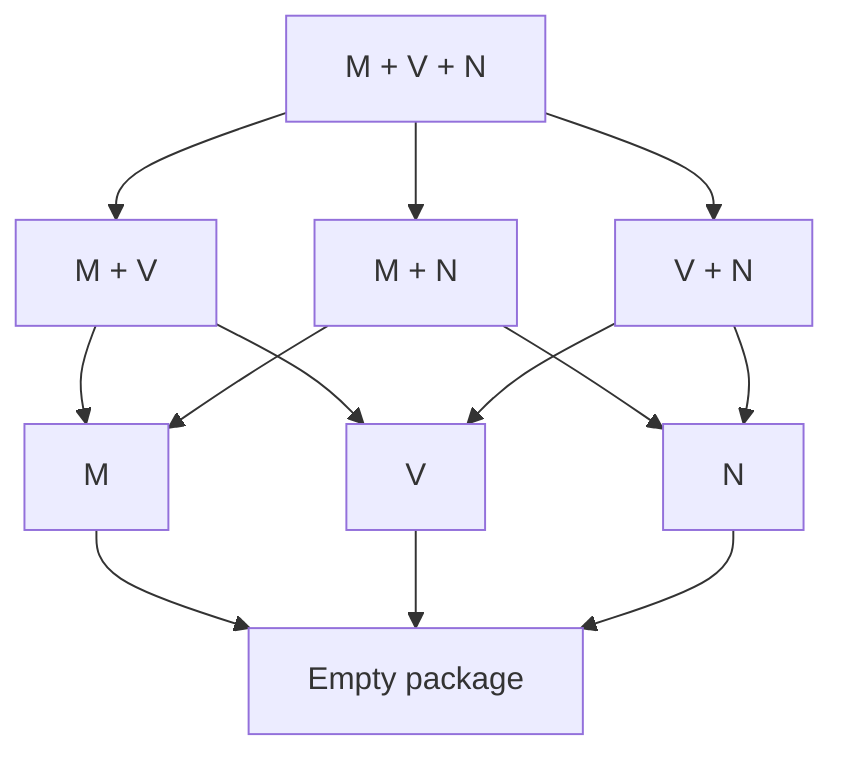

# The theorem space of observer separation over H

H is the fixed base throughout this map. C is an additional theory recovered in one region. The map separates the exact implication order of primitive preservation packages from the further relations introduced by derived operations, identity, observer restrictions and higher types.

Proofs by OpenAI Codex, prompted by Daniel Kodsi, 24 October 2026. Direct sources and section locators are given in the linked notes. See the [thematic diagrams](GRAPH.md) and [notation guide](README.md).

The [full graphical map](GRAPH.md) includes the structural, representation, quantifier, identity, affine and reversible-meet results, as well as the primitive and upper logical regions. Extra premises appear explicitly in its nodes. The current atlas contains 75 proof/model notes. Only the finite primitive family is completely classified; §10 gives the remaining comparisons.

## 1. Coordinates of a principle

Write S[R] for propositional separation by R-qualified observers:

$$
S[R]:=\forall p,q\, .\,p=q\leftrightarrow\forall E\, .\,R(E)\to(Ep\leftrightarrow Eq).
$$

FullSep[R] applies the same criterion to relations at every admitted argument tuple. Qualifications contain finite lists of types, indexed externally. The agreement clause is Ep↔Eq.

| Coordinate | Choices that must remain distinct |
| --- | --- |
| Preservation strength | Material truth law; pointwise identity; identity of whole operations |
| Separation scope | Propositions; one relational type; full relational schema |
| Primitive signature | M: conjunction; V: disjunction; N: negation; Qσ: universal; Pσ: existential |
| Endpoints | A: accept Top; Z: reject Bottom; fix either endpoint as an object |
| Equality | Translated reflexivity/substitution; truth-correct equality; pointwise or full fixing |
| Observer restriction | Factive, inflationary, endpoint range, finite image, idempotent, injective, onto, qualified left/right inverse, reversible, native-Box commuting, bounded fibre degree, commuting with every qualified observer, unique |
| Explicit extra premises | Functionality, identity bivalence, ND_t, Plenitude at t,t, Boolean Completeness at t, Zorn at t or tt with its stated scope, admitted local homogeneity, internal finiteness, binary-family constructors, C or C5 |

Primitive and derived operations remain distinct until the appropriate identity is established. The empty accepting/rejecting propositional package is a theorem of H; its full typed version is Functionality.

## 2. The complete primitive-package order

For any finite Γ of independent clauses from M,V,N,Qσ,Pσ, put T_J=H+S[A∧Z∧J], for J⊆Γ. Fix one preservation tier and either propositional or full relational separation. Then

$$
T_K\vdash T_J\quad\Longleftrightarrow\quad J\subseteq K.
$$

This classifies all 2^|Γ| packages at once. Single-primitive corruption models prove every missing implication. The proof is [Primitive-package classification](primitive-package-classification.md), §§1–4.

For the three primitive connectives, arrows from a larger package to a smaller package are the only arrows within this family:

Every node retains A,Z, and uses the same tier and type scope. This diagram is an inclusion-ordered family inside the theorem space. It is not the whole theorem lattice: S[M] together with S[V] can be weaker than S[M∧V]. The [two-orders model](two-orders-model.md), §§2–4, proves this with strong full typed separation and much stronger endpoint/identity restrictions.

## 3. What separation represents

At any evaluation point, send a proposition p to the set of eligible observers accepting it. Separation says this map is injective. Preserved operations become intersection, union, complement, and admitted indexed intersections/unions. Hence each finite signature has exactly the algebraic equations and universal Horn laws valid in its two-element reduct. This is an external representation by truth sets, with no assertion that all external subsets or families are admitted. See [Truth profiles](truth-profiles-and-connective-reducts.md), §§2–3.

Without extra endpoint alignment, the connective output structures are:

| Same-observer signature | Structure forced on propositions |
| --- | --- |
| M; V; N | Meet semilattice; join semilattice; involution, respectively |
| M,V | Distributive lattice for the original operations |
| M,N | Boolean algebra with derived join; fixed Bottom, derived top ¬Bottom |
| V,N | Boolean algebra with derived meet; fixed Top, derived bottom ¬Top |
| M,V,N | Boolean algebra for the original operations and fixed endpoints |
| Implication | Join structure with greatest derived unit; every upper interval Boolean |
| Biconditional or XOR | Elementary abelian 2-group |
| Either group operation plus M or V | A Boolean ring and corresponding distributive lattice, possibly without the missing bound |

Acceptance/rejection aligns bounds; fixing the missing endpoint permits whole-operation preservation of the derived complement. The exact endpoint equivalences are in [Truth profiles](truth-profiles-and-connective-reducts.md), §4, and [Term closure and affine branches](term-closure-and-affine-branches.md), §§3–5. Strong preservation is closed under actual term composition, including fixed constants; it is not closed under mere truth-table replacement.

## 4. Exact intrinsic converses

| Separation principle | Exact counterpart, with stated premises |
| --- | --- |
| Material M | Meet-semilattice equations |
| Material V | Join-semilattice equations |
| Material N | Double-negation identity |
| Material A+M+QΔ | Meet semilattice with greatest Top and listed universals as admitted GLBs |
| Material Z+V+PΔ | Join semilattice with least Bottom and listed existentials as admitted LUBs |
| Material A+QΔ | Existence of an admitted partial order with greatest Top and those GLBs |
| Material Z+PΔ | Dual admitted partial-order statement |
| Pointwise A+M+QΔ, assuming ND_t | The same bounded meet/GLB structure |
| Pointwise Z+V+PΔ, assuming ND_t | The same bounded join/LUB structure |
| Strong A+M+QΔ, assuming IB_t and the listed local Functionality instances | The same bounded meet/GLB structure |
| Strong Z+V+PΔ, under the same local hypotheses | The same bounded join/LUB structure |
| Material or two-output pointwise XOR or biconditional, assuming internal Frege finiteness of all propositions | The corresponding Boolean-group equations |
| Pointwise M or V, assuming internal Frege finiteness of all propositions | The corresponding semilattice laws; add designated bounds for A/Z |

The first seven rows are proved in [Truth profiles](truth-profiles-and-connective-reducts.md), §§6–7. [Necessity of distinctness representation](necessity-of-distinctness-representation.md), §§1–5, proves the next two: under H+ND_t, material and pointwise M/Q separation have the same exact intrinsic counterpart, as do V/P. The witnesses have two outputs, which need not be Top and Bottom. The finite list may be empty and need not contain t. Whole-operation preservation additionally requires the stated local Functionality instances; at full relational scope all three tiers coincide. This proof assumes neither C nor NI.

The strong IB rows are [Local identity representation](representation-under-identity-bivalence.md), §§2–5: explicit endpoint-valued principal tests prove the converses. IB_t concerns equality judgments, not every proposition, and the local package is not identified with C. The finite affine row's original material character-extension proof is [Internally finite affine separation](finite-affine-separation.md), §§1–6. It is strengthened in [Finite affine normalization](finite-affine-normalization.md), §§2–5: internal Frege induction constructs an admitted subgroup of index two and a test invariant on its cosets, then a two-output homomorphism. No Choice, identity-collapse assumption, or external enumeration is used. Local binary Functionality gives whole-operation preservation; full typed separation adds exactly Functionality on the structural side.

The final row follows from [Finite semilattice normalization](finite-semilattice-normalization.md), §§2–6. Internal finite induction supplies a least true meet element, or greatest false join element. An explicit admitted two-valued operation then replaces every material character by a pointwise character with exactly the same truth profile. This collapses material and pointwise M/V separation under internal finiteness, and all three tiers at full relational scope, without identity bivalence. The local extremum already suffices without finiteness.

A further exact reduction needs only finite images of the separating observers, not finiteness of the proposition domain. Over H, for M and V separately and with any of no endpoint condition, A, Z or A+Z,

$$
S[\text{finite-image material observers}]\ \leftrightarrow\ S[\text{at-most-two-output pointwise observers}].
$$

Here finite image is internal Frege finiteness. The two outputs depend on the observer and need not be Top and Bottom. The normalization retains the entire current truth profile. At full relational scope, the pointwise condition can also be replaced by whole-operation identity. See [Finite-image material normalization](finite-image-material-normalization.md), §§2–5.

The same exact finite-image/two-output reduction covers M+QΔ, V+PΔ, and the joint signature M+V+QΔ+PΓ, without ND_t. Separation supplies the original semilattice or distributive-lattice order and the matching admitted bounds; the normalized false/true chain then preserves all listed operations pointwise. It also applies to unrestricted material observers when the whole proposition domain is internally finite. No negation-preservation or fixed-endpoint-range conclusion is added. See [Necessity of distinctness representation](necessity-of-distinctness-representation.md), §6. These reductions do not assert that every pointwise separator has finite image or settle the unrestricted infinite comparison.

The finite-image reduction also holds separately for XOR and biconditional, retaining any A/Z orientation: finite-image material affine separation is equivalent to two-output pointwise affine separation. Under the Boolean-group equations, every individual finite-image material observer receives a pointwise replacement with the same entire truth profile. A truth-oriented finite induction constructs the required invariant test without assuming that the image is a subgroup. See [Finite affine normalization](finite-affine-normalization.md), §6. Whole-operation lifting retains the explicit Functionality premises.

The existing Plenitude principle supplies a further infinite-domain bridge. Its single t,t instance admits a truth-correct selector into any specified false/true pair. Whenever the pair realizes the required operation tables as identities, this selector normalizes every material observer to a two-output pointwise observer with the same truth profile. Such pairs exist under material separation for all seven nonempty subsets of M,V,N, and separately for XOR and biconditional. Matching M/Q and V/P packages, and joint M,V with both listed quantifier families, also normalize by their admitted GLB/LUB laws. Full typed scope gives whole identities; no infinite affine character-existence theorem or quantifier-only reduction is asserted. See [Plenitude normalization](plenitude-material-normalization.md), §§1–6. Thus the remaining bare-H comparisons must also evade this explicit admission hypothesis.

Infinite affine character existence has a separate positive theorem using the existing **preorder Zorn instance at type tt**, stated explicitly over H. Under that premise, the Boolean-group equations are equivalent to material separation for each affine operation, with the existing endpoint alignments. More strongly, every admitted partial truth character extends to an admitted character. The proof applies Zorn to the admitted preorder of subgroups extending a prescribed kernel and avoiding a chosen element, then constructs the character from its two cosets. Pointed maximality exactly characterizes separation; the relative version exactly characterizes partial-character extension. See [Zorn supplies affine characters](zorn-affine-character-extension.md), §§1–7. No C-based equivalence of Zorn with another choice principle is imported.

The same explicit Zorn instance gives exact **joint lattice and Boolean converses**. Material M+V separation is equivalent to the distributive-lattice output equations, with A/Z adding precisely the corresponding designated bounds. Material M+N, V+N and M+V+N separation is equivalent to the appropriate Boolean algebra, retaining derived versus primitive operations and the stated endpoint alignments. An admitted maximal-filter argument supplies prime filters and extends every admitted partial lattice truth character. Relative prime-filter separation is exactly this extension principle. Plenitude adds pointwise normalization; local Fun gives whole identities, while full typed characterizations include all Fun. No quantifier preservation follows from the finite-operation theorem. See [Zorn supplies lattice and Boolean characters](zorn-lattice-character-extension.md), §§1–6.

Plenitude also gives a stronger partial-signature result: for negation alone and each separate affine operation, material separation is equivalent to separation by **pointwise involutions**, with endpoint truth conditions upgraded to fixing the corresponding endpoints. Negation uses an admitted flip of one negation pair; the affine proof adds to identity a two-output homomorphism whose square is zero. Local Functionality gives whole preservation and inverse identities; full typed scope supplies those instances. This does not preserve extra unnamed operations or the original observer's entire truth profile. Thus Zorn supplies affine characters, while Plenitude turns their separation into reversible separation. For details see [Reversible partial-signature normalization](partial-reversible-normalization.md), §§1–5. The six-element full-function meet model shows that Plenitude does not give the analogous collapse for conjunction.

The affine result extends to **linked operations**. Over bare H, joint material N/+ separation is exactly material + separation together with ¬x=x+c, where c=¬0 and 0 is that affine group's unit. Joint material XOR/biconditional separation is exactly material XOR separation together with D(x,y)=(x⊕y)⊕u, where u is the biconditional unit. Under Plenitude the witnesses may be chosen as pointwise involutions preserving the entire linked signature and fixing the required endpoints. Adding A/Z now aligns Top/Bottom with the appropriate two distinguished elements; the opposite-unit endpoint is no longer free as it was for one affine operation. For the actual expansion X=¬D, all three two-operation material packages N+X, N+D and X+D coincide and also give the three-operation package. Whole identities retain local Fun, or full typed scope. See [Negation and affine compatibility](negation-affine-compatibility.md), §§2–7.

## 5. Quantifiers can generate new lattice operations

An admitted uniform family constructor with exact range {p,q} allows Qσ-separation to define a meet by universal quantification over that family. Pσ similarly defines a join. These are operations determined by the observer profiles, initially independent of primitive conjunction/disjunction.

Composition of all strong Qσ observers is closed. Separation therefore upgrades the derived meet's truth law to an identity preserved by every such observer. The same argument applies to any more restricted separating class by first forgetting its extra restrictions. Full typed separation supplies the Functionality needed for the whole-operation identity. Thus adding preservation of this derived meet, or derived join, adds no strength to the full typed principle.

A common Q/P class yields a derived distributive lattice and the corresponding admitted quantifier adjunctions and distribution laws. The exact constructor premise and proofs are in [Quantifier-generated lattices](quantifier-generated-lattices.md), §§1–6. Pair-by-pair existence is distinguished from a uniform admitted constructor.

The constructor is a substantive additional premise. The [full three-object fork](fork-without-binary-families.md), §§2–5, satisfies C, all BF instances, all their boxed forms, and full typed universal-only separation. It has no nonconstant endpoint-valued family at any type. Even pair-by-pair exact binary-family existence therefore fails there.

There is also an exact general composition theorem. For a finite signature Σ of the displayed preservation clauses, optionally including fixed proposition constants,

$$
S[\mathrm{Pt}_\Sigma]\ \leftrightarrow\exists X\,[\mathrm{Sep}(X)\land\mathrm{Closed}(X)\land\mathrm{Material}_\Sigma(X)].
$$

The admitted family X may additionally be required to contain identity. Testing each proposed output equation with X and using composition closure proves that every X-member preserves it pointwise. Material acceptance/rejection in such a closed separating family upgrades to fixing the corresponding endpoint; ordinary A/Z qualifications are not silently composition-closed. For a relational type ρ the exact typed formula uses one X separating both t and ρ, and the full schema is indexed externally by ρ. Full typed scope also makes whole-operation preservation equivalent. See [Composition-closed characterization](composition-closed-characterization.md), §§1–4.

## 6. Identity and truth restrictions

Put z:=(Top=Bottom). Identity collapse IC_t says every true propositional identity judgment equals Top and every false one equals z.

| H principle | Exact counterpart |
| --- | --- |
| Accepting, truth-correct equality separation | IC_t |
| Accepting, pointwise equality-fixing separation | IC_t |
| Full typed versions, including whole equality fixing | IC_t + Functionality |
| The material equality branch plus material negation preservation | IC_t + double negation + z=¬Top |
| Factive separation, even with A,Z | Every false proposition equals Bottom |
| Inflationary separation, even with A,Z | Every true proposition equals Top |
| Factive or inflationary propositional separation plus negation preservation | Fregean Axiom; full relational separation additionally gives Functionality, hence Extensionality |
| One observer separating propositions | Propositional Fregean Axiom |
| Full separation plus unique qualified observer, for identity-containing A,Z classes | Full Extensionality |

Sources: [Identity collapse](identity-collapse.md), §§2–6, and [Observer restrictions](observer-restrictions.md), §§2–4. The IC witnesses already have two outputs {Top,z} and are pointwise idempotent. Those restrictions add no strength there; z need not be Bottom. A fixed n-observer separating family gives the exact unqualified bound of at most 2^n propositions; this is distinct from internal finiteness and finite image of each observer.

## 7. Reversible meet separation: atoms and order actions

Accepting/rejecting separation by reversible meet observers, together with one meet atom, implies that atoms distinguish every failure of order. Each proposition is the LUB of its atoms, and current truth is membership above a unique true atom. All atoms lie in one orbit of the admitted meet automorphisms.

This uses conjunction and admitted inverses only. No C, negation, disjunction, quantifier, BF or identity-bivalence premise is used. A unique atom then gives the Fregean Axiom; full typed separation upgrades this to Extensionality. Restricted-class transitivity requires the stated closure conditions. See [Reversible meet separation](reversible-meet-atomicity.md), §§2–6.

There is now an exact converse: reversible meet separation plus one atom is equivalent over H to a bounded atomistic meet structure with a true atom and admitted full-meet automorphisms transitive on atoms. For an arbitrarily restricted class, the precise condition is that each atom can be moved to truth by an eligible admitted meet automorphism; no closure of the extra restriction is required. Full relational separation adds exactly Functionality. See [Exact characterization](reversible-meet-characterization.md), §§2–5.

Its §6 gives a six-element H countermodel showing that atomisticity plus a true atom is insufficient without the transitivity condition, even with all Functionality, all-type identity bivalence and ordinary strong meet separation by endpoint-valued idempotent observers.

There is also a positive **atomless** region. For any admitted group G of whole meet automorphisms, the relation saying that p and q have the same truth under every member of G is the largest admitted G-invariant truth-compatible equivalence; it is automatically a meet congruence. Separation is exactly the absence of a nontrivial such congruence. On a chain this maximal obstruction is convex.

On a bounded dense meet chain, assume that the interior contains a true and a false proposition, and that every admitted G-invariant convex equivalence on the interior is equality or universal. This order-primitivity condition is independent of truth and implies reversible meet separation. The dual join theorem and joint meet/join version hold with the corresponding whole-preservation hypotheses. A full-function H model on the rational unit interval with its midpoint removed, truth above the midpoint, min/max and complementary negation, satisfies joint reversible M/V separation and all Fun while failing C. An admitted translation subgroup is already primitive and separating, although it is not order 2-homogeneous. See [Reversible semilattice order actions](reversible-semilattice-order-actions.md), §§1–7. Whole inverse and preservation identities are explicit; full typed lifting retains Fun. This supplies a substantial atomless theorem without claiming a complete atomless classification.

### Adjacent truth cuts and both quantifier families

A bounded chain with a greatest false f and least true u has an **exact gap characterization**. Separation by a specified admitted whole-meet automorphism group G holds iff every nontrivial interval contains an adjacent pair and G acts transitively on adjacent pairs. A separator's inverse sends the actual truth gap f<u into any given interval; conversely, moving a contained gap to f<u separates its endpoints and the surrounding pair. These gaps need not touch Bottom, so they are not proposition atoms.

The truth-extremum premise follows from one pre-existing admission instance: $\mathrm{Plen}_{t,t}$ admits a family ranging over all true propositions (with Top repetitions) and one ranging over all false propositions (with Bottom repetitions). If primitive Q_t and P_t supply admitted GLBs and LUBs, their bounds are respectively a least true and greatest false proposition. No C or Fun is used in this bridge. Order automorphisms preserve all admitted GLBs/LUBs pointwise; the relevant local Fun, or full typed scope, upgrades these to whole quantifier identities.

The full-function **complete split-interval model** realizes this region with atomless propositions. Its domain is Bottom, Top and two lexicographically ordered points at each real coordinate in (0,1); truth starts at the upper point over 1/2. Min/max and genuine infima/suprema give the primitive conjunction, disjunction and both quantifiers. Increasing coordinate bijections supply reversible endpoint-fixing separators preserving M,V and every listed Q/P as whole operations. Nevertheless C fails because primitive negation is not included in the separating qualification. See [Reversible truth-gap chains](reversible-truth-gap-chains.md), §§1–6. This strengthens the earlier rational-chain example by preserving both quantifier families, without silently identifying a jump with an atom.

### Convex blocks and finite lattice factors

Reversible separation also admits two exact local-to-global reductions. In a bounded dense chain, let an admitted G-invariant convex equivalence have blocks without endpoints. Then S[G] holds iff one block crosses the truth cut, G is transitive on blocks, and the admitted setwise stabilizer separates that crossed block. There is at most one crossed block. If block stabilizers are order-primitive, local separation follows from the crossed block's true/false pair; the global action itself can be imprimitive.

For a bounded distributive lattice with a specified external finite central partition preserved by G, exactly one factor unit w is true. Global S[G] is equivalent to transitivity on the factor units plus separation of the interval [Bottom,w] by its stabilizer. Finite distributivity detects a differing component, and z↔(z∧w) transfers its truth test to the whole proposition. The factors may be infinite and atomless. Full-function lexicographic-chain and finite-product models realize these two criteria, with joint reversible M/V separation, all Fun and failure of C. See [Reversible separation from blocks and factors](reversible-semilattice-local-global.md), §§1–6. Full identities, admitted groups and external finite scope remain explicit; no quotient domain or internal Choice is assumed.

## 8. Higher types and preservation tiers

For every qualification K,

$$
\mathrm H+\mathrm{FullSep}[K]\ \equiv\ \mathrm H+S[K]+\mathrm{Functionality}.
$$

Consequently pointwise and whole-operation preservation give equivalent full typed separation theories for corresponding finite qualifications. At propositional scope they can differ: the [hidden-proposition model](local-tiers-and-models.md), §3, has pointwise conjunction separation but lacks whole-operation conjunction separation, even with endpoint-valued equality-fixing witnesses.

The [hidden-individual model](local-tiers-and-models.md), §2, has only two propositions and satisfies every propositional logical-separation instance, including endpoint, factive and equality-fixing restrictions. It nevertheless fails C and Functionality at et. Thus even the strongest propositional region does not replace the full typed hypothesis. A separate existing C action model shows that propositional Boolean separation plus C still need not yield Functionality at tt.

Material and pointwise qualifications can differ as predicates. For M and V separation, internal finiteness collapses those two tiers; a least true meet element or greatest false join element suffices locally. ND_t is a separate sufficient condition, including the matching quantifier branches, and finite-image normalization covers the joint lattice/quantifier branch. The unrestricted infinite comparison outside these hypotheses remains unresolved. The complete logical full typed case has a positive equivalence, described next.

For negation, the material/pointwise distinction is proved at the level of separation theories: the [four-proposition relational model](relational-clone-model.md) satisfies all Functionality and full typed material N-separation, but fails even propositional pointwise N-separation. Its only pointwise negation-preserving observers are identity and negation; they cannot distinguish two propositions having the same truth value. This example concerns bare N (also one endpoint truth restriction at a time), not the joint A+Z primitive-package family above.

## 9. C and stronger theories as regions of the H space

Full typed separation by complete logical observers transports finite H proofs and recovers C and all BF instances. Material, pointwise and whole-operation versions of this complete theory coincide. All independent primitives and the translated equality rules have explicit sharpness models; a truth-functionally complete fragment does not automatically recover an omitted primitive. See [Typed separation and Classicism](typed-separation-and-classicism.md), §§3–7.

Within this region the earlier results remain available with their stated scope:

| Full typed complete-logical restriction over H | Established theory or relation |
| --- | --- |
| Ordinary logical separation | Entails C+BF; stronger than merely assuming that base |
| Equality reflection or equality fixing | Exactly C5 + ordinary logical separation |
| Endpoint-valued range | Exactly C5 + Atomicity |
| Reversible separation | Exactly C5 plus triviality of the propositions fixed by every reversible Good_t observer; also entails necessary OS and No Pure Contingency |
| Necessarily bijective Good-observer separation | Exactly reversible separation |
| C5 + bijective Good-observer separation | Exactly reversible separation |
| C5 + surjective Good-observer separation | Exactly reversible separation |
| Surjective Good-observer separation without C5 | Strictly between Rev and OS; incomparable with qualified left-inverse separation |
| Surjective plus qualified left-inverse separation | Strictly stronger than either factor and strictly weaker than Rev, even when both are separately boxed |
| Native-Box commuting Good-observer separation | Entails OS + necessary BF + necessary Functionality + .2; the converse fails |
| Idempotent native-Box separation | Strictly stronger than BoxSep; incomparable with Rev and End |
| Idempotent native-Box separation + C5, Rev, or End | Each combination is exactly Extensionality |
| Native-Box separation with $E^{r+1}=E^r$, for fixed external r≥1 | An unbounded strictly descending family $B_r$; every fixed bound is strictly stronger than BoxSep |
| Any fixed $B_r$ + C5, Rev, or End | Each combination is exactly Extensionality |
| C5 + separation by Good observers with n Boolean generators over their image, for fixed n≥0 | Exactly Rev; injectivity is not required of those observers |
| C5 + separation by Good observers whose local-transversal support is Top, or is currently true | Exactly Rev; the canonical support normalization has the same separating power |
| C5 + separation by Good observers of degree at most n, for fixed n≥1 | Exactly Rev; injectivity, Boolean Completeness and Zorn are not needed |
| C + Actuality + finite-image native-Box separation at fixed τ,Δ | Exactly C + $\mathrm{Fin}_t(\mathrm{All})$ + BoxSep(τ,Δ); no t∈Δ assumption |
| Central logical separation + C5, Rev, or End | Each combination is exactly Extensionality; central means commuting with every Good observer for the same list |
| Finite-image native-Box separation, full scope over H | Exactly $\mathrm{Fin}_t(\mathrm{All})$ + BoxSep; entails necessary $\mathrm{Fin}_t(\mathrm{All})$ and Actuality |
| C5 + finite-image native-Box separation | Exactly End + $\mathrm{Fin}_t(\mathrm{All})$; also exactly Rev + FinBoxSep |
| Central logical separation | Exactly IdemBoxSep plus at most four proposition objects; equivalently its separately boxed schema; implies Actuality and internal finiteness |
| Separation by the centre of the reversible observer group | Exactly C5 plus at most four propositions; equivalent to its separately boxed schema; incomparable with ordinary central separation |
| Rev plus E^n=I for every reversible Good_t observer, fixed external n≥1 | Exactly C5 plus at most 2^k propositions, where k is largest such that every 1≤m≤k divides n |
| Rev plus any fixed nontrivial group-word identity on the entire reversible group | Exactly C5 plus at most 2^k(w) propositions, where Sym(k(w)) is the largest symmetric group satisfying the word |
| C5 plus a fixed nontrivial group-word identity, without Rev | Exactly the orbit-overlap condition C_k(w); no k(w)+1 disjoint propositions have overlapping invariant orbit joins |
| Rev plus internally finitely many reversible Good_t observers | Exactly C5 + FinAll; equivalently End + FinAll or C5 + FinBoxSep |
| Separation by an internally finite family of logical observers, full scope | Exactly OS + FinAll; reversible version is C5 + FinAll, native-Box version is FinBoxSep |
| C5 + ordinary logical separation + a currently true admitted homogeneous interval | Entails qualified left-inverse separation; no J premise is required |
| C5 + injective Good-observer separation | Exactly C5 + native-Box separation; strictly between Rev and C5 + OS |
| C5 + injective separation, in one-formula form | Over the stated C5 base: Rev or (OS and $J_t$), with the one-observer condition defined below |
| Ordinary logical separation + Plenitude at t,t | Exactly endpoint separation |
| C5 + ordinary logical separation + Actuality, Boolean Completeness at tt, or full Boolean Completeness | Exactly endpoint separation; Boolean Completeness at t does not suffice |
| C + invertible QΔ-observer separation, with t∈Δ | Exactly reversible separation |
| Reversible and finite-image separation together | Exactly endpoint separation |
| Reversible separation plus one finite-image $\mathrm{Good}_{\{t\}}$ observer | Exactly endpoint separation |
| C5 + necessary ordinary separation + one proposition atom | Exactly endpoint separation |
| Factive separation; or ordinary separation plus one unique qualified class | Exactly Extensionality |

Reversible and finite-image separation are incomparable separately. The [logical observer hierarchy](../logical-observer-hierarchy.md) and [lattice models](../observer-lattice-models.md) contain the proofs and separating models. Internal finite image is not replaced by external finiteness.

The **single propositional Plenitude instance** has an exact complete-logical effect: End iff OS+$\mathrm{Plen}_{t,t}$ iff OS+Plen_r iff C5+OS+Actuality iff C5+OS+BC_r. Already C+BF_t+$\mathrm{Plen}_{t,t}$ is exactly C5+Actuality: the source's t,t selector proofs give ND_t and Actuality, BF_t gives boxed ND_t, and the recorded boxed type reduction gives C5. Thus current OS and current Plenitude suffice; neither is silently boxed. Conversely the endpoint package gives necessary Plenitude at all relational types. See [Propositional Plenitude and endpoint separation](plenitude-endpoint-bridge.md), §§1–5.

The reversible characterizations are proved in [Reversible quantifier observers](reversible-quantifier-observers.md), §§1–4. Over C, an admitted E has a whole-operation inverse exactly when □Bij(E); the explicit description term supplies the inverse without Choice or BF. Its inverse preserves every finite list of operations preserved by E. C5 additionally makes current Bij(E) necessary. Over C, Q_t plus admitted whole invertibility makes E a Boolean-order isomorphism, hence yields full Boolean identities. Thus the quantifier-only row retains an explicit C premise and a finite list containing t; invertibility can equivalently be replaced by necessary bijectivity. None of these statements upgrades current bijectivity over bare C or recovers C from an unpreserved primitive signature.

[Local symmetry conjugacy](local-conjugacy-and-reversible-observers.md), §§2–6, supplies admitted involutive separators in a precise semantic family: symmetric ideally-full models with countably infinite objects, all bijections as arrows, and finite pinning. It covers every one-object instance with arbitrary designated group, multiobject families with conjugate groups, and families whose groups all have finite bases. This is a sufficient model construction, not a necessary criterion for arbitrary reversible observers.

Further conditional coordinates are in [Modal selectors and quantifier reduction](../modal-selectors-and-quantifier-reduction.md): over C, modal .2 is equivalent to an endpoint selector; under C5, Boolean plus Q_t separation suffices for full logical separation. These are C-relative results, not H converses.

The unrestricted N+Q and V+Q reductions are refuted at the level of separation theories. The [ternary Cantor symmetry model](ternary-cantor-observer-model.md) satisfies C, all boxed BF and Functionality instances, and full endpoint-fixing separation for each of the separate M+Q/P, V+Q/P and N+Q/P classes, including their separately boxed instances. Nevertheless even propositional Boolean separation fails. Root propositions are a current truth bit plus a clopen Cantor profile; supported monotone tests preserve quantifiers because continuous leafwise minima and maxima have admitted lifts. Supported majority tests supply negation separation, while no supported Boolean ultrafilter can read the profile. Thus even the conjunction of the three separate separation theories does not provide a common Boolean separating class. Modal .2 fails in the model, so the earlier positive conditional reductions remain intact.

Section 6 of [Modal selectors and quantifier reduction](../modal-selectors-and-quantifier-reduction.md) also proves a sharp limitation on the individual-observer upgrade: C plus all boxed BF does not make every Q_t-preserving observer preserve M, or every P_t-preserving observer preserve V. The full fork supplies endpoint-fixing, finite-image, idempotent counterexamples that preserve the opposite binary connective. The fork itself has full OS, so this is not a countermodel to an equivalence between the corresponding separation theories.

Even full qualified left-inverse separation does **not** entail C5, ☐OS, its own boxed schema, ☐BF at e or t, or ☐Functionality at (e,t). The [all-maps left-inverse construction](finite-block-symmetry-left-inverse.md), §7, supplies this stronger verdict at the natural-number object of the existing finite-support natural-numbers/singleton model. Its [Barcan and Functionality witnesses](logical-separation-with-contingent-barcan.md), §§3–5, remain unchanged. No atomlessness verdict is transferred from the different finite-block symmetry model.

The atom-bearing necessary-separation region has an exact converse. In fact C5 plus the single boxed propositional instance S_{t,{t}} and one proposition atom already implies Atomicity_t. Hence, over H,

$$
\begin{aligned}\mathsf{End}&\leftrightarrow\mathrm{C5}+\mathrm{Atomicity}_t\\&\leftrightarrow\mathrm{C5}+\Box S_{t,\{t\}}+\text{one atom}\\&\leftrightarrow\mathrm{C5}+\Box\mathrm{OS}+\text{one atom}.\end{aligned}
$$

Here End is full typed endpoint separation, while S_{t,{t}} is one closed formula; the C5 premise explicitly includes C. One atom can equivalently be replaced by Actuality or by the existence of one internally finite-image $\mathrm{Good}_{\{t\}}$ observer. See [Necessary separation and atoms](necessary-separation-and-atoms.md), §§1–4. The atomless countermodel below shows why that atom-bearing conclusion does not extend to C5+□OS alone.

Reversibility also gives a pure-language consequence without any atom premise:

$$
\mathsf{Rev}\ \Longrightarrow\ \mathrm{C5}+\Box\mathrm{OS}+\text{No Pure Contingency}.
$$

For each closed pure sentence P, a qualified involution at the finite list of quantifier types occurring in P extends by explicit typewise conjugation. It fixes the logical constants and hence P. Involutive separation compares a true P with Top and gives □P. At the individual type, conjugation leaves variables unchanged; no forbidden e→e object is introduced. The quantifier-reindexing identity uses a necessary whole-operation involution identity, not necessitation of an optional premise. See [Reversible separation and pure truth](reversible-separation-and-pure-truth.md), §§1–4. This is not a characterization.

The implication Rev⇒C5+□OS is **strict**, even in atomless models. The [finite-block symmetry model](finite-block-symmetry-reversible-gap.md), §§1–8, has two countable objects: one partitioned into blocks of every positive even size, the other into blocks of power-of-two size. Independent within-block permutations and all bijections as arrows give C5 and full necessary OS at both objects. Yet the pure sentence MC₆—every admitted disjoint family of six-element sets admits a relation selecting a nonempty proper subset of each—fails at the even-block object and holds at the power-of-two object. This pure contingency obstructs Rev. The conclusion does not rely on treating failed local conjugacy as a necessary obstruction. The model gives an explicit failed reversible propositional instance at the finite type list stated in its §8; both proposition algebras are atomless.

Adding **No Pure Contingency still does not recover Rev**, even after strengthening necessary OS to necessary qualified left-inverse separation. The [component-shift symmetry model](component-shift-symmetry-reversible-gap.md) has one object, hence No Pure Contingency, and satisfies C5+□SplitMono. Its allowed arrows shift a sequence of components, alternating the two finite-block patterns. The same-component binary relation is endpoint-valued and fixed by every allowed arrow; a choice assertion inside the component of an individual changes truth under a shift. Every qualified involution fixes that assertion under conjugation, so Rev fails at an explicit finite propositional type list.

This gives a stronger positive bound as well: Rev implies noncontingency for pure formulas with finitely many individual parameters and finitely many first-order relation parameters of types eⁿt, provided each relation is endpoint-valued on all individual tuples. These parameters are fixed by conjugation, so the pure-term argument still applies. The condition does not extend here to arbitrary higher-type parameters. The exact external schema and proof are in the component-shift note, §6; its countermodel shows why closed pure noncontingency alone is weaker.

**Reversibility has an exact algebraic characterization.** Over C5, let A(E) be the finite identity-based qualification for reversible $\mathrm{Good}_{\{t\}}$ observers. Then

$$
\mathrm{Rev}\ \Longleftrightarrow\ \forall p\,[\mathrm{Inv}(p)\to(p=\bot\lor p=\top)]\qquad(\mathrm{C5}).
$$

The same-observer quantifier reduction makes this single finite sentence characterize full typed Rev over the stated C5 base. Define the admitted orbit join O(p)=∃E(A(E)∧Ep). Its guard is endpoint-valued under C5. Composition and the admitted inverse show that O(p) is fixed by every eligible observer; it is the least such invariant above p. If the fixed propositions are only the endpoints, p≠Bottom forces O(p)=Top, whose existential truth supplies a reversible observer accepting p. Apply this to p△q to obtain separation. Conversely Rev identifies every invariant proposition with the endpoint matching its truth.

Failure of Rev therefore has an admitted nonzero false invariant O(r), not merely an external orbit obstruction. The invariant propositions form a Boolean algebra closed under admitted quantified families. The dual ¬O(¬p) is the greatest invariant below p, and O(p∧q)=O(p)∧q for invariant q. This is an algebraic characterization in terms of the admitted observer action; it does not identify the weaker first-order parameter-noncontingency schema with Rev. See [Reversible separation and fixed propositions](reversible-fixed-proposition-characterization.md), §§1–5.

**The invariant algebra is also determined by all logical observers locally.** For arbitrary Good_t E over C5, let $s_E$ be its canonical local-transversal support and N(E)p=($s_E$∧Ep)∨(¬$s_E$∧p). A proposition u is fixed by every reversible observer exactly when $s_E$∧Eu=$s_E$∧u for every Good_t E, equivalently when every N(E) fixes u. Another exact criterion is that no nonzero parts of u and ¬u admit a relative order isomorphism with an admitted inverse. The admitted orbit closure therefore has the identities

$$
O(p)=\exists E\,[B(E)\land s_E\land Ep]=\exists E\,[B(E)\land\mathcal N(E)p].
$$

Here $B(E)$ is the endpoint-valued identity-based Good-t guard. These are admitted joins, not external orbit unions. If an observer accepts a false invariant u, its true crossing Eu∧¬u is disjoint from $s_E$. For an injective detector, C5+$\mathrm{BC}_t$+$\mathrm{Zorn}_t$ and $L_E s_E=\top$ supply a qualified left inverse killing that crossing, hence K. The support-coverage premise is additional: the general inverse comparison remains unresolved. See [Invariant components and local support](invariant-components-and-local-support.md), §§1–5.

Qualified right inverses give another exact characterization of Rev: full typed logical separation by E admitting a same-list Good right inverse F with E∘F=I is equivalent over H to reversible separation. Over C+BF, for each finite Δ containing t, a localized Boolean patch replaces a distinguishing right-invertible observer by a same-list involution. The theorem is about separation principles, not equality of the individual observer classes. See [Qualified right-inverse separation](split-inverse-logical-observers.md), §§1–4.

Over **C5**, current surjectivity of a $\mathrm{Good}_\Delta$ observer, with t∈Δ, does supply an admitted same-list qualified right inverse. Define its greatest kernel element k_S=∃p[(Sp=Bottom)∧p], take the unique representative of each fiber below ¬k_S, and fill the k_S region with identity. This is an explicit term, with no Choice or external section. Consequently surjective Good separation plus C5 is exactly Rev. The C5 premise remains explicit; the theorem does not upgrade bare-C surjectivity. See [Surjective logical observers](surjective-logical-observers.md), §§1–5.

The canonical construction extends to **every $\mathrm{Good}_{\{t\}}$ observer E over C5**, without injectivity or surjectivity. The admitted terms

$$
Rq:=\exists p^t\,[(Ep\le q)\land p],\qquad Lq:=\neg R(\neg q).
$$

satisfy Lq≤p iff q≤Ep and Ep≤q iff p≤Rq. Put k=RBottom and a=¬k. Then R(Ep)=p∨k and L(Ep)=p∧a. E factors through p↦p∧a as an isomorphism from [Bottom,a] onto its image, with a canonical admitted inverse on that image. The image floor j=E∘R and ceiling c=E∘L are idempotent, satisfy j≤I≤c, and have the image as their common fixed points.

| Individual observer condition, over C5 + $\mathrm{Good}_{\{t\}}$(E) | Exact counterpart |
| --- | --- |
| E injective | R fixes Bottom; equivalently L fixes Top |
| E onto | R preserves join; equivalently L preserves meet; equivalently a∧R=L |
| E bijective | R=L; equivalently either adjoint preserves negation |
| E endpoint-valued | Its image floor j is the original Box; equivalently c is Diamond |

There are canonical endpoint-fixing envelopes T⁻q=(a∧Rq)∨(k∧q) and T⁺q=Lq∨(k∧q). T⁻ preserves meet and every universal quantifier; T⁺ preserves join and every existential quantifier. They coincide exactly when E is onto, giving the earlier qualified right inverse. The image floor is generally an auxiliary S5 interior, distinct from the language's necessity operation. For any **Boolean** observer over C5, even without Q_t, commuting with the original Box—or with Diamond—is exactly injectivity. See [Canonical adjoints and image factorization](canonical-adjoints-and-image-factorization.md), §§2–7. The argument uses only admitted families, with no Choice or external completeness; its all-type preservation consequence recovers the already established C5 reduction. The separation and qualified-inverse consequences require the distinct arguments that follow.

**Native-Box separation** uses the additional whole-operation identity λp.E(□p)=λp.□Ep, where □p is the original identity judgment p=Top. Denote this full typed theory by BoxSep, and separation by currently injective Good observers by InjSep. Over H,

$$
\mathsf{BoxSep}\ \Longrightarrow\ \mathrm C+\mathrm{OS}+\Box\mathrm{BF}+\Box\mathrm{Functionality}+.2.
$$

The Barcan argument is finite and local: over C, current BF_σ plus BoxSep(t,Δ) for Δ containing σ and σt gives □BF_σ. Every qualifying E sends the closed BF_σ formula to a true instance of current BF_σ applied to λx.E(Fx); separation from Top then gives necessity. The .2 argument needs even less: **over C, propositional separation by observers fixing Bottom and commuting with Box implies .2**, without Boolean or quantifier qualification. If ◇□p, a separating E makes E□p true, hence Ep=Top. NI on that identity and EBottom=Bottom gives □(p≠Bottom). No optional premise is necessitated.

The transport argument extends to **universal modal reflection**. Over C+BoxSep(t,{t}), every current closed law A=∀p̄ θ(p̄), with θ a finite Boolean/native-modal formula, satisfies A→□A. More generally, let A universally quantify finitely many predicate variables and let its body be a first-order modal formula built from their applications. Both universal and existential object quantifiers are allowed inside the body; the finite qualification list contains the outer predicate types and the inner binder types. Object variables serve only as predicate arguments, including when their type is t. There are no inner quantified predicate heads or extra atomic equality judgments. The observers replace each predicate R by the admitted λx̄.E(Rx̄), leaving object arguments unchanged.

This includes current BF_σ→necessary BF_σ and conditional .3→□.3 and 5→□5. It does not reflect arbitrary ∀p∃q formulas with q used as a proposition atom: an existential witness need not lie in an observer's image. Also **C+BF_t+.2 already proves □.2**, by making an endpoint-selector witness necessary using NI and BF_t; □.2 is not a new strictness over that lower package. A finite root with a terminal singleton and a terminal two-point cluster has □OS+□BF+□Fun and a current universal modal law failing necessarily, so ordinary necessary separation does not give the general reflection theorem. That model fails .2 and therefore does not compare reflection with the stronger lower bundle containing .2. See [Native-Box reflection](native-box-reflection.md), §§1–5.

Over C5, the native-Box and current-injectivity restrictions coincide at every fixed finite list and output type. At full scope this gives a strict chain:

$$
\mathrm{C5}:\qquad\mathrm{Rev}\ \Longrightarrow\ \mathsf{InjSep}\ \Longleftrightarrow\ \mathsf{BoxSep}\ \Longrightarrow\ \mathrm{OS}.
$$

The finite-block C5+SplitMono model supplies the upper strictness; the linear/circular C5+□OS model, where every admitted injection of type tt is onto, supplies the lower. That latter model also refutes the converse from the entire bundle OS+□BF+□Fun+.2 to BoxSep. Outside C5, BoxSep is incomparable with InjSep and with SplitMono, already over C+current BF: omega shifts commute with native Box but its only injective logical observer is identity, whereas the all-maps SplitMono model fails necessary BF. BoxSep is also incomparable with □OS even over C+□BF: the C5-tail root extension has BoxSep but fails future OS, and the linear/circular model gives the other direction. In particular BoxSep implies neither C5 nor □OS nor □BoxSep. These are full-schema conclusions with the explicit failed finite instances given in [Native-Box logical observers](native-box-logical-observers.md), §§1–7.

**Finite-image native-Box separation forces global finiteness.** Let FinBoxSep require the same Good/native-Box observers also to have internally Frege-finite images. For every fixed relational output τ and finite qualification list Δ **containing a relational type**, over C,

$$
\mathrm{FinBoxSep}_{\tau,\Delta}\ \Longleftrightarrow\ \mathrm{Fin}_t(\mathrm{All})+\mathrm{BoxSep}_{\tau,\Delta}\qquad(\mathrm C).
$$

For each qualifying E, define the observed image I_E(V)(q)=∃p(Ep=q∧E(Vp)). Internal Frege induction proves Fin(I_E(V))→E(Fin(V)). Native-Box preservation gives E(p=x)=(Ep=Ex), so deleting x from V deletes the entire observed fibre Ex from I_E(V), without injectivity. The zero step uses Q_t. A whole Q_σ law at any relational σ supplies Q_t by the admitted constant-relation/evaluation retraction; an existential law does so by Boolean duality. The empty-finite and finite-adjoining implications are unconditional H theorems and therefore have C identity with Top; applying E to them requires no preservation of the higher quantifiers inside the finiteness definition. Taking V=All makes every finite-image Box observer accept $\mathrm{Fin}_t(\mathrm{All})$, and separation identifies that proposition with Top.

At full scope over H, this proves **FinBoxSep exactly equivalent to $\mathrm{Fin}_t(\mathrm{All})$+BoxSep**, with Actuality now a consequence. Under C5, or with Rev added instead, it is exactly **End+$\mathrm{Fin}_t(\mathrm{All})$**. FinBoxSep is strictly stronger than BoxSep and incomparable with IdemBoxSep, Rev and End: the infinite omega chain, finite P_{2,2}, two-point chain and infinite full S5 cluster give the required comparisons. See [Finite-image Box reflection](finite-image-box-reflection.md), §§1–5.

FinBoxSep itself need not persist: the finite exterior-arm model $A_{2,3}$ satisfies it and □FinAll, while its future P_{2,3} cone fails BoxSep and hence FinBoxSep. In every full finite rooted-poset model the two schemas coincide point by point; in $A_{m,n}$, boxed FinBoxSep holds exactly when m=1 or n≤m. See the reflection note, §5.

The earlier fixed-instance theorem remains useful when Δ is empty or contains only e: over C, **Actuality+FinBoxSep(τ,Δ) iff $\mathrm{Fin}_t(\mathrm{All})$+BoxSep(τ,Δ)** for every finite Δ. Its accepting-actual-world argument makes one finite-image Box observer injective and pulls finite image back through it. The full rooted-poset classification also remains exact at arbitrary width: FinBoxSep holds precisely when the frame is externally finite and has BoxSep. These retained results are in [Finite-image native-Box observers](finite-image-native-box-observers.md), §§1–5. No assertion identifying internal finiteness with an external numeral in arbitrary Henkin models, or with a finite separating family, is used.

**Idempotent native-Box separation**, written IdemBoxSep, adds the whole equation E∘E=E to the same Good-and-BoxComm class. Unlike idempotence for ordinary OS, this is a substantive strengthening: IdemBoxSep strictly implies BoxSep. Over C5 the qualifying observer is injective, hence an idempotent one is identity; consequently C5+IdemBoxSep is exactly Extensionality. IdemBoxSep is incomparable with Rev and with End, while each conjunction IdemBoxSep+Rev and IdemBoxSep+End is exactly Extensionality. These conjunctions permit separate witness families.

There is an exact construction-level criterion. In the full action model on a finite rooted partially ordered frame with singleton individuals, a Boolean observer is an inflationary coordinate map f. Native-Box preservation says f[↑x]=↑f(x), and idempotence says f²=f. Such an observer reading a at the root must be f(x)=x∨a. Thus full IdemBoxSep holds exactly when the frame is a join-semilattice; then it holds necessarily. This is a classification of that model family, not an abstract representation of every IdemBoxSep theory.

A six-point frame with levels {o}<{x,a}<{b,c}<{1} has full BoxSep but fails IdemBoxSep because x and a have no join. The four-point diamond has ☐IdemBoxSep but fails C5 and the modal linearity axiom .3. A root below a terminal two-point cluster has current IdemBoxSep, □OS, □BF and □Fun but fails □IdemBoxSep; at the cluster only identity meets the new qualification. The cluster nevertheless has endpoint separation, supplying End without IdemBoxSep. See [Idempotent native-Box observers](idempotent-native-box-observers.md), §§1–7, for the full composite equations and all-type transport checks.

The two-antichain frames have an exact numerical classification. Let $P_{m,n}$ have a root, an m-point lower antichain, an n-point upper antichain and a top, with all cross-level comparisons, where m,n≥1 are external finite integers. In its full model,

$$
\begin{aligned}\mathsf{BoxSep}&\ \Longleftrightarrow\ m=1\ \text{or}\ n\le m,\\\mathsf{IdemBoxSep}&\ \Longleftrightarrow\ m=1\ \text{or}\ n=1.\end{aligned}
$$

For m,n≥2, a native-Box reader of a lower point must send every upper point to the top, so the n upper values must be covered by the m lower inputs. An onto finite assignment supplies the converse. In particular the seven-point P_{2,3} satisfies C+□OS+□BF+□Fun+□Atomicity_t+□.2 but fails BoxSep. Its common top verifies .2 at every point. This supplies a finite countermodel to the converse from the entire established modal lower bundle, separately from the reflection countermodel above. See the idempotent note, §5, (7a); no internal cardinality principle is inferred.

**Fixed finite stabilization gives an unbounded strict hierarchy.** For each fixed external r≥1, $B_r$ requires the same Good/native-Box observers to satisfy the whole identity $E^{r+1}=E^r$. Thus B₁=IdemBoxSep, and

$$
B_1\Longrightarrow B_2\Longrightarrow B_3\Longrightarrow\cdots\Longrightarrow\mathsf{BoxSep}.
$$

Every successive implication is strict, as is $B_r$⇒BoxSep for each fixed r. The separately boxed hierarchy is strict as well. In the two-antichain family, B₂ holds exactly when m=1 or n=1 or m>n, and B₃ is equivalent to BoxSep. The frame $P_{3,2}$ gives □B₂ but not B₁. For every r≥2, a root followed by r successive two-point antichains and a top gives □$B_{r+1}$ but not $B_r$: a reader of the first level must map each antichain bijectively onto the next. These finite witnesses retain C+□BF+□Fun+□OS+□Atomicity_t+□.2.

There is also one infinite witness. A root followed by countably many two-point antichains and a common top has □BoxSep and the same necessary background, but fails every fixed $B_r(t,\{t\})$, using the same unread singleton against Bottom. The full Q_t law excludes nonprincipal Boolean truth characters: the admitted diagonal F(y,q)=[q≠{y}] makes each current F(p) cofinite, since its omitted points are the finitely many maximal elements of p, whereas ∀pFp is Bottom. Thus the coordinate classification is exhaustive. The argument works on any full rooted-poset model of fixed finite external width and extends the IdemBoxSep/join criterion to that family without assuming finite height.

For every fixed r, C5+$B_r$, Rev+$B_r$ and End+$B_r$ are each exactly Extensionality, by finite injective cancellation. Each $B_r$ is nevertheless incomparable with Rev and End. All iteration indices and frame widths here are external finite parameters; neither the hierarchy nor the single infinite witness introduces an object-language quantifier over bounds or an infinitary disjunction. See [Bounded native-Box stabilization](bounded-stabilization-native-box-observers.md), §§1–6.

**Finite-poset persistence fails from the second bound onward.** Add a new root o and n−1 exterior arms z_i<b_i to a future $P_{m,n}$ cone rooted at v, leaving one distinguished upper point b₀ without an arm. The resulting $A_{m,n}$ frame has m+2n+2 points and always has full B₂ at o. A reader of a lower point a sends o to a, the whole lower part of the v-cone to b₀, each exterior arm to its own upper point, those upper points to top, and fixes b₀. Its exact cone images certify native-Box preservation and its whole map stabilizes after two steps. All other target points have join readers.

The cone at v retains the old $P_{m,n}$ thresholds. Therefore the eight-point $A_{2,2}$ has B₂+□B₃ but not □B₂. The ten-point $A_{2,3}$ has B₂ while its future cone fails even BoxSep(t,{t}); the same finite model has $B_r$ but not □$B_r$ for every fixed r≥2. It retains C+□BF+□Fun+□OS+□Atomicity_t+□.2. Thus BoxSep and every $B_r$ with r≥2 are not cone-hereditary even on full finite posets. B₁ remains hereditary in the full finite-width poset family by the join criterion; its earlier nonpersistence example uses a preorder cluster. See [Exterior-arm posets](exterior-arm-posets-native-box-nonpersistence.md), §§1–5. Qualified equations persist under restriction, but the required read points need not remain available.

**Commuting with every logical observer gives an exact finite-domain restriction.** A central observer E is $\mathrm{Good}_\Delta$ and satisfies the whole identity E∘G=G∘E for every admitted $\mathrm{Good}_\Delta$ observer G. This quantifies over the entire same-list qualified class, not merely a chosen pairwise commuting separating family. Over C with unary Functionality, Boolean patching makes a central observer idempotent. For an idempotent Good observer with t∈Δ, the equality-free formula k=∃p(p△Ep) is its greatest kernel element already without C5. Hence the earlier centre classification extends to C plus the stated Functionality and ordinary S_{t,Δ}: every central observer is identity or one endpoint-valued observer with currently true greatest kernel.

Under C5, if central observers themselves separate, that alternative would have a true atomic kernel. Its principal endpoint reader does not commute with the proposed central observer, a contradiction. Thus **C5+CentreSep is exactly Extensionality**, already from the propositional instance at any Δ containing t. Full CentreSep+Rev and CentreSep+End are each exactly Extensionality as well. CentreSep is nevertheless incomparable with Rev and End over H: the full two-point chain has ☐CentreSep but fails C5, whereas the full two-point S5 cluster has End and Rev but fails central separation.

The full characterization over H is:

$$
\mathrm{CentreSep}\ \Longleftrightarrow\ \mathrm{IdemBoxSep}+\mathrm{Four}_t\ \Longleftrightarrow\ \Box\mathrm{CentreSep}.
$$

In particular the proposition algebra is finite, with at most two Boolean atoms; CentreSep gives Actuality and FinBoxSep. In its nonextensional case the two central observers distinguish exactly 0,k,¬k,1. Modal congruence and BF_t force □k=0 and □¬k=¬k, making the central endpoint observer native-Box preserving. Conversely, under Four_t, an idempotent Box separator reading the false atom rules out every Boolean observer except itself and identity, so it is central at the original qualification list. Persistent finite identities, NI, BF_t and the necessary Functionality supplied by BoxSep then prove the separately boxed central schema. This does not assume that a current universal centrality assertion is automatically necessary.

CentreSep strictly implies both IdemBoxSep and FinBoxSep: the full diamond has both latter principles but too many propositions for CentreSep. Extensionality strictly implies CentreSep, witnessed by the two-point chain. The earlier full finite rooted-poset classification remains exact: central separation holds just on a singleton or a two-point chain. See [Central separation and its finite bound](central-separation-and-four-propositions.md), §§1–5, and [the earlier centre theorem](central-logical-observers.md), §§1–5. Arbitrary internal finiteness cannot replace the exact bound Four_t in the new converse.

**Centrality within the reversible group gives a different finite theory.** Write CentreRevSep for separation by reversible $\mathrm{Good}_\Delta$ observers that commute, as whole operations, with every reversible $\mathrm{Good}_\Delta$ observer. Over H,

$$
\begin{aligned}\mathrm{CentreRevSep}&\ \Longleftrightarrow\ \mathrm{C5}+\mathrm{Four}_t\ \Longleftrightarrow\ \mathrm{End}+\mathrm{Four}_t,\\\mathrm{CentreRevSep}&\ \Longleftrightarrow\ \Box\mathrm{CentreRevSep}.\end{aligned}
$$

For a reversible G, its admitted moved support m_G=∃p(p△Gp) is fixed by every group-central observer. Their separation forces m_G to an endpoint. A local swap of disjoint relatively isomorphic intervals has support exactly their union; requiring every nonidentity swap to have total support leaves at most two Boolean atoms. Conversely C5+Four_t gives Atomicity_t and End; its reversible group has at most two members and is abelian. This concerns the entire admitted group, not a selected commuting separating family.

Thus Extensionality strictly implies CentreRevSep, which strictly implies End. It is incomparable with ordinary CentreSep: the two-point S5 cluster and two-point chain give the two directions. Their conjunction is exactly Extensionality. See [The reversible group centre](centre-of-reversible-logical-observers.md), §§1–5.

**A uniform group exponent gives a family of exact finite bounds.** For each fixed external integer n≥1 let Exp_n say that every reversible Good_t E satisfies the whole identity E^n=I. Let k be the largest integer such that each of 1,…,k divides n. Then

$$
\mathrm H+\mathrm{Rev}+\mathrm{Exp}_n\ \equiv\ \mathrm{C5}+\mathrm{AtMost}_{2^{k(n)}}(t).
$$

The finite bound is an explicit finite enumeration formula. It is not internal Frege finiteness without a bound. For n=1,2,6,12,60 the bounds are respectively 2,4,8,16,64 propositions. The theorem uses a stronger structural lemma: under Rev, any finitely many disjoint nonzero regions contain smaller nonzero parts related by admitted reversible observers. Shrinking one common part at each finite step preserves the earlier identifications. Patching these maps gives a logical cycle of any specified length among those parts. A (k+1)-cycle contradicts Exp_n; finite Boolean splitting therefore leaves at most k atoms covering Top. Conversely the finite algebra's automorphisms permute its at most k atoms, so their n-th powers are identity.

Different n can yield the same k and hence the same theory; numerical increase alone is not a strict hierarchy. Distinct k are separated by finite full S5 clusters. Requiring only the chosen separating witnesses to satisfy E²=I is already Rev and does not force finiteness. The universal restriction on all reversible observers is essential. See [Bounded exponents of reversible observers](bounded-exponent-reversible-observers.md).

**Every nontrivial group equation has an exact finite bound.** Fix a nonempty reduced group word w. Law_w universally quantifies its finite tuple of admitted qualified inverse pairs and requires the resulting whole operation to be identity. Let k(w) be the largest j such that the finite symmetric group Sym(j) satisfies the word. If w has reduced length L, an explicit path on L+1 vertices supplies permutations on which w moves the initial vertex; thus 1≤k(w)≤L. Over H,

$$
\mathrm{Rev}+\mathrm{Law}_w\ \equiv\ \mathrm{C5}+\mathrm{AtMost}_{2^{k(w)}}(t)\ \equiv\ \mathrm{End}+\mathrm{AtMost}_{2^{k(w)}}(t)\qquad(\mathrm H).
$$

The finite common-refinement lemma supports a faithful admitted Sym(m) action, with whole multiplication and inverse identities on every proposition. A violating permutation tuple in Sym(k(w)+1) therefore excludes that many disjoint nonzero propositions. Conversely a Boolean algebra with at most k(w) atoms makes every admitted automorphism tuple obey the word. Commutativity gives k=2; the metabelian word saying that any two commutators commute gives k=3. The exponent theorem is a special case. A word reducing to the empty word imposes no new condition. See [Group identities for reversible observers](group-identities-reversible-observers.md), §§1–6.

**Without separation, the same equation bounds invariant components exactly.** Over C5 define C_k to say that, for any k+1 disjoint propositions b_i, the meet of their admitted orbit joins O(b_i) is Bottom. Then

$$
\mathrm{C5}\ \vdash\ \mathrm{Law}_w\longleftrightarrow\mathcal C_{k(w)}.
$$

More generally, finitely many target propositions have smaller nonzero parts related by admitted reversible observers exactly when their orbit joins have nonzero common meet. This supplies the forward group-law implication without Rev. For the converse, a finite sequence of Boolean partitions generated by a selected observer tuple stabilizes on finitely many invariant regions; C_k limits each localized partition to k cells. The tuple then acts by permutations on at most k atoms, so every word valid in Sym(k) holds there and hence globally. No Stone representation, Choice, BC or Zorn is used. Under Rev every nonzero orbit join is Top, recovering the global finite bound. Without Rev no bound on the total proposition domain follows from this argument. See [Group identities within invariant components](invariant-components-and-group-identities.md), §§1–5.

**Internal finiteness of a separating family has an exact domain meaning.** Already over H, if an internally Frege-finite admitted family U of arbitrary observers separates an admitted class V of propositions, then V is internally finite. Deleting one observer splits V into its true-output and false-output classes, each separated by the smaller family; internal finite union completes the induction. Independently, finite input and output predicates make an admitted class of functions finite when evaluations on those inputs identify its members by output identity. Functionality supplies this identification on a full input domain. These arguments use no external enumeration or Choice.

Consequently the following full theories coincide:

$$
\begin{aligned}\mathrm{Rev}+\mathrm{Fin}_{tt}(\mathrm{Aut})&\ \equiv\ \mathrm{C5}+\mathrm{FinAll}\\&\ \equiv\ \mathrm{End}+\mathrm{FinAll}\ \equiv\ \mathrm{C5}+\mathrm{FinBoxSep}\qquad(\mathrm H).\end{aligned}
$$

Here $\mathrm{Aut}$ is the admitted predicate of reversible Good-t observers, and FinAll is internal Frege finiteness of all proposition objects, with no fixed bound. C5+FinAll yields Atomicity_t by an internal minimal-element argument. One can equivalently require finiteness of the whole tt domain. At full scope, separation by an internally finite family of ordinary logical observers is OS+FinAll; the reversible version is C5+FinAll; the native-Box version is FinBoxSep. The finite family is existentially supplied for each fixed output type and finite qualification list, not chosen once for all types. For Box observers this is the same theory as finite-image Box separation, although family size and image size are different restrictions. See [Internally finite observer families](internally-finite-observer-families.md), §§1–5.

There is a separate admission theorem for **individual unqualified left inverses**. Over C, for any admitted E, □Inj(E) is equivalent to ∃F(F∘E=I), with no Good requirement on F and no BF premise. The admitted description D_E(q)=∀p[(Ep=q)→p] supplies the inverse by necessitating the discharged unique-fiber equivalence and applying Intensionality. Current injectivity cannot replace necessary injectivity: a full action model with a root below the integer chain has a currently bijective fully logical observer which becomes noninjective at every integer stage, despite necessary BF and Fun. These statements do not identify a qualified inverse; see the native-Box note, §4.

The **qualified** question has an exact individual answer over C5. Fix currently injective $\mathrm{Good}_\Delta$ E with t∈Δ, let L be its canonical left adjoint and c=E∘L its image closure. Qualified left inverses correspond bijectively to admitted propositions u satisfying

$$
C_E(u)=\top\quad\land\quad\forall q^t\,[u\land C_E(u\land q)=u\land q].
$$

The inverse determined by u is F_u(q)=L(u∧q); conversely u is the complement of F's greatest kernel element. This is an internal Boolean-transversal condition, not an assumed quotient type or external selection function. A full-function C5 model based on 2×RO(Cantor²) contains an injective observer preserving all logical operations but no such transversal and hence no qualified left inverse. The cylinder embedding supplies the observer; splitting a rectangle inside a proposed transversal refutes its defining identity. The model fails OS already at propositional list {t}, so it does **not** separate InjSep from SplitMono. See [Injective observers and Boolean transversals](injective-observers-and-boolean-transversals.md), §§1–6.

**Local transversals have a canonical support.** Over C5, for arbitrary $\mathrm{Good}_\Delta$ E with t∈Δ, put $C_E$=E $L_E$ and define Loc_E(b) by $b\land C_E(b\land q)=b\land q$ for all q. Equality of the two complete unary operations supplies an endpoint-valued locality guard. Then

$$
\begin{aligned}
s_E&:=\exists b\,[\mathrm{Loc}_E(b)\land b],\\
s_{F\circ E}&=s_F\land F(s_E),\\
s_G&=(d\land s_E)\lor(\neg d\land s_F),
\end{aligned}\qquad G(p)=(d\land Ep)\lor(\neg d\land Fp).
$$

The support is the largest region in which each nonzero part contains a nonzero local transversal. Loc_E(b) is equivalent to injectivity of $L_E$ on [Bottom,b]. An admitted indexed family of locals has a local join exactly when every pair has a local union; directed families therefore glue. This does not turn an arbitrary predicate's current extension into such an indexed family.

Boolean patching defines $\mathcal N(E)(p)=(s_E\land Ep)\lor(\neg s_E\land p)$, a retraction onto the Good class with $s_E=\top$. Separation by that class, by the class with $s_E$ currently true, or by the admitted range of N is exactly Rev over C5, at each fixed output type and finite list containing t and at full-schema scope. A true support supplies a true local interval and hence an involution with E's entire current truth profile. Full support need not itself be local or provide a qualified inverse. It also need not have any finite Boolean generating bound: a powerset evaluation observer has full support and only two image values. See [Local-transversal support](local-transversal-support.md), §§1–6.

**A fixed degree bound supplies full local support without a selection principle.** For a fixed external n≥1, $\mathrm{Deg}_n(E)$ says that n+1 disjoint propositions cannot have the same nonzero $L_E$-image; equivalently their $L_E$-images have zero common intersection. Here E is any $\mathrm{Good}_\Delta$ observer over C5 with t∈Δ, without injectivity. A nonlocal piece splits into two disjoint pieces with one common nonzero image. Repeated splitting and restriction therefore contradict a fixed degree bound on any nonzero part outside the support. Thus $\mathrm{Deg}_n(E)$ implies $s_E=\top$ and supplies a qualified involution with E's entire current truth profile.

At every fixed relational output and finite list containing t, separation by degree-at-most-n Good observers is exactly Rev over C5, with no BC or Zorn premise. Degree one is exactly surjectivity. Degree bounds multiply under composition and add under Boolean patching; these are upper bounds for fixed finite tuples, not a disjunction over all finite degrees. See [Bounded fibre degree](bounded-fibre-degree-logical-observers.md), §§1–4.

**Actual chain selection uses additional premises.** Under **C5+$\mathrm{BC}_t$+$\mathrm{Zorn}_t$**, any Good E and any r have a maximal admitted local u≤r with $L_Eu=L_E(s_E\land r)$. Boolean Completeness at t supplies the actual current least upper bound of a chain; Zorn at t selects a maximal element. The image closure is left adjoint to the image floor, so compatibility survives those actual joins. The proof does not identify ∃b(Xb∧b) with the join of the current X-members.

For an **injective** Good E, the resulting exact criteria are

$$
\begin{aligned}
\exists F\,[\mathrm{Good}_\Delta(F)\land F\circ E=I]
&\longleftrightarrow L_E(s_E)=\top,\\
\exists F\,[\mathrm{Good}_\Delta(F)\land F\circ E=I\land Fc=\bot]
&\longleftrightarrow L_E(s_E\land\neg c)=\top,\\
\exists u\,[\mathrm{Loc}_E(u)\land u\le r\land C_Eu=\top]
&\longleftrightarrow L_E(s_E\land r)=\top.
\end{aligned}
$$

Here a global transversal also covers the whole image; its inverse is F(q)=$L_E$(u∧q). Thus, under the same C5+$\mathrm{BC}_t$+$\mathrm{Zorn}_t$ premises, K_Δ is exactly the existence of an injective $\mathrm{Good}_\Delta$ E and a currently true c with $L_E(s_E\land\neg c)=\top$. This entails the J condition $R_Ec=\bot$, but J alone need not give the required support coverage. No uniform choice of transversals, boxed admission premises or all-type Zorn is used. See [Zorn selects global transversals](zorn-local-transversal-selection.md), §§1–5.

The same explicit **C5+$\mathrm{BC}_t$+$\mathrm{Zorn}_t$** premises turn a degree bound into a global sheet count: $\mathrm{Deg}_n(E)$ is equivalent to a partition of Top into at most n local transversals. Choose n local pieces successively in the remainder, each with the full remainder's $L_E$-image; a nonzero final remainder would create n+1 disjoint pieces of equal nonzero image. Conversely a finite sheet partition gives the degree bound by finite Boolean distributivity. Therefore, for each fixed k≥0, **$\mathrm{FG}_k(E)$ iff $\mathrm{Deg}_{2^k}(E)$** under these premises. $\mathrm{FG}_k$⇒$\mathrm{Deg}_{2^k}$ already holds over C5 alone. No injectivity is needed in either statement; the additional premises construct sheets, while the preceding truth-profile and separation normalization requires neither. See the bounded-degree note, §§5–6.

Without C5, **surjective separation and qualified left-inverse separation are incomparable**, even over C+□BF+□OS. In the full omega-chain model, every $\mathrm{Good}_{\{t\}}$ observer has the exact form E(p)=f⁻¹[p], where f(m)≥m. Full Q_t forces each coordinate's Boolean truth test to be principal; this is an exhaustive classification of logical observers in that model. The shifts f(m)=m+k yield surjective logical separation at every future stage. An injective observer would require f onto, which forces f=id by induction. Thus the propositional left-inverse separation instance at {t} fails. Every nonidentity forward map also lacks any admitted whole right inverse, even without a qualification requirement on that inverse. The finite-block C5+□SplitMono model supplies the opposite distinction: SurjSep would give Rev there, but Rev fails. Consequently both arrows Rev⇒SurjSep⇒OS are strict, alongside the distinct chain Rev⇒SplitMono⇒OS. Under C5, SurjSep is Rev and does imply SplitMono; that stronger background is not the incomparability base. See [Omega-chain logical observers](omega-chain-surjective-observers.md), §§1–6.

Combining the two weaker restrictions still does **not** recover reversibility. A full action model of any cancellative monoid, with singleton individuals, has separately necessary surjective logical separation: constant-arrow evaluation gives an onto observer by left cancellation, while right cancellation gives the all-type onto transports needed for its full quantifier identities. A specified infinite sequence of distinct units additionally supplies separately necessary qualified left-inverse separation, with one common left inverse. If the monoid has a nonunit, C5 fails because its action sends the nonzero proposition {1} to Bottom. Thus the full ℤ×ℕ monoid model satisfies C+□BF+□SurjSep+□SplitMono but fails Rev. Together with the two incomparability witnesses, this gives the strict fork

$$
\mathrm{Rev}\ \Longrightarrow\
(\mathrm{SurjSep}+\mathrm{SplitMono})\ \Longrightarrow\
\begin{cases}\mathrm{SurjSep},\\\mathrm{SplitMono}\end{cases}
\ \Longrightarrow\ \mathrm{OS}.
$$

Both branches out of the conjunction are strict, as are the existing arrows to OS. The conjunction allows separate witness families. The nonimplication to Rev persists when both conjuncts are separately boxed. See [Full cancellative monoid observers](full-cancellative-monoid-observers.md), §§1–6. This is a reusable positive model construction as well as the separating example; no current surjection is silently assigned an admitted inverse.

Current **surjectivity of an individual E is already necessary over C+BF_t**: NI turns a witness Ep=q into □(Ep=q), necessitated existential introduction gives □∃p(Ep=q), and BF_t moves the outer universal inside the box. Whole $\mathrm{Good}_\Delta$ qualification is persistent over C as well. But the separation sentence does not follow it: a new root truth-profile extension satisfies full SurjSep+□BF+□Fun while failing □OS, already at the future propositional Boolean instance. The tail model combines infinitely many symmetry-fixed points, which provide the true-kernel pairs, with an infinite freely permuted part, which retains the Boolean-separation obstruction. The unrestricted root truth coordinate then allows onto qualified observers to distinguish both coordinates of each proposition.

Thus SurjSep implies neither □OS nor □SurjSep, despite the persistence of each current witness's qualification. The necessary-surjective branch is strictly above current SurjSep and strictly below Rev; the new root model and the earlier omega-chain give the two strictness witnesses. ☐SurjSep also strictly implies necessary OS. See [Surjective separation without persistence](root-truth-profile-surjective-separation.md), §§1–6. This model retains □BF.

The separate question is now settled negatively: **SurjSep does not imply necessary BF at any admitted type.** In the [integer-shift predecessor model](integer-shift-predecessor-contingent-barcan.md), §§1–7, the tail objects are ℕ×ℤ and {∗}×ℤ, with arrows (f,k) acting by an arbitrary first-coordinate map and translation by k. Finite pins at the first object can be approximated by split epimorphisms, supplying current BF, Fun and all-type separating truth readers. Tag-indexed translation charts supply onto logical tails with a kernel containing any prescribed reader. The root extension combines them into full surjective logical separation. At the accessible second object, one individual pins every profile; an arrow with a missing value at each type supplies an admitted predicate whose current instances are all Top but whose universal is not Top. Thus the same model has ¬□BF_σ for every σ. This leaves individual onto persistence intact and removes SurjSep⇒□BF from the frontier.

The opposite orientation gives two strict arrows: Rev implies qualified left-inverse separation, which implies OS. The finite-block model gives strictness of the first arrow even under C5, atomlessness and separately necessary left-inverse separation. The full three-object fork proves strictness of the second: it has full necessary OS, all boxed BF and Functionality, but every left-invertible Boolean observer fixes current truth and therefore cannot separate. Together with the all-maps model, this also proves that qualified left-inverse separation and necessary OS are incomparable. See [Finite-pinning left-inverse models](finite-block-symmetry-left-inverse.md), §§1–7, and [The fork without left-inverse separation](fork-one-sided-inverse-separation.md), §§1–5. The all-maps model separately shows that left-inverse separation gives neither C5 nor necessary BF or Functionality.

Left-inverse separation has an **exact fixed-instance decomposition** over C+BF, for finite Δ containing t and any relational output type τ:

$$
S_{\tau,\Delta}[\mathrm{SplitMono}]
\ \leftrightarrow\ S_{\tau,\Delta}[\mathrm{Rev}]
\lor\bigl(S_{\tau,\Delta}[\mathrm{Good}]\land K_\Delta\bigr).
$$

$$
\begin{aligned}
K_\Delta:=\exists E^{tt},F^{tt},c^t\, .\,[
&\mathrm{Good}_\Delta(E)\land\mathrm{Good}_\Delta(F)\\
&\land F\circ E=I\land c\land Fc=\bot].
\end{aligned}
$$

One such pair converts every ordinary G into E_G(p)=(c∧Gp)∨(¬c∧Ep), with the same whole left inverse F and the same complete current truth profile as G. Conversely, a left-invertible separator either supplies a distinguishing involution or yields this true kernel element. Over full H scope the exact result is full OS together with the external schema RevSep(t,Δ)∨KΔ. At that general C+BF base it is not one global disjunction between schemas; the additional C5 reduction below is stronger. See [Left-inverse decomposition](left-inverse-separation-decomposition.md), §§1–6.

The canonical-section theorem removes the inverse parameter from KΔ over C5: KΔ holds exactly when some surjective $\mathrm{Good}_\Delta$ observer S has a currently true greatest kernel element k_S, equivalently some currently true c satisfies Sc=Bottom. Thus ¬KΔ says that every such S satisfies c→◇Sc for every c. See [Surjective logical observers](surjective-logical-observers.md), §6.

Injective separation now has a parallel exact decomposition over C5. Define J_Δ by one admitted injective $\mathrm{Good}_\Delta$ observer E and one currently true c such that no nonzero image value lies below c:

$$
J_\Delta:=\exists E^{tt}c^t\,[\mathrm{Good}_\Delta(E)\land\mathrm{Inj}(E)\land c\land\forall p^t(Ep\le c\to p=\bot)].
$$

Equivalently $R_Ec=\bot$ for E's canonical right adjoint. This single pair turns every ordinary G into the injective observer (c∧Gp)∨(¬c∧Ep), preserving its entire current truth profile. Conversely, put u=∀q(j_Eq↔q) for j_E=E∘R_E. If u is false, removing the image floor from a true proposition yields J_Δ. If u is true, a distinguishing E has a local Boolean interval isomorphism; swapping that interval with its inverse and using identity elsewhere gives a qualified involution. The inverse piece uses $L_E$ only on the interval, never as an assumed globally Good observer.

Over C5 the same $\mathrm{Good}_{\{t\}}$ observer qualifies at every requested finite list, and Functionality lifts propositional separation to every relational output type. Thus full OS, InjSep, Rev and SplitMono are each represented by their single propositional instance at Δ={t}. The resulting full classifications are genuine finite disjunctions:

$$
\begin{aligned}\mathsf{InjSep}&\ \longleftrightarrow\ \mathsf{Rev}\lor(\mathrm{OS}\land J_{\{t\}}),\\\mathsf{SplitMono}&\ \longleftrightarrow\ \mathsf{Rev}\lor(\mathrm{OS}\land K_{\{t\}}),\\K_{\{t\}}&\ \longrightarrow\ J_{\{t\}}.\end{aligned}\qquad(\mathrm{C5})
$$

No infinitary common-observer premise or object-language type quantifier is introduced: one $\mathrm{Good}_{\{t\}}$ witness already has each requested finite qualification. The unresolved C5 implication InjSep⇒SplitMono is now exactly the question whether OS+$J_{\{t\}}$ forces Rev or $K_{\{t\}}$. The theorem does not infer either disjunct or $J_{\{t\}}$⇒$K_{\{t\}}$. See [Injective separation decomposition](injective-separation-decomposition.md), §§1–6.

There is now a positive finite-generation theorem over C5. For fixed external n≥0, $\mathrm{FG}_n(E)$ says that n admitted propositions together with the Boolean image of E generate the whole proposition algebra. Equivalently, for their finite partition cells b_s, every q has an expansion $q=\bigvee_s(b_s\land Ep_s)$. This is a single finitary formula for each n; it does not assert a finite proposition domain or finite output range.

For any Good observer E with $\mathrm{FG}_n(E)$, a currently true partition cell is a local Boolean transversal. Swapping the associated relative intervals gives a qualified involution with the entire current truth profile of E. **Injectivity is not needed for this normalization.** Hence, over C5 at each fixed τ and finite Δ containing t,

$$
S_{\tau,\Delta}[\mathrm{FG}_n]\ \longleftrightarrow\ S_{\tau,\Delta}[\mathrm{Rev}]\qquad(\mathrm{C5};\ n\ge0).
$$

The equivalence also holds for the full schemas with C5 retained, and more generally for separation by Good observers each admitting a currently true local transversal. In contrast, the controlled qualified-left-inverse theorem does require an injective E: $\mathrm{FG}_n(E)$ then supplies a qualified F with FE=I, chosen to satisfy Fc=Bottom whenever $R_Ec=\bot$.

Let $J_\Delta^{(n)}$ add $\mathrm{FG}_n$ to the same injective witness in J_Δ. Then **$K_\Delta\leftrightarrow J_\Delta^{(1)}\leftrightarrow J_\Delta^{(n)}$** for every fixed n≥1. A K pair gives a new J witness whose image needs only its greatest-kernel proposition as one generator; conversely finite generation supplies the inverse killing the specified true proposition. One such witness need not separate arbitrary pairs. Structurally, J asks for an admitted relative logical embedding into a currently false principal interval, while K asks for a relative logical isomorphism with an admitted inverse. See [Finite generation over an observer's image](finite-relative-image-generation.md), §§1–6. No Choice, finite-range assumption or disjunction over n is implicit.

**$J_t$ alone does not imply $K_t$, even over C5.** In the unchanged full-function model A=2×RO(Cantor²), choose a nonempty clopen partition P,Q and a complete isomorphism h:RO(Cantor²)→RO(Cantor²)|Q. The observer E(ε,U)=(ε,εP∨h(U)) is injective and Good at every finite list. The true proposition c=(1,0) contains no nonzero E-image, so it witnesses J. Every Good_t observer nonetheless preserves current truth, ruling out any true kernel and hence K. This E even has a qualified left inverse; that inverse's greatest kernel element is false. Ordinary separation also fails, so the model does not settle OS+$J_t$⇒Rev∨$K_t$. It shows why the OS premise cannot simply be dropped. See [A true image gap without a true split kernel](injective-gap-without-split-kernel.md), §§1–5.

**Local homogeneity supplies another positive route to splitting.** Over C5, let TrueHom mean that some currently true a has the following admitted homogeneity property: for every nonzero b≤a, the guarded intervals [Bottom,a] and [Bottom,b] have an admitted order isomorphism and admitted inverse. These witnesses preserve each requested quantifier by the current C5 order bounds and Functionality; no new interval type or family of selected isomorphisms is assumed.

If a is an atom it gives Actuality. Otherwise a has a nonzero false part b, and the relative isomorphism to b, patched with identity outside a, gives a logical isomorphism of the whole algebra onto a currently false principal interval. Filling its complement supplies a qualified pair with a true kernel. Hence TrueHom gives Actuality or K_Δ, with the same pair available at each finite list in the second case. Consequently **C5+OS+TrueHom implies SplitMono**: the atom case gives End and Rev through the local atomic-observer converse, while K normalizes ordinary separators. The single S_{t,{t}} instance can replace OS over C5. An explicitly admitted homogeneous cover whose existential join is Top suffices for TrueHom. Neither an arbitrary external decomposition nor external homogeneity establishes that premise. See [Local homogeneous intervals](local-homogeneity-and-split-observers.md), §§1–4. This is a sufficient structural criterion, not a converse or a general solution to the J/K comparison.

The inverse and endpoint effects of finiteness have different strengths. Let D_t say that every admitted injective operation E:tt is onto. Over H+D_t+Fun(t,t), any qualified whole left inverse is already two-sided, with the same witnesses. Thus full SplitMono and Rev coincide under D_t. But D_t+Rev need not give endpoint separation or internal Frege finiteness. The [two-colour finite-pinning model](finite-pinning-dedekind-propositions.md), §§2–5, satisfies C5+Rev+D_t with atomless propositions. Every fixed-pin proposition algebra is finite, so an admitted injection is onto each sufficiently large fixed-pin algebra; a fresh colour coordinate splits every nonzero proposition. This proves the stated nonimplications without confusing external infinitude with failure of internal $\mathrm{Fin}_t(\mathrm{All})$.

**Propositional Boolean Completeness does not supply Actuality, even with ☐Rev.** The same two-colour model additionally satisfies □$\mathrm{BC}_t$. For an admitted predicate pinned by P, its current proposition family is invariant under the stabilizer G_(P). Existential elimination of a member's finitely many colour coordinates outside P is the actual join of its stabilizer orbit. Only finitely many such projections lie in the finite P-pinned Boolean algebra, and their join is the actual least upper bound of the whole current family. This proves current-family $\mathrm{BC}_t$; it does not replace that family by the weighted formula ∃p(Xp∧p). The one-object construction makes the pure completeness sentence necessary.

The model has C5+□Rev+□$\mathrm{BC}_t$+D_t and atomless propositions, while Actuality and End fail. The exact higher-type boundary is already **C5+$\mathrm{BC}_{tt}$⇒$\mathrm{Plen}_{t,t}$⇒Actuality**, by the type-local specialization of the recorded completeness/Plenitude proof. Consequently the model fails $\mathrm{BC}_{tt}$, and C5+OS+$\mathrm{BC}_{tt}$ reaches End whereas $\mathrm{BC}_t$ does not.

There is also a positive reflection theorem. Over C5, S_{t,Δ}+$\mathrm{BC}_\sigma$ gives □$\mathrm{BC}_\sigma$ when Δ contains σ and σt: an observer fixes the endpoint-valued order judgments and replaces the family predicate X by E∘X, to which current $\mathrm{BC}_\sigma$ applies. C5's Good_t reduction then permits S_{t,{t}}. This is instancewise persistence, not a lift from $\mathrm{BC}_t$ to $\mathrm{BC}_{tt}$ or BC_r.

The same model **fails $\mathrm{Zorn}_t$**. Its admitted preorder puts invalid propositions below the finite joins q_F of colour tests indexed by finite F⊂A, ordered by inclusion. An admitted antisymmetric chain has a finite pin N; finite-order stabilizer symmetries fix its members, so every valid F lies inside N∩A. The valid q_(N∩A) bounds the chain, yet no element is maximal. Thus the model does not test a conclusion with both $\mathrm{BC}_t$ and $\mathrm{Zorn}_t$ assumed, and leaves the earlier controlled-inverse premises intact. See [Finite colour patterns and propositional completeness](finite-colour-propositional-completeness.md), §§1–6.

The stronger comparison **C5+necessary OS⇒SplitMono is refuted** by the [linear/circular fibre model](linear-circular-fibre-left-inverse-gap.md), §§1–9. At one object, infinitely many infinite individual fibres carry a dense linear quotient order; at the other they carry a dense circular quotient order. Local stabilizer inclusions supply full necessary OS. Both groups have finitely many orbits on each finite tuple space, so every fixed-pin proposition algebra is finite and D_t holds. A closed pure sentence asserts a total preorder whose quotient is a dense linear order without endpoints and whose cells are infinite amorphous sets. It holds at the linear object and fails at the circular one: k pinned fibres leave exactly k moving arc orbits, whereas such a linear quotient needs k+1 nonempty invariant gaps. The internal Frege-finiteness assertions are checked through an admitted standard-numeral predicate. This pure contingency refutes Rev, hence SplitMono by D_t, at the explicit propositional list {t,e,et,eet,(et)t,((et)t)t}. The model is atomless. Thus strengthening necessary OS by C5 does not repair the fork's failed implication.

The reverse modal comparison fails **even over C5**. In the symmetric finite-pinning framework with all bijections as arrows, a specified countably infinite sequence of individuals fixed by the source symmetry group gives one uniform qualified inverse pair F∘E=I and a currently true c with Fc=Bottom. The pair works for every finite qualification list, so the normalization above turns ordinary separation into qualified left-inverse separation at that source. A trivial source group supplies ordinary separation as well. Applying this to the trivial-symmetry object of the existing qualitative-contrast model gives C5+SplitMono+□BF+□Fun but not □OS, and hence not □SplitMono. Together with the linear/circular model, this proves SplitMono and □OS incomparable over C5. See [Fixed-point symmetry and left inverses](fixed-point-symmetry-left-inverse-separation.md), §§1–6.

Under **internal Frege finiteness of all propositions**, full qualified left-inverse separation, Rev and endpoint separation coincide. A left inverse gives injection; internal finite Dedekind reasoning gives surjection, and current Functionality yields the second whole inverse equation. The finite image of identity then invokes the existing endpoint theorem. This finite boundary, proved in the fork note §5, does not upgrade ordinary OS.

## 10. Explicit frontier

The exact primitive-package order, typed factorization and displayed characterizations are settled by the linked arguments. The following comparisons are not settled by this research map:

- Material versus pointwise conjunction/disjunction separation in the infinite nonprincipal case, outside the local identity, ND_t, Plenitude at t,t or finite-normalization hypotheses; corresponding partial-signature comparisons at full typed scope.
- Intrinsic representation for general infinite affine/group signatures without a character-extension or admission hypothesis. Zorn at tt now supplies material characters and their partial extensions; Plenitude at t,t supplies pointwise involutive separators, with Functionality needed for whole identities. The bare-H character-existence question remains unresolved.
- An intrinsic classification of the general atomless meet region and further partial-signature reversible theories remain unresolved. Section 7 now includes the invariant-congruence obstruction, dense-chain primitivity, the exact adjacent-gap characterization, and exact convex-block/finite-factor reductions. The complete split-interval model preserves both quantifier families reversibly and still fails C. These settle substantial structured regions without classifying arbitrary admitted semilattice actions. Negation and affine reversible collapses under Plenitude, and the C-relative invertible-Q branch, remain available.
- **Main unresolved question:** does full InjSep imply SplitMono, over H or over C5? See [Conjectures](../../CONJECTURES.md#observer-strength). Over C5 the exact finite decompositions reduce the question to OS+$J_{\{t\}}$⇒Rev or $K_{\{t\}}$; $K_{\{t\}}$⇒$J_{\{t\}}$ is established, and $J_t$⇒$K_t$ alone is now refuted. Finite Boolean generation over the image of a J witness gives K, while separation by Good+$\mathrm{FG}_n$ observers, or by Good observers with currently true local support, is already Rev. Under the separate premises C5+$\mathrm{BC}_t$+$\mathrm{Zorn}_t$, $L_E(s_E\land\neg c)=\top$ exactly supplies an inverse killing c; J alone gives only $L_E$¬c=Top. Independently, C5+OS plus a currently true admitted homogeneous interval implies SplitMono without J. The regular-open countermodel has J and no K but also fails OS, so it does not settle the separation question. BoxSep and InjSep coincide over C5 but are incomparable without it. Their verified comparisons with Rev, OS and necessary OS are stated in §9; no strictness is inferred for SplitMono⇒InjSep itself.
- Adding $\mathrm{BC}_t$ to C5+OS does not force Actuality or End, even with ☐Rev and necessary $\mathrm{BC}_t$. The two-colour witness fails $\mathrm{Zorn}_t$, so it does not settle the comparison after adding both $\mathrm{BC}_t$ and $\mathrm{Zorn}_t$. The stronger completeness instance $\mathrm{BC}_{tt}$ already supplies Actuality over C5. Bounded-degree profile normalization needs neither completeness nor Zorn; its global sheet and finite-generation equivalences retain both explicit premises.

- Further relationships between inverse restrictions and their separately boxed schemas. SurjSep ⇒ ☐BF is refuted at every admitted type. The persistence, conjunction and C5-relative comparisons in §9 are settled.
- The comparison of Rev with the first-order endpoint-parameter noncontingency schema remains unresolved. The component-shift model refutes C5+□SplitMono+No Pure Contingency⇒Rev, and therefore the weaker C5+□OS+No Pure Contingency converse. Whether the precisely stated first-order endpoint-parameter noncontingency schema supplies a converse is not asserted. Ordinary OS⇒necessary BF and the unrestricted N+Q/V+Q reductions to Boolean separation are also refuted and no longer open comparisons here.

At a fixed relational output over C, removing Actuality from the FinBox equivalence for empty or individual-only qualification lists remains unresolved.

The modal results retain their stated scopes. IdemBoxSep is the first level of the strict fixed-bound hierarchy $B_r$; the current and boxed hierarchies are both strict, and one infinite full model has ☐BoxSep while failing every fixed bound. IdemBoxSep does not imply C5 or .3, and need not persist in general preorder models, although it is cone-hereditary in the full finite-width poset family. Even on finite posets, B₂ need not imply ☐BoxSep: one ten-point exterior-arm model refutes persistence of BoxSep and every $B_r$ for r≥2. Adding C5, Rev or End to any fixed $B_r$ gives Extensionality. The finite-image/native-Box equivalence derives Actuality at full scope and needs no Actuality premise when the qualification list contains a relational type; the arbitrary-list theorem retains that premise. The rooted-poset classification is a model-family theorem. Central separation is exactly IdemBoxSep plus at most four propositions over H. The reflection theorem allows inner object existentials beneath outer predicate universals, but does not cover arbitrary existential proposition or predicate heads. Its strict comparison with OS+□BF+.2 is not claimed; the finite reflection countermodel fails .2, and □.2 already follows from C+BF_t+.2.

No missing comparison is treated as a non-implication. The map is a systematic H foundation with an exact finite primitive core, proved connecting theorems, explicit countermodels, and a stated frontier; it is not a claim that every theorem over H has been enumerated.

**Lean certified:** H + OS ⇒ C + BF with explicit endpoint identities. [Certificate scope and evidence](../../evidence/RESULT-INDEX.md#logical-observers).
