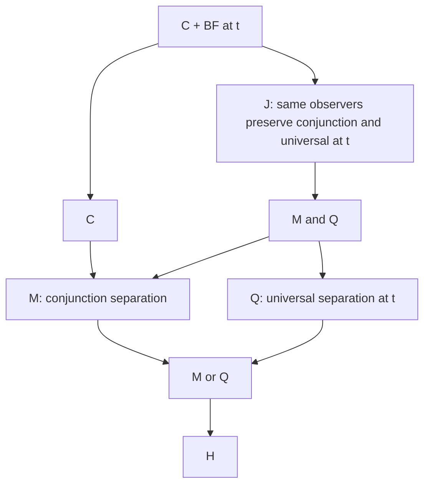

# Conjunction and quantifier separation over H

Ordinary mathematical research by OpenAI Codex, prompted by Daniel Kodsi, 24 October 2026. Direct source: misc, this note, sections 1–7, unpaginated.

Separation by observers that accept Top and strongly preserve conjunction gives a meet-semilattice with greatest element Top. Separation by observers that accept Top and strongly preserve universal quantification gives indexed greatest lower bounds in an observer-defined order. Requiring the same observers to preserve both is strictly stronger than the conjunction of those two separation principles: it makes the two structures agree.

All three principles lie below C + BF. The combined and quantifier principles are exactly BF over C, even with full operation identities in their qualifications.

## 1 Definitions and type scope

Work over H in the fixed relational language. Propositions have type t; observers E have type tt. Top and Bottom are the fixed abbreviations, not arbitrary true and false propositions. Write a = ∀p p, Top = a ∨ ¬a, and Bottom = a ∧ ¬a.

For any qualification R define propositional separation:

$$
S[R]:=\forall p,q\, .\,p=q\leftrightarrow\forall E\, .\,R(E)\to(Ep\leftrightarrow Eq).
$$

The observers agree in truth on their two outputs.

Use these qualifications:

$$
\begin{aligned}
A(E)&:=E\top, &U(E)&:=E\top=\top,\\
M(E)&:=(\lambda p,q\, .\,E(p\land q))=(\lambda p,q\, .\,Ep\land Eq),\\
Q_\sigma(E)&:=(\lambda F\, .\,E(\forall x^\sigma Fx))=(\lambda F\, .\,\forall x^\sigma E(Fx)),\\
Q_\Delta(E)&:=\bigwedge_{\sigma\in\Delta}Q_\sigma(E).
\end{aligned}
$$

A is Top acceptance, a truth condition. U is Top fixing, an identity condition. All commutation clauses are identities between the composite operations.

Abbreviate:

$$
\mathsf M:=S[A\land M],\qquad\mathsf Q_\Delta:=S[A\land Q_\Delta],\qquad\mathsf J_\Delta:=S[A\land M\land Q_\Delta].
$$

M and QΔ without an observer argument refer to the separation principles; M(E) and QΔ(E) refer to qualifications. For the strict comparisons in sections 4–5, Q and J mean Δ={t}. That fixed instance already exhibits every strict comparison shown. The positive theorems hold for every finite Δ; allowing all finite Δ gives the corresponding schema.

These are propositional separation principles. They yield identities between proposition outputs. No step silently upgrades a universally quantified output identity to an identity between higher-type operations.

## 2 The order and conjunction results

For any of these qualifications R put:

$$
p\preceq_R q\quad\leftrightarrow\quad\forall E\, .\,R(E)\to(Ep\to Eq).
$$

H proves reflexivity and transitivity. S[R] is precisely the antisymmetry of this preorder: mutual comparison says that every eligible observer agrees on p and q. For the qualifications containing A, Top is greatest. Identity is eligible, so p ≼R q also entails the material implication p→q.

If R includes M(E), conjunction is a greatest lower bound:

$$
u\preceq_R(p\land q)\quad\leftrightarrow\quad(u\preceq_Rp\land u\preceq_Rq).
$$

Indeed full M gives E(p∧q)=Ep∧Eq, and H then supplies its ordinary truth condition. Quantify this calculation over E. Moreover:

$$
p\preceq_Rq\quad\leftrightarrow\quad p\land q=p.
$$

For the forward direction, Ep→Eq makes E(p∧q) and Ep agree for every eligible E; separation identifies p∧q and p. The reverse follows by substitution and the conjunction truth condition. Thus the observer order is exactly the order defined by the original conjunction.

Consequently M gives commutativity, associativity and idempotence of conjunction, and p∧Top=p. These are identities, not merely material equivalences.

There is an exact redundancy result:

$$
S[A\land M]\quad\leftrightarrow\quad S[M]\land\forall p\, .\,p\land\top=p.
$$

The forward direction follows from inclusion of observer classes and the unit law just proved. Conversely, assume bare meet separation and the unit law. If a meet observer rejects Top, then E(p)=E(p∧Top)=Ep∧E(Top) makes it reject every p. Such an observer cannot distinguish any pair. Removing those observers therefore preserves separation.

The same argument works with further restrictions, including QΔ, held fixed. It does not replace acceptance by fixing.

## 3 Quantification and the interaction result

If R includes Qσ(E), H proves:

$$
u\preceq_R(\forall x^\sigma Fx)\quad\leftrightarrow\quad\forall x^\sigma\, .\,u\preceq_R Fx.
$$

For each eligible E, universal commutation gives E(∀x Fx) ↔ ∀x E(Fx). Since x is absent from Eu, distribute implication over that universal and exchange the universal quantifiers over E and x. Separation then makes the preorder a partial order. Thus each listed quantifier supplies greatest lower bounds of admitted indexed families.

Under QΔ this entails:

* BF and CBF: (∀x Fx)=Top iff ∀x(Fx=Top).
* Vacuity: (∀x p)=p when x is absent from p.
* Interchange of two listed universal quantifiers.
* Invariance under an admitted surjective reindexing between listed types.
* Quantifier congruence: pointwise identities Fx=Gx imply (∀x Fx)=(∀x Gx).

For BF, if every Fx is Top, every eligible observer accepts every Fx and hence their universal. Separation identifies that universal with Top. Conversely, if the universal is Top, its image is accepted by each observer; universal commutation makes every E(Fx) true, and separation identifies each Fx with Top.

Vacuity and interchange follow from uniqueness of greatest lower bounds. Reindexing follows because a surjection leaves the lower bounds unchanged; congruence is its simpler pointwise analogue. Only admitted indexed families are involved, not all external subsets of the proposition domain.

JΔ supplies the extra identification of this order with conjunction order. It therefore entails:

$$
\begin{aligned}
u\land(\forall x\,Fx)=u&\quad\leftrightarrow\quad\forall x\,(u\land Fx=u),\\
\forall x\,(p\land Fx)&=p\land\forall x\,Fx,\\
\forall x\,(Fx\land Gx)&=(\forall x\,Fx)\land(\forall x\,Gx).
\end{aligned}
$$

The last two formulas follow by comparing lower bounds in the common order. Domains are nonempty, as in H; this matters when pulling a constant factor out of a universal. Equivalently, transport each side through a jointly qualified observer and apply the corresponding H truth equivalence.

Separate M and QΔ do not provide this common order. Section 5 gives a model where they have different orders and the displayed constant-factor identity fails.

## 4 The exact upper bound and the lattice fragment

For every finite Δ, over C:

$$
\mathrm C\vdash\mathsf M,\qquad \mathrm C\vdash\mathsf Q_\Delta\leftrightarrow\mathsf J_\Delta\leftrightarrow\mathrm{BF}_\Delta.
$$

These statements remain true when U replaces A in every qualification. BFΔ is the finite conjunction of the closed, universally quantified BF instances at the listed types.

For M, the admitted principal tests P_a(r)=Box(a→r) fix Top and preserve conjunction by full composite identity. They separate: agreement on p,q, applied to P_p and P_q, yields both necessary implications, hence p=q by C's propositional Intensionality.

The quantifier proof requires a different observer. Let B be BFΔ and put:

$$
E_a(r):=(B\land\Box(a\to r))\lor(\neg B\land r).
$$

C proves unconditionally that this operation fixes Top and preserves conjunction by full identity. This follows from the Boolean identities and the normal-modal conjunction identity for Box, on each side of the Boolean partition B,¬B.

C also proves the following closed theorem, with no optional assumption:

$$
\forall a,F\, .\,E_a(\forall x^\sigma Fx)\leftrightarrow\forall x^\sigma E_a(Fx).
$$

Split on B. If B, its BFσ conjunct and CBF give the material universal law for the principal test. If not B, E_a has the same current truth values as identity, which gives the other branch. B is closed and independent of x, so these case calculations apply uniformly to the family.

Necessitate this unconditional universally closed C theorem. CBF and Intensionality then identify the two λF operations. This is how the full composite law follows; Logical Equivalence is not applied directly to a formula proved from an optional BF premise.

Finally assume B at the current point. E_a has the truth values of the principal test, so the choices a=p and a=q separate p and q. The same term is qualified at every type in the finite list. Thus C+BFΔ proves JΔ, even with Top fixing. The implication to QΔ follows by inclusion, and QΔ gives BFΔ by section 3. No Atomicity or necessary BF is used.

For Δ={t}, every arrow in the following diagram is strict:

Here “and” and “or” are logical conjunction and disjunction of the two closed separation principles. Thus M,Q,M∧Q,M∨Q form the ordinary four-element lattice generated by the incomparable M and Q. J is strictly above their join M∧Q. The diagram is a proved fragment, not a claim that all other meets and joins among the displayed theories have been classified.

The upper-bound result additionally identifies C+Q and C+J with C+BF at t. C and Q are incomparable, and C and J are incomparable. Their join in strength is C+BF at t.

The all-type package has the same substantive comparisons. Full typed separation adds Functionality; over C, all BF supplies Functionality and lifts propositional separation to relations. Do not infer every relational instance from BF at just one fixed tested type.

## 5 Separating models

The new constructions below have D_t={0,u,v,1}={00,01,10,11}, truth given by the first coordinate, singleton D_e, and all functions at every admitted arrow type. Equality at each type is (δxy,0). Ordinary function application and abstraction validate conversion and Functionality. All logical primitives have classical first-coordinate truth conditions, so these are models of H.

Unless modified below, use coordinatewise conjunction, disjunction and negation. Set existential quantification to the negation dual of the stated universal. All types have nonempty domains. In every construction, a=∀p p is 0, so the fixed Top and Bottom are 1 and 0.

### Diamond meet with chain-minimum quantifiers

Keep conjunction as the Boolean diamond meet. Interpret every universal quantifier as minimum in the chain 0<u<v<1.

The diamond principal-filter maps into {0,1} fix Top, preserve conjunction, and separate all four propositions. The chain threshold maps into {0,1} fix Top, preserve every universal, and also separate all four propositions. Full function domains turn these pointwise calculations into full composite operation identities.

However, let E preserve both and write h(r) for the truth value of Er. Diamond conjunction gives h(0)=h(u)∧h(v). Choose an admitted predicate at type t whose range is {u,v}. Its chain minimum is u, so universal commutation gives h(u)=h(u)∧h(v). Hence h(0)=h(u): no joint observer separates 0 from u.

This proves M∧Q does not imply J. The witness is stronger: it has all BF, all CBF, full Functionality and the ordinary Boolean identities. A chain minimum equals 1 exactly when every input is 1. The failed interaction law is explicit: for range(F)={u,v},

$$
\forall x\,(u\land Fx)=0,\qquad u\land\forall x\,Fx=u.
$$

The same failure of joint separation holds for acceptance or fixing whenever the tested list contains t. The model satisfies M and every QΔ while refuting the combined all-type schema. With only a singleton individual type tested, or with an empty list, it does not give this strict distinction.

### Models for the remaining comparisons

Put

$$
R_\sigma(F):=\bigl(\text{all first coordinates of }Fx,\;1\text{ iff }F\text{ is constantly }\top\bigr).
$$

Rσ(F)=Top iff F is constantly Top. Thus its BF and CBF instances hold. But Rσ(constant u)=0≠u, so vacuity fails.

| Construction | Conjunction | Universal | M | Q | J |
|---|---|---|---|---|---|
| Coordinate model | Coordinate meet | Coordinate universal | yes | yes | yes |
| Diamond meet / chain minimum | Diamond meet | Chain minimum | yes | yes | no |
| Meet only | Coordinate meet | Rσ | yes | no | no |
| Quantifier only | First-coordinate meet, second coordinate 0 | Coordinate universal | no | yes | no |
| Neither | First-coordinate meet, second coordinate 0 | Rσ | no | no | no |

For the coordinate and meet-only models, the two diagonal coordinate readers fix Top and preserve conjunction. For the coordinate and quantifier-only models, those readers fix Top and preserve every universal. A conjunction with second coordinate always 0 fails idempotence at u; by section 2 it cannot have M separation. The Rσ models fail Q separation by vacuity. These facts prove every entry, without treating absence of a witness as a failure proof.

All five models fail C: the reflexivity proposition x=x has value v, whereas Top=1. Thus the coordinate model proves J does not imply C, and the meet-only model proves M does not imply C. The “neither” model proves H does not imply M∨Q, even after adding all BF, all CBF and Functionality.

For C without BF at t use the recorded full-two-object-retract model. Its proved-only engine closure includes failure of barcan-t. Since C proves M and Q implies BF, this supplies C without Q or J, and verifies the remaining strict arrows at the top.

An exhaustive finite check of all 256 maps on the four propositions corroborates the algebraic claims. In the two orders model, 20 Top-accepting meet maps and 30 Top-accepting universal maps each separate; their 13 jointly qualified maps agree on 0,u. With Top fixing the counts are 16,20,10, with the same inseparable pair. Universal preservation was checked on all nonempty subsets of the four-element domain; the argument above covers every admitted indexed family.

## 6 Acceptance and further connective restrictions

The main results need only Top acceptance. Top fixing defines smaller observer classes and hence stronger separation requirements over H. Each strict model comparison above remains valid for the fixing variants. Over C the two versions coincide in separation strength, by section 4. Their equivalence over bare H is not established here.

Do not confuse equivalence of separation principles with equality of observer classes. In the coordinate model, E(r)=v∧r accepts Top, preserves conjunction and every universal, and sends Top to v≠Top, even though fixing observers also separate the model.

The same order argument gives useful further branches. If V and N denote the full disjunction and negation operation identities, then:

| Observer qualification | Consequence of separation over H |
|---|---|
| A+M+V | Original conjunction and disjunction form a distributive lattice with greatest Top |
| A+M+N | A Boolean algebra using conjunction, negation, and the derived join ¬(¬p∧¬q) |
| M+V+N | The original Boolean operations form a Boolean algebra; Top acceptance follows automatically |

For each row, transport the relevant Boolean identity through E and apply separation. In the middle row primitive disjunction remains unconstrained. In the first row no claim identifies a least element with the fixed Bottom. These are further branches, not additional nodes asserted to lie below C+BF.

The intrinsic semilattice and greatest-lower-bound laws have not been proved sufficient to reconstruct the corresponding strongly preserving admitted observers over H. The established exact results are the meet/unit equivalence in section 2 and the over-C characterizations in section 4.

## 7 Sources

The new H implications, conditional observer construction and countermodels are original arguments in this note, source misc, sections 1–6, unpaginated. No novelty relative to the literature is asserted.

* The fixed H/C framework and theoremhood restriction are in [background.md](../source/topics/classicism/background.md), Framework and Notation, and Bacon–Dorr, Classicism, section 1.3.
* [Full two-object retract](../source/topics/classicism/models/full-two-object-retract.yaml) cites Bacon–Dorr, Classicism, draft of 16 May 2023, section 3.5, p. 59, fifth paragraph and note 81; p. 61. Its proved-only derived failures barcan-t and barcan-r were checked on 24 October 2026.
* [BF implies Functionality](../source/topics/classicism/results/barcan-r-implies-functionality-r.yaml) cites Classicism, Proposition 2.1, note 27, pp. 20–21, for the typed extension over C.
