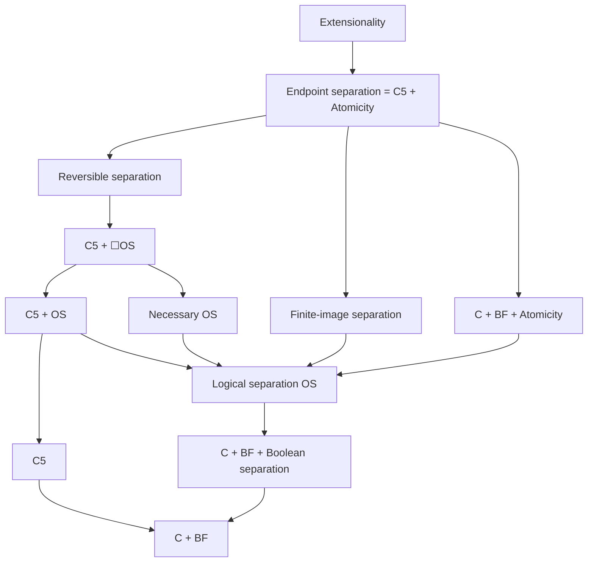

# Relations among observer principles

Ordinary mathematical research by OpenAI Codex, prompted by Daniel Kodsi, 24 October 2026. Direct source: misc, this note, §§1–8, unpaginated. The model constructions are proved in [the companion note](observer-lattice-models.md).

The main pattern is that individually weak preservation requirements can become strong when imposed on the same separating observers. Over C, preserving any one of conjunction, disjunction or negation suffices for separation without additional assumptions; preserving any two is exactly Boolean separation. Fixing identity judgments gives a different branch: with Top acceptance it is exactly ND at t, and adding universal commutation at t makes it exactly C5.

Above C + BF, full logical separation, Atomicity, necessary separation, reversible separation and finite-image separation form a branching structure. In particular, finite-image separation is incomparable with both Atomicity + BF and necessary separation. The diagrams below are proved fragments, not a classification of every meet and join.

## 1 Definitions and the change of base

Use H and C in the fixed relational language. Propositions have type t and observers E have type tt. Put a = ∀p p, Top = a∨¬a and Bottom = a∧¬a, retaining these fixed abbreviations over H. Define propositional separation by

```math
S[R]:=\forall p,q\, .\,p=q\leftrightarrow\forall E\, .\,R(E)\to(Ep\leftrightarrow Eq).
```

Use the following qualifications:

```math
\begin{aligned}
A(E)&:=E\top,&Z(E)&:=\neg E\bot,&U(E)&:=E\top=\top,\\
M(E)&:=(\lambda p,q\, .\,E(p\land q))=(\lambda p,q\, .\,Ep\land Eq),\\
V(E)&:=(\lambda p,q\, .\,E(p\lor q))=(\lambda p,q\, .\,Ep\lor Eq),\\
N(E)&:=(\lambda p\, .\,E\neg p)=(\lambda p\, .\,\neg Ep),\\
Q_\sigma(E)&:=(\lambda F\, .\,E(\forall x^\sigma Fx))=(\lambda F\, .\,\forall x^\sigma E(Fx)),\\
P_\sigma(E)&:=(\lambda F\, .\,E(\exists x^\sigma Fx))=(\lambda F\, .\,\exists x^\sigma E(Fx)),\\
\mathrm{FixEq}_t(E)&:=(\lambda p,q\, .\,E(p=q))=(\lambda p,q\, .\,p=q).
\end{aligned}
```

QΔ and PΔ are the respective conjunctions for a finite type list Δ. FixEq fixes identity judgments; it is not the different requirement E(p=q)=(Ep=Eq). Separation compares Ep and Eq in truth, not E(p↔q).

All displayed commutation requirements are identities between the whole composite operations. Conclusions such as p∧q=q∧p are proposition identities; they are not silently upgraded to identities between higher-type operations over H.

The guarded construction in the [conjunction/quantifier note](meet-quantifier-separation.md), §4, gives qualifying observers over C. Let K(E) conjoin the universally closed truth equivalences for the requested finite list of operation laws, and put

```math
E^{\#}(p):=(K(E)\land Ep)\lor(\neg K(E)\land p).
```

H proves each requested truth equivalence for E# without assumptions: use K(E) in its true case and identity in its false case. Logical Equivalence, abstracting over E and all law inputs, gives the full composite laws. Requested endpoint truth conditions similarly become endpoint identities. When K(E) is true, the new observer agrees in current truth with E.

This constructs witnesses for the full composite identities. For constructions whose case proof uses C rather than H, we universally close the unconditional C theorem, necessitate it, and apply CBF and Intensionality. An optional assumption is never necessitated.

## 2 Disjunction and negation over H

For any separating class R, define

```math
p\preceq_Rq\quad\leftrightarrow\quad\forall E\, .\,R(E)\to(Ep\to Eq).
```

Separation is exactly antisymmetry of this preorder. Preservation of conjunction makes conjunction its meet; preservation of disjunction makes disjunction its join.

### Disjunction has two different endpoint conditions

Bare S[V] gives a join-semilattice, and its order is p≼q iff p∨q=q. More precisely,

```math
\begin{aligned}
S[Z\land V]&\leftrightarrow S[V]\land\forall p\,(p\lor\bot=p),\\
S[A\land V]&\leftrightarrow S[V]\land\forall p\,(p\lor\top=\top).
\end{aligned}
```

The first makes Bottom least; the second makes Top greatest. Requiring both gives a bounded join-semilattice.

For the forward implications, transport the two sides of the desired identity through any eligible E and use its endpoint truth condition. Separation identifies them. Conversely, under the bottom-unit identity, a join observer accepting Bottom accepts every p, since E(p)=E(p∨Bottom)=Ep∨E(Bottom). It cannot distinguish any pair and can be discarded. Under top absorption, an observer rejecting Top rejects every p, and can likewise be discarded. These arguments also work with further restrictions held fixed.

This is the dual of the exact conjunction result

```math
S[A\land M]\leftrightarrow S[M]\land\forall p\,(p\land\top=p).
```

Acceptance of Top on the disjunction branch supplies an upper bound, not the join unit.

### Negation gives an involution

Over H,

```math
S[N]\leftrightarrow S[A\land N]\quad\Longrightarrow\quad\forall p\,(\neg\neg p=p).
```

If an N observer distinguishing p,q rejects Top, postcompose it with negation. The resulting observer still satisfies the full N identity, now accepts Top, and still distinguishes p,q. This proves acceptance is redundant at separation level. For double negation, E¬¬p and Ep always agree in truth, so separation identifies ¬¬p and p.

For the accepting class A∧N, negation is an order-reversing involution of the observer order, Top is greatest, and ¬Top is least. Indeed E¬p=¬Ep reverses every observed implication, and E¬Top is false for every accepting observer.

The observer order for the bare N class is different: closure under post-negation makes it symmetric, and separation makes it equality. Equivalent separation principles need not induce the same order when their observer classes differ. Also N alone need not identify the fixed Bottom with ¬Top; the small models in §7 show this.

### Combining the connective branches

The following are direct H consequences of transport through the common observers and separation:

| Same-observer requirements | Resulting proposition structure |
|---|---|
| A + M | Meet-semilattice with greatest Top |
| Z + V | Join-semilattice with least Bottom |
| A + M + V | Original distributive lattice with greatest Top |
| A + M + N | Boolean algebra with join defined by ¬(¬p∧¬q) |
| M + V + N | Boolean algebra for the original connectives |

For the fourth row the least element is the fixed Bottom: E(a∧¬a) is false, so separation identifies it with ¬Top. It does not identify the derived join with primitive disjunction. In the last row acceptance is redundant, since E(a∨¬a) is true. Each algebraic law follows by applying the listed preservation laws, using the corresponding ordinary truth equivalence, then invoking separation. This proves the whole finite list of semilattice, distributivity or complement equations without presupposing those equations as identities.

Combining N with Qσ also gives preservation of the derived existential ¬∀x¬Fx. In the accepting observer order, ∀ supplies admitted indexed greatest lower bounds and this derived existential supplies least upper bounds. Over H, identifying it with primitive ∃ requires the corresponding primitive preservation clause. Over C, the full duality identities are already available.

### The existential branch

There is a direct dual of the universal-separation theorem. Over H, S[Z∧PΔ] gives least upper bounds of admitted indexed families, with least element Bottom:

```math
\begin{aligned}
(\exists x\,Fx)\preceq u&\leftrightarrow\forall x\,(Fx\preceq u),\\
(\exists x\,Fx)=\bot&\leftrightarrow\forall x\,(Fx=\bot).
\end{aligned}
```

For the first identity of conditions, transport ∃ through each eligible observer and use (∃x E(Fx)→Eu) iff ∀x(E(Fx)→Eu). The second follows from uniqueness of a least upper bound and the least-element property of Bottom. Adjoining V makes these the least upper bounds in the original join order, and yields identities such as ∃x(p∨Fx)=p∨∃x Fx. The H endpoint equation is a dual statement in its own right; identifying it with BF uses C's connective and quantifier duality.

Over C the exact bounds are

```math
\mathrm C\vdash S[Z\land P_\Delta]\leftrightarrow S[Z\land V\land P_\Delta]\leftrightarrow\mathrm{BF}_\Delta.
```

To see this, conjugate a meet/universal observer by negation: E†(p)=¬E(¬p). The full C De Morgan and quantifier-duality identities transfer M to V, Q to P, and Top acceptance to Bottom rejection. Apply separation to ¬p,¬q to transfer its distinguishing witnesses. Conjugation reverses itself, so the earlier exact universal bounds give the displayed equivalences. Bottom fixing can replace rejection by the same over-C normalization.

## 3 The Boolean triangle over C

Write $`\mathsf{Bool}=S[M\land V\land N]`$ for Boolean separation. Over C,

```math
\begin{gathered}
\mathrm C\vdash S[A\land M],\quad S[A\land Z\land V],\quad S[A\land N],\\
\mathrm C\vdash S[M\land N]\leftrightarrow S[V\land N]\leftrightarrow S[M\land V]\leftrightarrow\mathsf{Bool}.
\end{gathered}
```

The singleton theorems hold with both endpoint identities where applicable. Boolean separation is a genuine strengthening, even over C + BF.

For conjunction use the principal tests P_a(p)=Box(a→p), as in the earlier note. For disjunction use D_a(p)=Diamond(a∧p). Their truth values preserve disjunction and reject Bottom. If p≠q, choose a nonzero side of their symmetric difference; the corresponding D_a accepts Top and distinguishes p,q. The normalization lemma gives full composite preservation and endpoint fixing.

For negation, C supplies double-negation identity. The admitted term

```math
T_a(r):=(r=a)\lor(r\land r\ne\neg a).
```

has the negation truth condition: when r=a it is true and its value at ¬r is false; when r=¬a the values reverse; otherwise it follows r and ¬r. The two exceptional cases are disjoint. If distinct p,q are both false, take a=p; if both true, take a=¬p; if their truth values differ, identity distinguishes them. Orient a test by U_a(r)=(T_a(Top)↔T_a(r)); this preserves the negation truth condition, accepts Top, and preserves its distinguishing power. Normalize to obtain the full N law and endpoint fixing.

For M+N or V+N, C's full De Morgan identities supply the missing connective. For M+V, a distinguishing observer has a nonconstant truth profile. Preservation of the lattice truth conditions then forces Top true and Bottom false. Applying it to p∧¬p=Bottom and p∨¬p=Top shows E¬p↔¬Ep. It has the Boolean truth conditions, so the guarded construction supplies the required full Boolean identities. Thus endpoint clauses are unnecessary for the M+V separation equivalence.

Preserving implication alone also characterizes Boolean separation over C. Such an observer accepts Top because p→p=Top. If it accepts Bottom, the equation Bottom→r=Top forces it to accept every r, so it cannot distinguish. A distinguishing one rejects Bottom; the definitions ¬p=(p→Bottom) and p∧q=¬(p→¬q) then give the Boolean truth conditions. Normalize as before.

These equivalences require one observer to preserve the combined operations. The conjunction of two singleton separation principles is already a C theorem and therefore does not imply Boolean separation.

## 4 Fixing identity judgments

Fixing identity judgments gives the following exact bounds:

```math
\begin{aligned}
\mathrm C&\vdash S[A\land\mathrm{FixEq}_t]\leftrightarrow\mathrm{ND}_t,\\
\mathrm C&\vdash S[A\land\mathrm{FixEq}_t\land Q_\Delta]
\leftrightarrow S[A\land\mathrm{FixEq}_t\land M\land Q_\Delta]
\leftrightarrow\mathrm{ND}_t\land\mathrm{BF}_\Delta.
\end{aligned}
```

Here ND_t is ∀p,q(p≠q → Box(p≠q)), and Box r abbreviates r=Top. Top acceptance may be replaced by Top fixing, even over H at separation level.

First work over H. Every true identity judgment r is accepted by each identity-fixing observer, just as Top is. Separation gives r=Top, which proves NI_t. In particular (Top=Top)=Top. Every identity-fixing observer consequently fixes Top by substitution. This proves the acceptance/fixing equivalence. Every false identity judgment similarly agrees under these observers with z=(Top=Bottom), hence equals z. H alone does not identify z with Bottom or give ND.

If N is also required, a false judgment r has E¬r=¬Er=¬r true for every eligible observer. Separation gives ¬r=Top. Thus already over H,

```math
S[A\land N\land\mathrm{FixEq}_t]\quad\Longrightarrow\quad\mathrm{NI}_t\land\mathrm{ND}_t.
```

Over C, the H theorem ¬(Top=Bottom) and Logical Equivalence give (Top=Bottom)=Bottom. Hence the preceding false-judgment calculation gives ND_t without N. With QΔ, the earlier universal-separation argument also gives BFΔ.

For the converse take a parameter a and the guard

```math
G_a:=\mathrm{ND}_t\land\mathrm{BF}_\Delta\land a\ne\bot,
\qquad E_a(r):=(G_a\land\Box(a\to r))\lor(\neg G_a\land r).
```

Omit BFΔ and the quantifier laws for the first equivalence. Under G_a, C's NI and ND_t make every t-identity judgment an endpoint. The nonzero principal test is correct on both endpoints, so it agrees with those judgments in truth. It preserves conjunction, and BFΔ together with CBF supplies universal commutation. If G_a is false, E_a agrees in truth with identity. Therefore the required universally closed truth equivalences are unconditional C theorems. Necessitation, CBF and Intensionality turn them into full composite identities. Top is fixed as well.

Under the optional ND_t + BFΔ assumptions, if p≠q, either p is not below q or conversely. Use a=p in the first case, a=q in the second. This a is nonbottom, and its principal test distinguishes p,q. This proves all the reverse implications without necessitating the guard.

The final C5 identification uses the recorded results [ND (type t) + BF (type t) ⇒ ☐ND (type t)](../source/topics/classicism/results/nd-t-and-bf-t-imply-necessary-nd-t.yaml), Classicism Proposition 2.4, p. 23, and [☐ND (type t) ⇒ ☐ND](../source/topics/classicism/results/necessary-distinctness-necessary-t-implies-necessary-distinctness-necessary-r.yaml), Proposition 2.2, p. 22. C5 conversely supplies ND_t and BF at every type. If Δ omits t, retain the exact bound ND_t + BFΔ; no C5 conclusion is inferred just from the notation.

The same identity-fixing argument handles a finite list of equality types containing t, with the corresponding conjunction of ND instances. No unrestricted claim about a lone individual-equality clause is needed.

## 5 Atomicity improves the logical-separation upper bound

Atomicity and BF suffice:

```math
\mathrm C+\mathrm{Atomicity}_t+\mathrm{BF}\quad\vdash\quad\mathrm{OS}.
```

For each finite Δ, put

```math
G_a:=\mathrm{Atom}(a)\land\mathrm{BF}_\Delta,
\qquad E_a(r):=(G_a\land\Box(a\to r))\lor(\neg G_a\land r).
```

When G_a holds, an atom a decides each p: a≤p or a≤¬p, and not both. Thus its principal truth test has the Boolean truth conditions. BFσ and CBF give

```math
\Box(a\to\forall x^\sigma Fx)\quad\leftrightarrow\quad\forall x^\sigma\,\Box(a\to Fx).
```

This gives the universal truth condition; existential preservation follows by Boolean duality. If G_a fails, the test agrees in truth with identity. Universally close the resulting unconditional C theorems and use necessitation, CBF and Intensionality to obtain all full composite laws. Over C the translated equality clauses are redundant consequences of Boolean qualification.

Under Atomicity_t + BFΔ, choose an atom below a nonzero side of the symmetric difference of p,q. Its guard is true, and E_a distinguishes the pair. This proves propositional logical separation for every finite Δ. All-type BF supplies Functionality, so pointwise proposition separation yields the full relational separation schema: enlarge Δ when needed, and a distinct pair of relations has a tuple where its proposition values differ.

Consequently, over C + Atomicity_t, propositional Boolean-plus-QΔ separation is exactly BFΔ. The forward implication is the universal-separation proof; the construction above proves the reverse. This does not say C + BF alone supplies Boolean separation. It also does not make E_a endpoint-valued without C5: correct current truth values and endpoint output identities remain different conditions.

## 6 The region above C + BF

In this section every node includes D := C + BF at all types. Bool denotes propositional Boolean separation. Use the full typed definitions from [the main hierarchy note](logical-observer-hierarchy.md), §1:

| Label | Theory or separation restriction |
|---|---|
| OS | Full logical separation |
| At | D + Atomicity_t |
| Fin | Logical separation by observers with finitely many outputs |
| Rev | Logical separation by observers with an admitted qualified inverse |
| Nec | Separately boxed OS schema |
| Fix | C5 + OS, equivalently identity-fixing logical separation |
| End | Endpoint logical separation, equivalently C5 + Atomicity_t |
| Ext | Extensionality |

Fin uses internal Frege finiteness, with no common finite bound on all witnesses. Its established normalization to endpoints under C5 uses internal induction, not an assumption of external finiteness. The special full-model argument in the companion note justifies external finiteness only in that model.

The main implications are:



Every displayed arrow is strict except Rev ⇒ C5 + ☐OS, whose converse remains unproved. No unshown comparison is inferred from the diagram.

In particular the following chain is strict:

```math
\small\mathrm C+\mathrm{BF}\ <\ \mathrm C+\mathrm{BF}+\mathsf{Bool}\ <\ \mathrm{OS}\ <\ \mathrm C+\mathrm{BF}+\mathrm{Atomicity}_t\ <\ \mathsf{End}\ <\ \mathrm{Extensionality}.
```

Here < means strictly weaker. The witnesses, in the same order, are qualitative contrast at W0; the ordered/unrestricted-role model at its ordered object; finite-support permutations; the two-object chain; and the full two-element group. The ordered-role argument uses the stated external extreme-amenability theorem and ordinary ZFC; its source qualifications remain in [the original note](ordered-observers.md), §§2–3.

Several exact conjunctions locate the branches:

```math
\begin{gathered}
\mathsf{Rev}+\mathsf{Fin}\ \equiv\ \mathsf{End},\qquad
\mathsf{Rev}+\mathsf{At}\ \equiv\ \mathsf{End},\\
\mathrm{C5}+\mathsf{Fin}\ \equiv\ \mathsf{End},\qquad
\mathrm{C5}+\mathsf{At}\ \equiv\ \mathsf{End},\qquad
\mathsf{Fix}+\mathsf{Fin}\ \equiv\ \mathsf{End}.
\end{gathered}
```

These conjoin separation principles, allowing their witness families to differ. They do not require a single observer to be both reversible and finite-image. The first, third and fifth use Rev ⇒ C5 and finite-image normalization under C5. The second uses Rev ⇒ C5 and endpoint separation ⇒ Rev. The fourth is the endpoint characterization.

The incomparabilities are:

| Pair | First without second | Second without first |
|---|---|---|
| C5 and OS | Qualitative contrast W0 | Two-object chain W0 |
| Rev and Fin | Finite-support permutations | Two-object chain W0 |
| Rev and At | Finite-support permutations | Two-object chain W0 |
| Fix and Nec | Qualitative contrast W1 | Two-object chain W0 |
| Fin and At | Root truth-profile extension | Full omega-chain model |
| Fin and Nec | Root truth-profile extension | Finite-support permutations, or omega chain |

The last two rows are proved in [the companion note](observer-lattice-models.md). They show that the finite-image branch cannot be absorbed into either the atomic or the necessary-separation branch. Indeed Fin + Nec is strictly stronger than each of Fin and Nec, and strictly weaker than End: the two-object chain satisfies Fin + Nec but fails ND_t.

Necessary qualification is not the same as necessary separation. Over C, GoodΔ(E) is equivalent to its necessary form, but OS need not persist. Reversibility supplies a genuine persistence theorem, Rev ⇒ C5 + Nec, by postcomposition with reversible observers; see the main hierarchy note §4.

## 7 Small H countermodels for the connective distinctions

These models use D_t={0,1}², truth in the first coordinate, actual identity for equality's truth condition, singleton individuals and full set-theoretic function domains. Equality at functional types is actual function identity. Lambda abstraction and application are the ordinary ones. Because every primitive operation has the correct first-coordinate truth condition, these are H models; identities of composite operations are actual equality of functions. This common construction makes the verification of each witness a direct coordinate calculation.

**Negation without conjunction, disjunction or universal separation.** Negation flips both coordinates. Conjunction and disjunction have the ordinary first Boolean coordinate and second coordinate 0. Quantifiers use their ordinary truth condition in the first coordinate and 0 in the second; equality is (δ,0). Then Top=(1,0), Bottom=(0,0), and ¬Top=(0,1). Identity and E(b,c)=(1−c,c) fix Top, preserve negation by full identity, and together separate. But conjunction/disjunction idempotence and universal vacuity fail on second-coordinate-1 inputs. Hence their respective separation principles fail. This also verifies that N separation need not align Bottom with ¬Top.

**Conjunction without negation.** Put (b,c)∧(d,e)=(b∧d,c∨e), and use (b∨d,c∨e) for disjunction. Negation is (1−b,0); quantifiers and equality again have second coordinate 0. Top=(1,0). The maps E0(b,c)=(b,0) and E1(b,c)=(1−c,0) fix Top, preserve conjunction by full identity, and separate the coordinates. Double negation fails at inputs with second coordinate 1, refuting N separation. Together the first two examples establish incomparability over H.

**Derived and primitive disjunction differ.** Use coordinatewise conjunction and negation, coordinatewise ordinary universal quantification, and actual equality with any correct truth-coordinate value, say (δ,δ). Replace primitive disjunction by (b∨d,c XOR e). Top=(1,1), Bottom=(0,0). The diagonal coordinate readers E0(b,c)=(b,b), E1(b,c)=(c,c) fix Top, preserve M and N, and separate. Primitive disjunction is not idempotent, so full original Boolean separation fails. This verifies the primitive/derived distinction in §2.

**Identity fixing without ND.** Use coordinatewise Boolean operations and quantifiers, but interpret equality at every type as (δ,1). Top=(1,1), Bottom=(0,0). All maps fixing (1,1) and (0,1) are admitted identity-fixing, Top-fixing observers. They separate the four propositions: identity handles differing first bits, and unconstrained images of (0,0) and (1,0) handle the remaining pairs. Full function domains also give pointwise typed separation. A false identity is (0,1), whose negation (1,0) differs from Top; thus ND fails. This does not refute the C equivalence: the model fails C.

## 8 Sources and unresolved comparisons

The new connective, guarded-witness and identity arguments above are direct source misc, this note, §§2–5 and 7, unpaginated. The new upper separations are direct source misc, [the companion model note](observer-lattice-models.md), §§1–2, unpaginated. Established endpoint, reversible and finite-image theorems retain their proofs in [the main hierarchy note](logical-observer-hierarchy.md), §§3–7.

Unclassified comparisons remain unclassified. In particular, the converse of Rev ⇒ C5 + ☐OS is not proved here; no relation between At and Nec is asserted; and OS ⇒ ☐BF remains unsettled in this consolidation. Mixed join/universal and meet/existential qualifications are not classified by the matching-dual results above. Nothing in a missing arrow proves non-implication. The finite-list arguments do not assert a single observer qualifies for an infinitary conjunction of every type law.
